# Crimson Thread Pilgrimage / 绯线巡礼

本仓库维护 Godot 原生游戏，工程入口为 `godot/project.godot`，主场景为 `godot/scenes/World.tscn`。

游戏内默认按 **V**，在 **显示 → 语言** 中选择简体中文或 English。设置即时生效，下次启动会记住选择。
To play in English, press **V**, open **显示** (Display), then select **English** under **语言** (Language).

## 默认主角：缄 · 缠线小偶（2026-11-08）

缄由旧契约布与绯线组成，32 个动作状态覆盖跑跳、方向攻击、技能、受击与死亡。胸口线结承载回响，治疗缝补自身，钩索从线结放出。

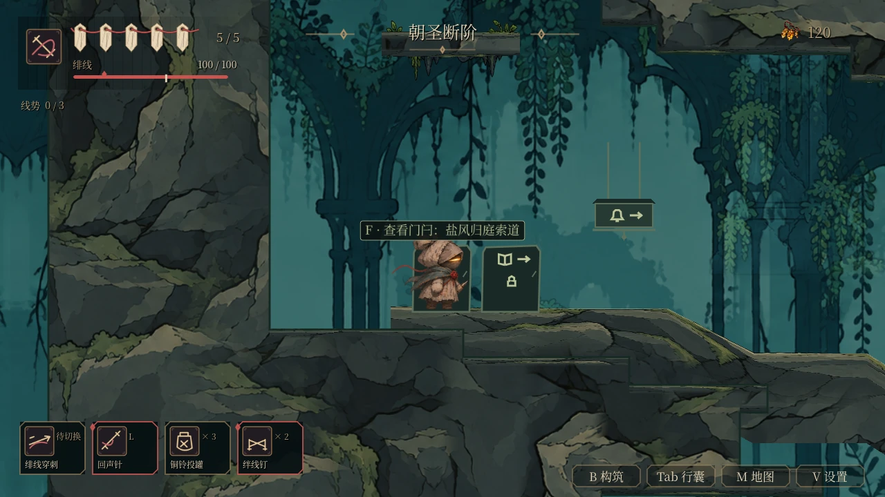

[第一章实机录像](artifacts/thread_doll_v1/gameplay-review.mp4) · [32 状态动作预览](artifacts/thread_doll_v1/actions-review.mp4) · [实装与验证](docs/THREAD_DOLL_PROTAGONIST.md)

## 当前版本实机（2026-11-25 更新）

截图取自 Godot 4.6.1 的正式 `World.tscn`，分辨率 1280 × 720。界面和六区起点取自独立展示档，六处路线取景落点均通过实际关卡验证。

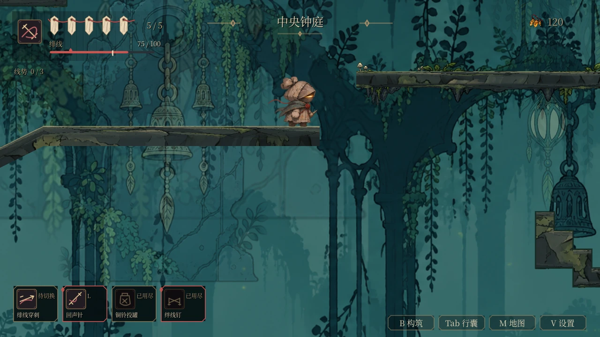

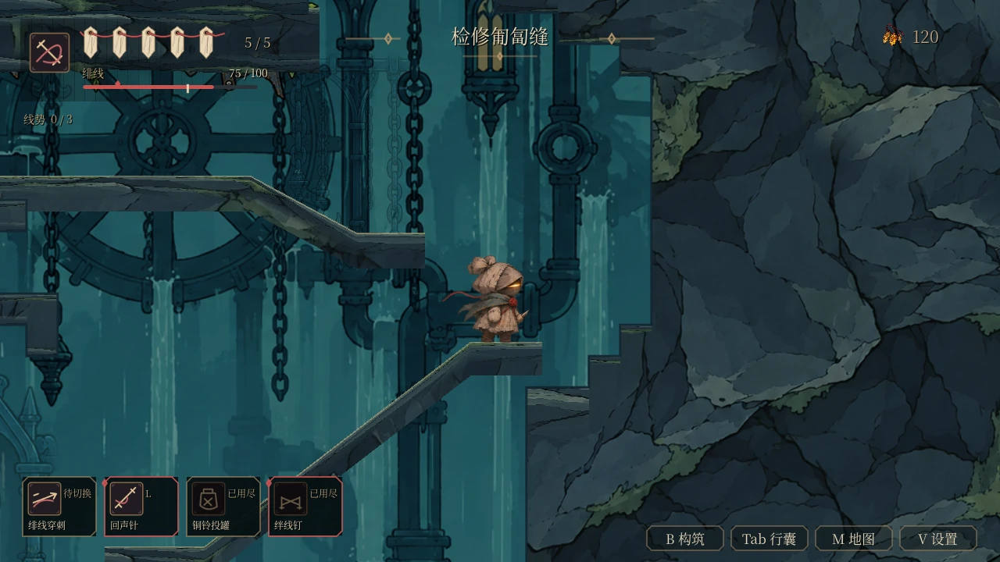

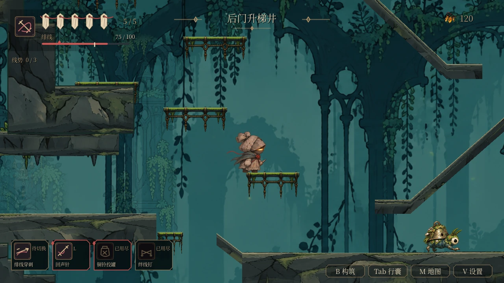

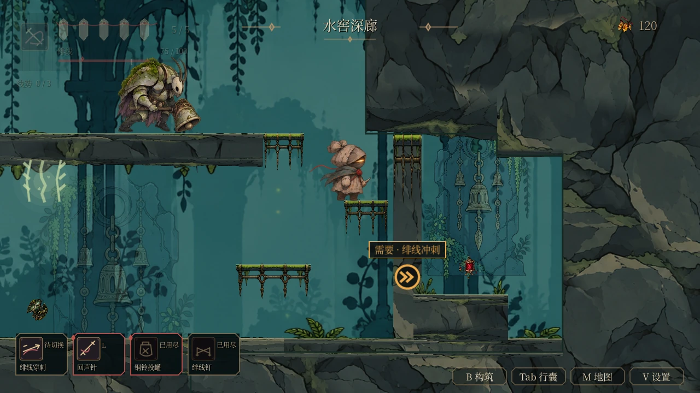

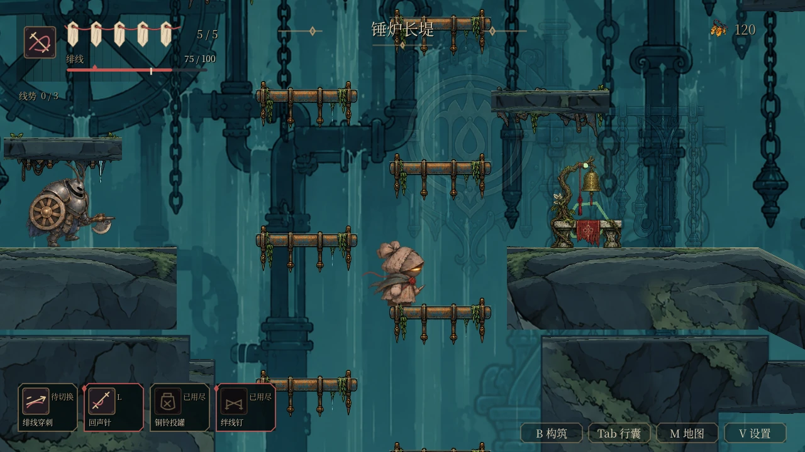

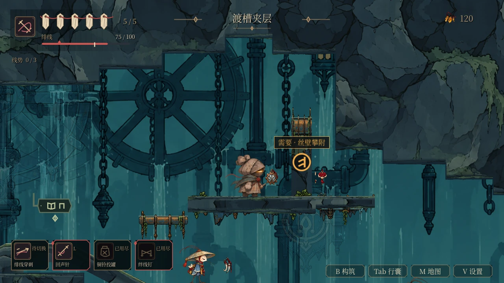

<details>
<summary>行囊、契印、旅记、区域地图和练习工房</summary>

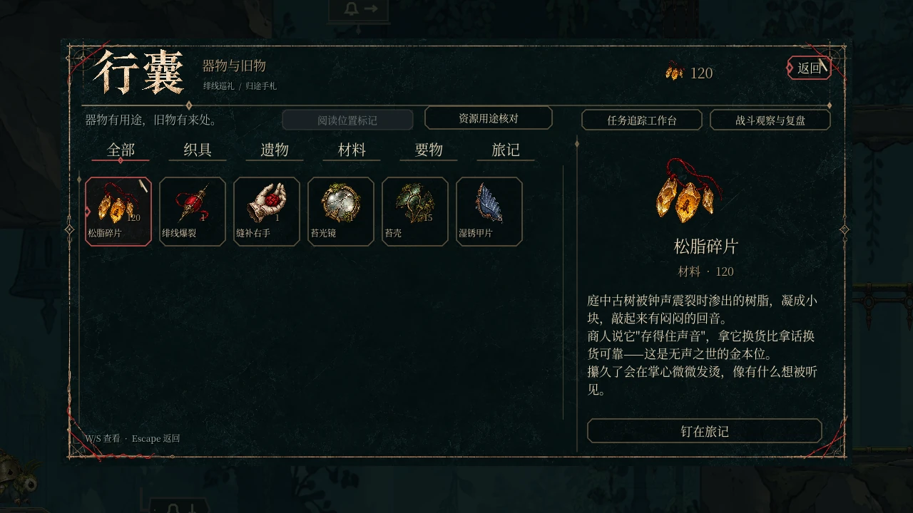

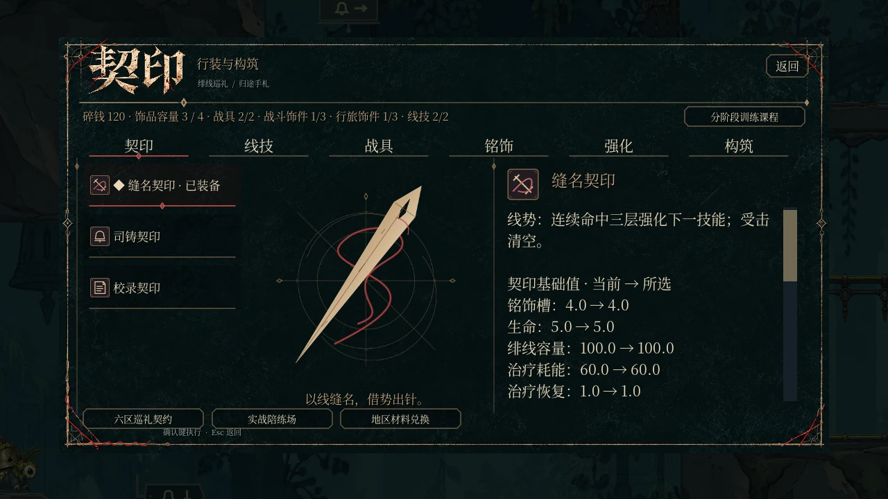

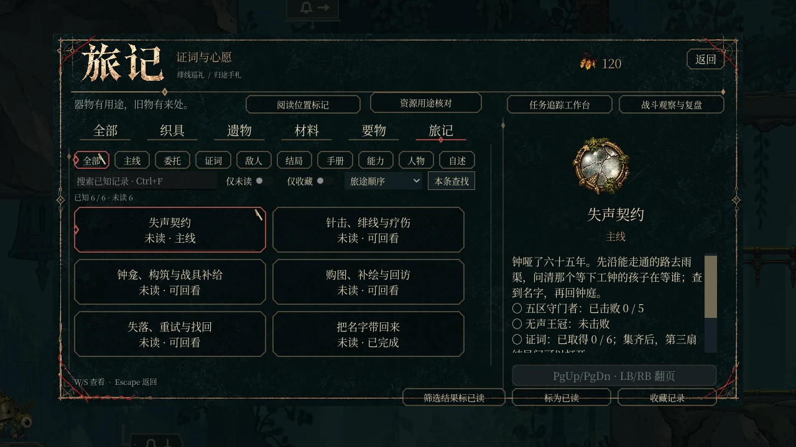

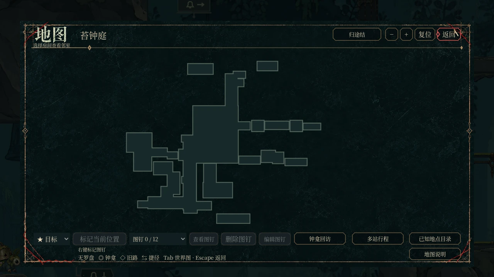

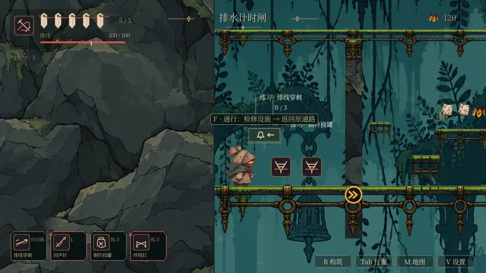

</details>

[查看 26 张实机图及复现方式](docs/gallery/20261123_current_world.md) · [11 月 7 日实机记录](docs/gallery/20261107_current_main.md)

## 升级进度（2026-11-07）

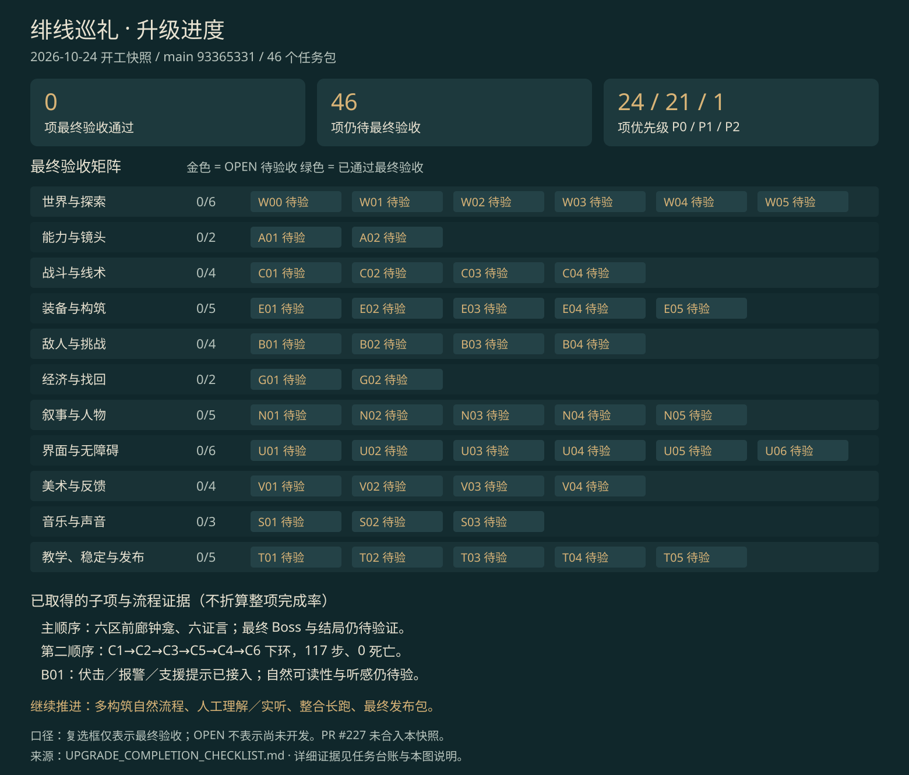

进度图按[最终验收清单](docs/UPGRADE_COMPLETION_CHECKLIST.md)的“最终验收”勾选框统计：46 项都还没有整项关闭，不代表尚未开发。各项已取得的实现与自动验证写在[任务台账](docs/UPGRADE_TASK_LEDGER.md)里（新增记录在 [docs/ledger/](docs/ledger/README.md)）。能用代码验证的部分已大体完成，剩下的主要是：

- 人工实机试玩（T04）；
- 美术统一；
- 几项待定的设计决定。

[进度图说明](docs/gallery/20261024_upgrade_progress.md) · [升级进度](docs/UPGRADE_PROGRESS.md)

## 怪物素材与完整地图（2026-11-24 更新）

40 种小怪与 6 位 Boss 的当前素材在下方直接展示；[完整图册](docs/gallery/20261011_current_assets.md)提供各章高清地图、小怪分章图册、实机画面，以及全部 46 类敌人的原始动画图集链接。

地图总览按当前章节 JSON 的世界坐标绘制地形和关键位置。表中的实机图拍摄于各区起点。


| 章节 | 完整地图 | 小怪图册 | 实机画面 |
| --- | --- | --- | --- |
| 第 1 章 · 苔钟庭 | [查看全图](artifacts/current_gallery/demo_ch01_moss_bell_court_full_map.jpg) | [6 种小怪](artifacts/current_gallery/ch01_enemies.jpg) | [实机](artifacts/readme_current_20261123/region_ch01_moss_bell_court.webp) |
| 第 2 章 · 铸雨渠 | [查看全图](artifacts/current_gallery/demo_ch02_rain_foundry_canal_full_map.jpg) | [7 种小怪](artifacts/current_gallery/ch02_enemies.jpg) | [实机](artifacts/readme_current_20261123/region_ch02_rain_foundry_canal.webp) |
| 第 3 章 · 盐白书库 | [查看全图](artifacts/current_gallery/demo_ch03_saltwhite_archive_full_map.jpg) | [6 种小怪](artifacts/current_gallery/ch03_enemies.jpg) | [实机](artifacts/readme_current_20261123/region_ch03_saltwhite_archive.webp) |
| 第 4 章 · 断弦温室 | [查看全图](artifacts/current_gallery/demo_ch04_broken_string_greenhouse_full_map.jpg) | [6 种小怪](artifacts/current_gallery/ch04_enemies.jpg) | [实机](artifacts/readme_current_20261123/region_ch04_broken_string_greenhouse.webp) |
| 第 5 章 · 黑曜巡礼道 | [查看全图](artifacts/current_gallery/demo_ch05_obsidian_pilgrim_road_full_map.jpg) | [7 种小怪](artifacts/current_gallery/ch05_enemies.jpg) | [实机](artifacts/readme_current_20261123/region_ch05_obsidian_pilgrim_road.webp) |
| 第 6 章 · 无声王冠 | [查看全图](artifacts/current_gallery/demo_ch06_silent_crown_core_full_map.jpg) | [8 种小怪](artifacts/current_gallery/ch06_enemies.jpg) | [实机](artifacts/readme_current_20261123/region_ch06_silent_crown_core.webp) |

历史升级记录与旧版截图（2026-10-11～15）已归档至 [docs/HISTORY_LOG.md](docs/HISTORY_LOG.md)。

## 运行 Godot 项目

需要：

- Godot 4.6.x
- Python 3.10+，用于素材/数据验证脚本
- Node.js 18+，仅用于开发阶段的跨平台验证入口和素材工具；游戏运行不依赖 Node.js

启动：

```powershell
godot --path godot
```

主场景：

```text
godot/scenes/World.tscn
```

`Main.tscn` 保留为独立章节试玩入口。

常用验证：

```powershell
godot --headless --path godot --script res://scripts/demo_validation.gd
godot --headless --path godot --script res://scripts/ch02_demo_validation.gd
godot --headless --path godot --script res://scripts/combat_validation.gd
godot --headless --path godot --script res://scripts/all_chapters_demo_validation.gd
godot --headless --path godot --script res://scripts/cave_exploration_validation.gd
godot --headless --path godot --script res://scripts/cave_route_walk_validation.gd
godot --headless --path godot --script res://scripts/chapter_route_regression_validation.gd
godot --headless --path godot --script res://scripts/pilgrimage_merge_regression_validation.gd
godot --headless --path godot --script res://scripts/pilgrimage_review_regression_validation.gd
godot --headless --path godot --script res://scripts/pilgrimage_overhaul_validation.gd

python tools\validate_chapter_files.py
python tools\render_current_gallery.py
```

开发验证入口：

```powershell
npm run check
npm test
npm run test:campaign
```

`npm test` 已包含活动地图几何、唯一性和运行器负面检查，`npm run test:campaign` 校验当前战役、剧情和世界路线。旧生成地图的 54 处恢复点缺陷仍由单独的严格检查报告；它不等同于活动六区地图。详见 [验证范围](docs/VALIDATION.md)。

## 当前内容

- 六章试玩数据：`godot/data/demo_ch01_*.json` 到 `godot/data/demo_ch06_*.json`
- 章节策划数据：`godot/data/chapters`
- Godot 主逻辑：`godot/scripts/main_level.gd`
- 玩家控制器：`godot/scripts/player_controller.gd`
- 敌人/Boss AI：`godot/scripts/enemy_actor.gd`
- Metroidvania System 插件：`godot/addons/MetroidvaniaSystem`
- 素材处理和验证脚本：`tools`
- 设计、决策、发布记录：`docs`

## 素材授权边界

可随本仓库发布的主要素材：

- Kenney assets: CC0
- GothicVania Cemetery / Ansimuz: Public Domain / 商用友好记录
- OpenGameArt Dark Fantasy Platformer Bestiary: CC-BY 系列来源，已在项目 NOTICE 中记录署名
- Godot Platformer 2D: MIT
- Metroidvania System: MIT
- 项目自制/生成运行资源：主角关键帧、部分 UI/验证产物和脚本生成图

不会随公开仓库发布的本地受限素材：

- Maaot / Mossy Cavern
- Arhimed122 / Abyss Bug Sprite Pack
- MonoPixelArt / Forest Monsters 2D Pixel Art FREE

详细清单见：

- [不可再分发素材包清单与开源边界](docs/decision/20260616162014251_不可再分发素材包清单与开源边界.md)
- [Third Party Notices](THIRD_PARTY_NOTICES.md)
- [Godot asset notice](godot/assets/NOTICE.md)

这些受限素材可能存在于本地开发缓存或历史文档中，但已从公开运行时引用中移除，并由 `.gitignore` 排除。

## 开源发布范围

提交范围包括：

- Godot 工程核心文件
- 运行所需且可再分发的素材
- 文档、验证脚本、展示图

提交范围排除：

- `artifacts/source_repos`
- `artifacts/source_assets`
- `artifacts/third_party`
- `artifacts/debug`
- `godot/.godot`
- `tmp`
- 本地受限素材目录和对应导入脚本


## 逐批关卡升级

[中央钟庭与铸雨渠实体坡道](docs/ledger/entries/2026-11-23-2033-w02-solid-court-and-flume.md) · [水窖与早期落差的回程](docs/ledger/entries/2026-11-23-1925-w04-physical-returns.md) · [当前实机图册](docs/gallery/20261123_current_world.md)

[W02 第一批：苔钟庭五间原房间重构](docs/CH01_ROOM_RECONSTRUCTION.md) · [实机前后对比](docs/gallery/20261011_ch01_rooms.md)。全清单仍分批推进，验收范围见文档。

[六区岩壁与整块结构材质修复：实机对比](docs/WORLD_MATERIALS.md)。


## License

项目代码使用 MIT License。第三方素材、插件、音频和字体等按各自许可证使用，详见 `THIRD_PARTY_NOTICES.md` 和各素材目录下的 NOTICE/LICENSE 文件。

