# Crimson Thread Pilgrimage / 绯线巡礼

本仓库维护 Godot 原生游戏，工程入口为 `godot/project.godot`，主场景为 `godot/scenes/World.tscn`。

## 升级进度（2026-10-24 开工快照）

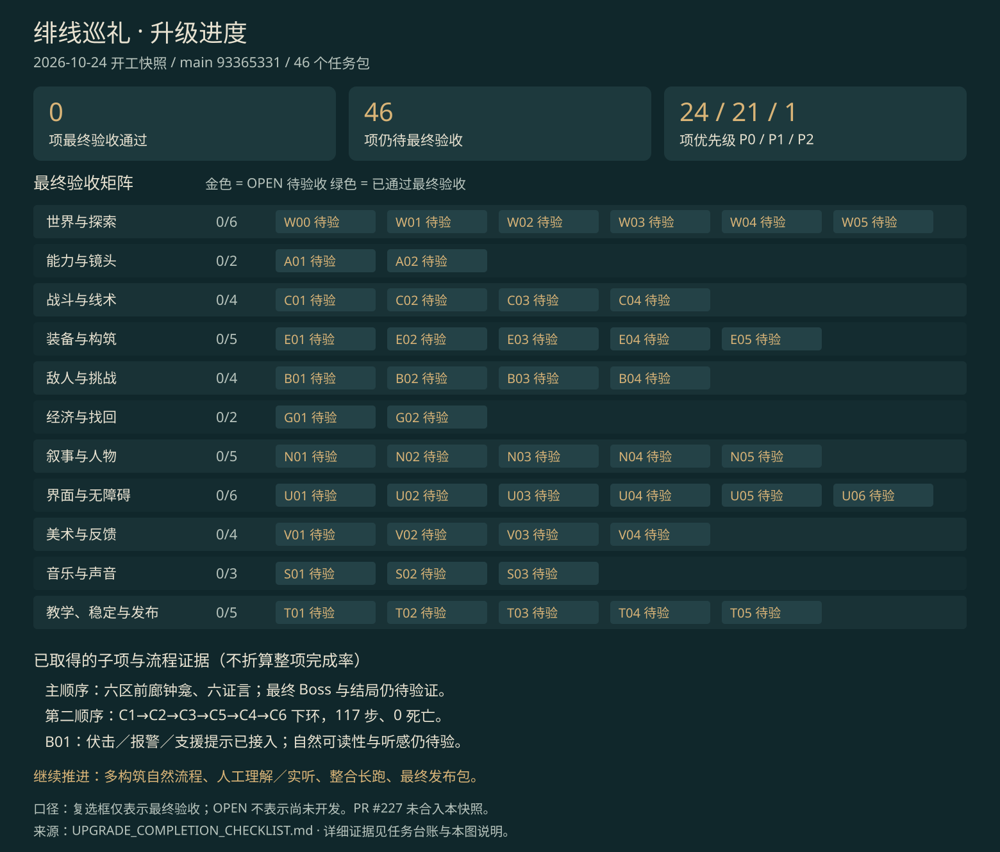

[进度图说明与下一批范围](docs/gallery/20261024_upgrade_progress.md) · [任务台账](docs/UPGRADE_TASK_LEDGER.md) · [最终验收清单](docs/UPGRADE_COMPLETION_CHECKLIST.md)

## 当前版本实机画面（2026-10-15）

以下图片重新运行 **main `03b4919` 的 Godot 4.6.1 / World.tscn** 截取，展示当前 HUD、分类行囊、四类装备槽、付费战具补给与地图。此前首页仍引用 10 月 11 日的静态截图，现在以本次实机取样替换。后续未合入的 PR 不计入这组图片。

截图使用隔离展示存档，装备、材料和进度由夹具授予；用于展示当前界面，不代表自然流程获得或六区带伤通关。

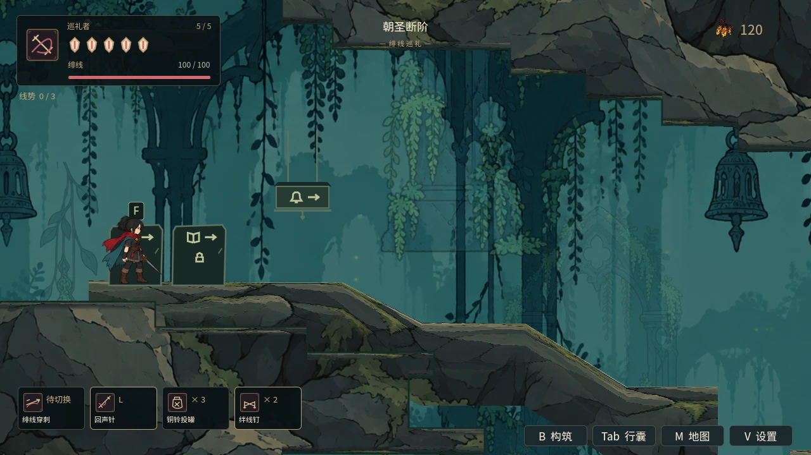

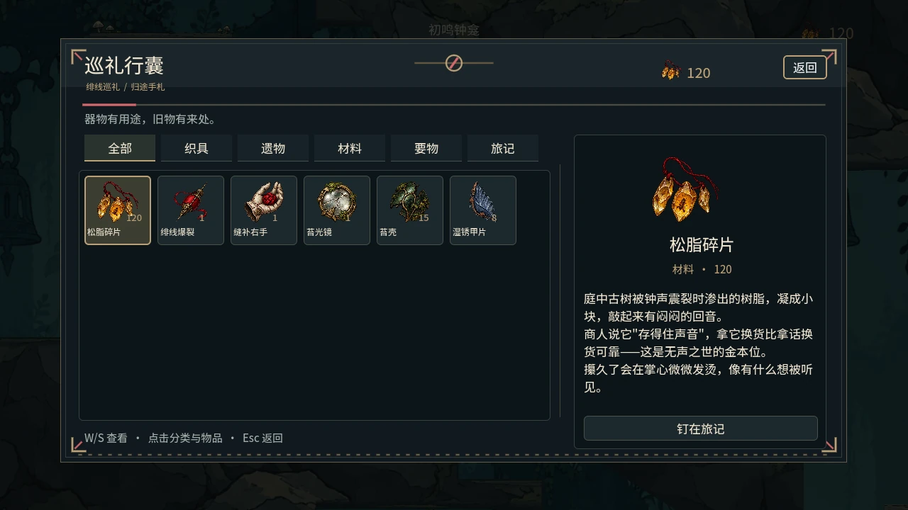

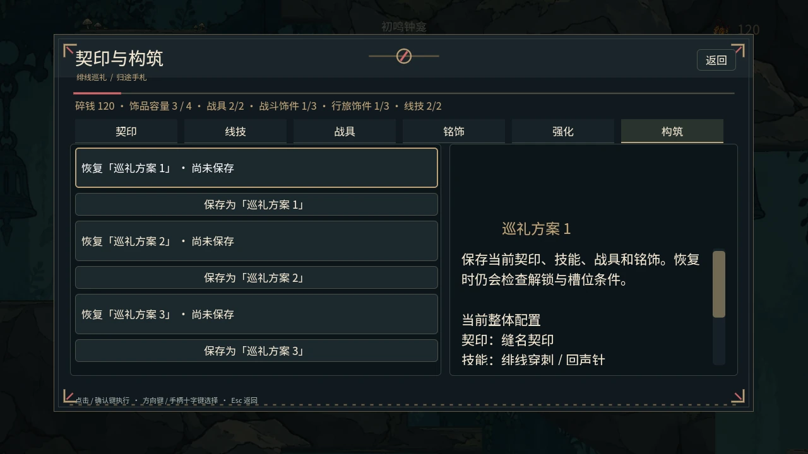

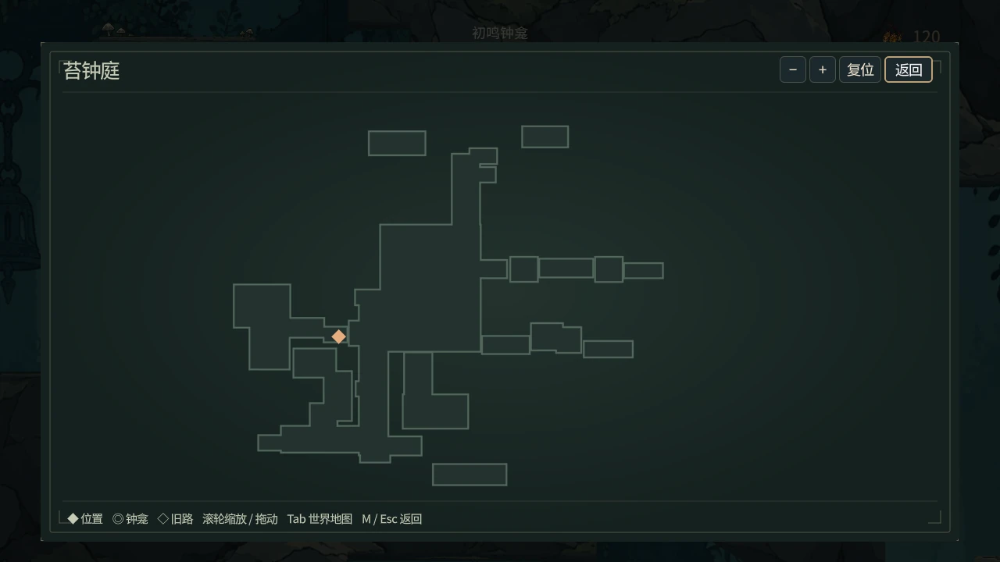

[查看本次全部 14 张实机界面与复现方式](docs/gallery/20261015_current_main.md) · [升级进度](docs/UPGRADE_PROGRESS.md) · [任务台账](docs/UPGRADE_TASK_LEDGER.md)

<details>
<summary>历史升级记录与旧版截图（2026-10-11～15）</summary>

以下为各批次当时的实现和验收记录，图片不作为当前版本预览。

## 第二份续接：战斗、构筑与剧情（2026-10-15，本批子项已验收）

从 PR #55 继续四类兼容槽位、付费部分补给、存档失败回滚、真实命中反馈、普通敌人职责与已知线索/结局旅记。第一份由其他人推进，本分支不包含其未发布改动；本次冲突修复已同步最新 main，包含已合入的 PR #54 修复。

已同步他人合入的 #54 / main 04812a4，整合后22套GL通过，默认CI清单87套。新增六套348项通过，首轮86套的6个失败已修复并通过16套集中GL复验；实际World画面和失败记录均已保留。[本批实现、验收与剩余清单](docs/report/20261015_combat_build_next.md) · [进度](docs/UPGRADE_PROGRESS.md) · [任务台账](docs/UPGRADE_TASK_LEDGER.md)。本批仅按已验收子项推进，六区自然通关、完整视听与最终发布仍待完成。

## 最新续接：PR #54 异步预取测试修复（2026-10-15）

最新CI在 `a448734` 上80套中79套通过，唯一失败改为 `world_streaming` 的旧任务测试：分帧配置校验尚未完成，2秒准备窗口就已结束。现在先等真实纹理任务准入，再核对切区后逐个丢弃、无旧代数纹理发布；保留180秒套件上限和严格错误门禁。[本次修复与验证](docs/report/20261015_pr54_streaming_fixture_fix.md)。

前次PR #54补修：远端80套中仅邻区压力180秒超时；同地区换入口现在复用已校验配置、重检落点，碰撞与角色继续按入口退休/重建，减少80轮中的重复读取/完整验证。原轮数、超时和绘制模式保留。[修复与最新验收](docs/report/20261014_pr54_stress_fix.md)。

修复后9套相关真实GL回归通过，80轮压力循环82.119秒完成、16403项零失败，配置85项和正常伤害步行44项通过；npm/campaign及两轮导入通过。退出ObjectDB警告仍待归因，完整远端CI按修复提交核对。

承接 #53，靠近出口准备邻区时的配置读取/JSON解析复用正式切区的唯一后台服务；校验分帧推进，完整通过后才进入邻区缓存和对象预建。正式切区优先，离开范围、换入口和区域代数变化会废弃旧任务。已完成但未接收的结果保留其票据所有权。

最终14套相关真实GL回归通过，含新增69项和正常伤害双向步行44项；npm/campaign与两轮恢复模式导入通过。早期导入超时及资源未就绪失败保留，完整80套远端CI按新提交核对，ObjectDB退出警告与自然六区通关继续待验收。

[本批实现与验证范围](docs/report/20261014_neighbor_config_budget.md) · [升级进度](docs/UPGRADE_PROGRESS.md) · [当前任务台账](docs/UPGRADE_TASK_LEDGER.md)。W00仍部分完成：路线覆盖、缓存复制和首区准备仍有同步单项；共享物理洞口、第五/六地区及工房体验、自然六区通关与长期稳定继续待办。

## 前批：切区提交阶段分帧（2026-10-13）

基于正式 PR #29，切区尾部的落点恢复、碰撞预热、HUD/各面板和逐项行囊改为跨帧任务，地图复用字体缓存。提交期间可按 Esc 回到来路，完整界面建好后才统一发奖与保存；半成品界面不接收输入。

六区几何/界面一致及取消恢复424项通过，真实GL十组UI对照像素差均为0，双向实际步行/正常伤害/奖励/钟龛/存档44项通过。本地25套相关Godot回归与npm/章节审计通过；结果见 [本批报告与耗时边界](docs/report/20261013_budgeted_region_commit.md) · [验证摘要](artifacts/region_commit/verification.json) · [升级进度](docs/UPGRADE_PROGRESS.md)。不等待前一CI，远端完整CI单独报告；2ms为准入预算，复杂单项与共享洞口等剩余范围继续保留。

## 邻区玩法对象预建（2026-10-13）

PR #29 在固定世界坐标旅册之上，补齐邻区敌人、NPC、钟龛和交互物的树外预建与抵达复用，并修复正常步行进入管道时立即折返的问题。双向实际输入和真实 GL 验证通过，保留正常伤害、攻击、奖励、NPC 对话、钟龛与存档；80 轮缓存生命周期压力通过。Godot 最终 63 套验证零失败（62 套完整真实 GL + 20 工房 403 项定向复验），远端 CI 以最终提交为准。

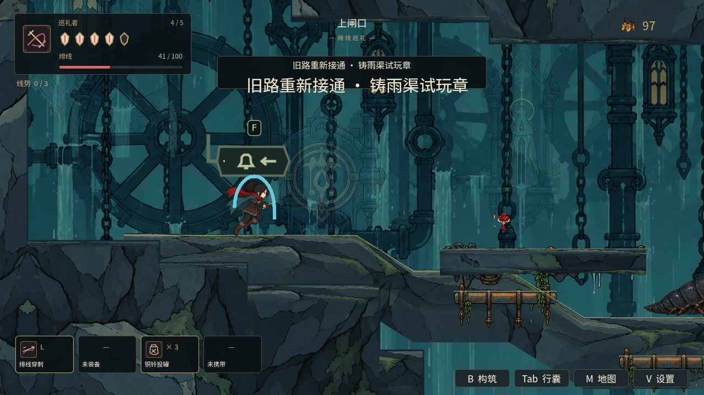

[完成报告与三张实机图](docs/report/20261013_neighbor_gameplay_prebuild.md) · [验证摘要](artifacts/neighbor_gameplay/verification.json) · [升级进度](docs/UPGRADE_PROGRESS.md)。起始检查点为夹具定位，其后使用真实输入且不开免伤；此局部验证不代表六区完整带伤通关。W00b2b / W00c 其余范围仍待完成。

## 固定世界坐标旅册（2026-10-13）

世界总览按六区固定原点与真实房间矩形统一比例绘制，替换原区域卡片。购图、途中笔记、钟龛补绘、隐藏房间规则保留；实体钟管与尚未实体化的旧路端点关系分开显示。PR #27流式地形旧夹具已修复并推送c61b822。本地定向回归/三种GL地图夹具通过，本地完整60套零失败、最终地图548项通过；远端CI按最终提交另行报告；W00c、共享洞口、邻区玩法驻留与T03/T04未完成。

## 当前升级：首条步行排水钟管（2026-10-13 素材修正）

承接 PR #26 的邻区平台、岩层和斜坡预建，本批推进 W00c：苔钟庭与铸雨渠之间的排水钟管新增 8540 像素可往返实体路面。朝出口方向踏进入口即可进入，F 也可打开管道；需要实际走到另一端，途中可向来路折返，Esc 返回入口。原有能力门、另一侧闩门与源区存档恢复点保留。

管道采用同一苔岩材质绘制顶板、地板和背墙；支撑架采用完整苔石拱架与同图集吊灯；拱架与岩壁共用石材采样和苔褐色调，置于中景并由岩层遮挡柱脚与拱顶，补上接触阴影，人物保持前景可读。原区内容在管道内暂时隐藏、停止处理并隔离碰撞；出口仍执行可取消的分帧整区装载，保留宿主、玩家和构筑，完成时按固定世界坐标换算落点。**这是一条独立通道内容块，尚不是两区共用物理空间的无缝大世界。** 其它跨区连接仍是成对落点；连续世界地图、邻区角色/交互驻留和复杂提交预算仍待完成。

本地 58 套 Godot 全量门禁零失败；随后最终受影响三套再次零失败，通道扩展到 52 项检查。免伤导航 25 步/3728 物理帧通过，不能计为六区带伤通关。真实 Mesa llvmpipe 的三处管道取样通过，新增人物显隐像素对照；原有岩壁接缝 12 项图形检查通过。退出 RefCounted 警告与编辑器导入 RID 问题继续列入 T03。远端 CI 以最终提交为准。

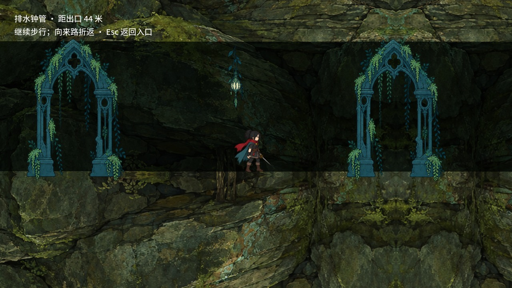

[本批报告与验收边界](docs/report/20261012_first_walkable_passage.md) · [全部升级进度](docs/UPGRADE_PROGRESS.md) · [阶段计划](docs/STAGED_UPGRADE_PLAN.md) · [验证摘要](artifacts/world_passage/verification.json)

## 游戏界面 · 归途手札

统一针线、旧铜、骨白与墨青的界面风格，重制生命刻印、四槽战斗 HUD、行囊、旅记、六页契印构筑、对话、地图与设置。菜单暗化世界并保留实际输入锁，适配不同窗口比例与 26px 对话。

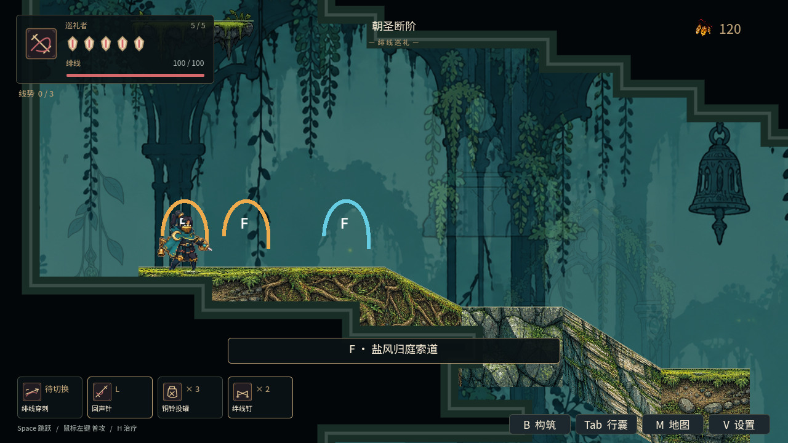
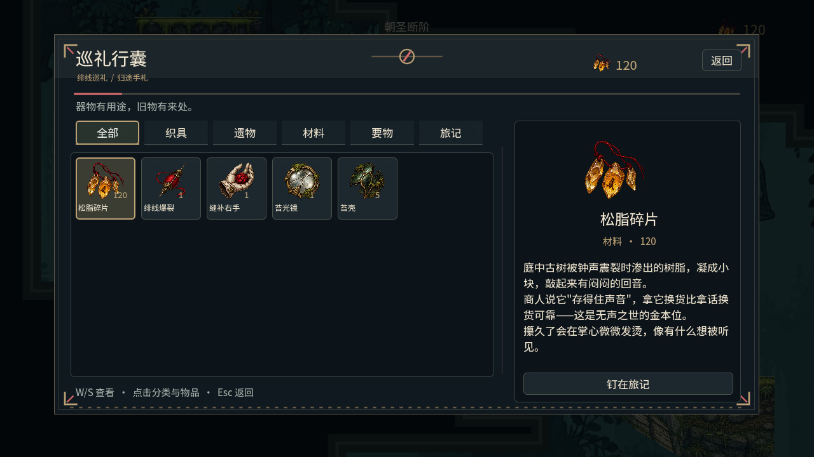

[查看 17 张实机界面与状态图](docs/gallery/20261011_ui_redesign.md) · [实现、验证与复现](docs/UI_REDESIGN.md)

## 契印升级与当时实机画面（2026-10-11）

[PR #12](https://github.com/superman2003/Crimson-Thread-Pilgrimage/pull/12) 已合入 main：六区跨区侧路、20 个能力练习／回访空间，以及按策划实现的 **契印系统**。缝名、司铸、校录通过线势、钟压和盐记形成不同打法；六个技能与四种战具各装备两个，六件铭饰消耗契印容量。获得接入既有 NPC 支线，永久探索能力独立保留。契印与铭饰在钟龛调整，战具在钟龛免费补给；换装和恢复方案不刷新生命、能量、次数或冷却。

下图由 **Godot 4.6.1 实际运行 `World.tscn`** 截取，包含游戏场景、人物、HUD 和实际构筑界面。截图采用隔离的展示存档，预置获得进度与配装，用于展示功能；不作为正常流程获得或带伤通关证明。旧的灰背景大字号 UI 测试截图另保留为布局验收资料。

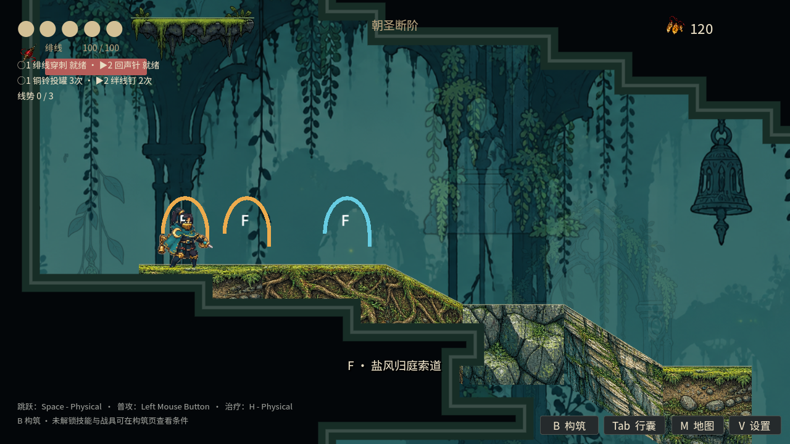

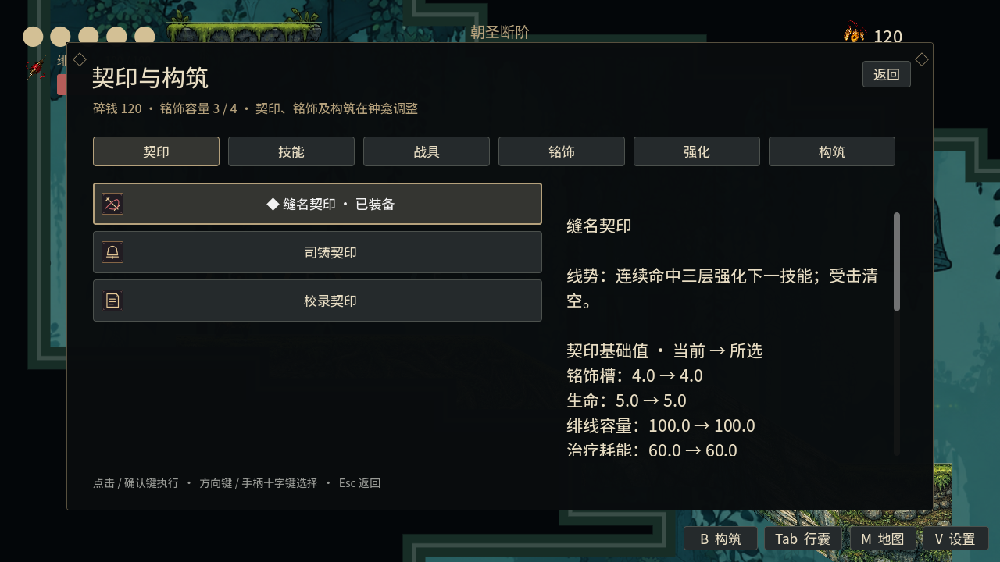

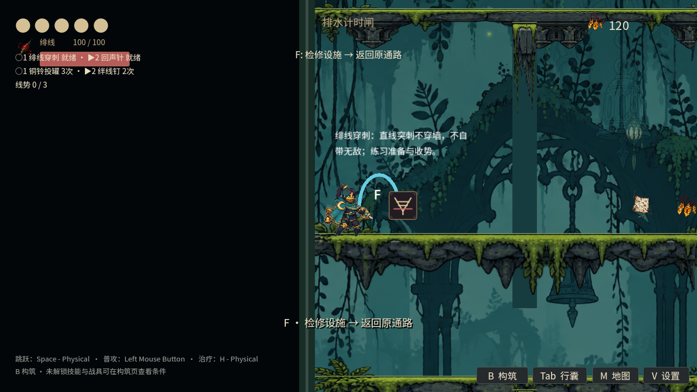

[查看全部 9 张最新实机图：六页面、HUD、练习与技能动作](docs/gallery/20261011_seal_world.md) · [契印验收与剩余项](docs/SEAL_VALIDATION.md) · [获得事件与剧情核对](docs/SEAL_LORE.md) · [六区升级范围](docs/SIX_REGION_UPGRADE.md)

默认操作：**B** 构筑，**L** 施放当前技能，**C** 切换技能，**T** 使用战具，**G** 切换战具；**K/X** 保留钩索。手柄 **Y** 技能、**L2/R2** 切换技能／战具、**十字键下** 使用战具。设置页支持重新绑定；技能和战具尚未获得时会显示条件。

验证覆盖 41 个不同 Godot 套件，最终受影响套件与新增契印套件串行复验通过；完整记录见验收文档。远端状态以 [GitHub Actions](https://github.com/superman2003/Crimson-Thread-Pilgrimage/actions) 为准。完整手柄体验、逐帧角色动画、混音试听和六区多构筑带伤通关仍待人工验收。

## 互联世界可玩版本（2026-10-11）

直接运行 Godot 工程现在进入 `World.tscn`：苔钟庭 → 铸雨渠取得攀壁 → 盐白书库取得双线跃 → 返回苔钟庭打开盐风封门 → 收取失名证词并接通永久归庭索道。途中不必先清空全图小怪或击败每区 Boss；受阻时仍有可走的水道和庭内支线。

世界按区域保存拾取、捷径、探索、Boss 和钟龛；跨区保持当前生命与能量，重启回到当前区域已记住的钟龛。**M** 打开地图，在地图内按 **Tab** 切换六区互联图；**F** 交谈、收取证词和穿过入口；**F9** 确认后开始新旅途并保留旧旅途备份。**K/X** 朝向铜环可用回声钩索位移，需先在雨渠取得既有钩索；空中再按跳跃使用已获得的双线跃。

五位 NPC 的“把名字带回来”支线跨越前三地区。完整听完才推进，F/鼠标先补全字幕再继续，返回学徒可获得一次性奖励。原创短拟声配中文字幕；保留原有区域音乐、战斗/命中/死亡音效，增加小怪交战叫声限频及跨场景混音保护。

**范围**：前三地区已用真实输入走通能力回访闭环；最新版本增加后三地区侧向支路与能力回访工坊，原房间逐间重构和非线性路线体验仍待打磨。运书索道目前使用明确的交互入口与成对落点，沿用的洞穴升降笼仍为真实物理交通。导航测试使用免伤，并不代表完整六区人工战斗通关。

独立试玩 `Main.tscn`、生成地图场景及 `--demo-config=...` 保持原配置，不读写新世界记录。[本轮实现与验证](docs/report/20261011_interconnected_world_implementation.md)。

## 历史整合记录（2026-10-11）

[PR #8](https://github.com/superman2003/Crimson-Thread-Pilgrimage/pull/8) 已合入 main，合并提交为 [b0326e6](https://github.com/superman2003/Crimson-Thread-Pilgrimage/commit/b0326e62491140a9fe089706d692f5d09ca30354)。六章地图、美术、战斗和界面已可从 main 使用；原分支保留供历史追溯。

[PR #7](https://github.com/superman2003/Crimson-Thread-Pilgrimage/pull/7) 的运行时修复也已合入；旧 [PR #6](https://github.com/superman2003/Crimson-Thread-Pilgrimage/pull/6) 已关闭，其旧地图没有覆盖新内容。

[合入版本的 CI](https://github.com/superman2003/Crimson-Thread-Pilgrimage/actions/runs/38117357448) 通过 15 个 Godot 套件、三个 Node 测试和两项章节结构检查，其中章节回归 270 项、物理与减速 12 项、复审回归 133 项。此处记录当时的整合检查；最新版本另扩展了构筑、状态清理与剧情回归。详见[整合与验证记录](docs/report/20261011_flat_map_integration.md)。

## 洞穴探索升级（2026-10-11）

洞穴升级由 [PR #9](https://github.com/superman2003/Crimson-Thread-Pilgrimage/pull/9) 整合；该 PR 的合并状态与 CI 结果可在链接中查看。新增六章升降笼正常玩家物理上行回归，洞穴套件共 170 项检查。

地图现以实心岩层围出洞道，普通通道有洞顶和洞壁，大厅与 Boss 场保留战斗空间。普通洞道、升降井和 Boss 场完整显示，岩层外围仍为不透明黑色；只有显式标记的黑暗区域启用局部视野，目前为第一章“假苔穴”。离开后恢复正常视野；39 条新增地面连接可双向步行，每章有一座可呼叫的物理升降笼。找到并接通捷径拉杆即可开启 Boss 通路，清空全图小怪也仍可开门。

下方为洞穴升级初版的 Godot 实机渲染，不是概念图；其中旧的普遍局部视野效果已改为仅在特殊暗穴启用。按 **F** 呼叫/乘坐升降笼，**M** 查看已探索地图。保留攀爬和少量跳跃路段，主线增加步行、洞道探索与升降通路。

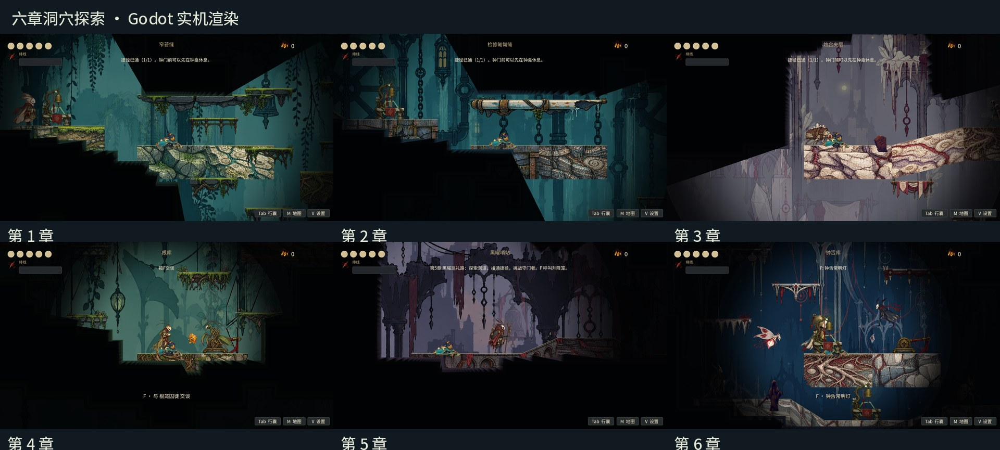

[调研、改动与验证记录](docs/report/20261011_cave_exploration_upgrade.md) · [完整地图及怪物图册](docs/gallery/20261011_current_assets.md)

| 章节 | 洞穴画面 | 升降笼画面 |
| --- | --- | --- |
| 第 1 章 | [实机画面](artifacts/cave_exploration/ch01_cave.jpg) | [升降笼](artifacts/cave_exploration/ch01_lift.jpg) |
| 第 2 章 | [实机画面](artifacts/cave_exploration/ch02_cave.jpg) | [升降笼](artifacts/cave_exploration/ch02_lift.jpg) |
| 第 3 章 | [实机画面](artifacts/cave_exploration/ch03_cave.jpg) | [升降笼](artifacts/cave_exploration/ch03_lift.jpg) |
| 第 4 章 | [实机画面](artifacts/cave_exploration/ch04_cave.jpg) | [升降笼](artifacts/cave_exploration/ch04_lift.jpg) |
| 第 5 章 | [实机画面](artifacts/cave_exploration/ch05_cave.jpg) | [升降笼](artifacts/cave_exploration/ch05_lift.jpg) |
| 第 6 章 | [实机画面](artifacts/cave_exploration/ch06_cave.jpg) | [升降笼](artifacts/cave_exploration/ch06_lift.jpg) |

## 怪物素材与完整地图

40 种小怪与 6 位 Boss 的当前素材在下方直接展示；[完整图册](docs/gallery/20261011_current_assets.md)提供各章高清地图、小怪分章图册、实机画面，以及全部 46 类敌人的原始动画图集链接。

地图总览由当前章节配置按世界坐标比例生成，展示完整布局及关键对象位置，属于布局图。实机画面见下方预览及完整图册。

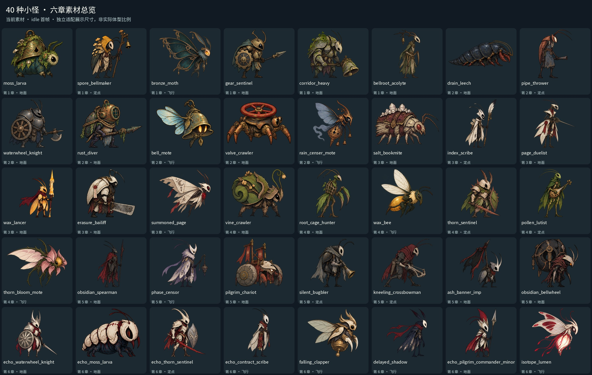

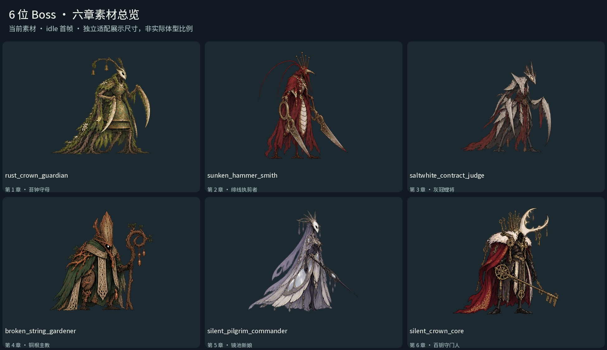

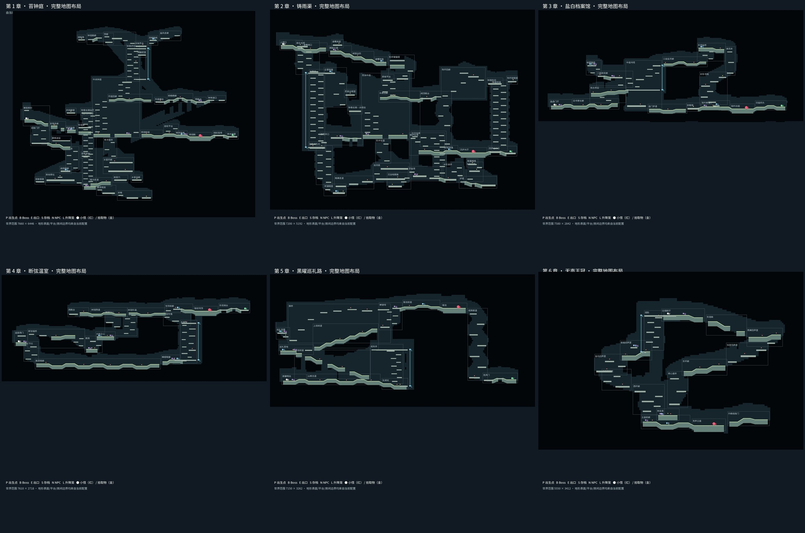

| 章节 | 完整地图 | 小怪图册 | 实机画面 |
| --- | --- | --- | --- |
| 第 1 章 · 苔钟庭 | [查看全图](artifacts/current_gallery/demo_ch01_moss_bell_court_full_map.jpg) | [6 种小怪](artifacts/current_gallery/ch01_enemies.jpg) | [截图](artifacts/pilgrimage_overhaul/demo_ch01_moss_bell_court.png) |
| 第 2 章 · 铸雨渠 | [查看全图](artifacts/current_gallery/demo_ch02_rain_foundry_canal_full_map.jpg) | [7 种小怪](artifacts/current_gallery/ch02_enemies.jpg) | [截图](artifacts/pilgrimage_overhaul/demo_ch02_rain_foundry_canal.png) |
| 第 3 章 · 盐白档案馆 | [查看全图](artifacts/current_gallery/demo_ch03_saltwhite_archive_full_map.jpg) | [6 种小怪](artifacts/current_gallery/ch03_enemies.jpg) | [截图](artifacts/pilgrimage_overhaul/demo_ch03_saltwhite_archive.png) |
| 第 4 章 · 断弦温室 | [查看全图](artifacts/current_gallery/demo_ch04_broken_string_greenhouse_full_map.jpg) | [6 种小怪](artifacts/current_gallery/ch04_enemies.jpg) | [截图](artifacts/pilgrimage_overhaul/demo_ch04_broken_string_greenhouse.png) |
| 第 5 章 · 黑曜巡礼路 | [查看全图](artifacts/current_gallery/demo_ch05_obsidian_pilgrim_road_full_map.jpg) | [7 种小怪](artifacts/current_gallery/ch05_enemies.jpg) | [截图](artifacts/pilgrimage_overhaul/demo_ch05_obsidian_pilgrim_road.png) |
| 第 6 章 · 无声王冠 | [查看全图](artifacts/current_gallery/demo_ch06_silent_crown_core_full_map.jpg) | [8 种小怪](artifacts/current_gallery/ch06_enemies.jpg) | [截图](artifacts/pilgrimage_overhaul/demo_ch06_silent_crown_core.png) |

## 预览

2026-10-11 改版：[第一章实机画面](artifacts/pilgrimage_overhaul/demo_ch01_moss_bell_court.png)、[分类背包](artifacts/pilgrimage_overhaul/inventory.png)、[NPC对话](artifacts/pilgrimage_overhaul/dialogue.png)。[六章截图目录](artifacts/pilgrimage_overhaul)。本轮包含46类敌人的104个招式、六章手绘地图与连续地形，详见[改版记录与验证](docs/release/20261011_pilgrimage_overhaul.md)。

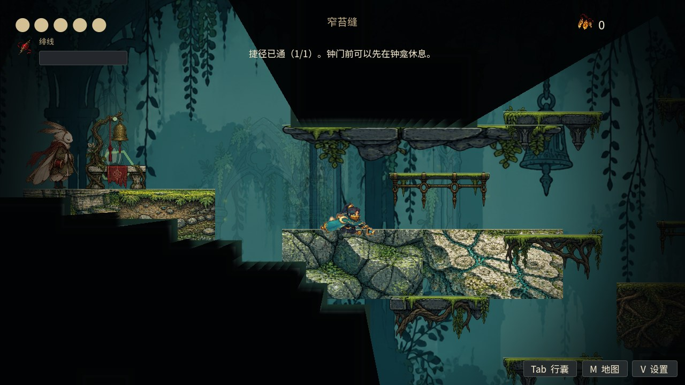

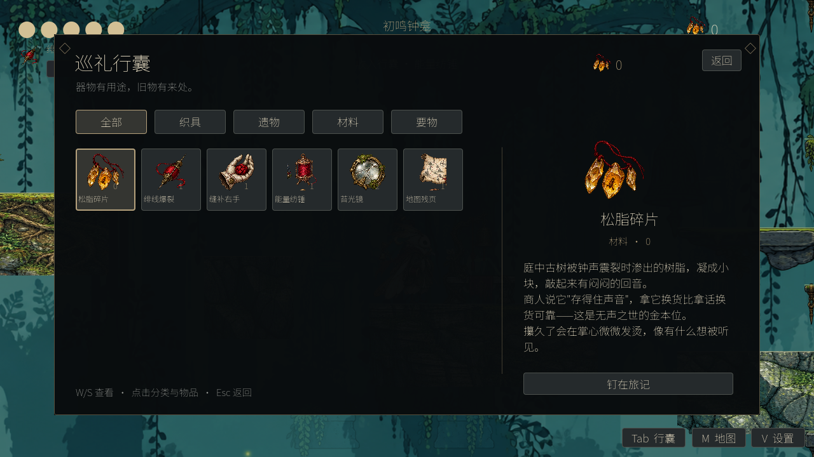


</details>

## 运行 Godot 项目

需要：

- Godot 4.6.x
- Python 3.10+，用于素材/数据验证脚本
- Node.js 18+，仅用于开发阶段的跨平台验证入口和素材工具；游戏运行不依赖 Node.js

启动：

```powershell
godot --path godot
```

主场景：

```text
godot/scenes/World.tscn
```

`Main.tscn` 保留为独立章节试玩入口。

常用验证：

```powershell
godot --headless --path godot --script res://scripts/demo_validation.gd
godot --headless --path godot --script res://scripts/ch02_demo_validation.gd
godot --headless --path godot --script res://scripts/combat_validation.gd
godot --headless --path godot --script res://scripts/all_chapters_demo_validation.gd
godot --headless --path godot --script res://scripts/cave_exploration_validation.gd
godot --headless --path godot --script res://scripts/cave_route_walk_validation.gd
godot --headless --path godot --script res://scripts/chapter_route_regression_validation.gd
godot --headless --path godot --script res://scripts/pilgrimage_merge_regression_validation.gd
godot --headless --path godot --script res://scripts/pilgrimage_review_regression_validation.gd
godot --headless --path godot --script res://scripts/pilgrimage_overhaul_validation.gd

python tools\validate_chapter_files.py
python tools\validate_open_asset_policy.py
python tools\validate_itch_enemy_assets.py
python tools\render_current_gallery.py
```

开发验证入口：

```powershell
npm run check
npm test
npm run test:campaign
```

`npm test` 已包含活动地图几何、唯一性和运行器负面检查，`npm run test:campaign` 校验当前战役、剧情和世界路线。旧生成地图的 54 处恢复点缺陷仍由单独的严格检查报告；它不等同于活动六区地图。详见 [验证范围](docs/VALIDATION.md)。

## 当前内容

- 六章试玩数据：`godot/data/demo_ch01_*.json` 到 `godot/data/demo_ch06_*.json`
- 章节策划数据：`godot/data/chapters`
- Godot 主逻辑：`godot/scripts/main_level.gd`
- 玩家控制器：`godot/scripts/player_controller.gd`
- 敌人/Boss AI：`godot/scripts/enemy_actor.gd`
- Metroidvania System 插件：`godot/addons/MetroidvaniaSystem`
- 素材处理和验证脚本：`tools`
- 设计、决策、发布记录：`docs`

## 素材授权边界

可随本仓库发布的主要素材：

- Kenney assets: CC0
- GothicVania Cemetery / Ansimuz: Public Domain / 商用友好记录
- OpenGameArt Dark Fantasy Platformer Bestiary: CC-BY 系列来源，已在项目 NOTICE 中记录署名
- Godot Platformer 2D: MIT
- Metroidvania System: MIT
- 项目自制/生成运行资源：主角关键帧、部分 UI/验证产物和脚本生成图

不会随公开仓库发布的本地受限素材：

- Maaot / Mossy Cavern
- Arhimed122 / Abyss Bug Sprite Pack
- MonoPixelArt / Forest Monsters 2D Pixel Art FREE

详细清单见：

- [不可再分发素材包清单与开源边界](docs/decision/20260616162014251_不可再分发素材包清单与开源边界.md)
- [Third Party Notices](THIRD_PARTY_NOTICES.md)
- [Godot asset notice](godot/assets/NOTICE.md)

这些受限素材可能存在于本地开发缓存或历史文档中，但已从公开运行时引用中移除，并由 `.gitignore` 排除。

## 开源发布范围

提交范围包括：

- Godot 工程核心文件
- 运行所需且可再分发的素材
- 文档、验证脚本、展示图

提交范围排除：

- `artifacts/source_repos`
- `artifacts/source_assets`
- `artifacts/third_party`
- `artifacts/debug`
- `godot/.godot`
- `tmp`
- 本地受限素材目录和对应导入脚本

## License

项目代码使用 MIT License。第三方素材、插件、音频和字体等按各自许可证使用，详见 `THIRD_PARTY_NOTICES.md` 和各素材目录下的 NOTICE/LICENSE 文件。

## 逐批关卡升级

[W02 第一批：苔钟庭五间原房间重构](docs/CH01_ROOM_RECONSTRUCTION.md) · [实机前后对比](docs/gallery/20261011_ch01_rooms.md)。全清单仍分批推进，验收范围见文档。

[六区岩壁与整块结构材质修复：实机对比](docs/WORLD_MATERIALS.md)。

## 黑曜巡礼道体验升级（2026-10-14）

第五区14间房接入独立构图，缆车井、瞭望塔和下降索道随高度跟随；营地钟轮与镜池门前战车让出交谈／休息位置，保留正常伤害和双招。最终147项专项、8套相关真实GL回归与5处已落地取样通过，完整CI单独按新提交核对。第六区、工房和六区自然通关仍待验收。

[2026-10-14 巡礼营地历史取样](artifacts/obsidian/camp.webp)

[本批报告与五处画面](docs/report/20261014_obsidian_experience.md) · [验证摘要](artifacts/obsidian/verification.json)。

2026-10-15 第一份任务的整合交付、验证和剩余：[连续世界、探索操作与工程稳定](docs/report/20261015_world_exploration_stability.md)。
