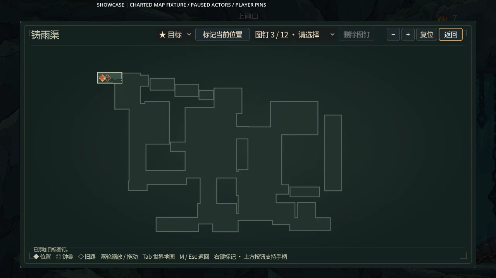
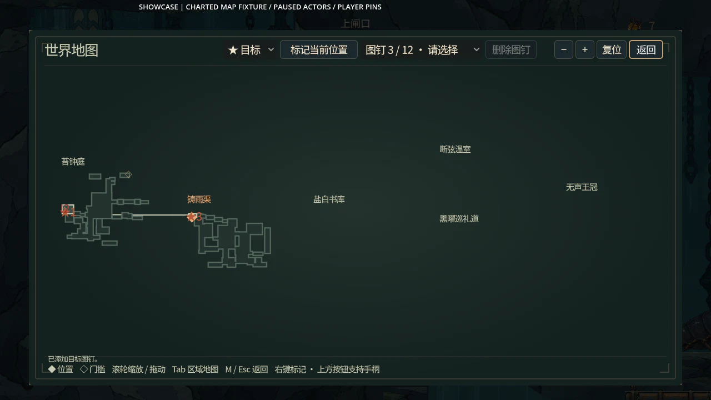
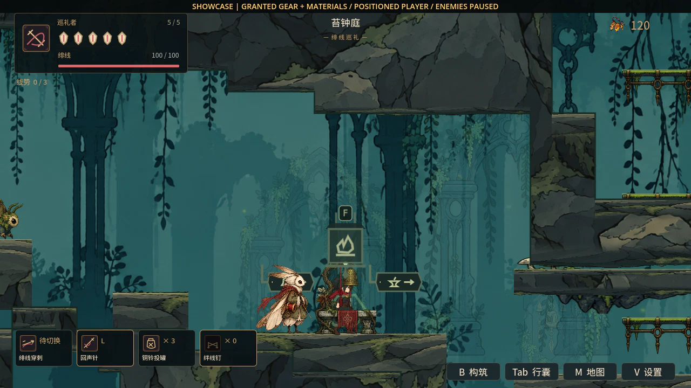
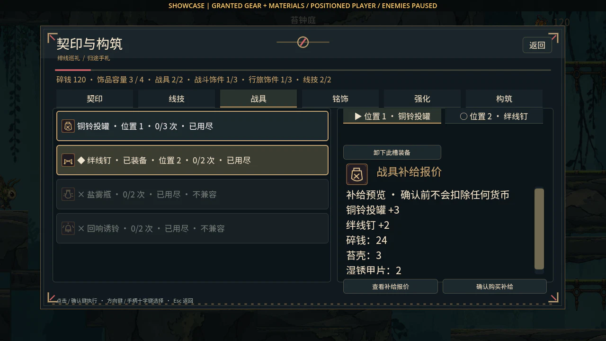

# Crimson Thread Pilgrimage / 绯线巡礼

以针、线与旧铜遗物探索失声世界的原创二维动作冒险。玩家穿过六个互联地区，取得永久探索能力，回访旧路，寻找证词和失名者，并用契印、线术与战具组成自己的打法。

本页整体整理于 **2026-10-15**，说明对应 **PR #67 的 `5cf7303` 开发代码**，承接 PR #65 的保存候选与文档基线。它是开发分支说明，不是 main 或正式发行版的发布公告。当前进度、使用指南和历史交付分开维护，完整目录见[文档导航](docs/README.md)。

## 项目现状

| 领域 | 已有内容 | 仍需完成 |
|---|---|---|
| 世界与探索 | 六区拓扑、固定世界坐标、持久玩家、邻区预建、分帧切区；一条8540像素可折返实体钟管 | 相邻实体共同驻留、共享物理洞口、桥井和普通出口连续衔接；后三区两种自然探索顺序 |
| 房间与能力 | 八项永久能力、20个练习／回访空间；六区镜头和局部房间体验升级 | 替换重复结构，逐房补齐用途、线索、遭遇和奖励，验证自然取得及有价值的回访 |
| 地图 | NPC售图、途中笔记、钟龛补绘、真实地形轮廓、固定坐标世界图、缩放拖动、动态已知门与危险；个人图钉 | 绘针取得、装备定位与辅助规则、楼层、大房间分段、图钉取得和密集避让、自然导航 |
| 战斗与构筑 | 缝名／司铸／校录三契印、六线术、四战具、铭饰与四类兼容槽；报价、部分补给和失败回滚 | 三契印多构筑长期实战、完整动画与判定同步、自然经济和材料保底 |
| 人物与剧情 | “把名字带回来”支线、跨区人物标志、一次性报酬、证词与三结局条件、已知线索旅记 | 人物／设施的阶段变化、不同线索顺序、终局后果及六区自然流程 |
| 工程与交付 | 迁移／备份／多槽、私有保存候选、严格回归运行器、Windows与Linux候选包工具 | 同步保存成本、长期引用／内存／帧时间、真实手柄、听感、最终候选重建与目标机验收 |

46个任务包均仍有剩余实现或整包验收；已有子项不从零重做，也不按截图数计算完成率。[剩余总清单](docs/REMAINING_UPGRADE_ROADMAP.md)保留按主题排出的22批规划、现实预算28–36批。这是排期估算，包含保存候选批，不是从本文起重新承诺还需22次PR；图钉只是完整地图主题的一个子项。

## 启动源码工程

需要 **Godot 4.6.1 stable**、Git和Git LFS。工程使用 Compatibility 渲染器，设计视口1280×720。Python 3.10+用于验证和构建工具，Node.js 18+用于npm命令与旧浏览器原型。

```sh
git clone https://github.com/superman2003/Crimson-Thread-Pilgrimage.git
cd Crimson-Thread-Pilgrimage
git lfs install
git lfs pull --include='godot/assets/**'
godot --path godot --editor
```

先等待资源导入完成，再运行工程，或执行 `godot --path godot`。默认入口为 `godot/scenes/World.tscn`。要复现本文功能，请检出相应开发分支；默认克隆得到的main可能与本文基线不同。

`Main.tscn`、生成地图场景与 `--demo-config=...` 保留独立试玩路径，不等同World旅途。桌面候选ZIP的解压、启动、存档备份与问题反馈见[玩家指南](docs/RELEASE_PLAYER_GUIDE.md)；玩家运行独立包无需安装Godot。

## 基本操作

下表为源码默认键位；已有重映射以游戏设置页为准。未获得的永久能力或装备需先满足条件。

| 操作 | 默认键鼠 |
|---|---|
| 移动／朝向 | A、D或左右；W、S或上下向上／向下瞄准 |
| 跳跃／冲刺 | 空格／Shift |
| 针击／疗伤 | J或鼠标左键／H或鼠标右键 |
| 交谈、钟龛、机关、入口 | F |
| 钩索／钟卫／灯影相位／王冠共鸣 | K或X／Q／E／R |
| 施放／切换已装备线术 | L／C |
| 使用／切换已装备战具 | T／G |
| 行囊／构筑／设置 | I或Tab／B／V |
| 地图／地图中切换区域与世界图 | M／Tab |
| 关闭界面、取消可取消的切区 | Esc |
| 开始新旅途 | F9，需确认并保留旧旅途备份 |

设置支持重映射与字幕、声音、闪光和震动选项。手柄已有映射和焦点操作，完整真实设备体验仍待验收。

## 探索、地图与回程

初期可从苔钟庭进入铸雨渠取得攀壁，再向盐白书库取得双线跃，回访苔钟庭的盐风封门与证词支路。此路线是已有回访闭环，不要求先清空所有敌人或逐区击败Boss。更多侧路与能力工房允许后续回访；六区完整自然带伤流程仍需验证。

六区各有指定售图NPC，当前每区底图20枚松脂碎钱。购买不等于补绘：途中发现记入笔记，安坐钟龛后补到已购地图；未购与未补绘的秘密不因此曝光。M先打开本区图，Tab切换统一世界坐标总览；滚轮缩放，左键拖动，复位使用地图界面控件。

区域图和世界图右键可在**已购且已补绘的房间**放置个人图钉，也可通过上方按钮标记当前位置。目标／留意／回访三种类型共用12个上限，图上编号与删除列表对应。图钉跨区及重启保存；失败时撤回本次图钉操作。未知嵌套密室不能借用外层房间的补绘状态。

首条苔钟庭↔铸雨渠排水钟管可实际往返和折返，但仍是独立内容块，出口执行整区装载；其他成对入口与交通也各有现有实现边界，不能称为六区完全共享物理空间。

## 构筑、补给与旅途记录

钟龛用于休息、补绘和调整配置。构筑页区分战具、战斗铭饰、行旅铭饰与绯线技能，按契印布局检查兼容、锁定与容量。途中只能切换已装备项，切换不恢复生命、绯线、次数或冷却；旧装备迁移后的休眠状态须在钟龛重新分配。

休息恢复生命与绯线，战具需要另看报价并确认补给。补给消耗松脂碎钱与对应可再生材料，资源不足可补当前负担得起的部分次数；永久技艺、饰品和剧情遗物不会当材料扣除。制作／补给保存失败会回滚该事务。

人物对话完整读完才提交相关进度，未领奖可按既有完成态重访。旅记只透露已遇线索；终局条件显示已知信息与尚未发现的线索数量。世界记录保存区域拾取、捷径、探索、Boss和钟龛，跨区保留当前状态，重启按记录恢复。升级前退出游戏并备份整个用户数据目录，位置与恢复说明见[玩家指南](docs/RELEASE_PLAYER_GUIDE.md)。

## 当前游戏运行画面

以下均为Godot4.6.1真实OpenGL截帧，使用隔离展示存档，预置取得／探索与定位，部分暂停敌人。它们展示运行界面与场景，不作为自然取得、六区通关或硬件帧率证据。









[地图图钉两图与验证](docs/MAP_PLAYER_PINS_UPGRADE.md) · [场景／构筑六图及来源](docs/gallery/20261015_current_world.md)。旧图册按原日期保留在[文档目录](docs/README.md)，不混作当前素材和当前规则。

## 验证与已知限制

```sh
npm test
npm run test:campaign
python3 tools/run_godot_import.py --engine /absolute/path/to/godot --recovery-mode --log-dir /tmp/pilgrimage-import
python3 tools/run_godot_regressions.py --engine /absolute/path/to/godot --software-gl --log-dir /tmp/pilgrimage-regressions
```

软件GL回归需要Linux的Xvfb和Mesa。运行器逐套隔离存档，缺脚本、超时、非零退出、缺成功标记及引擎ERROR均失败，退出码0不能替代检查日志。[完整命令、分项选择与证据边界](docs/VALIDATION.md)。

图钉基线默认清单为99套；本地13套相关回归通过，新专项64项，独立重复并截两图时66项。它不是本地全99套通过，也不代替精确提交的远端结果；请查看[PR #67](https://github.com/superman2003/Crimson-Thread-Pilgrimage/pull/67)及其检查。历史报告中的41／58／80／98套均属于各自当时版本。

当前仍有ObjectDB退出警告待归因，保存JSON与盘写等同步成本未消除。旧生成地图严格检查曾记录54处恢复点嵌入平台的缺陷，属于另一套生成管线，不能拿活动六区检查通过替代。自然六区带伤通关、所有结局、陌生玩家、真实手柄、长时性能、混音和最终发布包验收继续待办。

## 开发导航与历史

| 需要查什么 | 入口 |
|---|---|
| 全部Markdown及阅读状态 | [文档导航](docs/README.md) |
| 完整余项、优先级与主题批次 | [剩余路线图](docs/REMAINING_UPGRADE_ROADMAP.md) |
| 每批交付证据／任务ID状态 | [升级进度](docs/UPGRADE_PROGRESS.md)／[任务台账](docs/UPGRADE_TASK_LEDGER.md) |
| 阶段依赖与完成条件 | [阶段计划](docs/STAGED_UPGRADE_PLAN.md) |
| 验证／候选包构建 | [验证指南](docs/VALIDATION.md)／[发布检查](docs/RELEASE_CHECKS.md) |
| 整体改写前首页与旧截图 | [首页历史存档](docs/README_HISTORY.md) |

运行核心在 `godot/scripts/main_level.gd`，玩家在 `player_controller.gd`，敌人在 `enemy_actor.gd`；章节配置在 `godot/data/chapters`，拓扑在 `godot/data/world_routes.json`，素材处理与回归工具在 `tools`。另一个agent负责的第六区隐藏支路尚未纳入本基线，不能从本文推断其已交付。

旧浏览器原型可执行 `npm start`，打开 `http://127.0.0.1:5173/`；它不等同当前Godot World内容。

## 授权与开源范围

项目代码为MIT；第三方美术、音频、字体和插件保留各自许可。[Third Party Notices](THIRD_PARTY_NOTICES.md)与[运行素材NOTICE](godot/assets/NOTICE.md)列出署名和来源，MIT不覆盖这些素材条款。

公开仓库包含工程、可再分发运行素材、文档、验证和展示产物。Kenney、Metroidvania System及其他来源按各自NOTICE使用；受限的Maaot／Mossy Cavern、Abyss Bug Sprite Pack、Forest Monsters等不随公开运行时发布。[不可再分发素材清单](docs/decision/20260616162014251_不可再分发素材包清单与开源边界.md)保留具体边界。

本地来源缓存、受限素材、`godot/.godot`、调试及临时目录不作为发布内容。候选包的许可收集、LFS水合和最终ZIP校验由[发布工具](docs/RELEASE_CHECKS.md)检查；现有来源记录不等于已完成最终原创性与全包许可复核。
