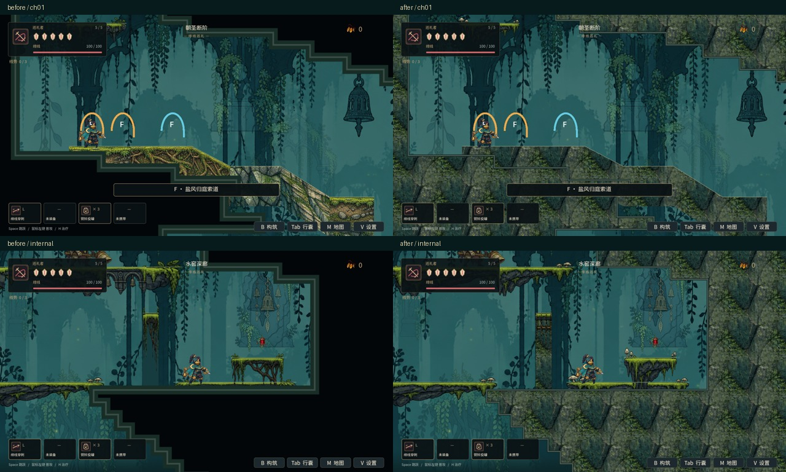
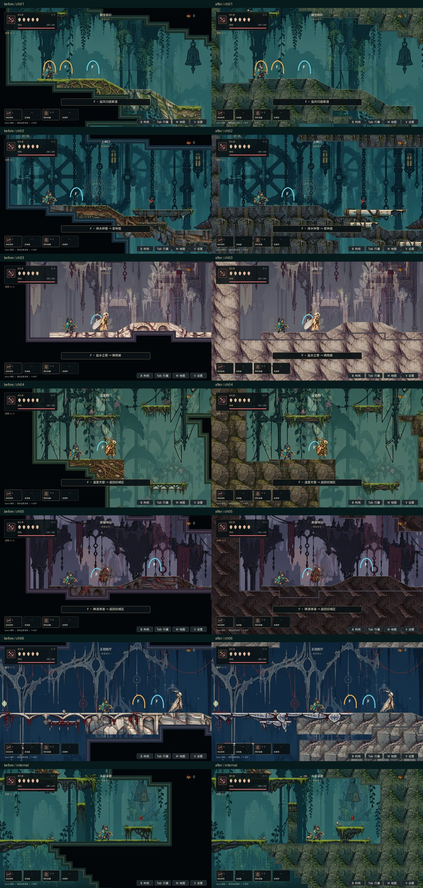

# 六区岩壁与整块结构材质修复

> 文档状态校准（2026-10-15）：本文是早期岩壁材质修复检查点，下文“周期交叉混合／不用镜像”不再是现行算法说明。后续大块岩层与mirror_repeat周期修复见[角色与整块岩层升级](HERO_AND_LARGE_ROCK_UPGRADE.md)。原图与测试数字保留为前后对比证据，当前画面见[首页](../README.md)。

## 已修复

- 洞穴外围岩壁和内部岩柱、顶棚均使用各区域现有手绘岩石图集，移除直接填黑的岩体绘制。
- 连续地形使用统一岩石取样和世界坐标，不再在同一缓坡、同一地面内部轮换土层、根须、砖墙等贴图。
- 一个完整平台的左右端部与所有中段使用同一图集变体、同一翻转方向。苔石台、铜桥和 Boss 石台分别按材质选择完整外观。
- 老数据中的随机 `variant`、`body_variants` 不再控制局部拼接；需要专门外观时使用整个平台的 `material_variant` / `material_flip_h`。
- 岩石取样采用周期交叉混合，消除切片边界；不用镜像岩石形成明显的对称拼花。岩壁仍覆盖背景，保持洞穴实体与通路的区别。

墙体与地形采用同一份区域岩石材质。区域之间分别读取苔钟庭、铸雨渠、盐白书库、断弦温室、黑曜巡礼路和无声王冠的现有图集，没有新增外部素材或混入其他区域的贴图。

## 实机对比

图形渲染使用 Godot 4.6.1，World 场景，1280 × 720，隔离存档。左右使用相同几何、镜头、玩家位置，敌人暂停更新。旧版本为 `655bf74` 的材质代码。

### 苔钟庭边界与内部房间



### 六区



## 验证

`npm test` 通过；Godot `world_material` 六区 1983 项检查、第一章房间 63 项、六区洞穴双向步行 78 次穿行通过。图形模式成功渲染六区及一处内部房间，没有着色器编译错误。

```sh
python3 tools/run_godot_regressions.py --engine /path/to/godot \
  --suite world_material --suite ch01_room_reconstruction --suite cave_route_walk
# 使用图形模式，而非 headless，生成实机截图。
godot --path godot --script res://scripts/capture_world_material.gd -- \
  --capture-output=/absolute/output/directory
```

这次仅修改材质与绘制，六区地图 JSON、碰撞、能力门和奖励位置没有变更。纹理画在原岩体范围内；通路不会因视觉修改被挖穿。

本批完成材质一致性的基础修复，仍保留原有格状碰撞轮廓。更细致的破损边缘、手工场景构图与六区整体美术完善属于后续 V01/V03；这次不代表完整美术升级或 T03 性能验收。截图退出偶发已有 ObjectDB 警告，未将截图进程当作长时稳定性证明。
