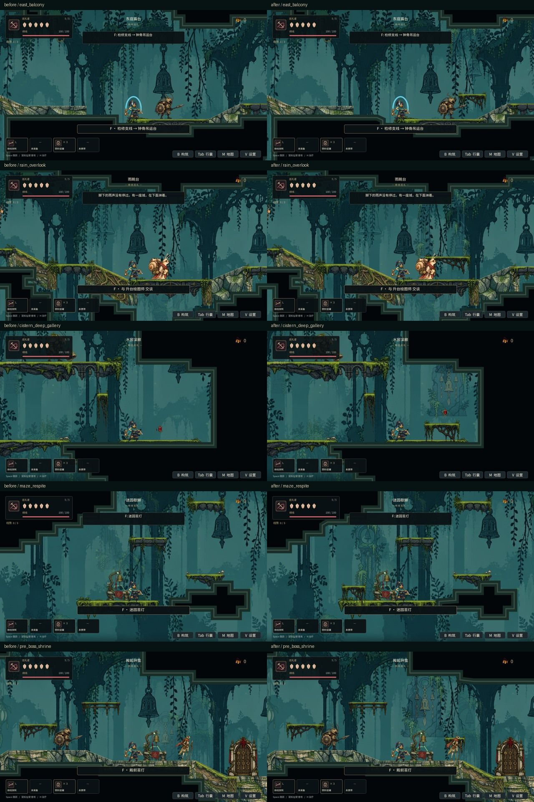
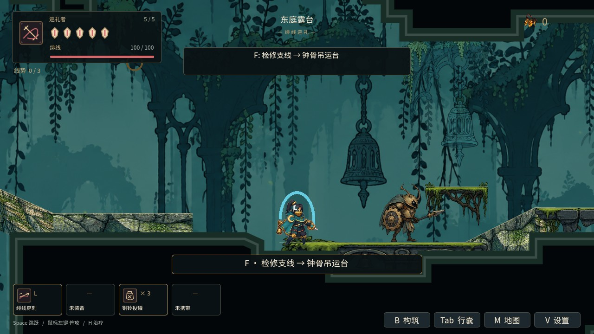
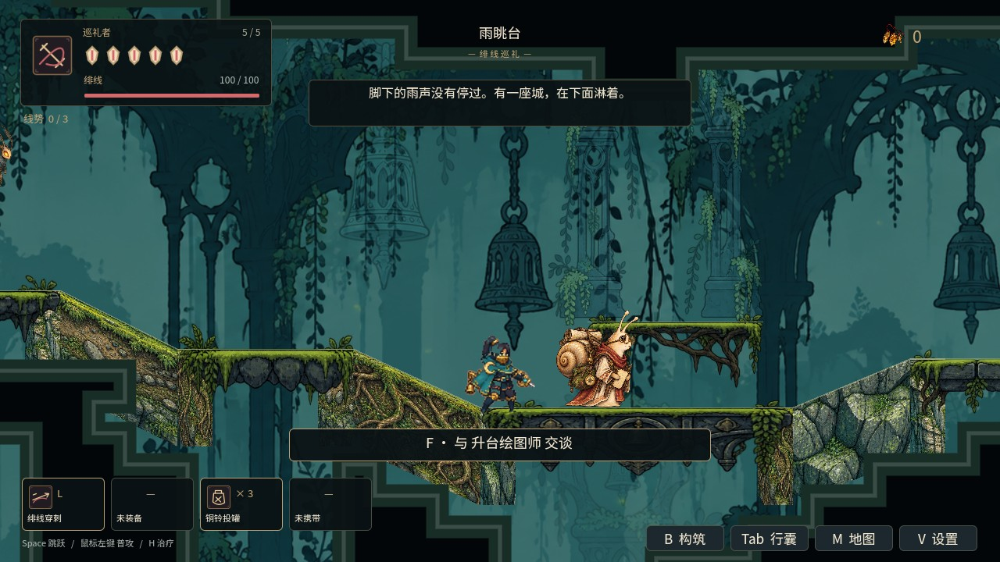
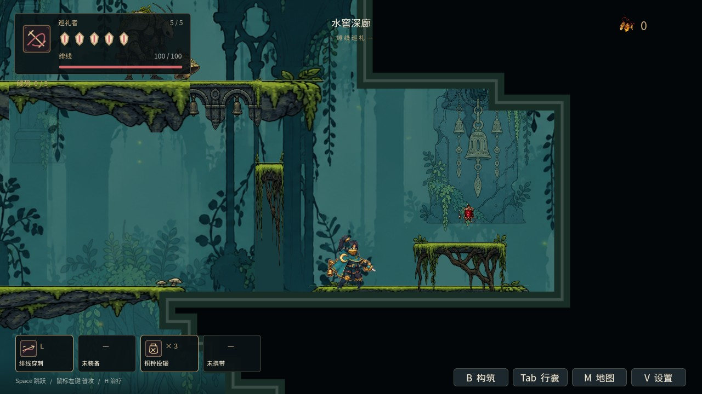
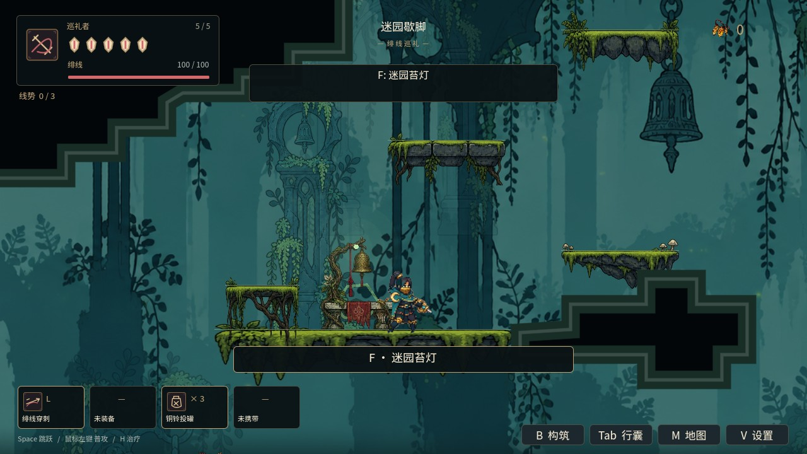
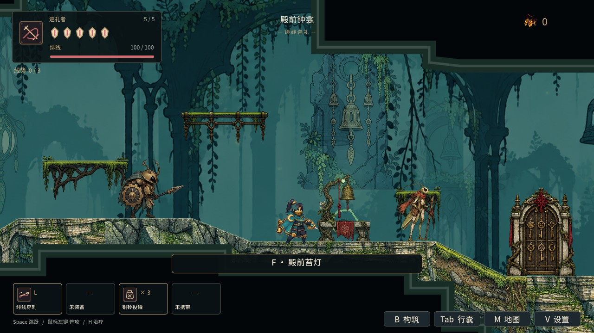

# 苔钟庭五间房：重构前后实机对比

Godot 4.6.1，World 场景，1280 × 720。左栏为父提交章节数据，右栏为本批重构；使用同一镜头和隔离存档，敌人保持起始姿态。截图不作为带伤害全流程通关证据。

## 东庭露台

## 雨眺台

## 水窖深廊

## 迷园歇脚

## 殿前钟龛

交付和验证边界见 [W02 第一批说明](../CH01_ROOM_RECONSTRUCTION.md)。
