# 六章洞穴地图与怪物素材展示

本页展示 2026-10-11 当前素材与洞穴章节配置。40 种小怪、6 位 Boss 均从原始 manifest 的 idle 首帧提取；展示尺寸分别适配，不能用图册判断游戏中的体型比例。点击原始图集链接可查看完整动画素材。

完整地图是按当前 JSON 世界坐标绘制的布局图，覆盖全部世界范围和房间，标记实心岩层、地形、出生点、Boss、章节出口、升降笼、存档、NPC、小怪及拾取物。它不是实机全景截图；每章同时提供真实运行画面。


| 章节 | Boss | 完整动画图集 |
| --- | --- | --- |
| 第 1 章 | 苔钟守母 | [rust_crown_guardian](../../godot/assets/sprites/original_creatures/rust_crown_guardian/atlas.png) |
| 第 2 章 | 绯线执剪者 | [sunken_hammer_smith](../../godot/assets/sprites/original_creatures/sunken_hammer_smith/atlas.png) |
| 第 3 章 | 灰冠螳将 | [saltwhite_contract_judge](../../godot/assets/sprites/original_creatures/saltwhite_contract_judge/atlas.png) |
| 第 4 章 | 铜根主教 | [broken_string_gardener](../../godot/assets/sprites/original_creatures/broken_string_gardener/atlas.png) |
| 第 5 章 | 镜池新娘 | [silent_pilgrim_commander](../../godot/assets/sprites/original_creatures/silent_pilgrim_commander/atlas.png) |
| 第 6 章 | 百钥守门人 | [silent_crown_core](../../godot/assets/sprites/original_creatures/silent_crown_core/atlas.png) |

## 第 1 章：苔钟庭

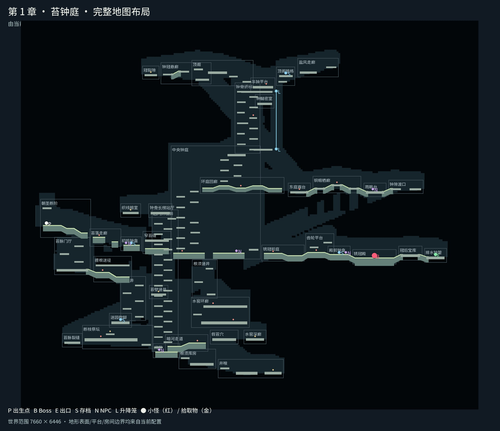

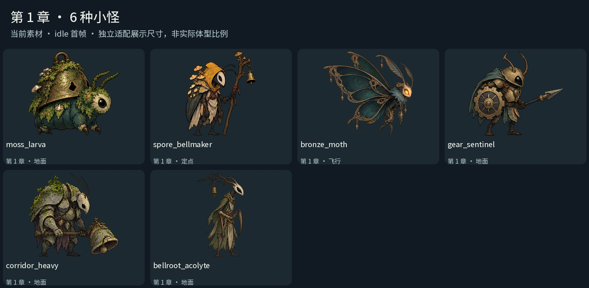

[洞穴实机画面](../../artifacts/cave_exploration/ch01_cave.jpg) · [升降笼实机画面](../../artifacts/cave_exploration/ch01_lift.jpg) · [前轮改版 Boss 画面](../../artifacts/pilgrimage_overhaul/demo_ch01_moss_bell_court_boss.png) · [章节配置](../../godot/data/demo_ch01_moss_bell_court.json)

| 小怪 ID | 活动类型 | 完整动画图集 |
| --- | --- | --- |
| `moss_larva` | 地面 | [atlas.png](../../godot/assets/sprites/original_creatures/moss_larva/atlas.png) |
| `spore_bellmaker` | 定点 | [atlas.png](../../godot/assets/sprites/original_creatures/spore_bellmaker/atlas.png) |
| `bronze_moth` | 飞行 | [atlas.png](../../godot/assets/sprites/original_creatures/bronze_moth/atlas.png) |
| `gear_sentinel` | 地面 | [atlas.png](../../godot/assets/sprites/original_creatures/gear_sentinel/atlas.png) |
| `corridor_heavy` | 地面 | [atlas.png](../../godot/assets/sprites/original_creatures/corridor_heavy/atlas.png) |
| `bellroot_acolyte` | 地面 | [atlas.png](../../godot/assets/sprites/original_creatures/bellroot_acolyte/atlas.png) |

## 第 2 章：铸雨渠

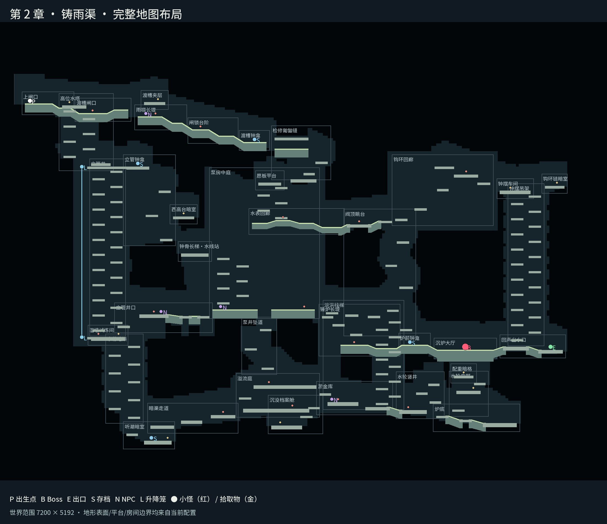

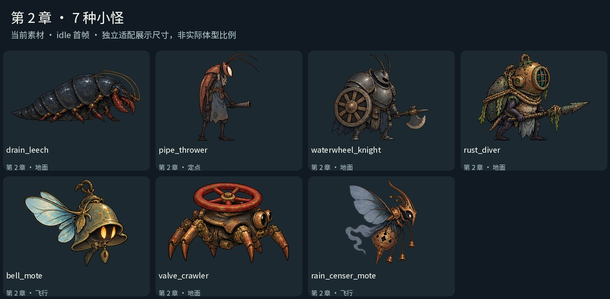

[洞穴实机画面](../../artifacts/cave_exploration/ch02_cave.jpg) · [升降笼实机画面](../../artifacts/cave_exploration/ch02_lift.jpg) · [前轮改版 Boss 画面](../../artifacts/pilgrimage_overhaul/demo_ch02_rain_foundry_canal_boss.png) · [章节配置](../../godot/data/demo_ch02_rain_foundry_canal.json)

| 小怪 ID | 活动类型 | 完整动画图集 |
| --- | --- | --- |
| `drain_leech` | 地面 | [atlas.png](../../godot/assets/sprites/original_creatures/drain_leech/atlas.png) |
| `pipe_thrower` | 定点 | [atlas.png](../../godot/assets/sprites/original_creatures/pipe_thrower/atlas.png) |
| `waterwheel_knight` | 地面 | [atlas.png](../../godot/assets/sprites/original_creatures/waterwheel_knight/atlas.png) |
| `rust_diver` | 地面 | [atlas.png](../../godot/assets/sprites/original_creatures/rust_diver/atlas.png) |
| `bell_mote` | 飞行 | [atlas.png](../../godot/assets/sprites/original_creatures/bell_mote/atlas.png) |
| `valve_crawler` | 地面 | [atlas.png](../../godot/assets/sprites/original_creatures/valve_crawler/atlas.png) |
| `rain_censer_mote` | 飞行 | [atlas.png](../../godot/assets/sprites/original_creatures/rain_censer_mote/atlas.png) |

## 第 3 章：盐白档案馆

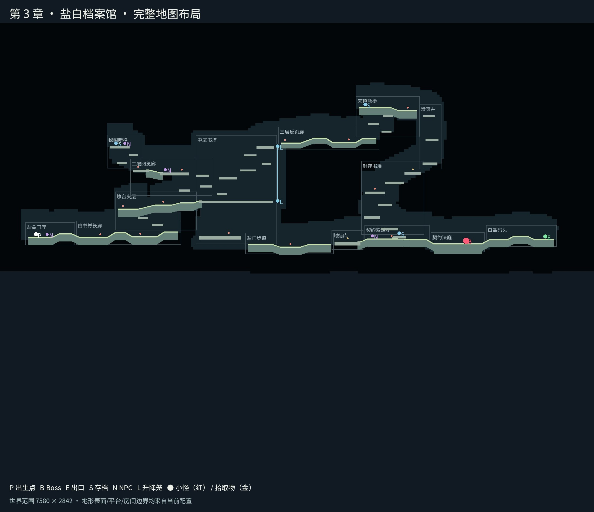

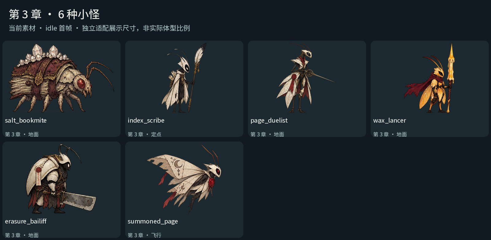

[洞穴实机画面](../../artifacts/cave_exploration/ch03_cave.jpg) · [升降笼实机画面](../../artifacts/cave_exploration/ch03_lift.jpg) · [前轮改版 Boss 画面](../../artifacts/pilgrimage_overhaul/demo_ch03_saltwhite_archive_boss.png) · [章节配置](../../godot/data/demo_ch03_saltwhite_archive.json)

| 小怪 ID | 活动类型 | 完整动画图集 |
| --- | --- | --- |
| `salt_bookmite` | 地面 | [atlas.png](../../godot/assets/sprites/original_creatures/salt_bookmite/atlas.png) |
| `index_scribe` | 定点 | [atlas.png](../../godot/assets/sprites/original_creatures/index_scribe/atlas.png) |
| `page_duelist` | 地面 | [atlas.png](../../godot/assets/sprites/original_creatures/page_duelist/atlas.png) |
| `wax_lancer` | 地面 | [atlas.png](../../godot/assets/sprites/original_creatures/wax_lancer/atlas.png) |
| `erasure_bailiff` | 地面 | [atlas.png](../../godot/assets/sprites/original_creatures/erasure_bailiff/atlas.png) |
| `summoned_page` | 飞行 | [atlas.png](../../godot/assets/sprites/original_creatures/summoned_page/atlas.png) |

## 第 4 章：断弦温室

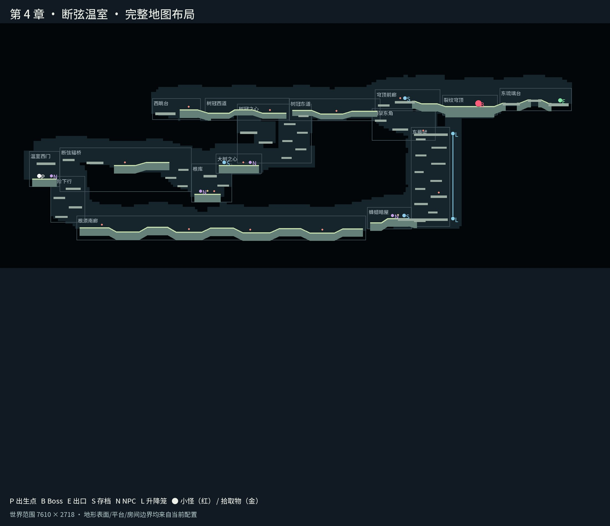

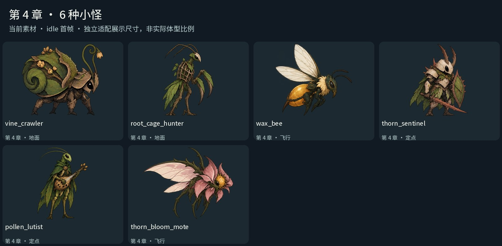

[洞穴实机画面](../../artifacts/cave_exploration/ch04_cave.jpg) · [升降笼实机画面](../../artifacts/cave_exploration/ch04_lift.jpg) · [前轮改版 Boss 画面](../../artifacts/pilgrimage_overhaul/demo_ch04_broken_string_greenhouse_boss.png) · [章节配置](../../godot/data/demo_ch04_broken_string_greenhouse.json)

| 小怪 ID | 活动类型 | 完整动画图集 |
| --- | --- | --- |
| `vine_crawler` | 地面 | [atlas.png](../../godot/assets/sprites/original_creatures/vine_crawler/atlas.png) |
| `root_cage_hunter` | 地面 | [atlas.png](../../godot/assets/sprites/original_creatures/root_cage_hunter/atlas.png) |
| `wax_bee` | 飞行 | [atlas.png](../../godot/assets/sprites/original_creatures/wax_bee/atlas.png) |
| `thorn_sentinel` | 定点 | [atlas.png](../../godot/assets/sprites/original_creatures/thorn_sentinel/atlas.png) |
| `pollen_lutist` | 定点 | [atlas.png](../../godot/assets/sprites/original_creatures/pollen_lutist/atlas.png) |
| `thorn_bloom_mote` | 飞行 | [atlas.png](../../godot/assets/sprites/original_creatures/thorn_bloom_mote/atlas.png) |

## 第 5 章：黑曜巡礼路

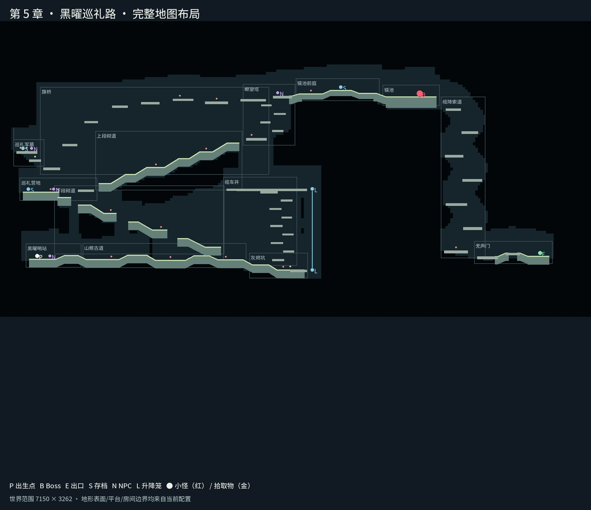

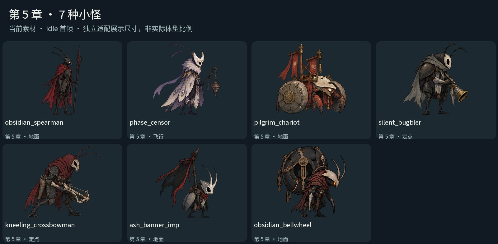

[洞穴实机画面](../../artifacts/cave_exploration/ch05_cave.jpg) · [升降笼实机画面](../../artifacts/cave_exploration/ch05_lift.jpg) · [前轮改版 Boss 画面](../../artifacts/pilgrimage_overhaul/demo_ch05_obsidian_pilgrim_road_boss.png) · [章节配置](../../godot/data/demo_ch05_obsidian_pilgrim_road.json)

| 小怪 ID | 活动类型 | 完整动画图集 |
| --- | --- | --- |
| `obsidian_spearman` | 地面 | [atlas.png](../../godot/assets/sprites/original_creatures/obsidian_spearman/atlas.png) |
| `phase_censor` | 飞行 | [atlas.png](../../godot/assets/sprites/original_creatures/phase_censor/atlas.png) |
| `pilgrim_chariot` | 地面 | [atlas.png](../../godot/assets/sprites/original_creatures/pilgrim_chariot/atlas.png) |
| `silent_bugbler` | 定点 | [atlas.png](../../godot/assets/sprites/original_creatures/silent_bugbler/atlas.png) |
| `kneeling_crossbowman` | 定点 | [atlas.png](../../godot/assets/sprites/original_creatures/kneeling_crossbowman/atlas.png) |
| `ash_banner_imp` | 地面 | [atlas.png](../../godot/assets/sprites/original_creatures/ash_banner_imp/atlas.png) |
| `obsidian_bellwheel` | 地面 | [atlas.png](../../godot/assets/sprites/original_creatures/obsidian_bellwheel/atlas.png) |

## 第 6 章：无声王冠

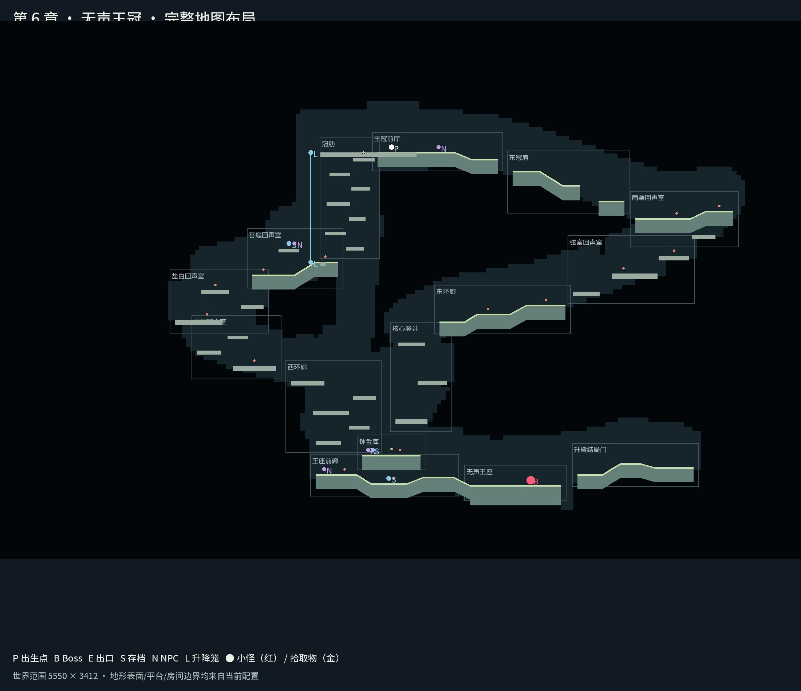

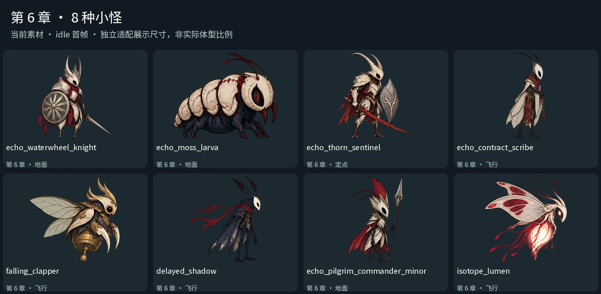

[洞穴实机画面](../../artifacts/cave_exploration/ch06_cave.jpg) · [升降笼实机画面](../../artifacts/cave_exploration/ch06_lift.jpg) · [前轮改版 Boss 画面](../../artifacts/pilgrimage_overhaul/demo_ch06_silent_crown_core_boss.png) · [章节配置](../../godot/data/demo_ch06_silent_crown_core.json)

| 小怪 ID | 活动类型 | 完整动画图集 |
| --- | --- | --- |
| `echo_waterwheel_knight` | 地面 | [atlas.png](../../godot/assets/sprites/original_creatures/echo_waterwheel_knight/atlas.png) |
| `echo_moss_larva` | 地面 | [atlas.png](../../godot/assets/sprites/original_creatures/echo_moss_larva/atlas.png) |
| `echo_thorn_sentinel` | 定点 | [atlas.png](../../godot/assets/sprites/original_creatures/echo_thorn_sentinel/atlas.png) |
| `echo_contract_scribe` | 飞行 | [atlas.png](../../godot/assets/sprites/original_creatures/echo_contract_scribe/atlas.png) |
| `falling_clapper` | 飞行 | [atlas.png](../../godot/assets/sprites/original_creatures/falling_clapper/atlas.png) |
| `delayed_shadow` | 飞行 | [atlas.png](../../godot/assets/sprites/original_creatures/delayed_shadow/atlas.png) |
| `echo_pilgrim_commander_minor` | 地面 | [atlas.png](../../godot/assets/sprites/original_creatures/echo_pilgrim_commander_minor/atlas.png) |
| `isotope_lumen` | 飞行 | [atlas.png](../../godot/assets/sprites/original_creatures/isotope_lumen/atlas.png) |

## 重新生成

安装 Pillow 后，在仓库根目录运行：

```sh
python tools/render_current_gallery.py
```

生成脚本只读取当前配置与素材，不修改运行代码。输出清单与配置 SHA-256 见 [index.json](../../artifacts/current_gallery/index.json)。旧 `artifacts/godot_showcase` 中的历史总览与 LFS 占位文件不作为本页的展示来源。
