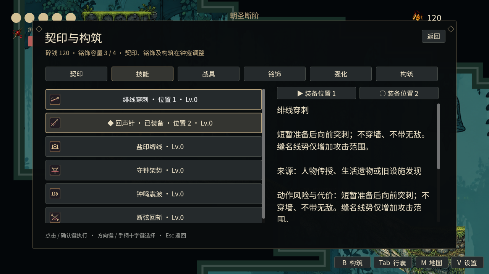
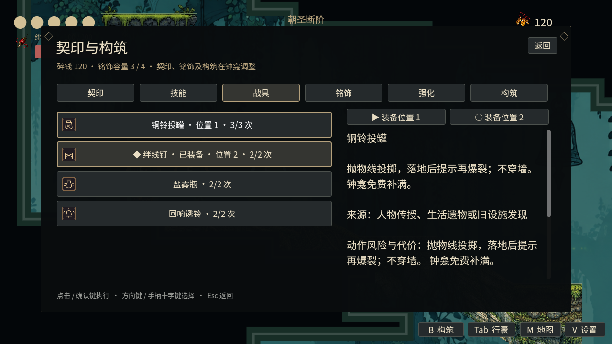
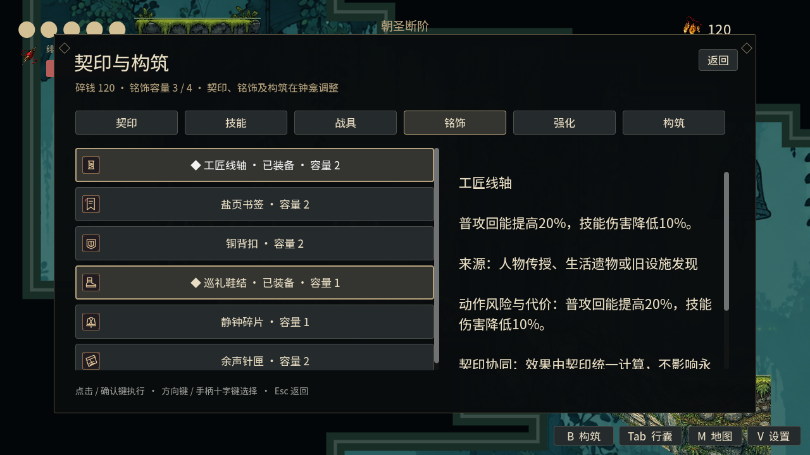
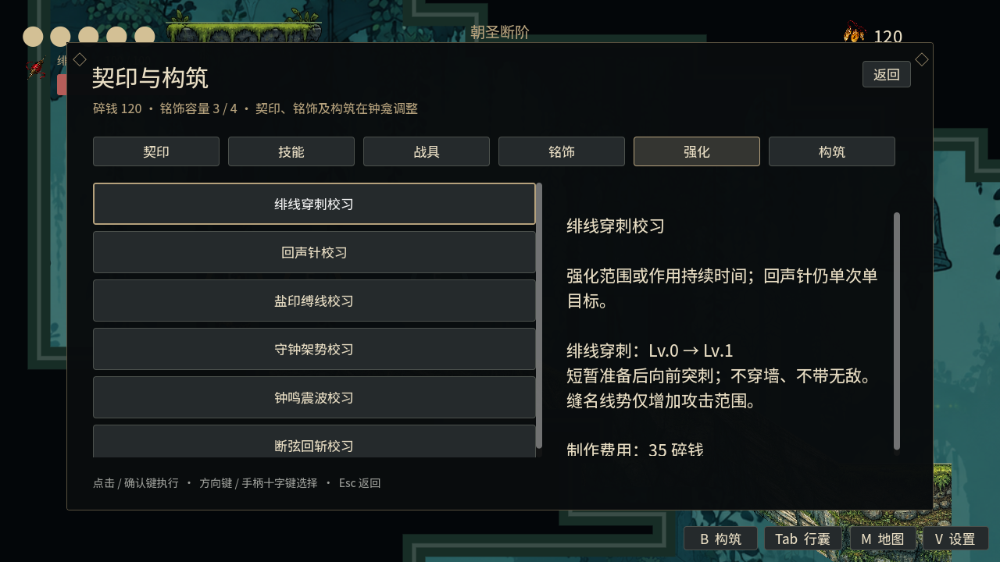
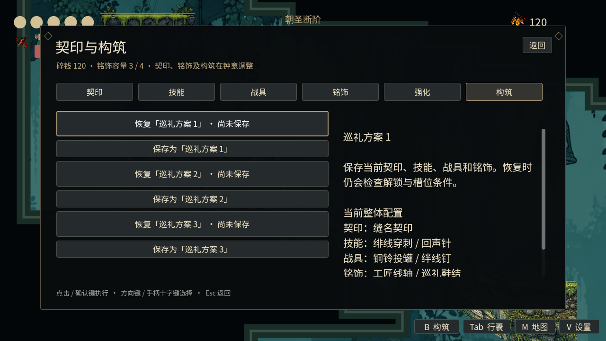
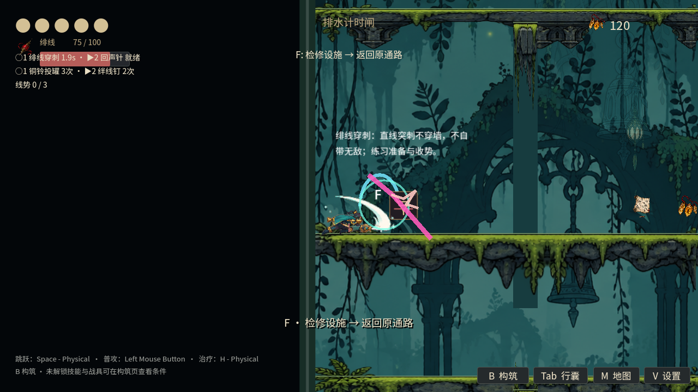

# 契印升级 · 实际 World 画面

> 历史图册：此页保留2026-10-11当时的画面与规则，不代表当前槽位、补给或世界布局。[查看2026-10-15当前实机图](20261015_current_world.md)。

2026-10-11，Godot 4.6.1、1280 × 720、Compatibility 渲染。全部图片来自实际 `World.tscn` 的场景、玩家、HUD 和运行时构筑界面，没有使用 MockRuntime 或概念图。

展示使用隔离存档，预置获得进度、货币和配装，便于展示所有页面；技能截图执行真实付费动作，练习画面使用实际练针架。图片用于展示当前版本，不是正常获得流程或带伤全流程通关证明。

## 场景与双槽 HUD


## 契印


## 技能



## 战具



## 铭饰



## 强化



## 构筑方案



## 实体练习工房


## 绯线穿刺有效阶段



## 重现截图

使用图形模式启动，引擎需有可用显示器；将用户目录设为临时目录以隔离展示存档：

```sh
XDG_DATA_HOME=/tmp/pilgrimage-showcase godot --path godot --audio-driver Dummy --script res://scripts/capture_seal_world.gd -- --capture-output=/absolute/output
```

旧的 [26px 六页布局截图](../SEAL_VALIDATION.md) 使用独立 UI 测试夹具，保留用于布局回归，与本页实际 World 图片分别标注。更多功能证据及人工验收缺口见 [契印验收](../SEAL_VALIDATION.md)。
