# 绯线巡礼 · 归途手札 UI

Godot 4.6.1 实际运行 World.tscn 的界面截图。采用隔离展示存档，预置获得进度；不作为正常获得流程或通关证明。对话文字用于展示阅读布局。PNG 原图由捕获脚本生成，此处提交 JPEG 以减小仓库体积。

视觉来自针、线、铜钟、旧物与被抹去的名字：墨青底、骨白字、旧铜刻边和绯红缝线。HUD 使用针形生命刻印、当前契印图标、真实能量与双技能／双战具状态。菜单采用同一套缝线框、阅读分区、焦点和选中状态；世界在菜单后暗化。

## 战斗 HUD

## 契印

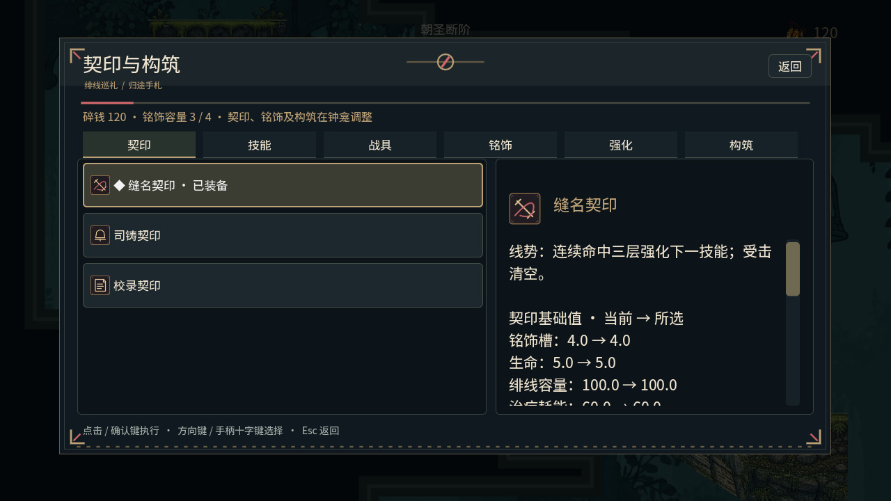

## 技能

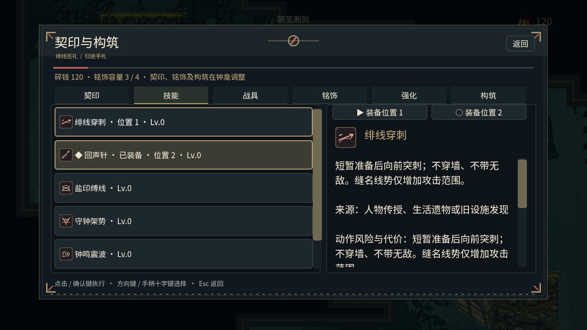

## 战具

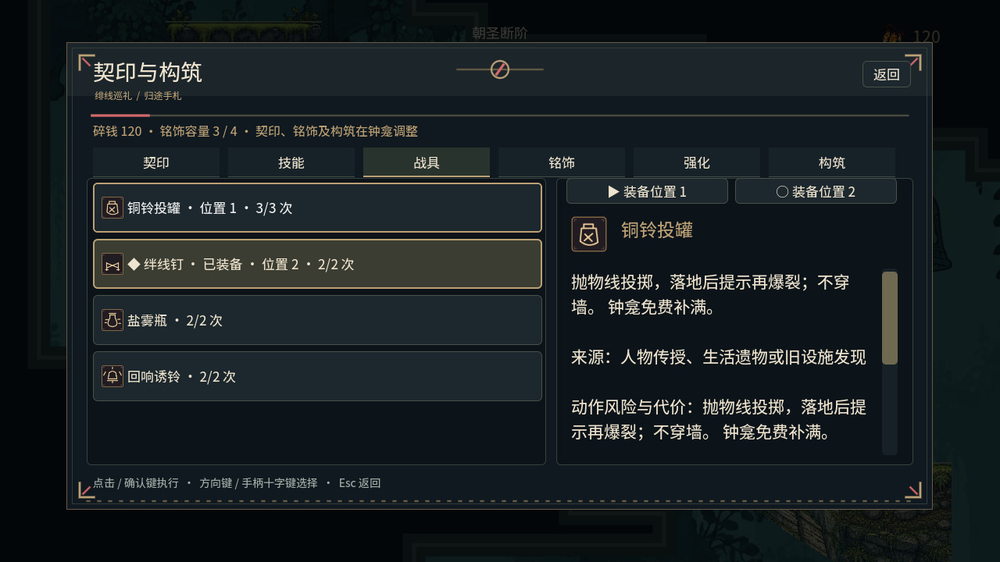

## 铭饰

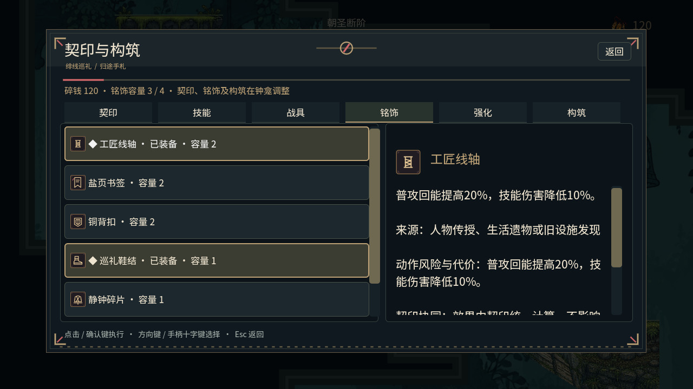

## 强化

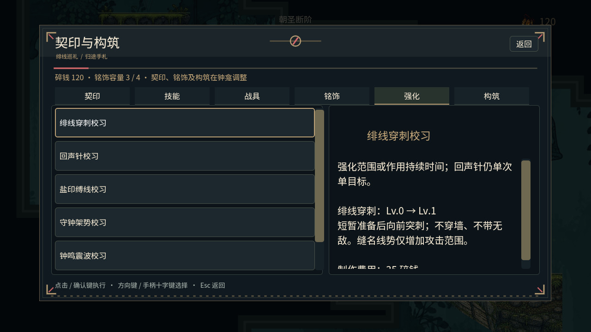

## 构筑方案

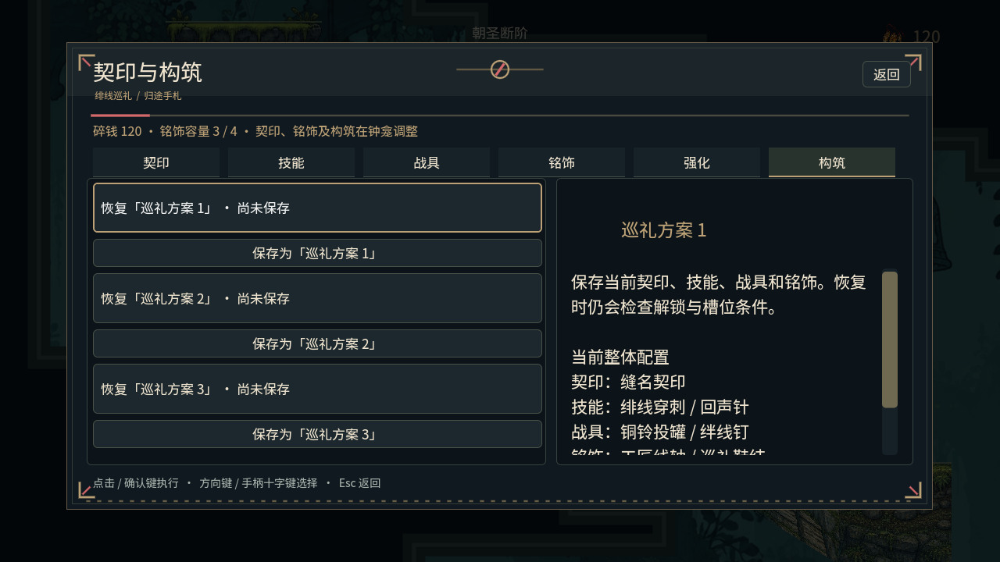

## 分类行囊

## 旅记与证词

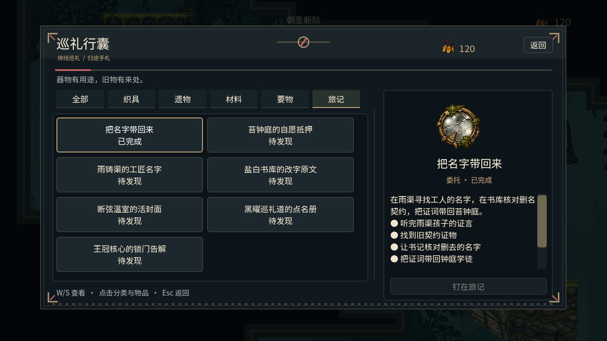

## 区域地图与愿板

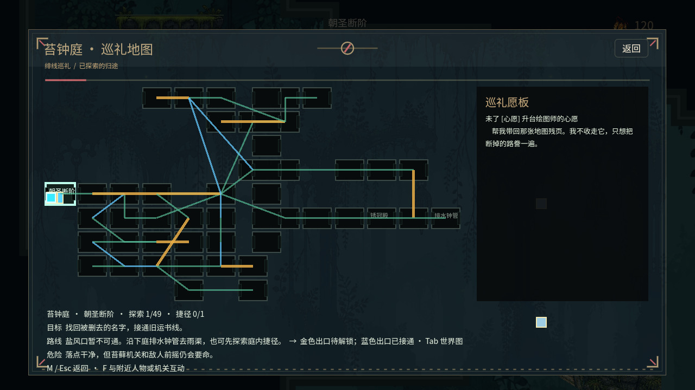

## 设置、重映射与存档

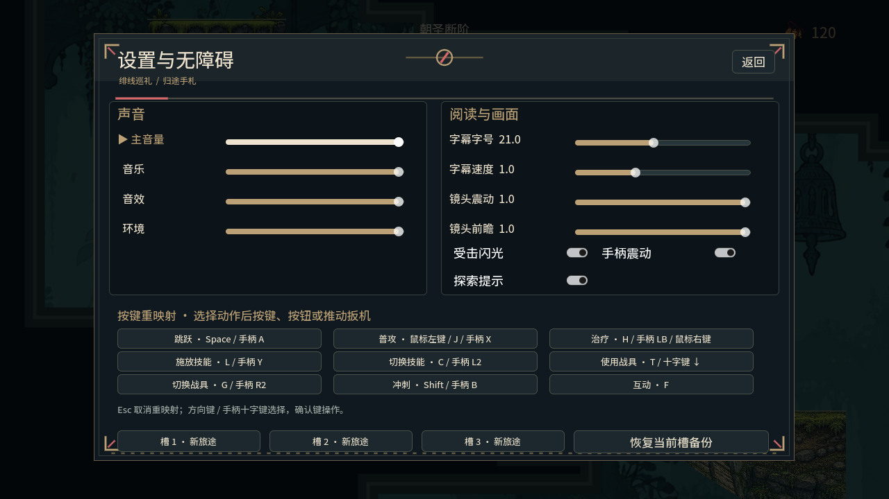

## NPC 对话

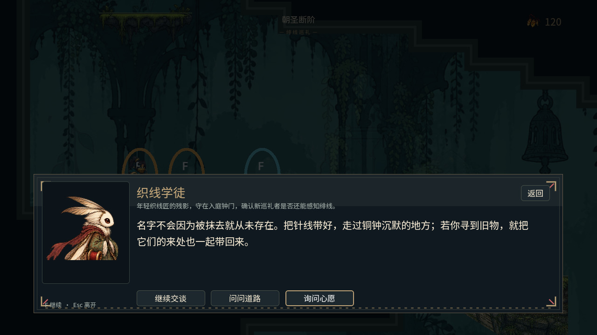

## 26px 对话

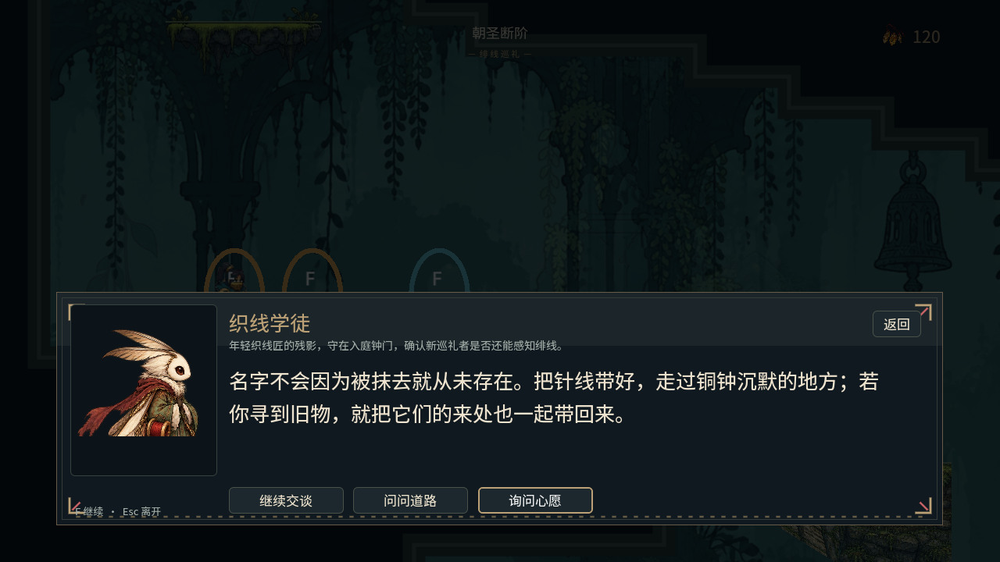

## 低生命状态

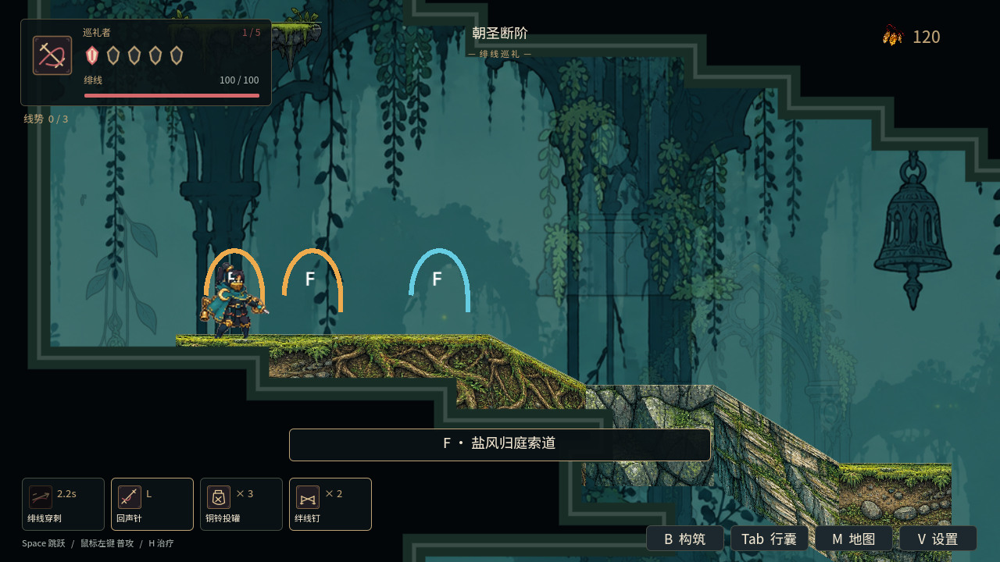

## 超宽窗口行囊

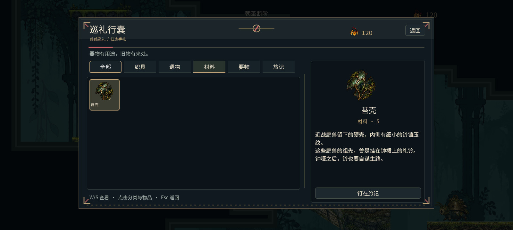

## 练针区

## 技能动作

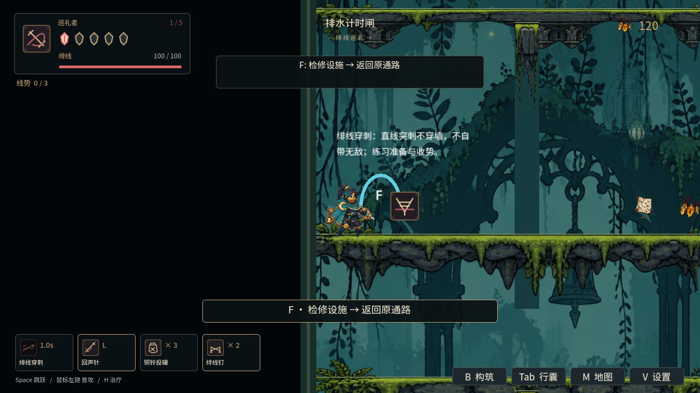
