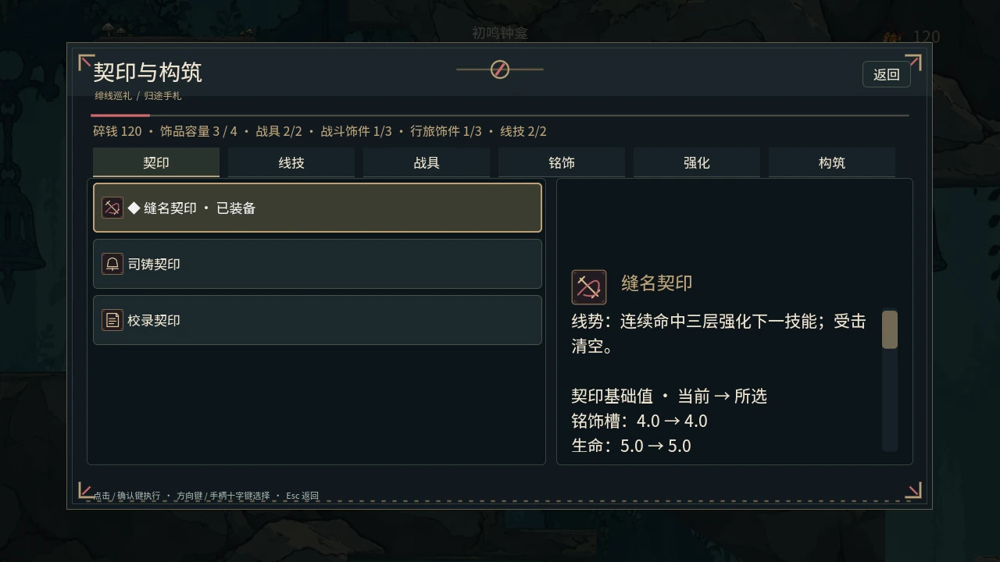
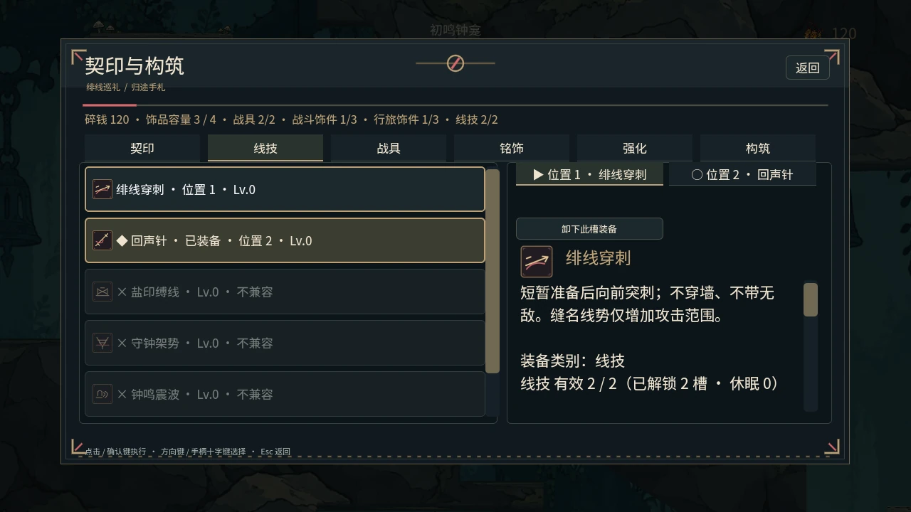
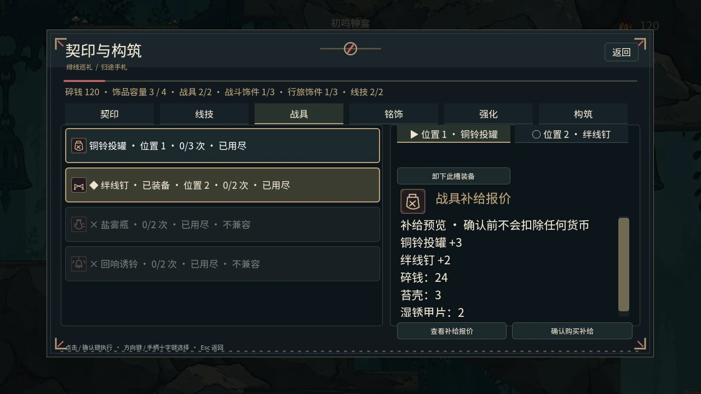
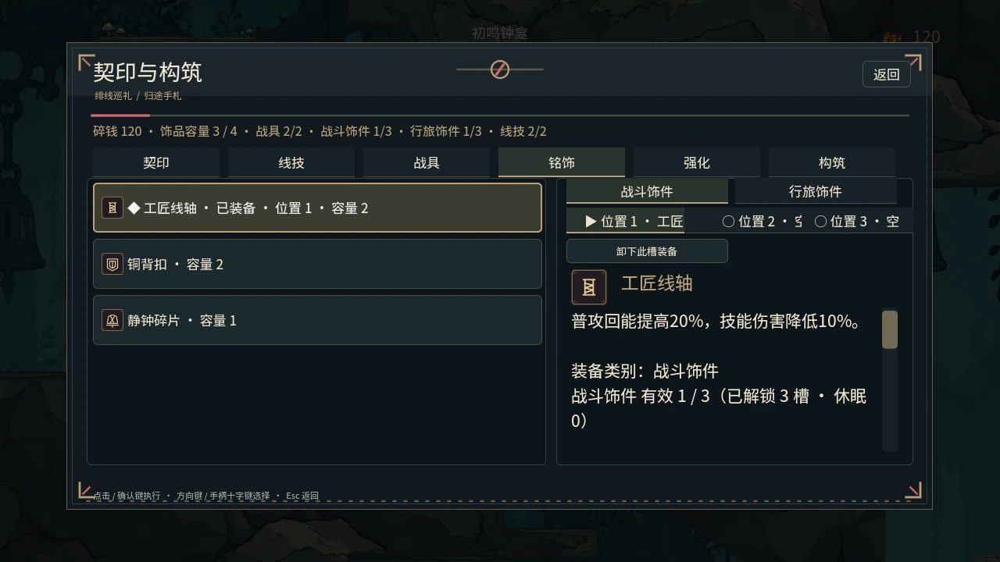
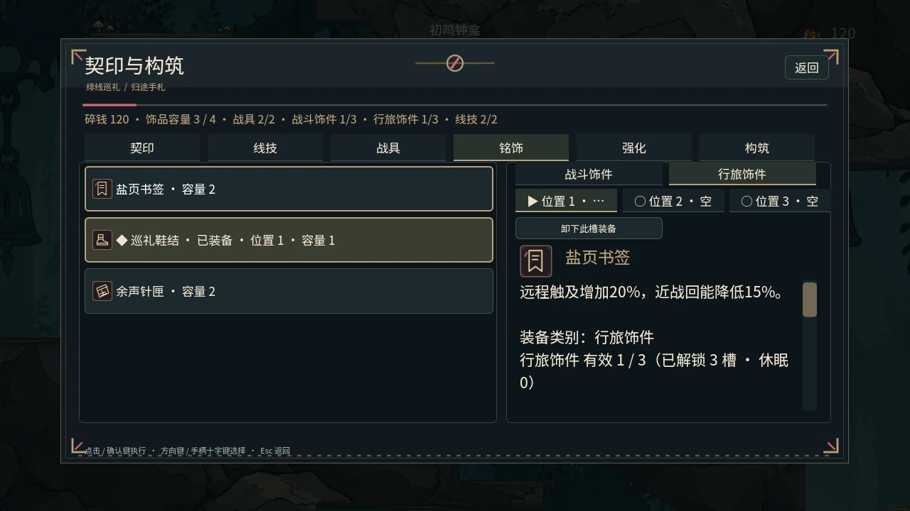
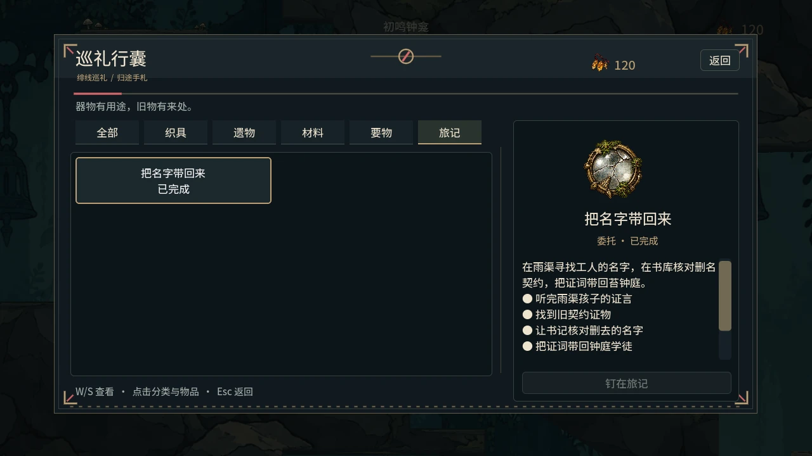
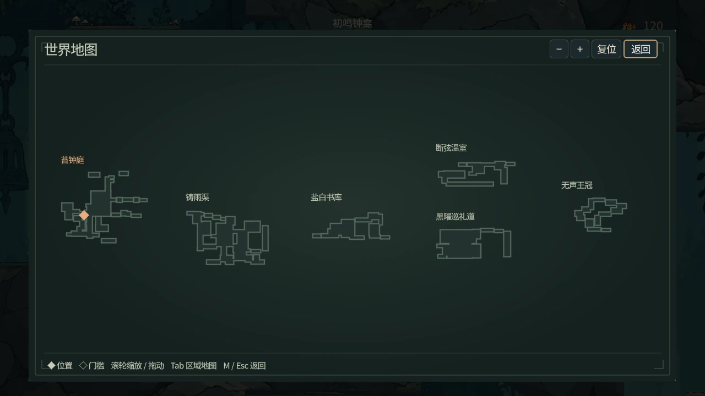
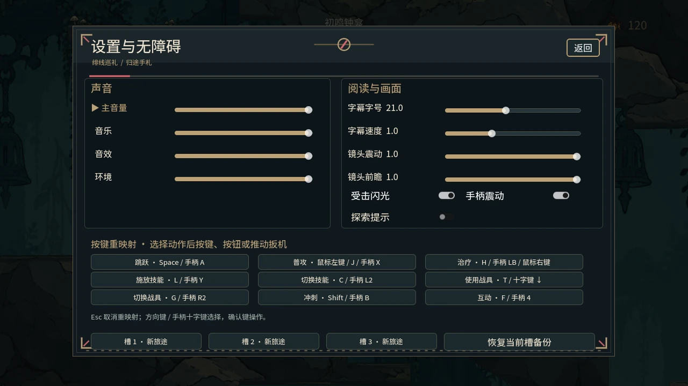
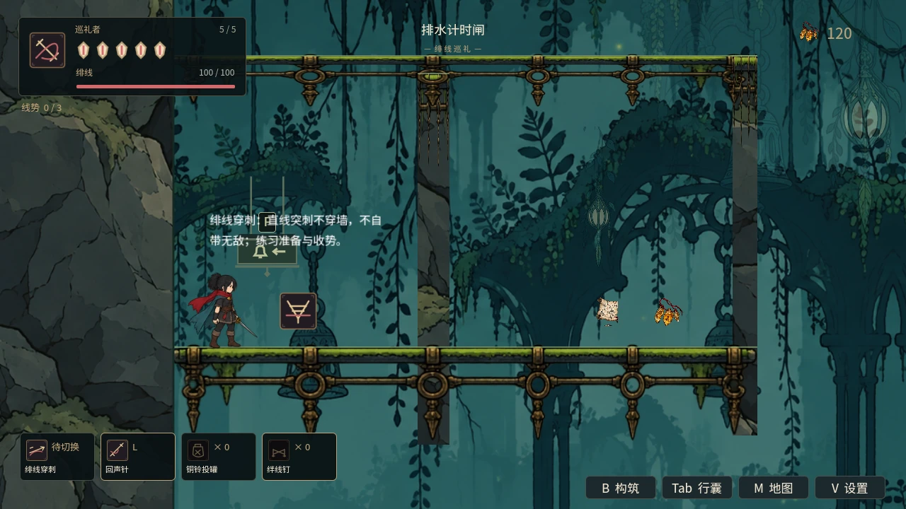
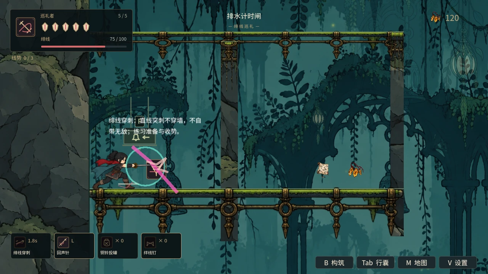

# 当前 main 实机界面（2026-10-15）

本组重新运行 main `03b4919c6fa0e755349d5b303c0f984f81ac64dc` 的 Godot 4.6.1 / `World.tscn` 生成，1280 × 720，Compatibility / Mesa llvmpipe。不是概念图或旧图改名；当前提交之后未合入的 PR 不在本组范围内。

使用隔离展示存档：装备解锁、材料、货币、地图所有权和练针架定位由夹具设置；补给、面板与技能调用现有生产入口。地图只授予底图，不揭示隐藏房间或伪造探索完成。构筑取样在真实钟龛旁暂停角色物理，玩法取样恢复物理控制。这些图片只展示界面与局部场景，不证明自然获得、六区通关或完整测试通过。

## 复现

先导入 Godot 工程资源，再用有图形输出的 Godot 执行：

```sh
godot --headless --path godot --editor --recovery-mode --import --quit
godot --path godot --rendering-method gl_compatibility --audio-driver Dummy --fixed-fps 60 --script res://scripts/capture_readme_current.gd -- --capture-output=/absolute/path/to/captures
```

使用独立 `XDG_DATA_HOME` 可与个人存档完全分开。原始 PNG 以 WebP quality 90 / method 6 转换后提交，输出目录采用日期路径，避免沿用旧版图片 URL。

## 当前 World 场景与 HUD


## 分类行囊


## 契印



## 线技



## 战具与付费补给报价



## 战斗铭饰



## 行旅铭饰



## 构筑方案与装备槽


## 旅记



## 区域地图底图


## 六区世界地图底图



## 设置



## 练针架



## 技能动作



## 验证记录

两轮严格资源导入通过；真实 GL 截图入口完成，14 张输出均核对尺寸与内容，README 和本页的图片路径均存在。首轮缺少本地导入旁车文件导致字体无法加载，补齐并重新导入后重新运行；失败取样未发布。未修改游戏运行逻辑。
