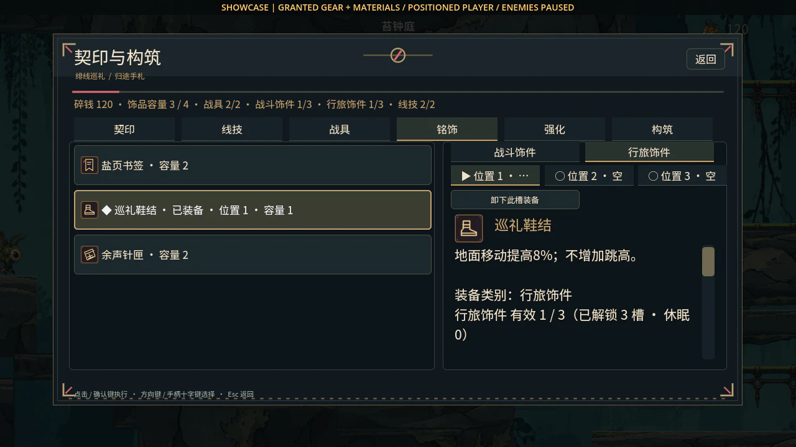
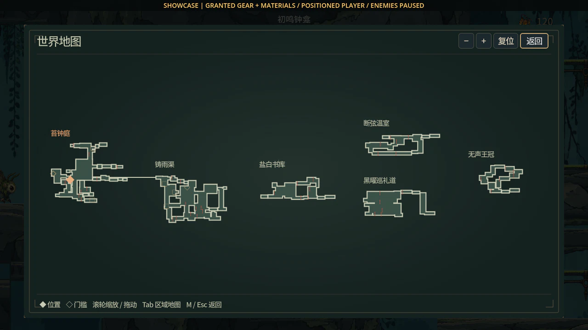
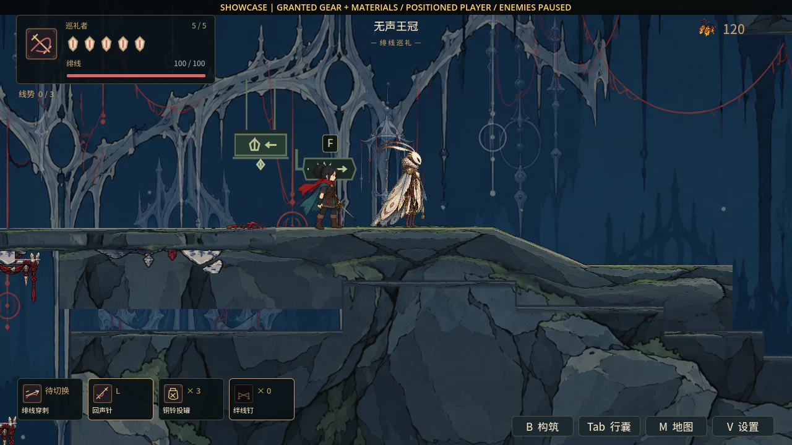
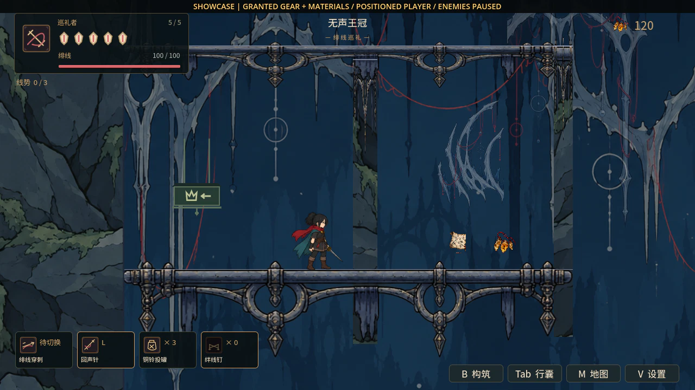

# World 场景与构筑实机图册 · 2026-10-15

> 本页保留PR #65基线的六张场景/构筑图。后续地图图钉工具栏与区域/世界图见[图钉升级](../MAP_PLAYER_PINS_UPGRADE.md)。

游戏运行时代码：PR #65 / `3841ae1d9b7151c291fec11caa262c947dce942d`。本轮使用 Godot 4.6.1 真实 OpenGL 渲染 `World.tscn`，1280×720，在绘制完成后直接保存帧。它是开发分支画面，不表示已合并 main 或已发布。

所有画面采用隔离展示存档，预置装备、材料、探索/购图等进度并定位拍摄；敌人/玩家可为稳定取景暂停。截图内有展示标记。自然获得、经济平衡、正常受伤和六区通关须看相应测试与后续人工流程，不能由这些展示图证明。保存候选和出发快照属于内部行为，本图册不证明其原子性或提速。

[截图逐项元数据与哈希](../../artifacts/current_showcase_20261015/verification.json) · [采集脚本](../../godot/scripts/capture_current_showcase.gd) · [完整剩余升级](../REMAINING_UPGRADE_ROADMAP.md)

## 当前场景与HUD

实际World场景、角色与HUD。装备和材料为展示预置，取景位置以采集记录为准。

## 付费补给报价

实际构筑界面的补给报价，展示费用、材料和可补数量。旧图中的免费补满属于历史机制。

## 行旅槽位

当前行旅分类槽、已装备状态与装备效果的实际界面；本图三槽均已解锁，不展示锁槽状态。装备取得进度为展示授予，不代表自然获得验收。

## 世界地图

实际地图组件与固定世界布局。可见程度来自展示档的购图/探索预置，不作为玩家未探索时的地图表现。

## 无声王冠

第六区实际场景与镜头构图，使用区域定位夹具；不是从新档自然走到第六区的记录。

## 王冠共鸣回访工房

王冠共鸣回访工房的实际定位取景，可见平台和奖励。能力预置与定位用于展示，当前帧不展示实际练习动作，不计自然回访链或完整战斗流程。

## 版本与验收

- 当前保存候选：70项新专项、13套相关本地回归，详情见[报告](../report/20261015_world_save_candidate.md)。
- 截图任务只验证画面真实、来源明确和无脚本/引擎错误，不复写完整玩法验收结论。
- 远端完整98套CI按精确head另行核对：[PR #65](https://github.com/superman2003/Crimson-Thread-Pilgrimage/pull/65)。
- 旧截图按日期保留：[2026-10-11契印](20261011_seal_world.md)、[2026-10-11界面](20261011_ui_redesign.md)、[2026-10-11素材/布局](20261011_current_assets.md)。
