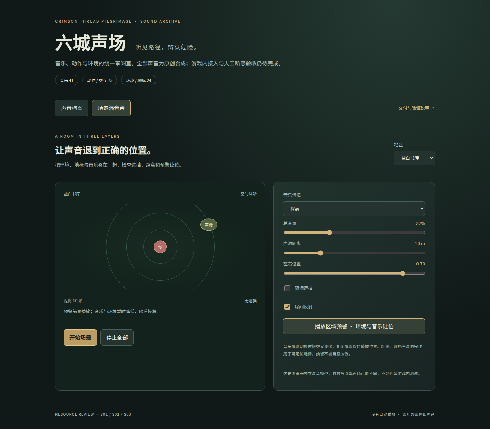

# 六城声场：S01–S03 音频资源整类交付

最初制作基线为 main `6544cceff5e812b5295b97204d7c55a4b8933de9`；提交前同步了已合入#39–#43的 main `6bf697b69463cab79418f2572ca3fad86bbbf198`，原有音效与新main逐文件一致，无需重复提交。本次把音乐、动作与交互声音、环境声音集中到一个分支和一个审阅入口；已有资源直接沿用，新缺口一次补齐。本次完成的是下表定义的**资源与独立审阅工具交付**，不是游戏内音频整体验收：运行接入、人工听感、设备混音仍未完成。

## 交付范围

| 类别 | 现有资源 | 本次新增 | 合计 |
|---|---:|---:|---:|
| S01 音乐 | 六区探索 / Boss 12首 | 战斗层6、钟龛休息6、终Boss乐章3、结局3、钟道3、支线5、人物/世界主题3 | 41首 |
| S02 动作与交互 | 六区预警、攻击主体/细节、受击24项 | 契印疗伤9、线术12、战具8、移动/死亡10、反馈6、地图NPC6 | 75项 |
| S03 环境与声音地标 | 本轮独立包不沿用旧环境音 | 六区各环境床1、设施循环1、稀疏事件2 | 24项 |
| **统一目录** | **36项** | **104项** | **140项** |

140条目录声音总计9,165,754字节。另保留旧包7条组合试听，不作为额外机制覆盖计数。音乐与环境为48kHz OGG Vorbis；短动作音效为48kHz单声道PCM16 WAV。所有新合成声音CC0-1.0；生成器、种子、乐谱事件、机制映射和检测记录随包提供。未使用第三方录音或真人配音；人物提示是非语义音色，不能代替中文对白或字幕。

- [补充音乐及29首角色映射](../audio_category_music/README.md)：17位叙事NPC、5条实际支线均有选曲建议；共享主题不意味着17首独立人物曲，也不代表已有运行事件钩子。
- [动作/交互声音及51项映射](../audio_category_sfx/README.md)、[事件覆盖表](../audio_category_sfx/coverage.md)：区分已存在音频key、信号与需要新增的事件来源。
- [六区环境与空间参数](../audio_category_ambience/README.md)、[mix_profiles.json](../../../assets/proposals/audio_category_ambience/mix_profiles.json)。
- 原有[12首区域音乐](../reverse_music_v2/README.md)与[24份战斗干声](../reverse_audio/README.md)原样保留。

## 使用统一审阅室

完整检出本分支，在仓库根目录运行 Python 3.10+：

```sh
python tools/proposals/audio_category/serve_review.py
```

打开 `http://127.0.0.1:8765/docs/proposals/audio_category/`。服务仅绑定本机，支持音频HTTP Range；不需要登录、游戏存档、Node或Godot。GitHub源码页不会运行HTML。本地直接打开HTML可逐条播放浏览器支持的音频；场景混音需使用上述HTTP地址。

声音档案可以按类别、地区和名称/ID检索，下载原始素材。播放默认暂停，切换停止上一条，保留试听音量。单条试听直接播放原文件，建议增益另外显示；它与场景混音的音量不是同一个标尺。

场景混音每次叠加一条音乐、一条环境床和一个设施地标，可选探索、Boss、休息或**战斗层独听**。本工具不把战斗层叠加到探索曲、不自动调度稀疏事件，也不模拟最终Boss整场切幕；这些资源在档案中单独审阅。情境切换为0.75秒等功率交叉淡化；同区等长探索/Boss曲保留相对循环位置，其余曲从头进入，未声称按小节同步。重复选择当前情境不重启。

距离使用profile的近/远界限与线性幅度衰减；隔墙低通、遮挡衰减、声像和合成房间反射仅作用于设施地标。六区最长4.2秒反射和预延迟均可预览。profile中的绝对增益只应用一次。预警使用旧包同区warning，压低环境和音乐后恢复；压低音乐是本审阅器的额外演示，环境profile原scope仍保持原意。初始总音量35%，上限70%；不会替用户调整系统音量。

切地区、切审阅模式、停止、页面隐藏和离页都会停止声音；解码中的旧请求不能复活已停止场景。已解码缓存最多四条。回到被浏览器缓存的页面后可重建关闭的AudioContext。



## 验证与复现

目录生成需要Python 3.10+和ffprobe。混音电平检查另外需要numpy/scipy/ffmpeg，各包重建依赖见相应tools目录。

```sh
python tools/proposals/audio_category/build_catalog.py
python tools/proposals/audio_category/test_catalog.py
node tools/proposals/audio_category/test_async_races.cjs
python tools/proposals/audio_category/validate_mix.py
```

浏览器验证需Playwright、Chromium及已启动的本机服务：

```sh
CHROMIUM_EXECUTABLE=/path/to/chromium node tools/proposals/audio_category/check_browser.cjs http://127.0.0.1:8765
```

`AUDIO_QA_OUTPUT`可指定报告与截图目录；不设置时只检查，不改文件。浏览器测试静音执行，不计人工听感。

2026-10-14检查记录：

- 140条目录音频逐一探测格式、时长、声道、文件哈希；路径越界、符号链接、LFS指针、错误声明与循环边界拒绝。正式目录要求六区完整有效mix profile。12项负向/边界回归通过。
- 5项异步竞态回归通过；在内存恢复5个旧缺陷时均能检出，未改动被测源码。涵盖resume中停止、切回当前曲、启动中换情境、旧预警回调与关闭context重建。
- [浏览器验证](browser_validation.json)：真实Chromium逐条解码140条声音，六区四种音乐状态、原生实际播放、音量保留、空间控制、预警恢复、取消、390px窄屏通过。截图为真实页面渲染。
- [混音电平验证](mix_validation.json)：六区×四音乐角色24组8秒合成场景通过，按70%总音量和额外叠加余量计算，最坏4倍重采样峰值约−10.647dBTP。此检查不是浏览器卷积输出的逐样本复刻，也不能证明感知遮蔽或听感通过。
- 新增三个包均实际做过完整二次重建，输出哈希一致；各包解码、峰值及循环/淡化检查见其验证报告。环境循环80ms端点整形可能产生短暂能量凹口，必须人工听审。

## 运行接入交接

沿用用户分工，本分支仅新增独立proposal目录，不改`main_level.gd`、`player_controller.gd`、`pilgrimage_interface.gd`、`world_config_validator.gd`、`world_region_loader.gd`、`audio_director.gd`、运行JSON、既有验证脚本或CI。

真正接入时仍需协调并完成：

1. 由运行脚本负责人按事件映射接入；部分弹体/区域效果没有保留skill_id，不能从现有hit回调正确推断来源。雾工具不能逐帧触发声音；取消疗伤不能残留成功尾音。
2. 统一既有总线、素材建议增益、用户音量和声部优先级，避免把建议增益重复叠加；验证切区取消、死亡、Boss阶段与退出的声音所有权。
3. 按房间实际坐标布置声音地标和遮挡；浏览器米制是抽象审阅单位，不能直接写入游戏像素坐标。稀疏事件需实际调度与限流。
4. 用耳机和扬声器试听，再做六区自然游玩、转场、对话、危险提示和终局混音验收。任何技术检查均不能替代此项。

本分支复用main中已合入#42的全部音频交付，并提供#44中的音乐部分，以供一次审阅；新增差异不重复包含#42，不包含#44的动作/场景资源。#44仍独立保留，未来合并时应避免重复提交其中音乐内容。本分支暂不合main，不发布游戏或宣传。
