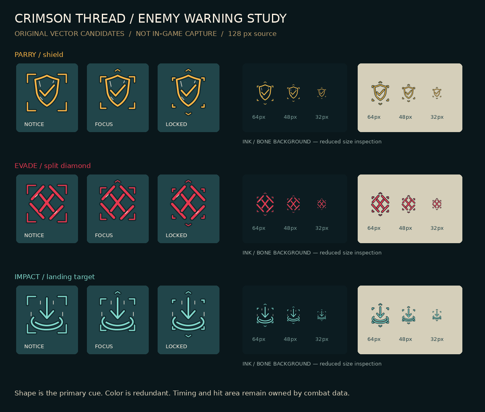

# 反向升级 · 敌方预警原创候选 v1

2026-10-14。**本批是可导入素材与人工审阅板，不是实机接入或战斗验收。**

## 范围与依据

检查现有 `godot/assets/ui/seals/{needle,mender,ward,crimson}.svg`、`artifacts/ui_redesign/world_hud.jpg` 和《20260726160500000_动作特效与打击感设计规格》§1.3、§4.2。现有界面采用墨青/旧铜/骨白刻线，预警规范明确可格挡琥珀、不可格挡绯红、环境落点白青。继承深墨描边、骨白短刻痕与不完全对称的手绘曲线，不重设计角色。

当前 `enemy_actor.gd::_show_telegraph` 使用指令色矩形且 `original_visual` 分支直接返回。本批补齐一种不只依赖颜色的**语义符号候选**；不宣称所有敌人现有预警都缺失，也不把符号当伤害范围本身。

## 交付

资源根目录：`assets/proposals/reverse_art/`。全部路径相对此目录。

| ID | 含义与主色 | 独立形状 | 图集 |
|---|---|---|---|
| `parry` | 已确认可格挡，`#FFB847` | 盾形 + 对勾 | `sheets/parry_sheet.png` |
| `evade` | 不可格挡、必须位移，`#E63950` | 断菱形 + 交叉斩痕 | `sheets/evade_sheet.png` |
| `impact` | 环境/延迟落点，`#7FD6CA` | 下箭头 + 椭圆落点 | `sheets/impact_sheet.png` |

每种包含 3 个 SVG 源文件、3 张 RGBA PNG 单帧、1 张横向 PNG 图集。`manifest.json` 给出机器可读规格。图集 384×128，三格各 128×128，依次 `notice → focus → locked`，无帧间距。单帧枢轴 `(64,64)`，外缘透明，straight alpha；最外描边距边缘至少 3px。没有背景、字样、预乘黑边、外部字体引用、SVG 滤镜或外部依赖。

图形语义主体全程可见，四角刻线逐段收拢；锁定阶段上下扣线闭合，避免纯颜色或高频闪烁承担唯一提示。不可格挡描边为 6px，可格挡/落点 4px，即规范中的 1.5 倍。墨青背衬 `#10272B` 在骨白背景上提供轮廓，骨白划痕只作小面积材质提示。

灰度下通过闭合盾形、断开的交叉菱形、向下箭头与横向落点三种轮廓区分，不依赖琥珀/绯红色差。低闪光模式可全程保持主体常亮，仅切换角线阶段或固定 locked 帧；本素材本身不含交替黑帧、亮度脉冲或全屏闪光，关闭闪光不应移除警告。帧名与以下时序均为候选挂接建议，未覆盖现有战斗规格。

## 待接入说明（本批未修改运行时）

1. 由接入者审核候选后复制到 Godot `res://assets/` 下。当前根目录 `assets/proposals` 在项目之外，不会自动改变游戏。
2. `Sprite2D` 使用图集，`hframes=3`、`vframes=1`、`centered=true`、白色 modulate、普通 alpha 混合；建议 Linear 过滤、关闭有损压缩、关闭 repeat。不使用 Add 混合，否则墨色背衬失效。
3. 建议屏幕高度 48–64px（scale 0.375–0.5，仍须按摄像机缩放验证）；32px 仅为压力预览，不作为默认目标尺寸。保留原精确伤害范围底纹，符号独立显示在敌人上方或实际落点上方，绝不可拉伸此符号充当碰撞框。
4. 只依据实际战斗可格挡规则映射 `parry`；不要按敌人颜色、名字或近战类型猜测。必须躲避的招式映射 `evade`；落点型映射 `impact`，落点符号不能隐含格挡承诺。若规则未知，先保留既有提示。
5. 帧序由既有 windup 驱动、一次播放、不循环。可先以进度 `[0,.4)、[.4,.75)、[.75,1]` 映射三帧。1.2s 必杀提示的末 0.2s 按规范保持 locked 常亮；短前摇不擅自延长，也不靠本图集伪造额外反应时间。这里是阶段图集，不是 24fps 连续手绘动画。
6. 环境/延迟招式必须跟随真实伤害落点。取消、死亡、脱战和转入 active 时按战斗状态清除，暂停时跟随战斗时钟。接入须同时检查 `_show_telegraph` 的 original_visual 绘制分支及 `_clear_telegraph` 生命周期，不可仅在被提前返回的路径加载图片。
7. 实机还需检查双敌重叠、明亮盐白关、暗色终章、摄像机拉远、UI 遮挡及双方 VFX 同屏。层级应遵循当前敌人渲染约定；本批不强行覆盖 z_index。

## 验收记录

- 9 SVG 成功栅格化；12 张 PNG（9 单帧 + 3 图集）可解码，精确尺寸、透明角点、alpha 0–255、边界未裁切及图集每格与单帧的 alpha 及可见 RGBA 一致（仅忽略 alpha=0 像素中不可见的 RGB）均通过。详情 `validation.json` 含 SHA-256。
- 人工查看彩色板：墨青与骨白背景，64/48px 主体轮廓可区分；32px 骨白划痕及角标明显细小，因此不建议低于 48px。
- 灰度板用于复核去色后的盾形、交叉菱形、下箭头落点区分；它不等于色觉障碍用户测试。
- 未运行 Godot、未验证碰撞提示一致性、没有实机帧率结论、没有主观可读性 A/B 用户测试。

[灰度审阅板](preview_grayscale.png)。重建：仓库根目录执行 `python docs/proposals/reverse_art/build_assets.py`，依赖 Python Pillow、Inkscape CLI、DejaVu Sans（仅预览文字）。素材为手工编写 SVG 路径，Python 仅组织源文件、调用栅格化、拼图和检查；未使用 AI 生图或编辑现有图像。无第三方视觉素材、新增许可依赖或角色设定变化。