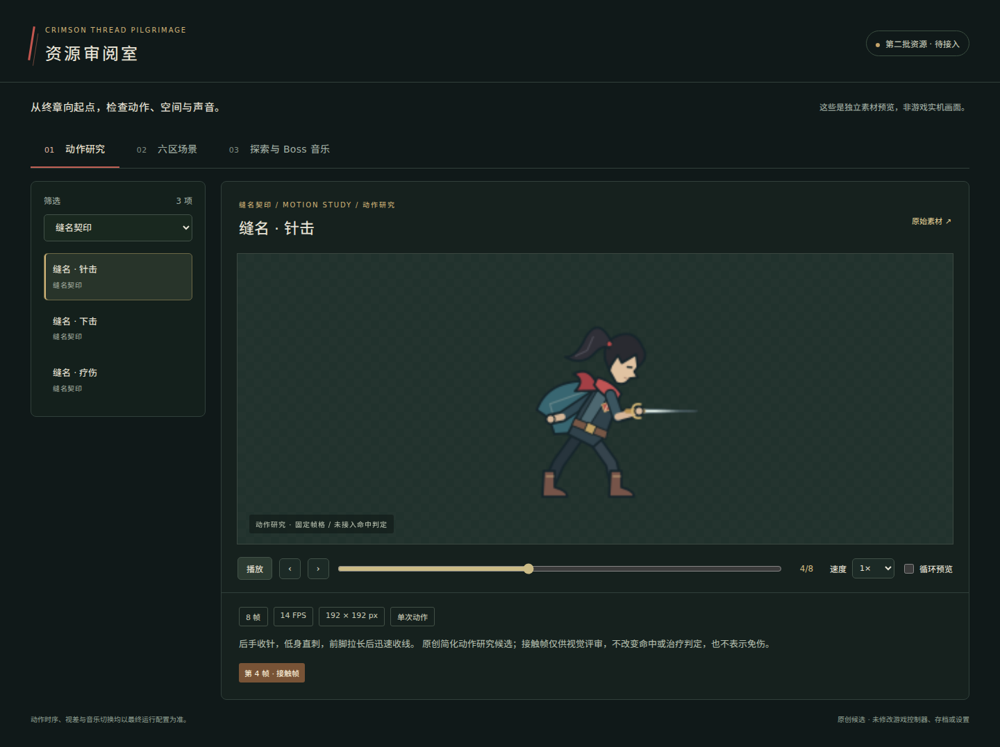

# 第二批资源升级：动作、场景与音乐

基线：main `6544cceff5e812b5295b97204d7c55a4b8933de9`，已包含 PR #37 的 World、控制与存档稳定性整合。本批继续按反向路线推进 V02/V03/S01，只新增独立资源、重建工具和审阅页；不改现有游戏代码、运行数据、验证脚本或 CI，不合入 main。

## 交付

| 任务 | 内容 | 原始资源与说明 |
|---|---|---|
| V02 动作表现 | 三契印各针击、下击、疗伤，9 套 × 8 帧；统一人物色板，用姿态、针轨迹和时序区分 | [动作说明](../reverse_motion_v2/README.md) / [manifest](../../../assets/proposals/reverse_motion_v2/manifest.json) |
| V03 场景层次 | 六区各远景、中景、边角前景，共 18 个原生 SVG；中央留白，不提供碰撞或落脚平台 | [场景说明](../reverse_scenery_v2/README.md) / [manifest](../../../assets/proposals/reverse_scenery_v2/manifest.json) |
| S01 音乐叙事 | CH06→CH01 每区探索与 Boss 编排各一首，共 12 首原创合成循环音乐 | [音乐说明](../reverse_music_v2/README.md) / [manifest](../../../assets/proposals/reverse_music_v2/manifest.json) |
| 资源审阅 | 逐帧播放、事件帧提示、契印/地区筛选、图层开关、静态视差、循环试听 | [打开审阅页](index.html) |

三名 GPT-6 Astra 子代理各自在独立分支制作资源；另一个 Astra 子代理只读复核接口、报告和审阅器。各资源提交在 `codex/reverse-media-upgrade` 中集中审阅，原分支保留，main 不变。



## 使用审阅页

下载本分支完整文件并保留目录结构后，用浏览器打开 `docs/proposals/reverse_media_v2/index.html`。目录数据内置于 `catalog.js`，不需要网络、登录、Node 或 Godot；音频需浏览器支持 OGG Vorbis。GitHub 的文件源码预览不会执行此页面。

若浏览器限制本地文件访问，可在仓库根目录启动仅本机服务：

```sh
python tools/proposals/reverse_media_v2/serve_review.py
```

访问 `http://127.0.0.1:8765/docs/proposals/reverse_media_v2/`。

此本地服务支持 HTTP 字节范围请求。普通 `python -m http.server` 不支持 Range，会导致 Chromium 对部分 OGG 估错时长、影响拖动定位；请使用附带服务或支持 Range 的静态服务器。

- 动作默认暂停。可单帧前后、拖动帧轴、调整播放速度；“循环预览”只是审阅器重播，不修改素材的 `loop=false`。
- 场景以 109% 比例绘入视口，为左右视差保留边缘余量；单独开关各层。背景图案不是碰撞地形。
- 音乐需要点击原生播放按钮，初始试听音量 40%。切换素材或分类停止上一首，离开页面暂停；原生音量控制与页内音量同步。曲目配对的分句对齐写在音乐说明中，本页不模拟游戏混音或无缝跨曲切换。
- 接触事件在 manifest 中是零基帧索引；页面向审阅者显示为第 1–8 帧。疗伤视觉重点不等于治疗生效、无敌或护甲时机。

## 重建目录与检查

所有路径相对资源包，目录构建拒绝越界、符号链接、缺文件、未水合 LFS 指针、重复 ID、错尺寸图集、越界事件帧及有外部引用/主动内容的 SVG。生成 `catalog_validation.json` 保留审阅引用文件的 SHA-256。

```sh
python tools/proposals/reverse_media_v2/build_review.py
python tools/proposals/reverse_media_v2/test_review_builder.py
```

目录构建只用 Python 3.10+ 标准库。各资源完整解码、栅格化、波形/循环与重建检查由对应包的独立验证器完成；目录检查本身仅核 PNG 头尺寸与 OGG 容器签名，不能替代解码或实听。

2026-10-14 验证：14 项目录/边界/HTTP Range 检查通过；官方 Chromium 151.0.7922.34 中 67 项浏览器检查通过，覆盖单次动作停止与事件帧、契印筛选、六区图层与视差、12 首 OGG 解码时长、实际播放进度、音量保留、切换停止及 390px 窄屏无横向溢出。无 JavaScript 运行错误或非预期资源加载失败，结果见 [browser_validation.json](browser_validation.json)。[场景截图](review-scenery.png)和[窄屏截图](review-mobile.png)均来自真实浏览器渲染，中文字体使用仓库已有 NotoSansSC 的本机安装，没有增加或修改运行字体。

可选浏览器检查需自行安装 Playwright 与 Chromium。启动上述本地服务后运行：

```sh
node tools/proposals/reverse_media_v2/check_browser.cjs http://127.0.0.1:8765
```

`CHROMIUM_EXECUTABLE` 可指定已有 Chromium 可执行文件；`MEDIA_QA_OUTPUT` 可指定截图和报告输出目录。不设置输出目录则只报告结果。浏览器测试静音运行，只验证解码/播放行为，不证明人工听感。

## 尚未接入的内容

动作是按当前 V3 身份线索重新绘制的简化矢量研究，不能无缝替代现有精细人物，也未改变命中、疗伤、取消、碰撞或位移。场景尚未放进六区关卡，Godot 原生 SVG 载入与静态留白检查不等同实机关卡可读性。音乐为原创程序合成，技术响度/峰值/接缝通过不等同耳机和扬声器实听或实机混音通过。

本批不宣布 46 个任务全部完成。后续接入要与负责控制器、运行数据和音频脚本的工作协调；上批 #38–#43 的候选也未因本 PR 自动接入。
