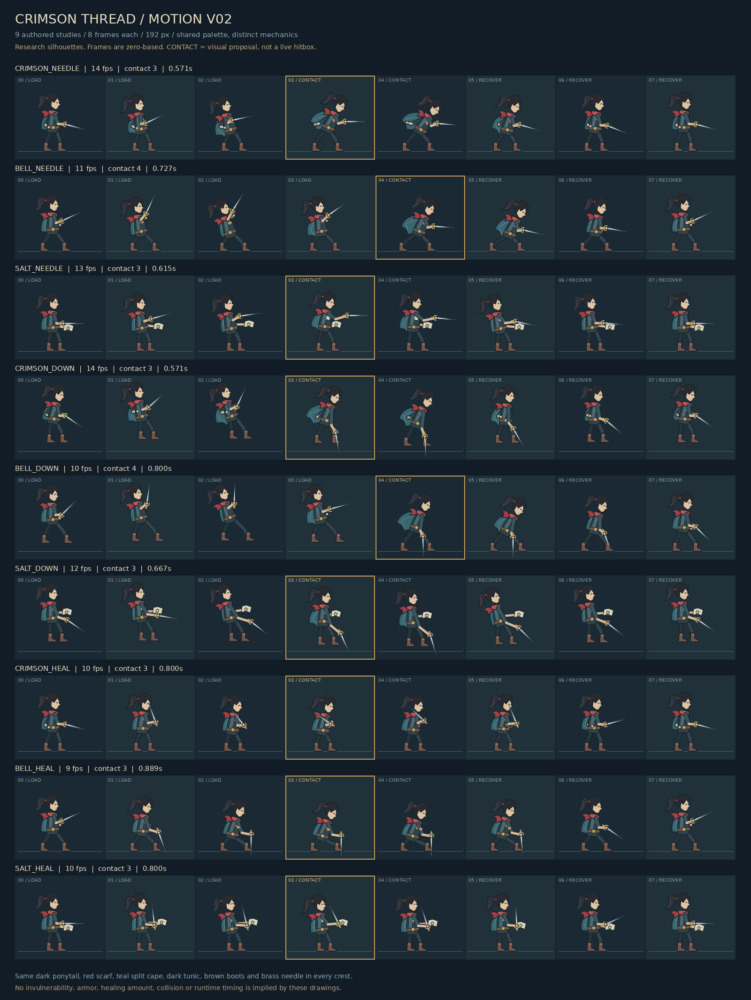

# 三契印原创动作研究 V02

这是待审资源包，不是角色控制器改动。基线为 `6544cceff5e812b5295b97204d7c55a4b8933de9`。交付 9 套动作、72 帧、9 张透明 PNG 图集及 9 张独立可编辑 SVG 源表。三契印使用同一人物、同一衣装色板，通过姿态、承力方式、针尖轨迹和收势节拍区分。



## 身份与适用边界

阅读了当前 `godot/assets/sprites/player/generated_hero_v3/manifest.json`，目检了其 `frames/idle_00.png`，并参考 `docs/HERO_HOOK_V4_SOURCE.md` 中的当前身份约束：深发马尾、红围巾、青绿开衩披衣、暗色内装、棕靴、金色针柄。V3 当前运行帧为 384×384、脚底基准 280；本研究重新绘制成 192×192，因此不能沿用其缩放与偏移参数。

更早的 `docs/spec/20260615154200000_主角独立设计去相似化说明.md` 提出灯笼头工匠，与后来的 V3 人物身份并不一致。本批依照后来的 V3 身份线索开展动作研究，保留人脸、马尾和工装，不使用白面具、角、昆虫拟人头部或第三方角色外形。本批没有覆盖或“统一”这些既有文档。

本人物是新绘制的简化矢量研究轮廓，细节密度与现有精细立绘不同，**不能宣称可无缝替换当前主角**。需先批准动作方向，再完成最终人物重绘和独立运行时集成。

## 三契印动作语言

| 契印 | 针击 | 下击 | 疗伤 |
|---|---|---|---|
| 缝名 crimson | 后手收针，低身水平直刺，前脚伸展 | 收膝引针，斜转竖直下缝，回弹收腿 | 左手牵衣前线结，右手穿缝拉紧 |
| 司铸 bell | 后肩承重，针柄上抬，两手合力压送 | 双手上举蓄重，竖直落针，宽脚低身承重 | 屈膝稳针架，左手压铜扣，再起身 |
| 校录 salt | 窄步抬腕校准高位，平刺后回撤 | 自身体侧斜下定点，左手保留校页 | 展开实物盐页，以针尖校读，再合页 |

针击的三条手部轨迹、下击的三条手部轨迹、疗伤的三条手部轨迹均不同，验证器检查几何数据差异；衣装没有按契印换色。胸前小五金图形分别为线结、钟扣、页签。校录持有的是实物书页，不是护盾。疗伤没有包裹身体的光罩或暗示免伤的遮挡效果。

## 帧布局与建议时序

所有图集单行 8 帧、每帧 192×192，实际尺寸 1536×192，RGBA 真透明。帧索引从 **0** 起。默认朝右；每帧公共原点 `pivot=[86,172]`。PNG 不包含辅助线，接触表的地线只是审阅标记。

| 动作 | FPS | 起手 ms | 接触 ms | 收势 ms | 接触帧 |
|---|---:|---:|---:|---:|---|
| 缝名针击 | 14 | 214 | 143 | 214 | 3–4 |
| 司铸针击 | 11 | 364 | 91 | 273 | 4 |
| 校录针击 | 13 | 231 | 154 | 231 | 3–4 |
| 缝名下击 | 14 | 214 | 143 | 214 | 3–4 |
| 司铸下击 | 10 | 400 | 100 | 300 | 4 |
| 校录下击 | 12 | 250 | 167 | 250 | 3–4 |
| 缝名疗伤 | 10 | 300 | 200 | 300 | 3–4 |
| 司铸疗伤 | 9 | 333 | 222 | 333 | 3–4 |
| 校录疗伤 | 10 | 300 | 200 | 300 | 3–4 |

表内毫秒取整；manifest 保存精确到微秒的阶段端点、持续时间及事件帧。疗伤“接触”指修补/读页动作达到视觉重点，不等于治疗生效帧。所有事件都只是视觉提案，未接入伤害框、治疗量、取消窗口、霸体、格挡或无敌帧。

站立针击和疗伤每帧两脚底均为 `y=168`；下击包含空中姿态，故脚底高度有意变化。每帧 `geometry.boot_soles` 和 `airborne` 明确记录其变化，公共原点不随裁剪漂移。司铸下击落到地面后保持低位承重，另两契印展示空中回收。这是视觉运动提案，不为控制器规定位移或着地检测。

手持针固定前伸 43px、后柄 9px，围绕 `geometry.weapon_hand` 旋转；针尖、手部、针柄末端、肩、髋和脚底均可从 manifest 读取。真实针绘制与这些坐标使用同一函数，避免武器和手脱节。大部分动作首末帧复用收起姿态，至少 7 个不同姿态；司铸下击为 8 个不同姿态。需要循环预览时应由审阅器重播，导入声明仍为 `loop=false`。

## 文件与重建

- `assets/proposals/reverse_motion_v2/manifest.json`：统一审阅 schema、资源路径、建议时序和逐帧关节点。
- `assets/proposals/reverse_motion_v2/atlases/*.png`：可按固定矩形直接裁帧的真透明图集。
- `assets/proposals/reverse_motion_v2/sources/*.svg`：完整矢量源表，`frame_0` 至 `frame_7` 分组；无外部图片、字体或 URL 依赖。
- `assets/proposals/reverse_motion_v2/contact_sheet.png`：有底色的审阅专用接触表，不作为运行图集。
- `tools/proposals/reverse_motion_v2/build.py`：原始姿态参数、原创轮廓与确定性生成器。
- `tools/proposals/reverse_motion_v2/validate.py`：限定本资源包的技术检查。
- `docs/proposals/reverse_motion_v2/verification.json`：此次技术检查结果与图集 SHA-256。

本次重建环境为 Python 3、Pillow 12.3.0、Inkscape 1.2.2。系统需安装 Inkscape CLI；字体仅用于接触表文字，使用系统 DejaVu Sans。生成器没有网络依赖。

```bash
python tools/proposals/reverse_motion_v2/build.py
python tools/proposals/reverse_motion_v2/validate.py --rebuild
```

`--rebuild` 比较重建前后全部 SVG、PNG、manifest 的 SHA-256；此环境通过逐字节确定性重建。不同 Inkscape/Pillow 版本可能产生不同压缩数据，请使用记录版本进行二进制复现。

## 验证范围

已通过 9 动作覆盖、72 帧固定尺寸、RGBA、真 PNG 标头、透明边界、每帧至少 8px 安全余量、每图小于 350KB、包含接触表的 PNG 合计小于 2MB、固定手持针长度与连接点、站立脚底坐标、逐阶段覆盖和事件定位、同动作三契印几何轨迹不重复以及完整重建校验。目检接触表确认姿态、披衣和身体不跨格；细针保留透明边缘，不以不透明背景冒充透明。

这不包括实机帧同步、命中判定、受击/疗伤平衡、碰撞框、运动根位移、动作取消、手柄体验或最终角色画风验收。本分支未更改任何现有运行脚本、数据、验证器或 CI。
