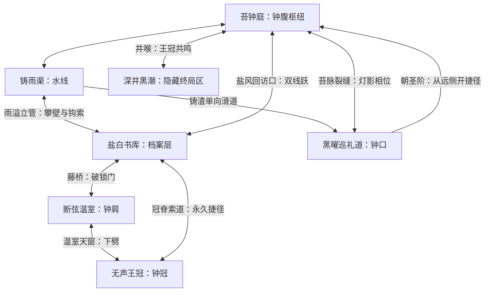

# 《空洞骑士》与《丝之歌》世界设计调研及运行时差距复核

日期：2026-10-11。核查基线：main `349de0d`，视野修正已通过 PR #10 合入 main（`8550a60`）。本文是调研与实施计划，不代表世界互联已完成。

## 结论

上一轮解决了实体地貌、洞道、连续步行和升降通路，未重构区域之间的推进结构。当前六区仍主要依赖击败本章守门者后单向换入下一章，因此玩家感受到的主体仍是分章动作平台流程。洞壁、地图面积和房间数量不会自动产生互联探索。

仓库已有互联世界、剧情和能力矩阵，缺口在运行时落地及验收。保留倒扣巨钟、失声契约、六区与六位守门者，先实现可回访世界，再按世界功能重做房间，避免再通过增加平台数量表现“内容丰富”。

## 调研依据与边界

1. [Team Cherry 在 PC Gamer 的地图设计访谈](https://www.pcgamer.com/how-to-design-a-great-metroidvania-map/)：2017 年访谈于 2025 年重新刊载。开发者从能力与世界结构的粗略顺序起步，逐渐拆开线性推进、减少硬性能力门；以十字路口为中心组织区域，保留安全的高手跳关。本文采用其开发者直接发言，不将作者或社区分析当成官方规则。
2. [ACMI 对 Team Cherry 的原始访谈](https://www.acmi.net.au/stories-and-ideas/from-ludum-dare-to-pharloom/)：2025-09-05 发布。开发者强调世界的自然逻辑，弱化传统固定钥匙顺序；圣堡的统治、建筑与资源关系影响周边地域。由世界功能推导场景和人物是重要方法。
3. [Team Cherry 官方系统介绍](https://www.teamcherry.com.au/blog/post-e3-wrap-silksong-systems-update)：2019 年开发日志，说明地图探索、人物对话与区域生态的关系；这是开发过程资料，不能当成最终版本所有细节的保证。
4. [ACMI 游戏世界展品介绍](https://www.acmi.net.au/works/125388--hollow-knight-silksong-game-worlds-acmi/)：支持圣堡与世界叙事相互关联这一观察。

需要纠正：互联世界不是每个区域直接连接所有其他区域；能力门不等于所有主线都排成固定钥匙序列。能力/道具门是严格访问条件；玩家因战斗、地形风险或信息不足暂缓进入，才是通常意义上的软引导。旧评估文档中的平均出入口、每区房间数、固定分钟数等未附实测资料的数字，不再作为樱桃社已验证事实。下文数字只表示本项目数据或拟议验收指标。

## 当前项目的实际证据

数据为 `godot/data/demo_ch01...demo_ch06*.json` 中的运行时配置；连接数只是 connections 元数据条数，不代表每条都通过物理通行验证。

| 区域 | 房间 | 区内连接记录 | locked_gates 实体能力门 |
|---|---:|---:|---:|
| 苔钟庭 | 42 | 46 | 9 |
| 铸雨渠试玩章 | 38 | 44 | 7 |
| 盐白书库试玩章 | 15 | 17 | 0 |
| 断弦温室试玩章 | 16 | 17 | 0 |
| 黑曜巡礼道试玩章 | 14 | 15 | 0 |
| 无声王冠试玩章 | 15 | 16 | 0 |

- 六区共 140 个房间、155 条区内连接记录。第三至第六区的实体能力门配置均为零。
- 前五区的 `chapter_transition` 依次指向下一章，第六区指向结局；当前 interactives 没有实际世界旅行或区域回访入口。
- `main_level.gd::_activate_chapter_exit` 默认依赖 `demo_complete`；`_transition_to_next_chapter` 新建下一场景并删除当前场景，按下一章默认入口落点。现有行为不能代替一对相互对应的区域门。
- 换章显式携带 story_flags、背包数量和货币；`_init_inventory_state` 清空已开捷径、已探索房间等局部状态。MetSys 有对象存储接口，但目前缺少已验证的完整区域回访与恢复链，不能仅凭框架存在宣称世界状态已完成。
- 第一、二区设置 ability_gated_start；第三至第六区未设置，现有 `_sync_player_abilities` 在缺省模式下直接开放冲刺和攀壁。部分工具由 starting_tools 发放，会削弱探索获得能力的意义。独立试玩的便利配置应与正式连续世界的获得规则分开。
- `_sync_player_abilities` 明确同步冲刺和攀壁两项。八能力蓝图中的钩索、二段跳、下劈破地面等需要分别验证真实动作与地形交互，不能把道具 ID、攻击动作或删除矩形墙当成全部能力已实现。
- 现有地图、NPC、证词与剧情数据值得保留。主问题是它们尚未与跨区回访、环境变化及多路线推进形成完整闭环，不是世界观文本完全不存在。

## 两作经验如何结合到本项目

| 设计层 | 项目采用的方法 | 玩家体验 |
|---|---|---|
| 世界位置 | 以倒扣巨钟的钟冠、钟肩、钟腹、水线、钟口、深井为真实区域关系 | 从钟庭能理解上方书库与下方水道的位置 |
| 互联骨架 | 苔钟庭作为枢纽，恢复已有跨区管道、立管、藤桥与索道规划 | 新区里打开门，发现回到旧存档附近 |
| 能力回访 | 先看见可辨认障碍，之后探索获得能力，再回去开路 | 新能力带来多个旧区目标，而非只开下一章 |
| 非线性选择 | 保留几条不要求新能力的路线，能力也能开启更短或更安全路线 | 暂时打不过一处，可以探索别处后回来 |
| 空间叙事 | 房间先明确原用途与当前灾变，再布置敌人、物品和路线 | 从泵房、运书道和根库推断巨钟运转代价 |
| 导航 | 地标、材质、声音、地图未通出口和 NPC 提示相互配合 | 玩家记住“那扇盐封高门”，而非依赖逐房 next 指令 |
| 世界记忆 | 保存各区 Boss、捷径、拾取物、NPC 任务阶段与站点状态 | 来回旅行不会重新刷出已拿能力或关闭已开捷径 |

## 沿用现有设定的互联目标图（规划，尚未落地）

这张图承接已有 `docs/spec/20260726150000000_绯线巡礼互联世界拓扑设计.md`，不是突然替换世界观。具体获得点与入口条件必须做可达性求解；例如双线跃如果在书库获得，就必须保留不要求双线跃的首访书库入口，不能让该能力成为通往自身获得点的唯一条件。

## 第一个可玩的跨区闭环

先做苔钟庭—铸雨渠—盐白书库的一段完整体验，再扩到六区：

1. 苔钟庭枢纽可见通往高层的盐风门，但当前跳不上去；同一枢纽仍有可通行的水道与探索支线。
2. 玩家进入铸雨渠，在立管支线获得攀壁，通过回环从另一侧开启通往钟庭的捷径。
3. 通过不要求双线跃的立管或原有书库入口进入书库，探索阅览支线取得双线跃。
4. 回到钟庭，跨过盐风高门，进入过去只能看见的上层通道；里面提供新的路线与证词，而不只是一个消耗品。
5. 新开的盐风通道成为书库和钟庭之间的长期捷径。NPC 因已发现的契约证据更新台词，地图保留门与探索状态。

此闭环包含首次拒绝、可选去向、能力获得、旧区回访、奖励和永久连接，才足以验证玩法方向。升降笼只服务无能力要求的交通井，不能绕过刻意设计的能力井；自动地面连接也必须避开能力门的绕行范围。

## 实施顺序与代码边界

1. WorldState：以 region_id 保存 Boss、拾取、捷径、任务、存档与站点，提供旧存档迁移。
2. WorldPortal：region_id、portal_id、目标区域/目标入口、条件与解锁方向；从 A 到 B 再返回 A 必须使用成对落点，不能全部落回出生点。
3. AbilityRegistry：统一拥有能力、动作启用、门条件、几何阈值与地图提示；正式模式不通过 starting_tools 补发关键能力。
4. 第一段跨区灰盒闭环：先完成三地区的门、支线、回环与实体路，再做装饰图与展示图。
5. 扩展第三至第六区：每个房间有明确空间用途；重做章节 Boss 对通路的约束，保留区域遭遇与终局条件，避免“每区必须杀 Boss 才能离开”。
6. 世界地图、交通站点和跨区 NPC 支线：最后接到已可游玩的拓扑，避免地图上画出运行时不存在的连线。

## 验收：同时检查图和真实玩家

- 从初始能力状态可到达至少两个有效探索目标；不能只增加无奖励死路。
- 不携带指定能力无法经过严格能力门；拿到后实测可以通过；关卡地形、升降笼、下劈反弹与新坡道不意外绕过门。
- 每次新增关键能力至少提供两处值得回访的旧目标（本项目目标，不宣称是两作官方数值）。
- A→B→A、跨三地区循环、死亡和重启后，拾取物、Boss、捷径与任务状态符合持久化规则。
- 对能力依赖执行状态图搜索，拒绝“自身门后放自身能力”的环形依赖。单向坠落必须有当前可用出口或明确安全返回。
- 检查地图连线与实际门户一一对应，出生和返程落点不在岩层、机关或 Boss 锁内。
- 人工玩完整首访—受阻—另路—拿能力—回访链；可达性脚本和“六章通关”测试不能代替路线选择的实际游玩评估。

## 与当前已交付内容的关系

实体岩层、连续地形、美术、敌人与剧情保留。PR #9 完成地貌升级；PR #10 修正普通区域视野。两者都没有宣称完成互联世界。本报告形成新的明确实施基线，后续应按上面的运行时闭环逐步交付，而不是再以图片、房间数或章节通关通过作为世界设计完成的证据。
