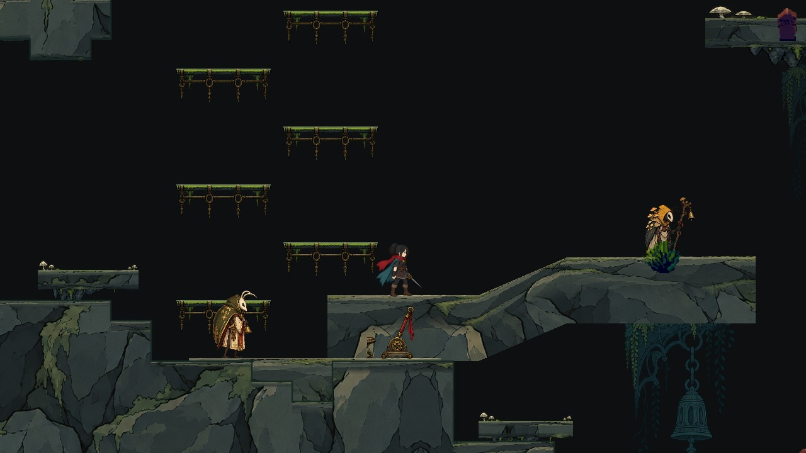
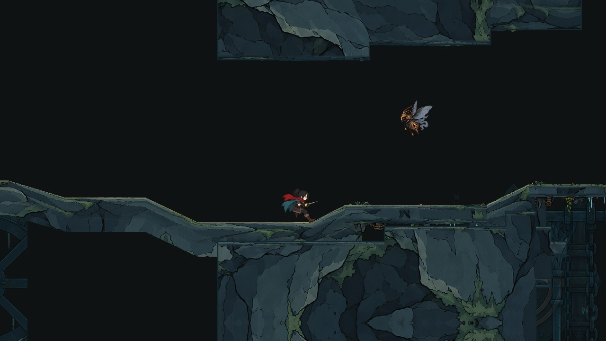
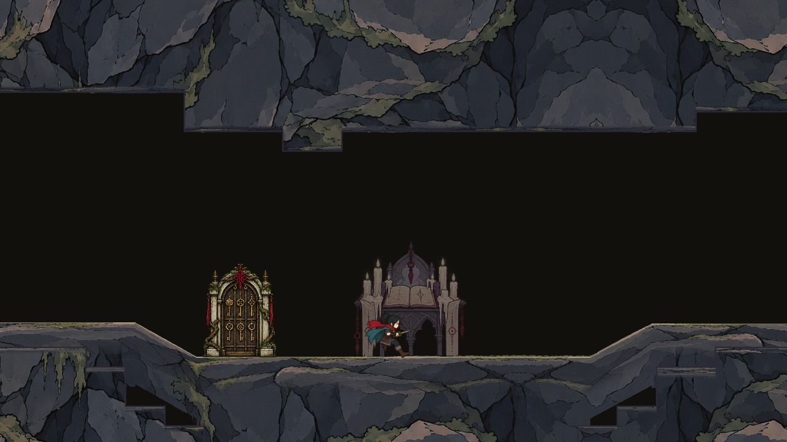
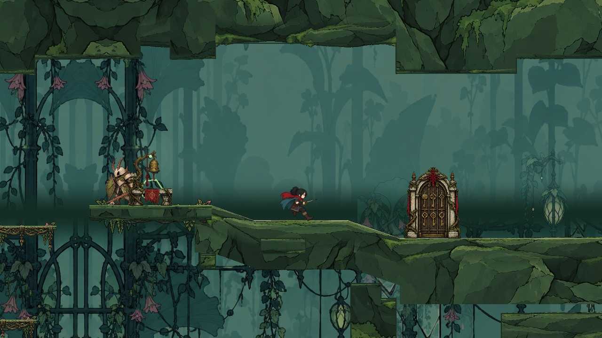
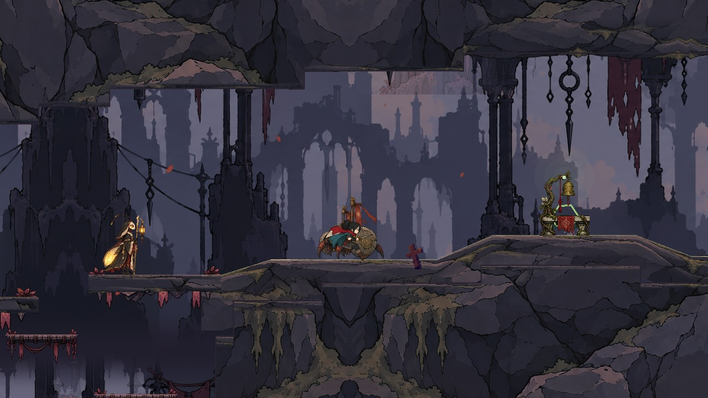
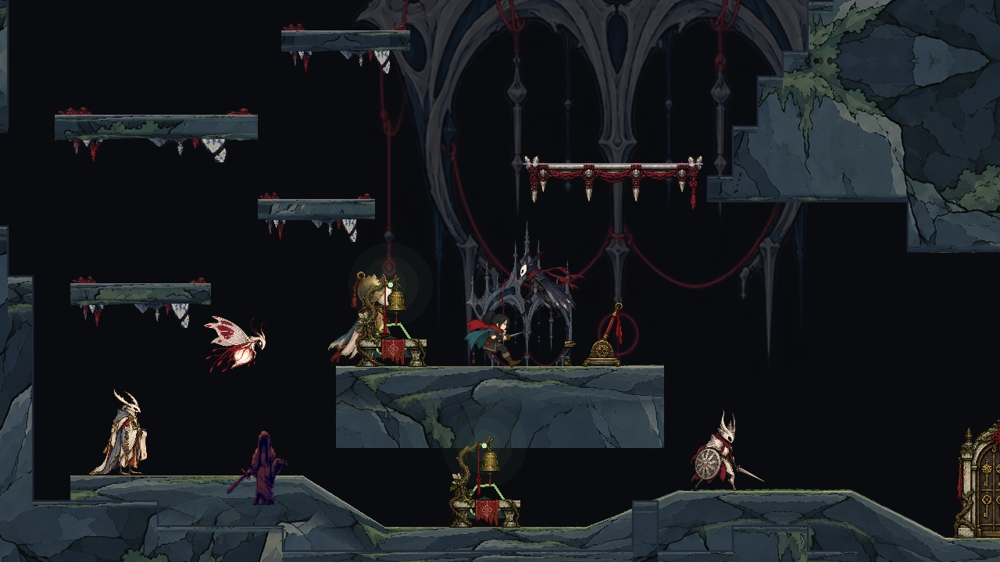

# 六区全部房间独立岩缘接入（2026-10-13）

承接2499f16。此前只有排水钟管接入独立顶壁/底壁原画；本批把同一素材族推广到六区全部房间的外露水平岩缘、地形坡面和石质平台。桥梁、金属机关与门保留相应材质，不套岩石皮肤。世界模式的20个新增检修/回访房间也使用同一创建路径；不是只修改基础章节试玩场景。

## 实现

- 对权威岩块矩形求外露水平边界，扣除被其它岩块覆盖的区间；相邻共线区间合并，重叠岩块去重，不在内部接缝画岩缘。
- 外露顶壁使用ceiling_ink_v1，底壁使用floor_ink_v1；原矩形体的边缘留出薄带，让透明轮廓实际替换硬切线。独立岩缘向岩体内部过渡为同一区域基底，减少整齐横缝。
- 地形/斜坡沿既有曲面采样线铺底壁，流式与常驻绘制走同一函数；石质平台接上下两种岩缘，原碰撞和特殊材质分类保留。旧亮色矩形描边收为低对比墨线。
- 洞穴岩缘按512px分段，只保留视野与迟滞范围内的节点；离开后释放。原碰撞驻留、远程查询、存档与取消恢复沿用。关键视野完整建好后再取样，非关键刷新每帧至多创建两条。

## 验证

- 世界模式六区共160个房间视野检查通过，新增11914项；外露支持、内部去重、视野完整驻留、远侧释放、驻留坡面岩缘与石质平台下沿均检查。
- 六区岩材1589项、异步切区358项、管道52项、普通平台15877项、洞穴碰撞129452项、地形碰撞2289项通过。
- 六区各两处实际GL取样共12处通过，岩缘显隐对照确有像素贡献；地形常驻/流式GL对照12处通过，像素差均为0。最终图形日志无ERROR或退出引用警告。
- 旧切区树计数把镜头历史导致的装饰迟滞数量差误计为内容差。本批比较固定岩缘描述，并额外强制当前镜头刷新后检查完整驻留；只排除标记为rim_chunk的视觉节点，原碰撞/敌人/存档/回滚检查保持。

## 边界

这表示全部房间的岩缘创建路径已接入，不表示160张专属原画或自然带伤通关。图形截图为定位夹具，暂停人物/敌人处理，UI隐藏；没有删除敌人，也未修改碰撞。初次图形夹具冻结音频造成退出引用警告，最终夹具先停止音频并解除流后取样，日志正常；不是整体T03完成。

岩缘节点峰值仅是驻留节点数，不是帧率/内存收益。新/旧几何准备和提交仍能超过2ms下一项准入预算，不能宣称无卡顿或预算严格完成。W00c共享物理洞口、相邻实体驻留、连续地图与T03/T04继续待验收。最终远端CI另行记录。

