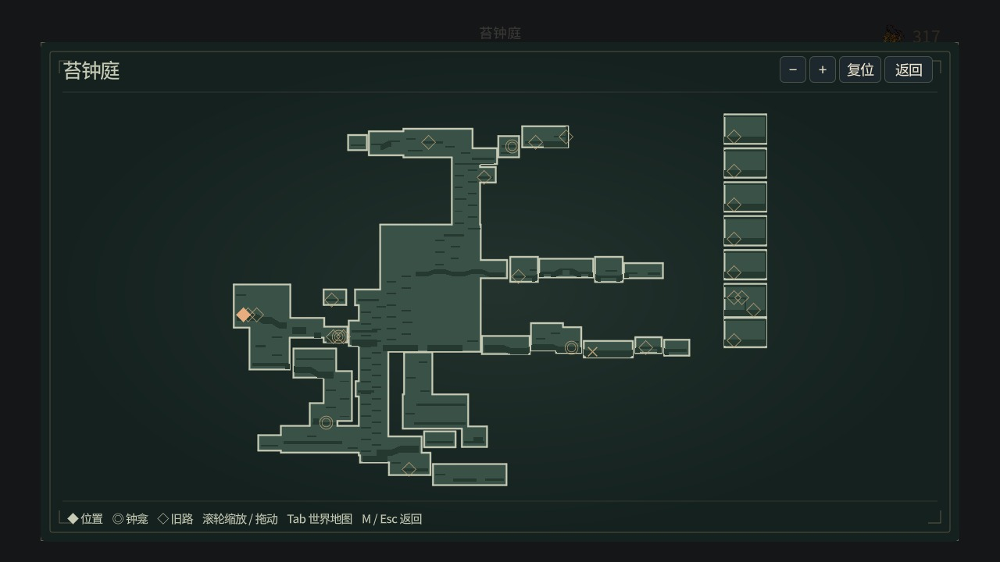
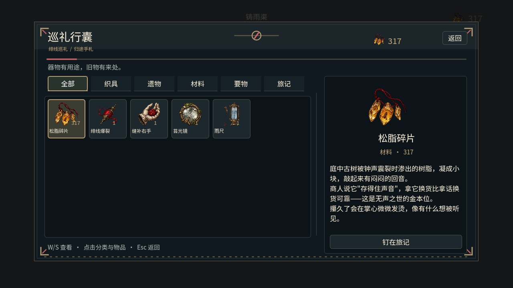

# W00b2b：切区提交阶段分帧与取消恢复

2026-10-13。基于正式 PR #29 的 `621f3a35d41ab24463d2374dd76133a243aa6a94`，后续分支 `codex/budgeted-region-commit`。按用户要求直接推进，不等待前一 PR 的 CI；本批本地结果与远端结果分别记录。

## 本批行为

旧加载器虽然已分帧卸载和构建地形，最后仍用一个同步 `_finish_region()` 恢复玩家、预热碰撞、绑定音频、创建全部 HUD/面板/行囊条目，再保存区域。本批把这段工作纳入跨帧任务计划；同步初始加载和同步回归复用相同任务顺序。

- 玩家/Camera、WorldState、BuildSystem 保留原实例。到达恢复、岩层/地形/平台预热、音频绑定、界面分区、逐项行囊、地图、NPC 购图窗口和新旅途窗口分别执行。
- 每批至多八个工作项；达到 2ms 后不再准入下一项。单个工作项不可抢占，仍可能超时。加载遮罩直到发布结束才移除，期间宿主停用、玩家碰撞屏蔽；半成品 UI 额外禁止 `_process` 和 `_input`。
- `committing` 阶段支持 Esc。几何未完、界面已部分创建，甚至界面全部建好但尚未发布时都可恢复出发快照。最后一批仍先让出一帧，检查取消/退树后才进入不可中断的 `publishing`。
- 愿板奖励、保存位置和加载代际在最终非让步边界提交。取消不发目标区奖励、不写目标落点；恢复源区后可正常继续与重启。保存仍使用既有原子写入契约。
- 地图复用一个独立 MSDF 字体及字形缓存；主题、面板和信号仍按区域创建/清理，字体不引用宿主。行囊按物品逐项创建，正常打开/刷新仍使用相同绘制函数。

永久探索能力与配装继续分开；构筑变更不会关闭探索能力门。本批未改世界拓扑或玩法数据。

## 验证

本地 **25 套相关 Godot 回归全部通过，零 ERROR/失败/超时**；逐套结果、引擎警告类别及源码/日志 SHA256 见 [验证摘要](../../artifacts/region_commit/verification.json)。覆盖切区/管道/邻区复用、存档、地图、UI/无障碍、构筑/纹章、叙事、音源退休、首领与六区场景。20 工房动作套件保留 403 项检查、真实 GL 资源后端和原有 180s 超时，只按前批既定方式关闭逐帧绘制。不是本批完整 63 套重跑；完整门禁和新像素探针均接入自动 CI，远端结果以最终提交为准。

- 扩展异步切区回归 **424 项通过**：六区几何/HUD/面板/行囊与同步构建一致；持久对象、生命、能量、钱包和冷却保留；分帧数量约束通过。
- 五处取消边界：卸载、地形构建、提交开始、部分 HUD、完整 HUD。后两处使用物理 Esc 输入。目标区已完成愿板为明确夹具：所有取消都不发 200 碎钱奖励，成功后仅发一次，回访/重启无重复。
- 三处退树边界：卸载、部分 HUD、完整 HUD；等待任务和根节点加载遮罩清理通过。部分 UI 的帧处理及快捷键调用不会提前开启菜单。
- 实际输入/真实 GL 44 项通过：完整双向排水钟管、正常受伤、攻击击败、一次 8 碎钱奖励、NPC 对话、钟龛恢复和存档重启。起始检查点为夹具；其后不开免伤，不算六区通关。
- 真实 Mesa llvmpipe OpenGL 的 **10 组 UI 对照像素差全部为 0**：苔钟庭/铸雨渠各 HUD、行囊、地图、构筑、设置。隔离 UI 视口且预置购图/补绘进度，属于暂停画面夹具。
- `npm test`、章节/世界路线/叙事/升级审计通过；运行器原有七项检查通过。

原始日志压缩包上传被自动审批拒绝，理由是可能包含环境信息；本 PR 改为提供不含该信息的验证摘要、游戏状态测量和真实 GL 夹具。完整原始输出保留在本地，未通过其它形式上传。

## 耗时记录与边界

同一 Godot 4.6.1/llvmpipe 环境的六区出生夹具记录如下。旧列来自上一批完整 GL 日志；新列来自本批扩展回归，均为一次测量，不能作为 FPS 或严格实时保证。

| 区域 | 旧同步尾部工作 ms | 本批最大提交批次 ms | 最终发布 ms |
|---|---:|---:|---:|
| 苔钟庭 | 305.12 | 34.90 | 4.51 |
| 铸雨渠 | 233.01 | 34.73 | 2.93 |
| 盐白书库 | 215.09 | 43.71 | 2.87 |
| 断弦温室 | 236.37 | 27.92 | 3.01 |
| 黑曜巡礼道 | 231.96 | 25.61 | 3.00 |
| 无声王冠核 | 212.48 | 22.59 | 3.09 |

提交计划为 38–39 项、22–23 批。分帧可响应取消，但会增加等待帧；本次尾部墙钟约 610–997ms，未宣称总装载时间缩短。完整工作耗时、逐项最大值、墙钟和最终发布分别记录，避免把等待时间或发布写盘隐藏在预算之外。

复杂界面分区、首次资源/字形加载、地图绘制、整树释放和准备阶段仍有不可抢占单项；地形构建也可能超出单帧准入预算。初始同步启动仍按原方式完成，没有改成可取消启动。旧 ObjectDB 退出警告继续跟踪，测试未将 WARNING 隐藏；所有 ERROR、非零退出和超时仍失败。本地并行 GL 探针曾因不同进程隔离环境无法共享端口探测而撞上 Xvfb display 90 的锁；改用独立 display 120 完成同一探针，CI 顺序执行无需该调整。

W00b2b 仅完成“提交阶段跨帧计划”子项，活动区敌人/NPC/交互空间驻留及更细单项预算仍待完成。W00c 的共享物理洞口、邻区同时驻留、消除出口整区加载及其它跨区实体连接仍未完成；T03 长期全游戏内存、T04 六区多路线带伤通关继续保留。

## 实际渲染界面夹具

以下为隔离视口的真实 GL UI，不是自然游玩截图：

下一批继续活动区玩法空间驻留及共享洞口原型；复杂 UI/准备任务还需更细拆分和实机帧时测量。完整连续世界和长期稳定性保持未验收。
