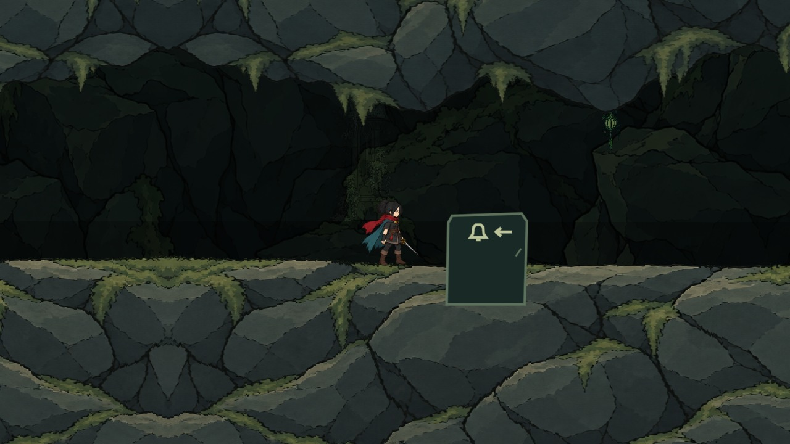
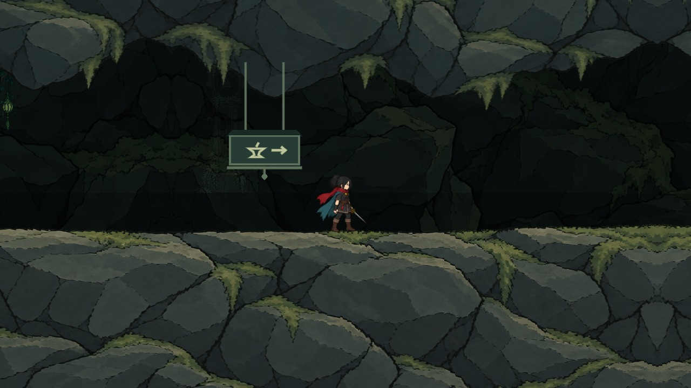

# 独立顶壁/底壁与多种路标（2026-10-13）

承接 PR #27 的 d67b3e2。原岩层带有写实细纹和硬高光，与主角的线描平涂不协调；管道顶底又由同一岩壁采样矩形裁切，造成明显横线与终点竖直截断。

## 实现

用内置 imagegen 重新绘制低对比、粗轮廓、大片哑光色阶的岩材。基础岩材用于六区岩层，按原区域主题赋予独立色调。顶壁和底壁分别生成：上方岩层自然下垂，下方岩层独立的石面/苔沿；不是把一张图片从中间切开，也没有用上图翻转代替下图。PNG 原图无损编码为 WebP，并逐像素核对一致。

本次先在首条排水钟管接入独立上下素材；其它区域统一基础岩材，但没有宣称全部房间都已逐间重画边缘。管道纹理透明轮廓独立于碰撞；底壁用从原图alpha提取的一维轮廓数据对齐行走面，残余起伏小于20像素，防止角色像站进岩层。顶壁保留原画自然轮廓。延长两端视觉到镜头外，消除终点整齐的竖直截断；没有改变原碰撞和终点装载流程。

路标提供立柱牌、落地石碑、壁挂支架、悬吊灯箱四种外形，允许数据用 sign_mount 明确指定；默认选择稳定，不随机跳变。管道两端分别用钟徽记石碑和砧徽记灯箱。火堆/钟龛仍共用火焰图标，交谈与购图等语义一致。每种交互只首次显示文字的存档规则沿用。

## 生成提示词与资源

提示词要点：平面手绘、干净墨线、大块哑光色阶、低细节密度、低对比苔绿/石灰蓝；禁止写实噪声、硬高光、文字与中央切割。上图要求岩体延伸到上/左右边缘、底部自然下垂并透明；下图独立构图延伸到下/左右边缘、顶部石面与苔沿并透明，明确禁止翻转上图。

工程资源：godot/assets/sprites/flat_maps/shared_ink/ 下的 rock_mass_ink_v1.webp、ceiling_ink_v1.webp、floor_ink_v1.webp；edges.json 保留原PNG哈希和独立生成标记。edge_profile.png 是技术轮廓数据，不是替代画稿。

## 验证与边界

受影响Godot检查、实际GL五处取样、岩材接缝检查与最终日志哈希见 artifacts/world_passage/verification.json 的 ink_cave_revision。两端和中段均保留实机截图，属定位夹具，不计自然通关。既有编辑器RID退出错误仍保留，T03/T04和W00c未完成项不改变。最终远端CI单独记录。

最终受影响三套Godot零失败（路标40项、管道52项、六区材质1589项）；此前平台15877项与洞穴碰撞129452项通过。最终真实GL五处取样零失败，岩材接缝12项通过。图形运行日志无ERROR，退出引用警告未新增；编辑器退出错误继续保留。
