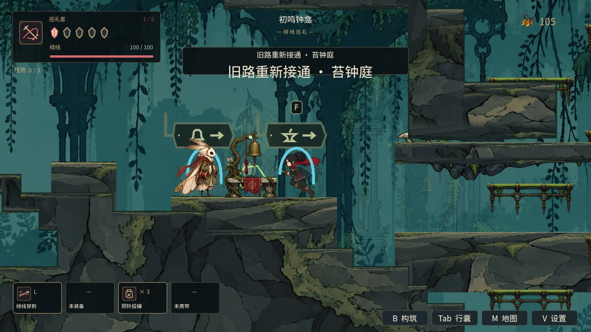
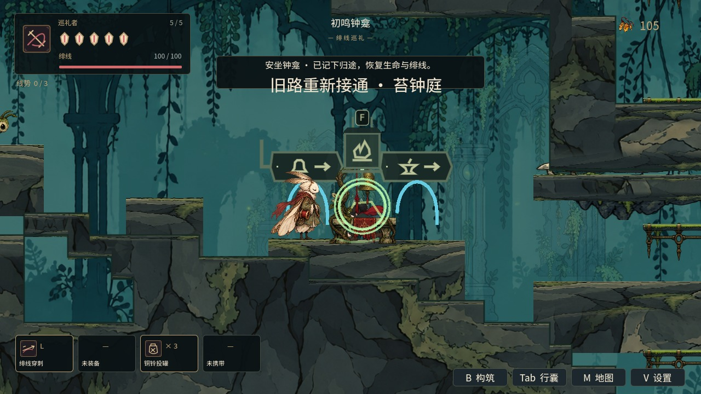

# 邻区玩法对象预建与实际采用

PR #29 基于 PR #28 的 `222b68b`。继续完成草稿 `5dc74fe`，恢复完整回归与 CI，补齐实际输入、战斗、交互和缓存生命周期证据。

## 实现范围

靠近区域入口时，提前创建敌人、NPC、钟龛、拉杆、首领门与世界入口。碰撞和原始美术均在场景树外准备；不会进入源区物理空间、启动 AI、连接当前宿主交互信号或改变进度。实际到达后采用原实例，绑定目标区的敌人支撑、碰撞避让、声音、NPC 剧情位置、交互信号和路标。

缓存至多两区、每区十二个玩法对象，总量二十四个，退休队列也计入容量。几何缓存另有四十八项上限；两类缓存共享每帧至多两项创建、两项释放和 2ms 准入预算。配置版本、入口、代际与范围变化会淘汰旧对象，退出同步排空。2ms 是准入预算，不能中断一次引擎操作，不能据此宣称帧率达标。

预检新增缺失坐标、空交互尺寸和非字典 AI 配置拦截；空的敌人身体/受击尺寸仍沿用冷创建的默认尺寸。

## 实际走入管道发现的修复

原入口允许玩家在路牌前 52px 内朝出口行走，但管道用路牌前 30px 作为折返线。正常靠近时可能先进入、立即折返；直接定位到路牌的旧夹具没有覆盖该问题。

现在折返线同时参考本次实际进入位置，保持进入时的坐标和速度。正常前行能够穿过完整管道，主动向后行走和 Esc 返回沿用。双向实际输入检查覆盖这一修复。

## 验证

Godot 4.6.1 最终验证矩阵 63 套零失败、零运行时 SCRIPT ERROR / ERROR：完整真实 GL 执行中 62 套通过；20 工房套件复验 403 项通过。最终计数与日志指纹见 [验证摘要](../../artifacts/neighbor_gameplay/verification.json)。运行器保持超时、非零退出码、`SCRIPT ERROR` / `ERROR` 全部失败的严格门禁。

| 检查 | 覆盖与结果 |
|---|---|
| 邻区玩法夹具 | 76 个落点夹具采用 397 个对象，覆盖六区出生点、全部配置入口及两类补充机关落点；原实例、冷/热状态和美术一致、物理隔离、AI 配置租约、尺寸预检、失效释放及部分采用后取消恢复。 |
| 实际输入 | 44 项零失败。初始源区检查点采用夹具定位；此后靠近、双向 8540px 管道、战斗、NPC/钟龛交互均由输入和碰撞驱动。去程采用 5 个对象、回程采用 8 个。 |
| 正常战斗 | 不开免伤，不直接调用伤害函数。预建敌人恢复 AI 并造成真实伤害，普通攻击击败后只发放一次 8 碎钱奖励；奖励、钟龛归途与重启恢复通过。 |
| 缓存压力 | 80 轮双邻区、入口变化和离开范围循环；1,320 个玩法对象创建/释放数量相等，3,760 个几何对象全部释放，最终所有权为 0，源区进度与场景树不变。 |
| 六区真实 GL | 6 个冷/热美术对照探针零失败，像素差均为 0。 |
| 实际输入真实 GL | 44 项零失败，包含双向采用、正常受伤/攻击与存档；新增 3 张实机截图。 |
| 管道真实 GL | 5 个探针零失败，原画面和可见人物检查沿用。 |
| 其它门禁 | `npm test`、章节/路线审计、主角素材与姿态提取检查通过。 |

真实 GL 摘要：[美术对照](../../artifacts/neighbor_gameplay/gpu_gameplay.json) · [实际输入](../../artifacts/neighbor_gameplay/gpu_live.json)。CI 同时运行三套邻区玩法回归与两项真实 GL 检查；新提交不含跳过 CI 标记。

首轮完整 headless 回归有 62 套通过、1 套因 `dummy/storage/texture_storage.h` 的 `Parameter "t" is null` ERROR 失败，对象释放断言本身通过。4.6.1 源码使用非线程安全的 `RID_PtrOwner<DummyTexture>`，与[上游已记录的 dummy 并发问题](https://github.com/godotengine/godot/issues/124139)一致。运行器新增显式 `--software-gl`，在 Xvfb/Mesa 下对全部套件使用真实 GL，保留实际资源预取和原有严格错误/超时门禁；缺少 Xvfb 时直接失败，不退回 dummy、不重试或过滤 ERROR。

首次完整 GL 执行的唯一失败是 20 工房动作套件达到 180 秒超时；该套件不做图像取样。最终仅为 `world_upgrade` 加入 `--disable-render-loop`，保留真实 GL 资源后端、物理、输入、声音、403 项断言和原有 180 秒超时；随后定向复验通过。其余 62 套和全部像素/实机输入检查继续绘制画面。CI 使用最终运行器从头执行全部 63 套。

复现完整门禁：`python3 tools/run_godot_regressions.py --engine /path/to/Godot_v4.6.1-stable_linux.x86_64 --software-gl --log-dir /tmp/pr29-regressions`。

## 实机截图

以下为 Mesa llvmpipe 实际渲染的输入验证过程；只有起始检查点经过夹具定位，不预置探索能力。截图与双向局部战斗验证不代表六区完整带伤通关。

步行抵达铸雨渠，复用入口与附近玩法对象：

原路步行返回苔钟庭：

通过 F 使用复用的钟龛并恢复状态：

## 验收边界

本 PR 完成邻区入口玩法预建、采用和生命周期子项。W00b2b / W00c 仍为部分完成：活动区敌人/NPC/交互的空间驻留、复杂单项与提交阶段拆分、共享物理洞口、双区实体驻留和其它连续通道仍需后续开发。

80 轮缓存压力证明本缓存的容量和对象释放，不等于长期全游戏内存驻留验收。既有退出 RefCounted/ObjectDB 警告和编辑器导入 RID 问题继续归入 T03；六区带伤通关与其它人工验收仍归入 T04。
