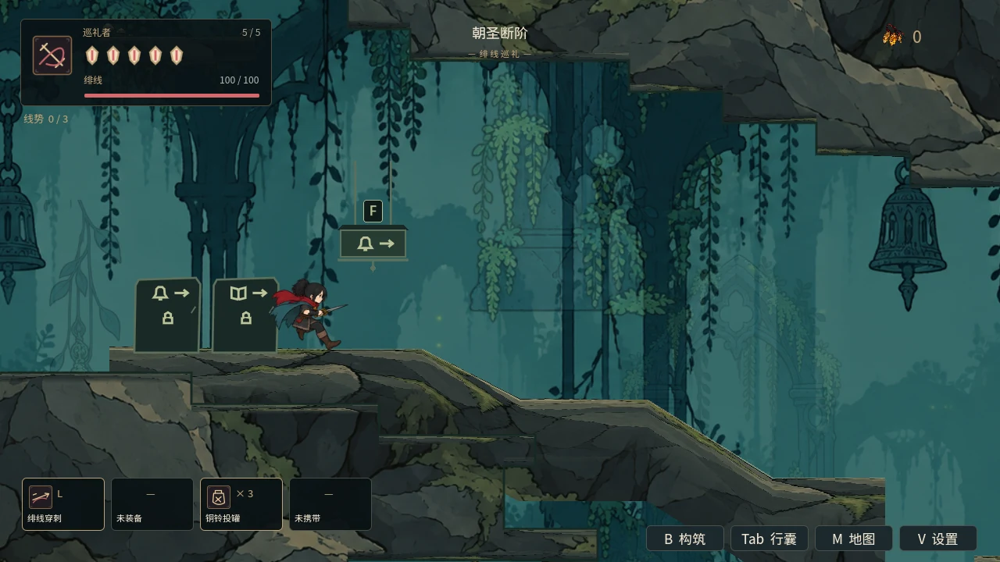
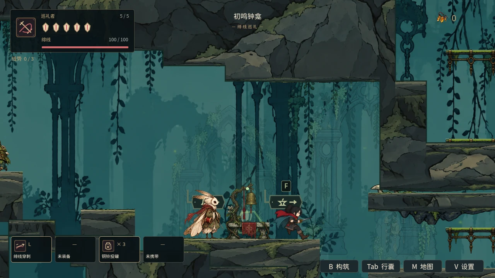
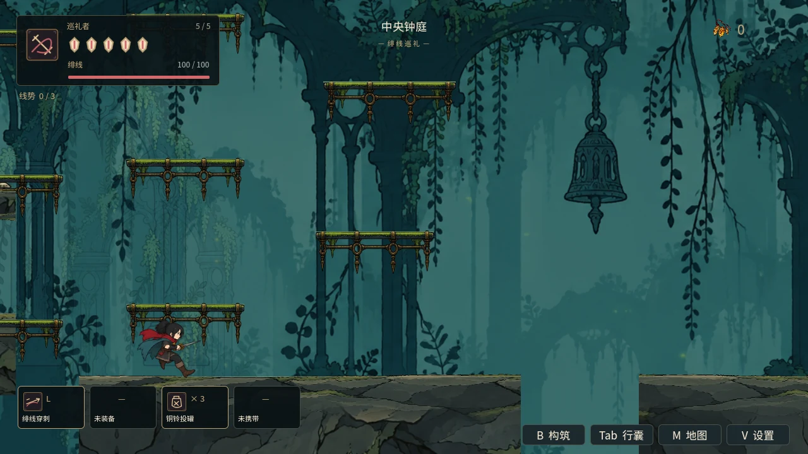
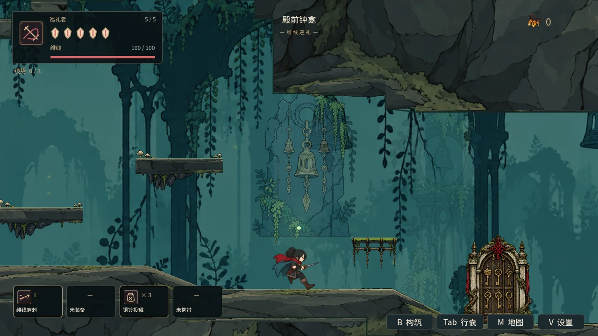

# 苔钟庭首段体验：房间镜头、单敌遭遇与首次缝补

日期：2026-10-14。基于 PR #48 的镜头／输入基线，目标为 main 的 PR #49。main 核对基线为 be47690；前批最终验证摘要已补上传。

## 玩家可见变化

- 苔钟庭42个原有房间增加独立镜头范围。狭廊显示落脚面和上方地标，竖井保留纵向跟随；中央钟庭保留上下分叉的视野。24像素门口迟滞抑制反复切换，范围以模拟时间平滑过渡。Boss事件优先于房间，解除封门后恢复探索构图。复活清除旧Boss锁后立即刷新可见中心、直接采用出生点房间，跨区／钟管清空旧范围。世界坐标、地图轮廓及缩放保持原契约。
- 苔落走廊的E01保留咬击与蜷壳扑身两种动作：咬击0.55秒前摇／1.15秒收招，扑身0.75秒前摇／1.25秒收招、约25像素前进；3点生命，较短巡逻和追击范围。它仍正常造成伤害、可被击败并提供正常奖励。原物种AI保留，只有此出生记录指定遭遇配置；邻区预建和直接生成走同一配置入口。
- 中央钟庭E02移到西岸远端，入口先看路线再进入交战；齿台E14缩短追击范围，保留殿前钟龛歇脚与重试空间。
- 跳跃、挥刃与缝补仅首次遇到对应情境显示短提示，记录到现有story_flags存档；使用当前绑定键。缝补提示需要受伤、能量足够、站稳且附近无活动敌人，不在菜单、危险地面或Boss战中展示。
- 已经按着方向、跳跃或冲刺时申请治疗会直接拒绝，不先扣能量。治疗开始后的移动、跳跃、受击和界面锁仍按原构筑结算打断，保留原治疗成本与持续时间。
- 场景路牌缩至原比例的65%，保留地区徽记、箭头和门槛图标；靠近时按键文字保持可读尺寸。旧通路的蓝／橙亮色拱圈停止绘制，交互范围和通行状态保持原规则。
- 初鸣钟龛学徒的首次对话与路况询问改为场景线索，移除固定热键和多项重复操作指令。

## 首段房间用途

| 房间 | 用途与地标 | 遭遇与奖励 | 本批深化 |
|---|---|---|---|
| 朝圣断阶 | 旧钟与断阶；安全尝试短跳 | 无敌人 | 镜头覆盖脚下台阶；首次短跳提示 |
| 苔落走廊 | 断钟舌与下行落点 | 单只庭兽；正常命中回能和击败奖励 | 缩小巡逻／追击范围，读前摇、退开、收招反击或缝补 |
| 初鸣钟龛 | 苔灯与织线学徒 | 歇脚、记录归途 | 独立歇脚构图；首次安全治疗提示与保存 |
| 窄苔缝 | 矮洞承接入口与枢纽 | 无额外敌群 | 聚焦洞内行走面 |
| 中央钟庭 | 巨钟与上下路线分叉 | 西岸远端庭兽 | 入庭先观察，保持入口缓冲 |
| 齿台／殿前钟龛 | 守卫在前、苔灯在后 | 守卫遭遇后休整／Boss重试 | 限制守卫追入休整区；房间镜头与Boss锁恢复 |

这批调整现有房间用途、敌人配置和构图，不声称新增完整首区路线或逐房重造所有地形。

## 验证与进度

- 新first_court_experience定向检查初次124项发现两项问题：门口折返迟滞、Boss测试放置点不在战场房间。迟滞逻辑已修复，测试移到实际战场落点；追加真实敌人收招治疗检查后127项通过；实际画面取样发现旧亮色门户与路牌体量问题，去掉亮圈、缩小路牌并补充44项检查，最终增加真实复活信号和首帧可见中心验证，共173项通过。
- 现有镜头86项、输入32项、首区局部房间65项、持久宿主539项通过；npm test和campaign静态检查通过。
- **75套最终逐套通过**。首轮完整序列有3套失败：all_chapters_demo要求每个小怪保留双招式、pilgrimage_overhaul要求104种动作、首区专项的短退未躲开扑身。E01恢复双招式；首区夹具改为等待新的前摇、退开24帧，符合扑身约25像素位移及实际判定。3套均已复验通过，既有检查未放宽。最终首区专项173项通过；实际GL五处取样通过。
- 清除Boss锁后立即刷新复活镜头；六套恢复相关复验通过。恢复模式资源导入两轮通过；普通编辑器导入在本环境出现Vulkan扩展／退出RID错误，不计编辑器插件通过。远端CI按最新提交另行报告。
- 完整序列启动后追加了复活刷新和敌人节奏修正，相关套件分别复验；75套是最终逐套结果，并非声称首轮同一源码零失败。每套来源、日志哈希及最终源码哈希写入verification.json；退出ObjectDB警告保留，未计长时稳定通过。
- 普通房间镜头仅覆盖苔钟庭42个原有房间；升级工房和另外五区继续沿用区域跟随，待后续逐间设计。W02/A02/C02/T01完成此子项；W00c/T03/T04全区连续世界、长时稳定和开启伤害自然六区通关仍未完成。
- 局部治疗检查使用真实Player/InputMap/敌人攻击与实际地面，但设置出生点、HP和能量；画面检查暂停敌人，均不计自然通关或陌生玩家验收。

## 实际GL取样（暂停画面夹具）

| 入口断阶 | 首场遭遇 |
|---|---|
|  |  |

| 初鸣钟龛 | 中央钟庭 |
|---|---|
|  |  |

钟龛取样角色在装饰右侧，可同时看清角色、学徒与休息点。以上为定位和暂停取样，不是首区自然通关。统计及源码／日志哈希见 `artifacts/first_court/verification.json`；原始日志保留本地，公开摘要不含本机路径或日志正文。

复现：`python tools/run_godot_regressions.py --engine "$GODOT" --software-gl --log-dir /tmp/first-court-regressions`。针对本批可选`--suite first_court_experience`；默认已包含该专项。
