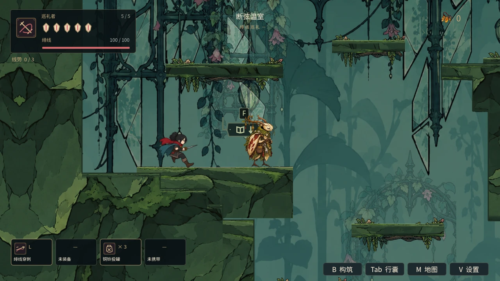
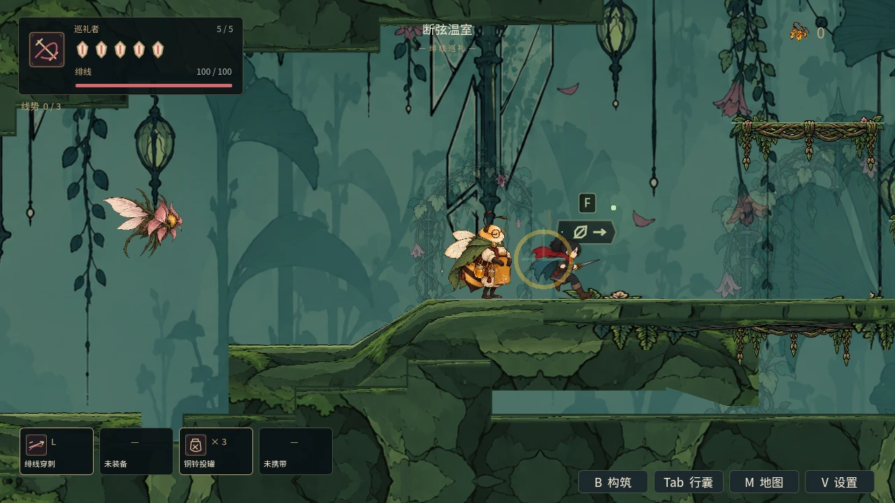
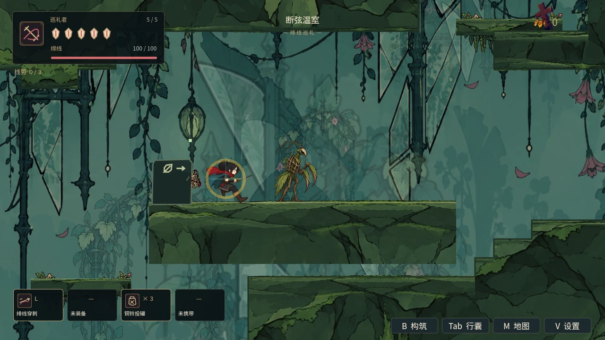
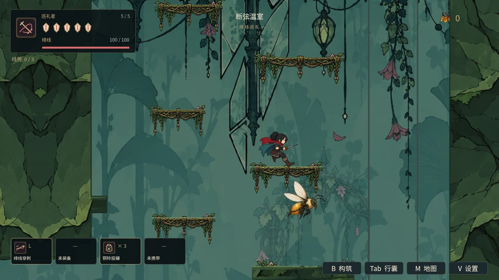
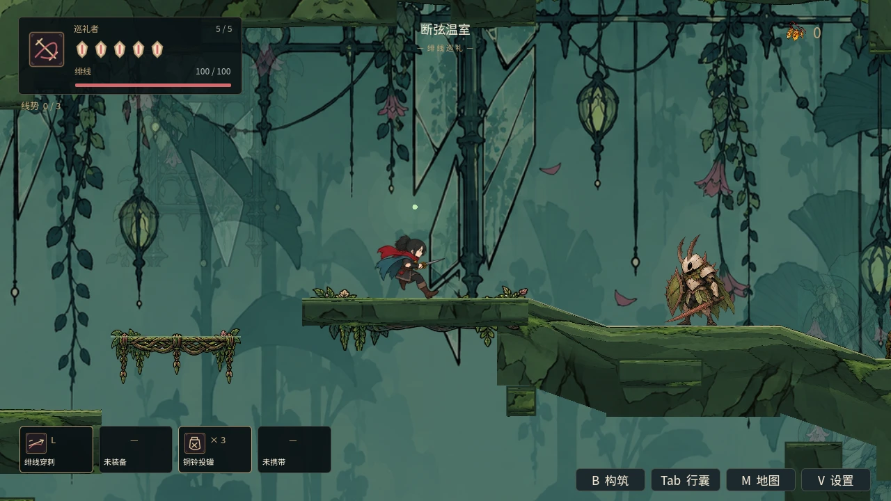

# 断弦温室：逐房构图与停留、交战空间

## 玩家体验

16个原有房间加入独立镜头范围。西门与西阶显示下一处落脚苗床；根须南廊沿长路跟随；东藤壁随攀升高度跟随；树冠缺口下落时保留下方枝台；树心、根库、蜂蜡暗屋与穹顶前廊各有自己的构图。门口迟滞、范围平滑、Boss优先锁及复活恢复沿用共享服务。

E05飞行花灵从蜂蜡商人身旁移到南廊出口south_run_i，出生(4470,2392)，保留悬浮高度、落刺和吐针；90像素领地、220像素警戒范围让暗屋商人和暗灯附近不触发新交战。E11树心猎手移至(2930,1562)，30像素巡逻、65像素领地，与歌者和暖灯分开；根网/扑刺收招1.1/1.2秒，起手冷却0.8/1.5秒。E12根库猎手移至平台东端(2650,1942)，15像素巡逻、55像素领地，留出囚徒停留位置。E14荆棘哨兵移到Boss门前boss_threshold，出生(5430,754)，保持轮射与根墙，领地90像素。

原生命、伤害、奖励、招式种类和状态效果保留。已启动的根网、落刺、扑刺、根墙继续结算；退出敌人领地或站在暖灯旁不自动清空危险。园丁指路改用西阶、苗床、暗屋、藤壁和树心暖灯的场景线索。

## 本批房间用途

| 房间 | 用途与交付 |
|---|---|
| 西门、西阶 | 园丁处观察路线，下降时辨认下一块苗床 |
| 根须南廊、蜂蜡暗屋 | 长路与地床陷阱之后迎战花灵，再进入商人补给/暗灯空间 |
| 东藤壁、树冠之心 | 逐层上攀、受控回落，镜头随当前高度变化 |
| 大树之心、根库 | 暖灯/歌者/囚徒处停留，再进入猎手领地 |
| 穹顶前廊、裂纹穹顶 | 暖灯休整、门前哨兵、Boss封门及死亡后重试 |

## 验证边界

新增专项检查16房间中心与边缘的身体/落脚视野、藤壁和树冠跟随、同实例切区、Boss优先级、实际复活信号及离开/返回恢复。六处生产World等待位置覆盖商人、暗灯、歌者、树心暖灯、囚徒和穹顶前暖灯；定位并冻结Player，只开启待检演员，显式清除到达、受伤与接触保护，保留普通伤害规则。局部战斗使用生产Player/敌人和实际物理地面，但归一敌人纵坐标；验证根网/扑刺保留、自然起手和真实伤害。

盐白书库专项同步到温室实际入口，检查16个目的地房间、温室西门选择和旧Boss锁清理，保留返回书库的断言。没有放宽SCRIPT ERROR/ERROR门禁。截图先预热当下地形和敌人驻留，再暂停演员并清空短时toast；属于定位取样，不能当作自然通关或陌生玩家记录。

构建基线是#51提交db84b9592f151f712c10d1969ec336f94e1e8b9a；新PR目标main并承接前批依赖。W02/A02/B02/C01仅第四地区子项推进，剩余两个地区和升级工房继续待逐房设计。W00c全连接、T03长期稳定、T04开启伤害新档六区通关仍待验收。退出ObjectDB警告保留。

新专项最终144项、0失败；11套相关回归零失败，随后清除等待夹具伤害保护的新专项复验通过。npm test、campaign和两轮恢复模式导入通过；未声称本地完整全量CI通过。统计、逐套日志和源码哈希见[verification.json](../../artifacts/greenhouse/verification.json)。恢复模式导入不包含编辑器插件验收；远端全量CI按新提交单独报告。

专项复现：`python tools/run_godot_regressions.py --engine "$GODOT" --software-gl --suite greenhouse_experience --log-dir /tmp/greenhouse-regressions`。图形取样：`godot --path godot --script res://scripts/greenhouse_experience_validation.gd -- --capture`。新专项已登记默认CI。

## 真实GL定位取样

| 温室西门 | 蜂蜡暗屋 |
|---|---|
|  |  |

| 大树之心 | 东藤壁 |
|---|---|
|  |  |

