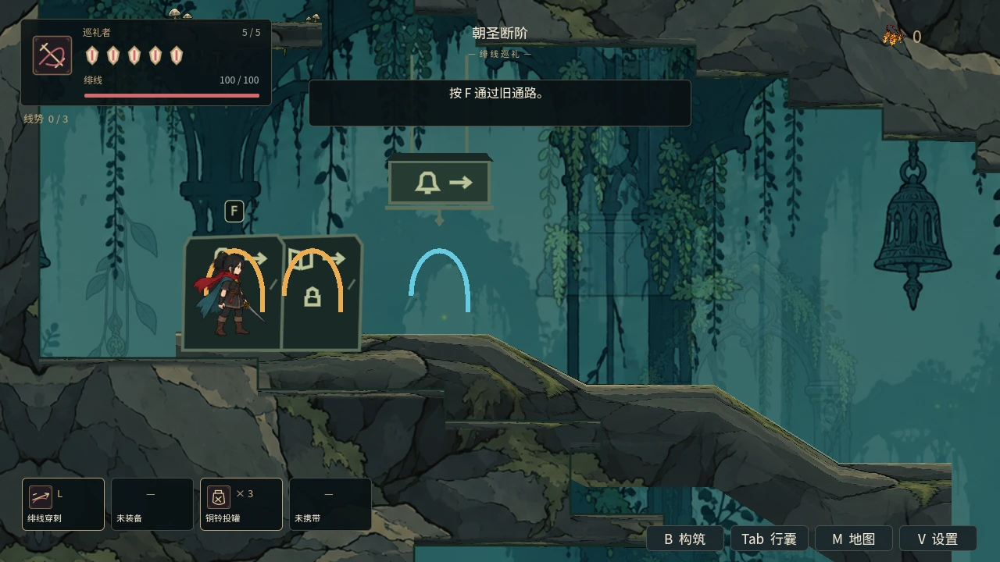
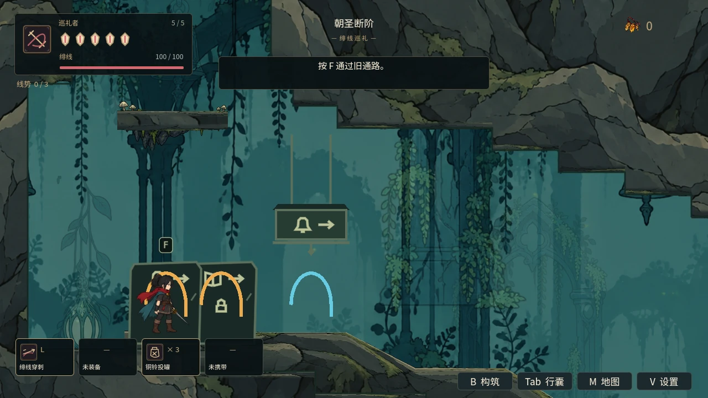
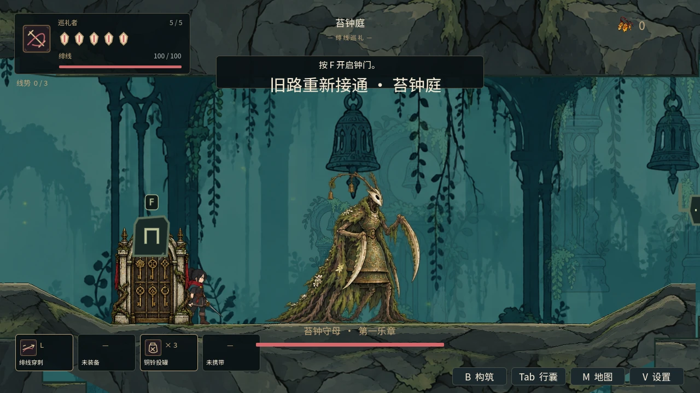
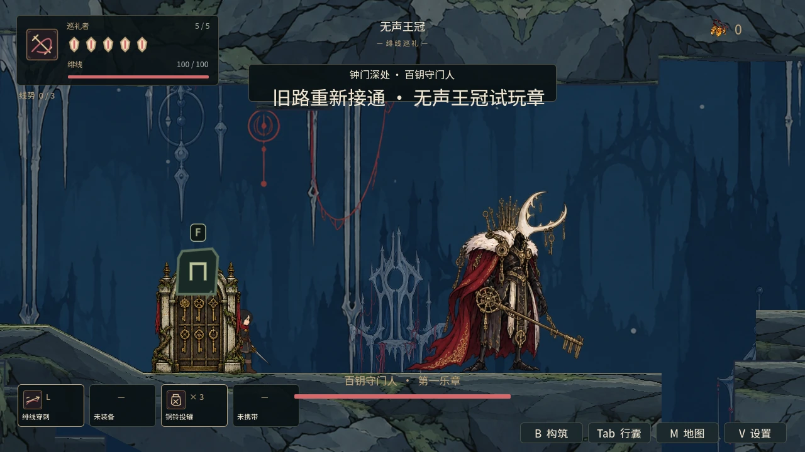

# 镜头观察与六区 Boss 战场构图

日期：2026-10-14。制作从 PR #47 的已验证 head `5d0d87c` 继续；提交期间 main 合入 #46/#45/#38，最终同步至 main `be47690` 与 #47 最新 head `17d1dd4`。目标为 main 的 PR #48，镜头代码单独提交为 `64f4994`，基线合并提交为 `4d537c3`。继承 #47 输入缓冲和已合入 main 的敌人生命周期修复。

## 玩家可见行为

- 站在地面静止、落地稳定后，持续按住现有上/下瞄准键 0.35 秒，镜头向对应方向观察，最大偏移150像素。短按保持原有瞄准行为；上下同时按保持中立。
- 移动、跳跃、攻击、钩索、治疗、格挡、受伤或输入被界面锁定时停止观察；放开后平滑回到正常构图。瞄准与攻击仍使用原 InputMap，兼容重映射和手柄。
- 使用既有 `camera_lookahead` 设置控制观察幅度；设置为0时不产生观察位移。保留原速度前瞻、下落前瞻与震屏。
- 六区 Boss 封门事件同时锁镜头，参考实际巡逻区间、地面与跳跃高度；击败/重试打开封门时解除。小战场在既有视口尺寸内居中，大试炼保留范围内跟随；不改变缩放。

## 实现与生命周期

`camera_focus.gd` 是 Player 所有的 RefCounted 服务，状态仅包含矩形、优先级和观察计时。事件锁按优先级选择；同优先级按ID确定选择顺序；释放高优先级锁恢复下层锁。当前游戏接入 Boss 事件锁，通用锁接口提供给后续房间镜头使用，不声称所有普通房间已逐间设计锁区。

窄区域会适配当前视口与缩放，在地区范围内形成有效矩形，避免反向限位。拒绝非有限/零/负尺寸和完全离区的锁；无效地区重设保留原状态。区域到达重新设地区限位并清除旧锁；独立实体钟管也使用同一配置入口，折返和出口恢复来源/目标地区边界。Player/Camera/Focus 服务在切区中保持同实例。菜单、伤害、复活与交接清除观察计时；不写入存档。

镜头位置采用现有指数缓动，观察目标只经过一次局部位置缓动；首轮定向验证发现的双重缓动回正拖延已修复。

## 最终本地验证

- Godot 4.6.1 两轮资源导入通过；npm test 与 campaign 静态审计通过。
- 新镜头专项在真实 Mesa llvmpipe OpenGL 中86项通过。包含实际 Player/InputMap/地面物理与可见屏幕中心、观察时序、瞄准兼容、菜单、伤害、移动/跳跃取消、同优先级确定性、窄区/缩放及异常输入。
- 生产 World 同步到达六区、原实例保持、真实封门事件、巡逻两端与跳跃/地面视野、解除后恢复地区范围通过。
- 原攻击缓冲、能力移动、玩家状态清理、Boss试炼和钟管专项均通过；完整默认 **74套、0失败**。同步 main 增加了资源/发布文件及驻留夹具修正和固定时钟调度，未改变本批运行代码；随后更新的敌人驻留、镜头86项、输入缓冲32项三套再次通过。同步后的 npm test 与发布工具20项单测通过。完整运行与补充复验的逐套来源分别记录在 `artifacts/camera_focus/verification.json`，保留源码与日志哈希；不公开原始日志正文。
- 截图为控制夹具取样，包含入口观察及两处暂停战场，不计开启伤害自然通关、人工手感或动态危险完整可读性验收。

## 进度边界

本批为 A02 / V01 的镜头与操作子项，不把 W00c 全部连续连接、逐房镜头美术、T03/T04 长时与六区自然通关标记完成。完整回归沿用严格 SCRIPT ERROR/ERROR 门禁；退出警告如实保留。公开交付采用核对过的统计与哈希摘要。

## 四处实际 GL 取样

普通观察取样中，主角保持 `(200, 3399.996)`，可见相机中心由 y=3345.007 到 y=3207.031，向上移动约138像素。取样待到达与物理稳定后进行；战场为暂停夹具。

| 正常镜头 | 向上观察 |
| --- | --- |
|  |  |





复现命令：

```sh
npm test
npm run test:campaign
python tools/run_godot_regressions.py --engine "$GODOT" --software-gl --log-dir /tmp/camera-regressions
```

GitHub Actions 按最终 PR 提交另行核对，运行中不计通过。
