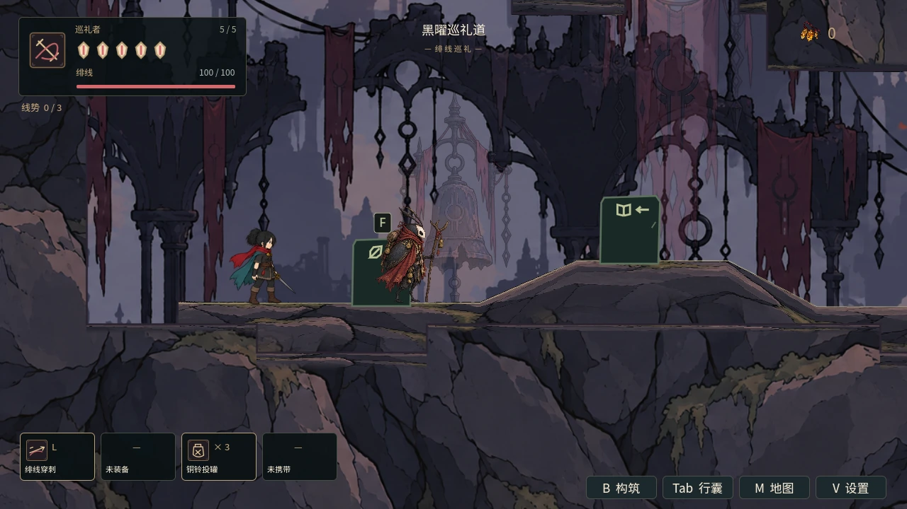
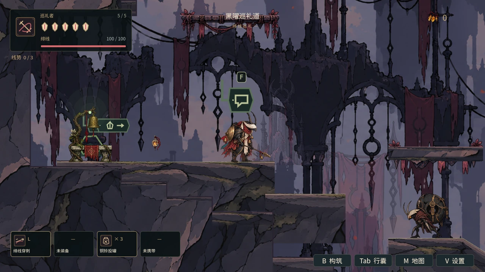
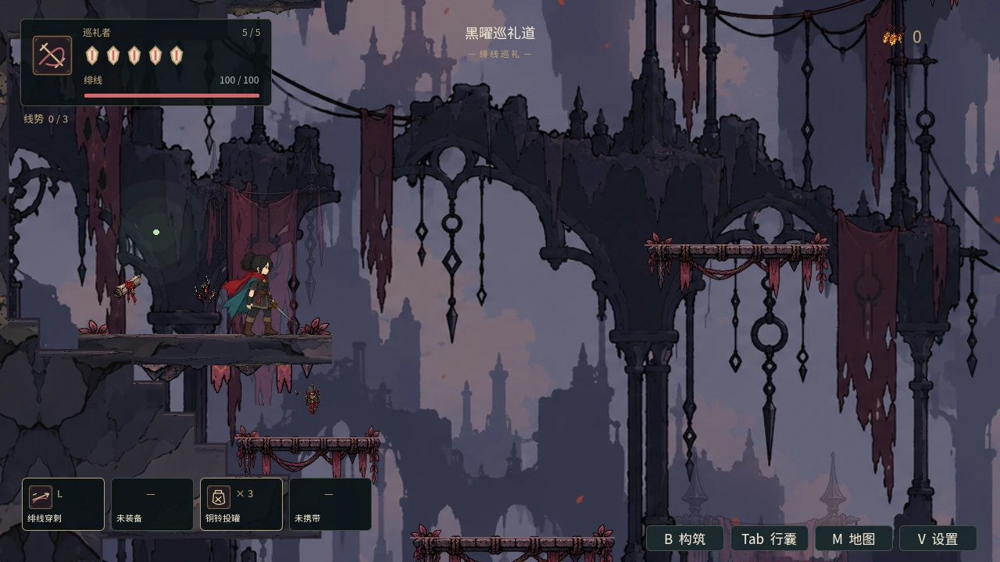
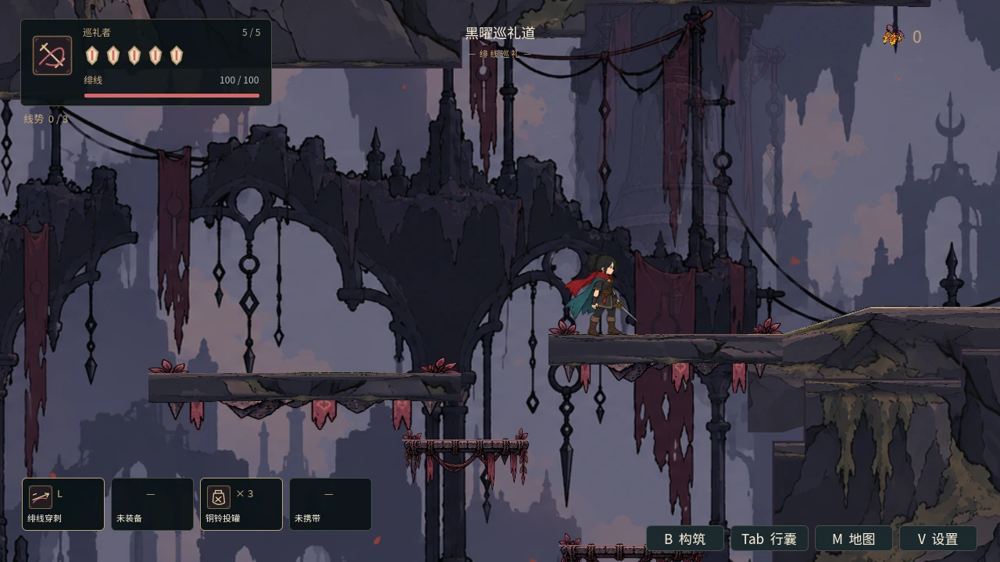
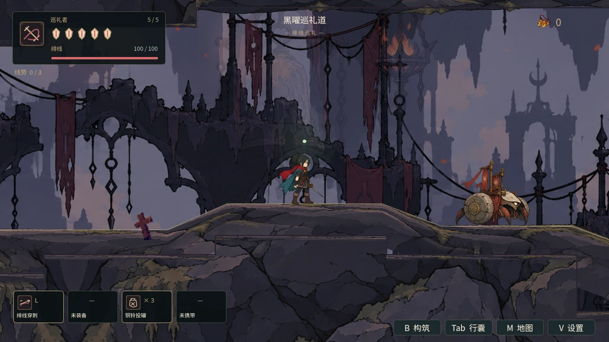

# 黑曜巡礼道：山腰休整、逐房构图与镜池门前遭遇

本批从 main `b63daaf`（已合并 #53）继续第五地区体验。邻区预取 #54 独立推进；本批无该分支依赖。

14 个原有房间接入共享房间镜头。山根古道沿长路跟随，下／上段砌道随爬升移动；缆车井、瞭望塔与下降索道按当前高度构图；军墓、营地、镜池前庭和池内分别保留观察与落脚空间。继续使用原有门口迟滞、平滑过渡、Boss 高优先级锁与复活恢复，不改变地图几何或永久能力门。

## 遭遇与指路

| 位置 | 调整 |
|---|---|
| 巡礼营地 | E07 钟轮从骑士旁移到东口石台 `camp_east_dock`，出生 (955,1838)、巡逻 20、领地 55。营火与骑士处可停留，越过石台才进入交战。 |
| 镜池门前 | E13 战车移到 `boss_threshold`，出生 (4510,616)、巡逻 25、领地 60。暖灯和门前守卫分开。 |
| 攻击节奏 | 钟轮滚撞／双向钟涟收招 1.2／1.1 秒，初始冷却 0.9／1.5 秒；门前战车灰钉收招 1.2 秒，重冲仍为 1.15 秒。 |
| 地区名与道路 | HUD、区域地图和到达短提示统一章节名称“黑曜巡礼道”；引路人改用破旗、绞盘、升降笼、营火和塔顶暖灯指路。修正营地混杂英文和旧镜池招式描述。 |

时序通过 spawn 的 `encounter_profile` 接入，覆盖原创物种配置之后应用。生命、伤害、奖励、物种双招、攻击几何、可格挡规则、弹速与危险持续时间保留；专项把非节奏字段与原创物种配置逐项对照。已经发出的钟波／灰钉不会因退到灯旁而消失。收招延长不等于原地治疗一定安全，灰钉仍需等待或避开。

## 验证与范围

- 新专项最终 **147 项、0 失败**，Godot 4.6.1、真实 Mesa llvmpipe OpenGL：14 房间中心／边缘身体与落脚视野、三条纵向路线、同实例切区、Boss 锁覆盖、实际复活信号和离开／返回恢复。
- 生产 World 的骑士、营火、镜池灯影、灯影修女与逃旗手位置等待检查：定位并冻结 Player，只开启待检演员，显式清除到达／受伤／接触保护，保留正常伤害规则。
- 局部物理地面夹具使用生产 Player／敌人，归一纵坐标；验证两处守卫自然起手、真实伤害、领地和双招。钟波／灰钉保留检查直接调用生产效果生成入口，不冒充自然施放。
- 8 套相关真实 GL 回归通过：本专项初版 142 项、温室 144 项、镜头 86 项、六章运行、敌人生命周期 31 项、故事指引、持久宿主 539 项（43 次切区）和地图 657 项。最后仅加强画面取样落地检查，再运行完整新专项及取样，最终 147 项通过。
- `npm test`、`npm run test:campaign`、脚本解析、两轮恢复模式资源导入和 `git diff --check` 通过。恢复模式不计编辑器插件验收。新专项登记默认 CI，并提供 `npm run test:obsidian-experience`。
- 5 处真实 GL 画面已目视检查；取样先预热地形驻留，让 Player 在生产碰撞上实际落地后冻结，敌人暂停。这是定位取样，不是自然通关截图。

最初专项检出 4 项失败：把节奏只写到区域物种配置时被原创配置覆盖，以及到达提示与地图名称不一致；修正为 spawn 覆盖及统一名称。没有删除断言或放宽错误门禁。GL 首次尝试因本环境缺少 X 键盘编译器／依赖而未能启动显示器；补齐环境后重新运行 8 套。初轮导入退出成功但出现宿主 `fatal library error, lookup self` 诊断，最终另两轮导入未出现该诊断。失败与重试的摘要／日志哈希保留在 [verification.json](../../artifacts/obsidian/verification.json)，原日志留在本地。

最终专项与部分相关套件仍有未归因 ObjectDB 退出警告，V-Sync 环境警告保留；无 SCRIPT ERROR／ERROR，不将这些结果当作长期内存稳定。未运行本地全部默认套件；远端完整 CI 按最终提交单独报告。

W02／A02／B02 仅第五地区子项推进。第六区、升级工房逐房体验、W00c 共享物理洞口、T03 长期稳定、T04 开启伤害新档六区自然通关继续待验收。

复现：`python tools/run_godot_regressions.py --engine "$GODOT" --software-gl --suite obsidian_experience --log-dir /tmp/obsidian-regressions`。取样：`godot --path godot --script res://scripts/obsidian_experience_validation.gd -- --capture`，输出 PNG；提交的 WebP 来自同次取样。

## 实际 GL 定位取样（已落地，演员暂停）

| 破旗哨站 | 巡礼营地 |
|---|---|
|  |  |

| 巡礼军墓 | 瞭望塔顶 |
|---|---|
|  |  |

