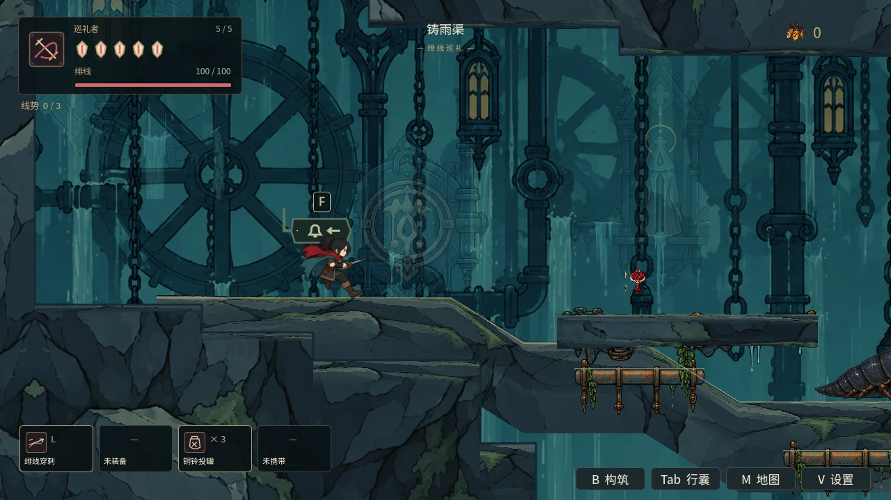
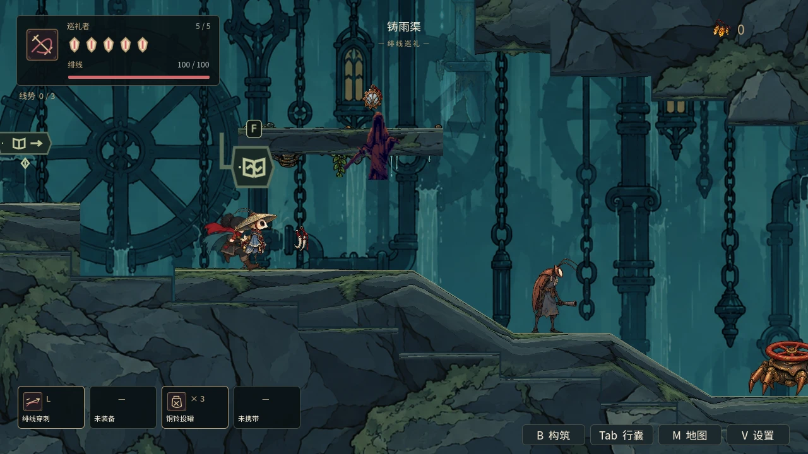
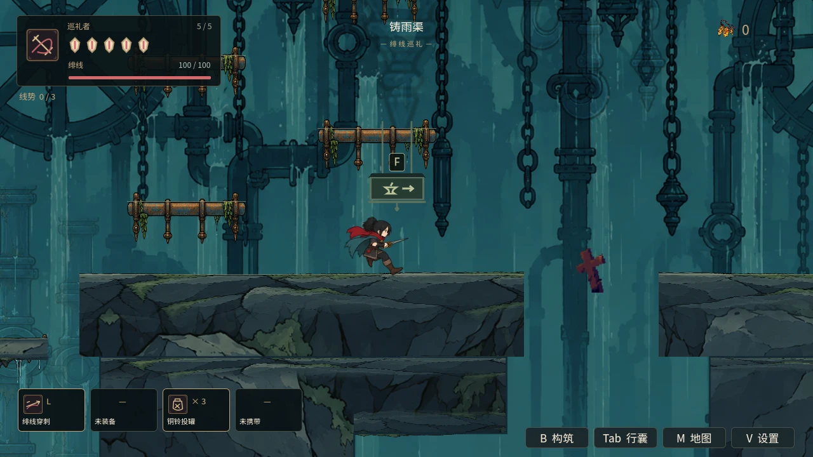
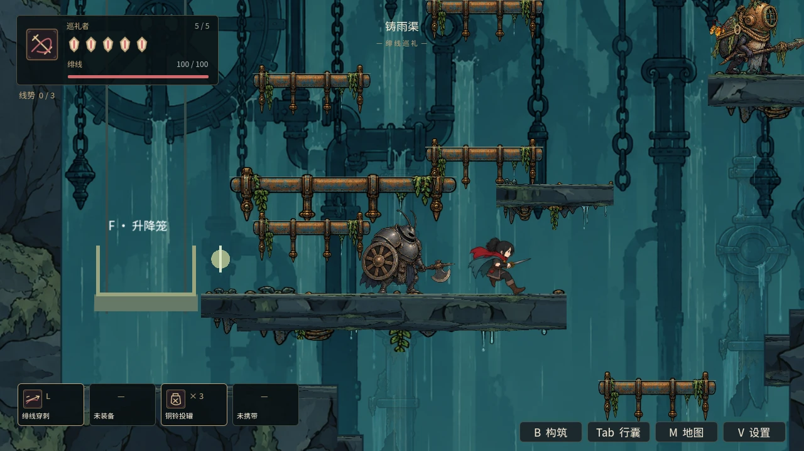
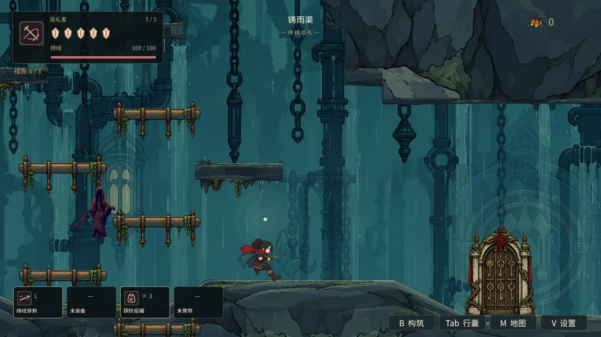

# 铸雨渠：逐房构图与观察、交谈、战斗的顺序

## 玩家行为

第二地区38个原有房间接入独立镜头范围。入口和横向渡槽留出前方落脚面；泵房中庭保留分叉与高差；立管井和钟摆吊架保持纵向跟随；钟龛与能力房聚焦当下行走面。继续使用已有门口迟滞、平滑范围过渡及Boss高优先级锁。跨区、复活与Boss解除仍由原宿主/玩家负责恢复。

雨栅长堤的E02炮手从童子身旁的平台移到坠钟之后的rd_step，位置(2020,960)，保持曲射与近身反喷；110像素领地和260像素观察范围使童子的水平位置不触发交战。E13潜兵移到西井平台的西端(1620,3340)，30像素巡逻、65像素领地，与铁匠留出空间。E14攀墙试炼守卫保持轮盾冲锋、返轮刃、生命和伤害，两种收招均为1.15秒，起手冷却错开，给玩家调整位置的机会。返刃仍会返回，收招状态不意味着所有飞行物已经消失。

场景取样发现旧切区通知写入永久结局横幅，持续挡住探索画面。正常到达改用现有短时toast，并显示“铸雨渠”等正式地区名；通关和结局事件继续使用永久横幅。童子的路况台词移除固定按键操作列表，保留水声、湿墙、水轮的场景线索。

## 本批房间用途

| 房间 | 用途 | 交付 |
|---|---|---|
| 上闸口、渡槽闸口 | 先观察入口落点 | 横向入口构图 |
| 雨栅长堤 | 交谈→坠钟→炮手 | 炮手移到后方高差平台，保留双招 |
| 渡槽钟龛 | 下探前恢复 | 苔灯与检修缝入口构图 |
| 泵房中庭 | 判断高层、西井、下层分叉 | 垂直枢纽范围 |
| 立管井口、湿墙试炼间 | 铁匠→潜兵→守卫→攀墙能力 | 潜兵领地与守卫收招调整 |
| 立管井、钟摆吊架 | 长井逐层攀升 | 镜头跟随当下高度 |
| 炉前钟龛、沉炉大厅 | 休整→Boss→重试 | 房间与Boss锁优先级、复活首帧恢复 |

## 基线与交付边界

承接未合并#49的4fc2c8571a2d70e03edc67fdbbf5cc58cd815863，同步已合并#47/#48后的main dc2dbf1d58ad3e19e7862ac39f3dc7ca9e127073。新PR目标main，因此包含#49依赖；#49合并后相同前批差异会自动消失。本批没有操作#49。

W02/A02/B02/C02推进第二地区子项；仅38个原有房间，升级工房与其余四区逐房设计继续待办。地图购图/坐火补绘、能力门、原地形、Boss及奖励沿用。不是六区连续大世界完成，也不是开启伤害六区自然通关、陌生玩家体验或长期稳定验收。

## 验证

新专项256项、0失败；13套相关回归通过，其中切区横幅修正后8套复验通过。npm test、campaign及两轮恢复模式导入通过。未宣称本地完整76套通过，远端全量按新提交另行核对。统计与每套日志哈希见[verification.json](../../artifacts/rain_foundry/verification.json)。新专项在真实Godot 4.6.1 / Mesa llvmpipe OpenGL中检查房间中心和边缘的身体/落脚视野、长竖井跟随、同实例切区、Boss优先级、真实复活信号及跨区清理；局部战斗使用生产Player和敌人配置、实际物理地面，验证NPC水平位置不主动交战、保留双招和真实伤害。

首轮检查发现守卫原拟收招0.9秒不足以满足0.85秒治疗加余量，已改为1.15秒；局部敌人夹具在同步物理位置前添加下一只演员，导致旧位置碰撞信号，已改为先复活定位、等物理同步再添加。检查未放宽。首次资源导入180秒超时到92%，延长首次导入预算后两轮通过；本地Xvfb启动缺少键盘编译器路径，运行环境修复后使用真实GL，未切换虚拟渲染或放宽错误门禁。

截图为定位并暂停演员的实机取样；先预热当下位置的地形与敌人驻留，再暂停。截图仅清空短时toast，不隐藏结局横幅来掩盖产品行为。退出ObjectDB警告保留；不能由本轮判断长期内存稳定。

复现：`python tools/run_godot_regressions.py --engine "$GODOT" --software-gl --suite rain_foundry_experience --log-dir /tmp/rain-foundry-regressions`；五处取样由同一专项附加`-- --capture`生成。默认CI已登记新增专项。远端CI按提交单独报告。

## 真实GL取样

| 上闸口 | 雨栅长堤 |
|---|---|
|  |  |

| 泵房中庭 | 湿墙试炼间 |
|---|---|
|  |  |

