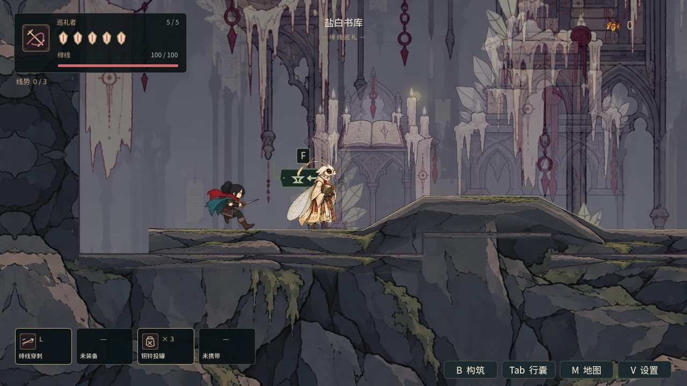
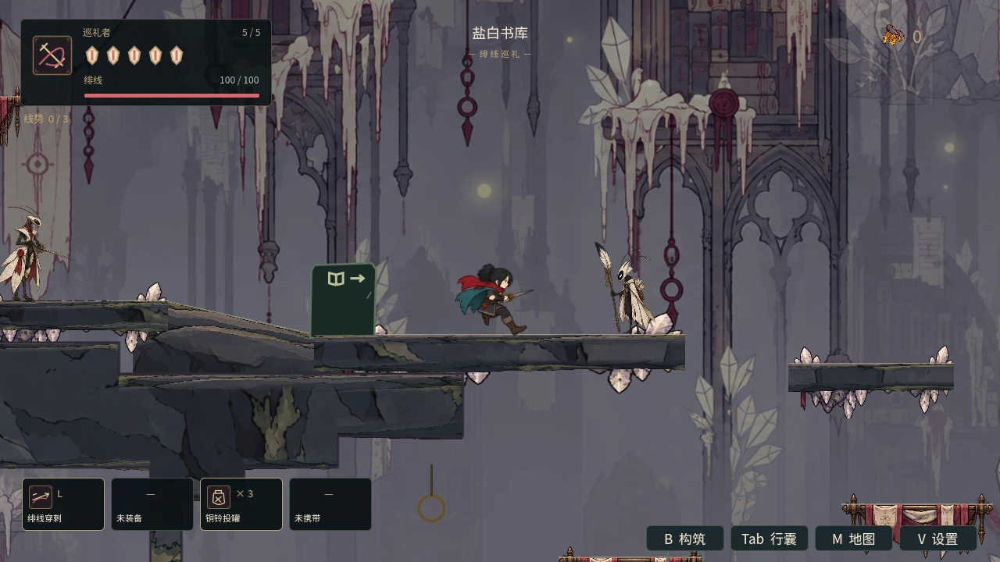
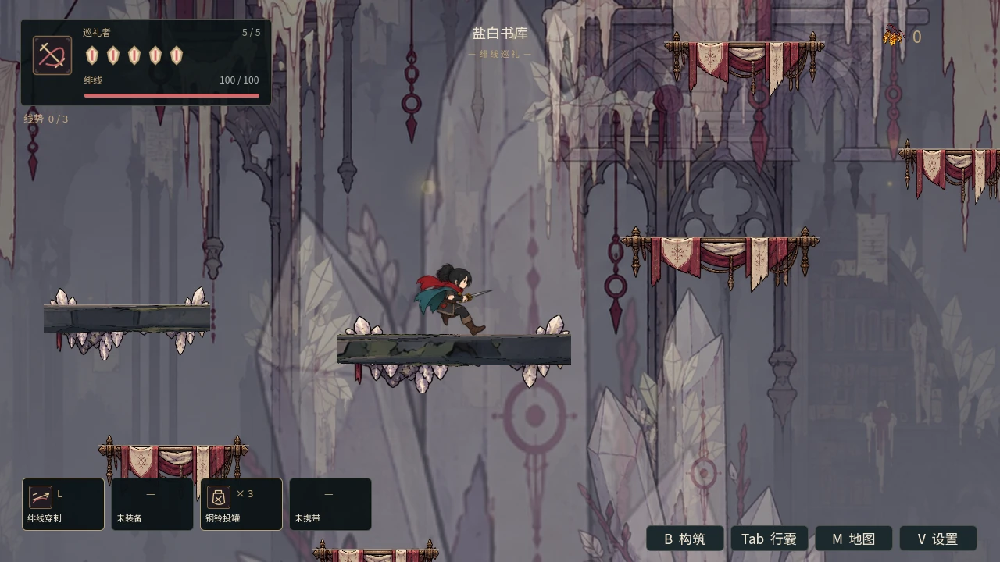
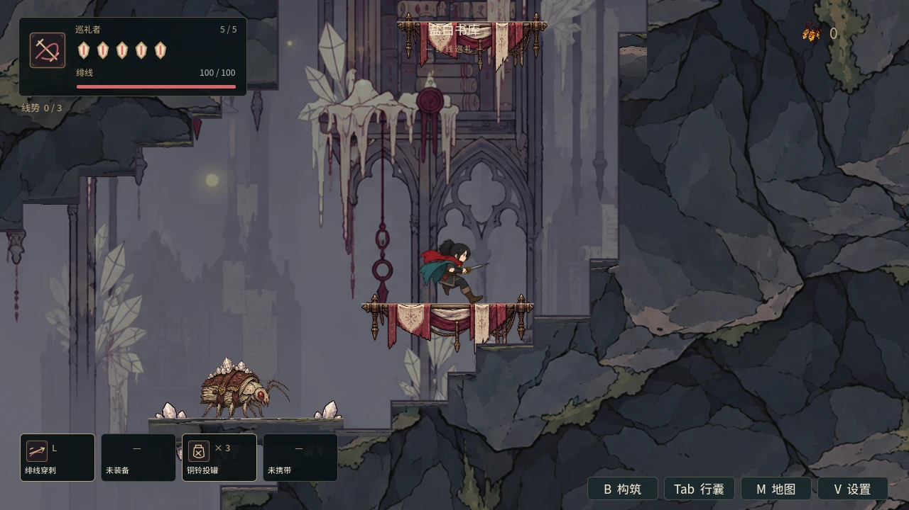
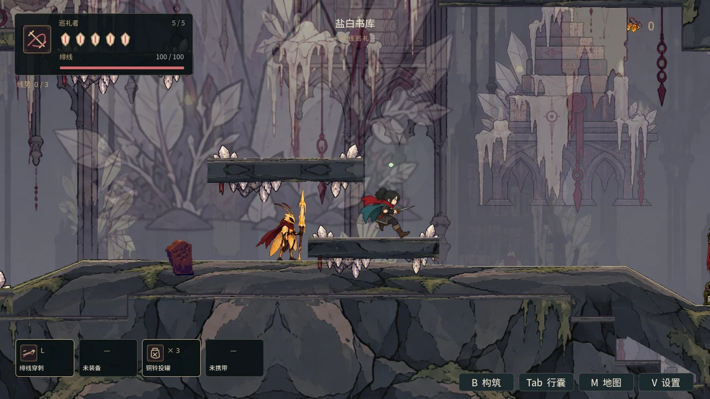

# 盐白书库：多层房间构图与交谈、战前恢复空间

## 玩家看到的变化

15个原有房间加入独立镜头范围：门厅与书脊长廊保留前方落脚面，烛台夹层与二层阅览廊聚焦当前层，中庭书塔随攀升高度跟随，滑页井随下落跟随并保留落脚书架。秘阁、天顶盐桥、封存书堆、索道厅和法庭各有自己的范围；继续沿用已有平滑过渡、门口迟滞与Boss优先锁。

E06索引书吏移至阅览平台东端(2285,1712)，保持页扇与落点封印；90像素领地与240像素警戒范围让读者身旁不触发新的交战。E12蜡枪兵移至索道厅平台(5030,2600)，30像素巡逻与65像素领地，与档案员和盐灯等待位置分开。已经开始的冲枪和地面蜡迹不会因玩家退到盐灯而自动消失，盐灯不是无敌区。

E04夹层决斗者保持虚晃退刺、双段追刺、原伤害和生命，巡逻35像素、领地95像素；两招收招分别为1.05/1.15秒，起手冷却0.8/1.6秒，让落脚后观察、避开连刺再反击的节奏更清楚。没有替换成单招或关闭伤害。

HUD和地图标题与章节进入提示统一为“盐白书库”。管理员路况台词改用书脊长廊、中庭书塔、反页廊与封存书堆的场景线索，移除重复固定按键说明。

## 房间用途

| 房间 | 玩家行为 | 本批交付 |
|---|---|---|
| 盐晶门厅、白书脊长廊 | 与管理员交谈，再观察低位书螨 | 入口和横向落脚视野 |
| 烛台夹层 | 落脚后观察虚晃与双刺 | 独立构图和双招收招节奏 |
| 二层阅览廊 | 读者处停留，再向东迎战书吏 | 交谈位置与远程敌人领地分开 |
| 中庭书塔、滑页井 | 按当前高度攀升或坠落 | 纵向镜头跟随 |
| 秘阁、封存书堆 | 找线索、奖励和证词 | 局部范围，地图与奖励规则沿用 |
| 索道厅、契约法庭 | 盐灯休整、进场、死亡后重试 | 蜡枪兵领地与Boss/复活恢复 |

## 验证与边界

新专项包含房间中心/边缘身体和落脚视野、书塔和滑页井跟随、保留Player/Camera实例、真实Boss封门、复活信号、离开清理与返回重建。局部战斗使用生产Player和原敌人配置、实际物理地面，验证决斗者自然起手和真实伤害；另在生产World的读者、档案员及盐灯实际位置等待，只开启待检演员，确认没有新的进战和伤害。局部地面夹具将敌人纵坐标归一，生产World等待夹具定位并冻结Player；均不是自然新档通关。

首轮相关回归中，铸雨渠旧专项假定下一地区没有房间镜头而失败。本批改为到达书库实际入口，检查15个书库镜头范围、盐晶门厅选择和旧Boss锁清理；保留切区/返回断言。没有放宽引擎ERROR或SCRIPT ERROR门禁。

最终新专项130项、0失败；13套相关回归取得通过结果，命名/目的地修正后5套复验通过。首轮11套序列有1套旧断言失败，如上记录；不是同一首轮完整零失败。npm test、campaign和两轮恢复模式导入通过；未声称本地完整77套通过。统计、日志及源码哈希见[verification.json](../../artifacts/salt_archive/verification.json)。截图为实际Mesa llvmpipe OpenGL取样，预热当下地形和敌人驻留后暂停演员；只清空短时toast。入口和阅览廊站位与NPC错开，主角可见。

构建基线为#50提交65a13a9e239a6d8f276a1895a7e70e1c0613f816；新PR目标main并包含前批依赖，#50合并后重复前批差异会自动消失。本任务不操作已有PR的合并。W02/A02/B02/C01推进第三地区子项，剩余三个地区及升级工房仍待逐房设计；W00c连续连接、T03长期稳定、T04开启伤害新档六区通关继续待验收。ObjectDB退出警告保留，未声称长期内存稳定。

专项复现：`python tools/run_godot_regressions.py --engine "$GODOT" --software-gl --suite salt_archive_experience --log-dir /tmp/salt-archive-regressions`。取样直接运行Godot：`godot --path godot --script res://scripts/salt_archive_experience_validation.gd -- --capture`（需要真实图形显示）。新专项已登记默认CI，远端全量以新提交结果为准。

## 五处实机取样

| 盐晶门厅 | 二层阅览廊 |
|---|---|
|  |  |

| 中庭书塔 | 滑页井 |
|---|---|
|  |  |

