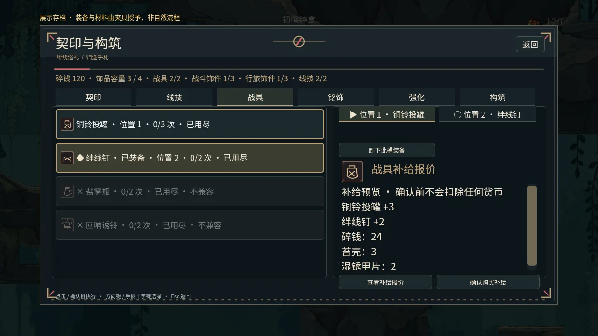
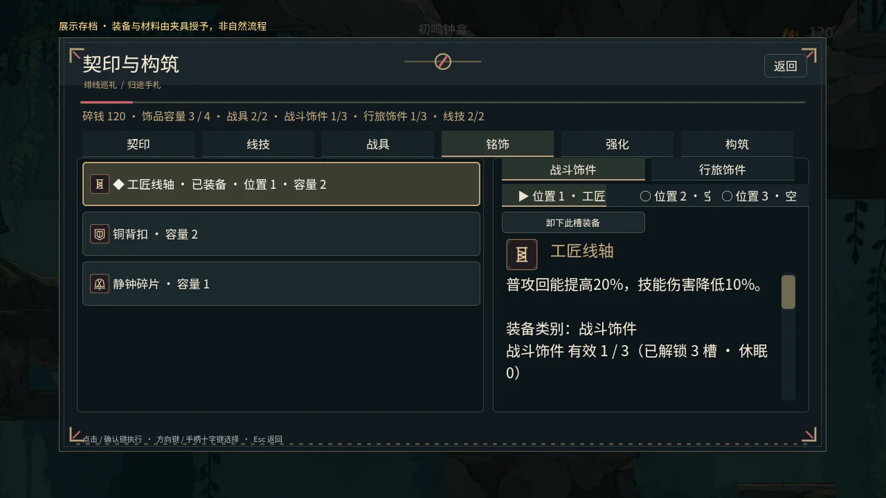
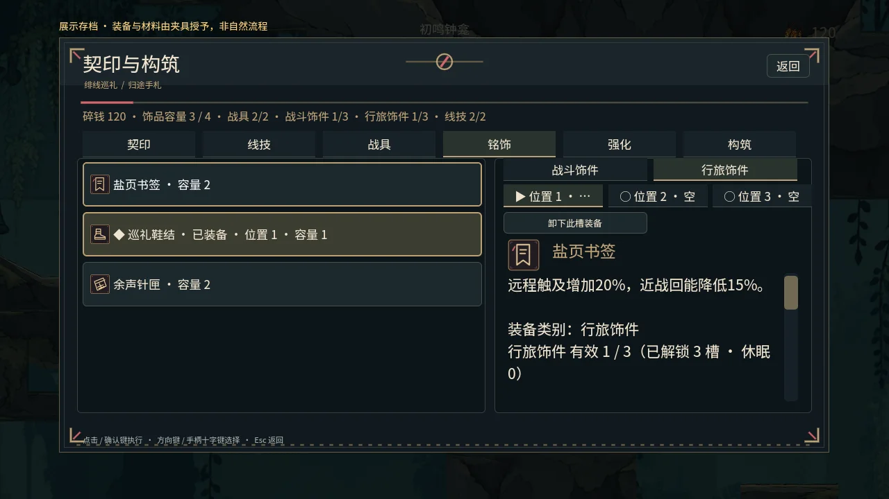

# 第二份升级：战斗、构筑与剧情验收

日期：2026-10-15。开发基线：PR #55 / e3f2427。用户已将第一份交由其他人推进，本分支不包含第一份未发布的代码，也不处理或推送 #54。发布期间 #54 由其维护者合入 main 后，同步 main 04812a4，合并两边 README、进度记录与回归登记；#54 的生产实现与主分支保持逐字一致。

## 本批实现

| 范围 | 本批子项 | 尚待完成 |
|---|---|---|
| C01 / C02 | 地形遮挡与真实伤害确认；被格挡命中不触发反弹、回能或契印收益；单次挥击反弹一次，多个实际命中的敌人保留各自收益；三契印治疗打断资源验证。 | 全动作/取消/恢复窗口与自然战斗手感。 |
| E01 / E05 | 四类兼容槽位、契印差异和解锁；v1/v2 构筑迁移；钟龛配置、路上仅切换预装方案；换装不刷新资源。 | 不同构筑与自然获得/解锁的全流程验收。 |
| E02 / E03 / E04 / G01 | 显式报价、付费部分补给；费用使用松脂碎片及可再生敌人材料；保存失败回滚构筑、钱包和库存。 | 独立碎铜预算、完整经济曲线、材料自然收入及所有被动叠加组合。 |
| B01 / B02 | 普通飞行敌人按视线/领地跟随，远程保持编排距离；受击保留已经武装的危险效果，未武装警告可中断；Boss 行为保留。 | 全地区逐房遭遇、Boss/可选挑战深化。 |
| N01 / N02 / N05 | 对话完成标志与奖励同源计算，恢复未领取奖励；证据按实际数量判定，结局与旅记仅展示已知线索；已选结局统一人物后果。 | 自然剧情顺序与环境/设施后果、主角表达。 |
| U02 / U03 / U05 | 类型/兼容/锁定/成本与剩余次数界面；先报价后确认；手柄按钮/焦点与已知结局旅记。 | 全页面样式、真实硬件操作和极端文本验收。 |
| T05 | 发布输入与打包工具继续验收。 | 新 Windows/Linux 候选包实际运行及最终发布验收。 |

六名 GPT-6 Luna 子代理分工实现，主代理整合、审查和集中验收。新增六项专项登记默认回归；原 180 秒、原有轮数和 ERROR/SCRIPT ERROR 门禁保留。源码与日志哈希摘要写入 artifacts/combat_build/verification.json，不公开原始诊断日志。

## 验证状态

- 首轮完整真实 GL：86 套，80 通过、6 失败。失败记录不覆盖：交互夹具瞬移后的迟到碰撞信号；三套 UI 夹具及一套升级整合夹具仍假设旧规则；结局重复打开时错误地重新发出后果标记。`seal_ui` 因旧数组访问错误最终触发原 180 秒超时。
- 修复后，16 套集中真实 GL 全部通过，覆盖上述六项及相关构筑、战斗、剧情和真实 World 交易/重启。新增六套共 **348 项**：近战 35、槽位 48、真实事务 29、敌群 19、UI 30、剧情 187。拉杆回收夹具又单独复验一轮通过；原释放断言保留，未改动生产驻留/预取实现。
- 最终两轮恢复模式资源导入通过；npm test、campaign 审计、发布输入检查（14198 文件）和发布工具 20 项单测通过。恢复模式不包含编辑器插件验收。
- 实际 World 九张画面已生成并检查；展示档授予装备/材料，不计自然取得。最后一次截图退出 0 且无 ERROR/SCRIPT ERROR；此前一次截图的资源退出错误保留在摘要，截图脚本等待延迟释放后复验。此等待不代表 T03 的生产退出诊断已解决。

首轮全量运行开始后仍有局部源文件修正，所有受影响范围在最终 16 套集中运行中重验；不把首轮写成“完整 86 套一次通过”。源码、日志及图片 SHA-256 见 [验证摘要](../../artifacts/combat_build/verification.json)。远端 CI 按最终提交单独报告。

实际失败注入作用于 World 保存提交边界，验证构筑/钱包/库存回滚和不生成战具效果；不代替操作系统重命名失败注入。普通测试仍可见 ObjectDB/StringName 退出警告，长期内存稳定性保持待验收。

## 已合并主分支后的整合验证

发布期间，#54 由其维护者合入 main 04812a4，造成 README 与回归登记冲突。同步官方 main 后保留双方记录，默认清单共 **87 套且无重复**；#54 的预取、读取及流式夹具源码未再修改。

合并后的 **22 套集中真实 GL 全部通过**，覆盖邻区配置、流式加载、实体、普通/实际战斗玩法、80轮压力及本批16套。压力82.212秒、16388项零失败；两轮资源导入、npm test/campaign 与14198文件发布输入检查再验通过。该次源码树为5fed8bb，精确日志哈希见验证摘要的post_merge。最终87套完整CI和Windows/Linux候选任务按最终提交另行核对，不将22套写成完整87套已通过。

## 实际游戏界面

以下来自真实 World 的展示档；顶部标明夹具授予，不是 MockRuntime 或自然游玩完成证据。长文本与材料明细可滚动。

## 第二份其余待升级点

| 编号 | 后续工作 |
|---|---|
| C01 / C02 | 动画与判定、下劈/反弹/取消、完整恢复窗口和三契印手感。 |
| C03 / C04 | 技能职责、成长获取与改变打法、费用冷却、完整施放/切区清理。 |
| E01 / E05 | 四类槽位获得路径、稀有解锁与不同方案的长期游玩验收。 |
| E02 / E03 | 工具遭遇用途、补给经济与被动叠加/互斥/卸下组合。 |
| E04 / G01 | NPC 制作关联、材料来源、碎铜预算、自然收入与后期消费。 |
| B01 / B02 | 全角色职责与逐房敌群、攻击错峰、交谈/治疗空间。 |
| B03 / B04 | 六位 Boss、可选挑战及奖励/失败恢复/重试成本。 |
| G02 | 死亡遗留物可达、二次死亡与跨区保存/追回方式。 |
| N01 / N02 | 变序证据主线因果、NPC 迁移与设施/任务变化。 |
| N03 / N04 / N05 | 主角短互动、场景历史印证、三结局实际后果与读档回访。 |
| U01 / U02 / U03 / U05 | 页面统一、手柄完整导航、HUD 准确、长文本和中断恢复。 |
| V01—V04 | 比例、动作、生活场景和危险优先反馈/特效清理。 |
| S01—S03 | 主题动机、连续转场、动作同步、空间音频与实际听感。 |
| T04 | 开启伤害、新档自然走完六区；两种顺序、三契印、经济不足、死亡重启及陌生玩家记录。 |
| T05 | 最终 Windows/Linux 候选包、入口/设置/存档/结局/许可/说明与已知问题。 |

自动化中的定位、授予物品、模拟信号和 MockRuntime 画面均是夹具，不计自然取得或 T04。编译/静态检查不代替运行时、实机画面、听感或目标平台验收。
