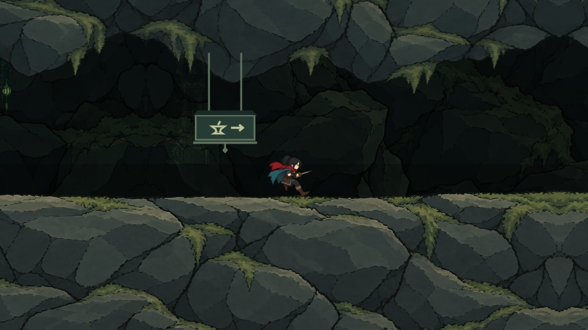
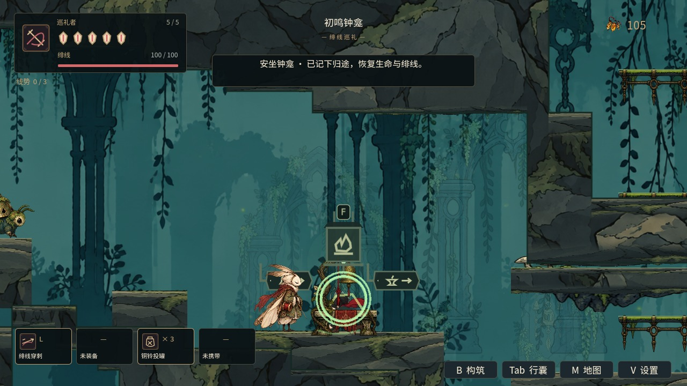
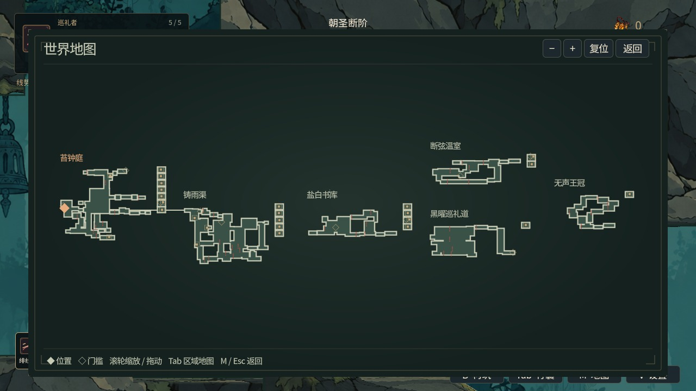

# 连续世界、探索操作与工程稳定：第一批整合

基于 main `b63daaf`，完整纳入 #54 `a448734` 与 #55 `e3f2427`。两份默认回归名单同时保留；不合并或关闭原 PR。工作分支 `codex/world-exploration-stability` 已通过 GitHub 插件保存整合基线；运行环境重置前未推送的本地草稿不是本批验收证据，本批重新实现并重新测试。

| 项目 | 本批实现 | 已验收及明确剩余 |
|---|---|---|
| W00 | 首区 prepare/build/finish 分帧；后台路线读；mtime 路线缓存、独占 overlay；512边/步缓存复制；加载器持有启动与切区 token；启动失败保留可聚焦错误/重试界面且不写坏存档 | 同 World 软件 GL 对照：同步挂入约1056ms，预算挂入约1.1ms，总启动约1.72s/83帧、最大观察帧间隔约145ms。2ms是准入而非硬上限。退出直接free/detach通过；仍有同步单项待拆解 |
| W00c | 管道终点暂停物理移动后再验证/加载；从校验过的相邻落点借用数字几何，短片段在通道物理空间驻留，取消或完成退休 | 物理管道52项与真实玩法46项通过；双向跨越缓存落点接缝、原对象复用、正常受伤/击杀、休息、NPC与重启均验收。仍在终点加载目的地区域，不是完整共享区域物理 |
| W01 | 保留现有两种首次区域访问顺序及能力门 | 静态图搜索不证明自然探索；后三地区新分叉与开启伤害实走仍待验收 |
| W02/A02 | 第六区15主房与20工房独立镜头、入口/动作/奖励位置、能力专属移动组合；生成器幂等并保留combat_practice/指南扩展 | 新王冠专项21项、工房403项及能力移动通过。使用定位/输入夹具，不计自然六区通关；房间结构模板仍需进一步替换 |
| W03/A01 | 八能力每种两处回访保留，动作门位置按各能力校准 | 工房真实输入、取奖、返程回归通过；完整“发现—获取—组合—回访”连续自然流程未验收 |
| W04/W05 | 保留钟龛、秘密和交通既有规则 | 本批未完成新秘密线索、交通费用预览及重试通勤深化 |
| U04 | 已购且补绘房间中的危险符号与动态能力/动作门符号；秘密嵌套归属、世界图逐地区状态一致性 | 认知和真实地图组件17项、地图657项、购图补绘4055项通过。楼层、自定义图钉和定位/导航工具区分仍待实现 |
| U06 | 热插拔焦点弱引用、菜单首个可导航控件、释放控件回退、断连取消重映射及一帧输入保护 | 输入设置32项、UI构筑与世界集成通过；真实硬件手柄体验仍待验收 |
| T01 | 首次移动、绯线资源、冲刺、战具教学使用当前绑定并保存一次性状态 | 首区教学专项通过；首次购图沿用商店说明，陌生玩家理解记录仍待验收 |
| T02 | 备份复制后重新校验、唯一原档保留、恢复安装失败回滚；世界坐标/旧地区名迁移、跨区重启、写入失败保护 | 存档37项及world_state通过；更完整的损坏/迁移矩阵仍待深化 |
| T03 | 80轮压力追加内存、节点、资源、音频与帧间隔趋势；明确启动协程所有权；死亡回收结延至物理查询结束后创建 | 压力16380项通过：82次采样，节点净增0、静态内存净增1,824,393字节、资源净增8；共用llvmpipe环境末600帧p95约28.65ms、最大443.61ms，不作硬件FPS结论。启动verbose退出无泄漏；部分专项仍有间歇ObjectDB退出警告，不计长期稳定通过 |

## 验证边界和失败记录

- 资源导入按既有180秒上限，两轮通过；不计编辑器插件验收。
- 恢复后初次运行暴露缩进、SceneTree viewport API及旧存档地区名坐标断言错误，均保留失败证据，修正后重跑。
- 改为分帧启动后，固定等待数帧的旧夹具须明确等待 initial_region_ready；保留原业务断言及运行器超时。
- 新工房镜头使旧地区总数增加；地区专项分别严格核对原房间数与工房镜头，并保留取景循环。第六区不再用“无镜头”旧假设。
- 过期纹理夹具在有效邻区上安排真实 ResourceLoader 请求，然后最初在2秒窗口确认在途任务；续接最新main后沿用其8秒准备窗口及2秒排空窗口，换代后逐个要求过期结果被丢弃。
- 新增缓存落点几何后，真实返程在终点前87像素被地面切边阻挡；定位到亚像素高差后，仅将通道阶段的借用落地面设为单向，正常地区仍采用原始实体碰撞。双向46项通过，未放宽入洞距离或屏蔽伤害。
- 远端Linux/Windows实际打包首启发现根节点仍在装载主场景时，启动任务在第一次await前添加根加载画布，触发`Parent node is busy setting up children`。任务现在先占有startup阶段，再等待一帧并校验宿主/树/取消状态后创建画布；新增首帧重复请求与立即销毁回归。隔离新档实际主场景首启复现原错误，修复后无引擎错误并生成完整存档；首区预算、异步加载492项、宿主539项复测通过；真实主场景续档保留探针并完成备份写回。复现日志中的原错误明确保留为修复前证据，[首启修复日志](../../artifacts/world_exploration_stability/desktop_startup_fix_logs.tar.gz)另存。双平台打包仍交由后续CI复核。
- 首轮完整回归中，重复请求写入共享last_error，污染分帧预检并使world_async_loading在180秒超时。拒绝重复请求现在不写正在执行任务的错误字段；专项492项、host539项、预检4020项通过。
- 延后死亡结算后，敌人驻留旧夹具在同一回调内读取回收结；补一个process_frame等待，保留半额扣款/单结/持久化原断言。专项56项通过。
- 七组真实GL像素检查全部通过：岩缝12、流送12、管道5、六区岩边12、世界图5、邻区美术6、区域UI提交10。
- 运行器增加全部86套专属完成正则与13项自身测试。初次world_route_walk和pilgrimage_merge日志缺少最终标记，不能只凭退出码0计为完成；两套重跑分别完成25步/3874物理帧与12项。提前结束未再复现，不推测根因。
- 槽位替换、新旅途及叙事spawn夹具统一等待首区发布；Boss试炼从构造期移至延迟执行，避免SceneTree尚未建立。保留全部原业务断言。
- 工房重生成曾抹掉六处combat_practice和地图说明；现在从seal_practice_plan重建，并增加12项静态契约检查。连续两次生成的SHA256均为48a998cea11bba3548fe0309f14ffa80370bfd194875e534c26f367f2b4d7df2；获取66项、工房403项、第六区21项复测通过。

## 最终本地证据

源码检查点 `795727ba68c263579fedd83758563584ad4ba054`，树 `2fe7827c1119f9cff04ecb2526e42613b85638e1`。默认86套的最终日志均通过结束标记与严格引擎错误复核，最终失败0。执行组成是85套初轮、单独真实玩法及受影响套复测；初轮有6套失败，另有两份不完整日志，不称一次命令干净跑过86套。逐套日志、SHA256、警告和来源见[验证摘要](../../artifacts/world_exploration_stability/verification.json)，完整初轮和最终日志见[压缩原始日志](../../artifacts/world_exploration_stability/validation_logs.tar.gz)。

CI运行器为 `world_neighbor_gameplay_stress` 加入有限的绘制隔离：它仍用GL renderer和同一80轮场景/租约生命周期操作，核对音频/资源计数和全部断言；该fixture暂停常规场景处理，不代表实时物理战斗，只不自动栅格化每一帧。此套不做像素断言；workflow的岩缝、管道、全区岩边、世界图、邻区美术、46项实时邻区玩法和区域UI专项继续使用开启的真实GL绘制循环。上文82点帧间隔和末600帧p95来自此前绘制开启的llvmpipe本地记录，仅作为该次环境观测；绘制隔离后的压力套耗时或帧间隔不作为渲染性能证据，不能与此前数值混读。

`npm test`、战役/地图结构审计、角色素材与姿态检查、20项发布门禁自身测试通过。Linux/Windows实际导出与启动仍须远端desktop矩阵验收；本地自身测试不替代该矩阵。资源恢复导入保持每轮180秒上限，不启用编辑器插件。

ObjectDB警告未被过滤。路线verbose退出仍列出 `AudioStreamPlaybackOggVorbis`、`AudioStreamOggVorbis`、`OggPacketSequence` 和 `RefCounted`；当前证据尚未锁定保留者，不据此断言音频缓存或RID已修复。80轮趋势的完整82点采样见[运行趋势](../../artifacts/world_exploration_stability/runtime_trend.json)。

## 提交状态与恢复

开发起点为main `b63daaf`。连接恢复后核验发现用户已合并新版#54：当前main `04812a4`；#55也已更新为 `300f206`。两者均已整合，保留本批86套清单和最新main的逐个旧任务归属/排空/丢弃断言。流送专项及npm/战役检查复测通过，[复测日志](../../artifacts/world_exploration_stability/reconnect_validation_logs.tar.gz)另存。本批不操作main或原PR合并状态。

GitHub写入权限已核验。此报告是推送前的本地证据快照；远端Godot/desktop两条工作流的最终结论以本批PR checks为准，不用本地通过代替。

提交包包含本批完整提交历史及验证材料。已有完整仓库可执行 `git fetch /path/world-exploration-stability.bundle HEAD:codex/recovered-world-upgrade` 后切到恢复分支；需要基线提交b63daaf及其祖先5fec013，浅克隆应先补齐历史。

下一批继续拆解超预算单项、扩展桥梁/井道共享物理、实际走通两种后三区探索顺序、替换重复工房结构，随后补秘密/交通、楼层图钉与陌生玩家教学记录；T03保留长期驻留和退出所有权归因。
