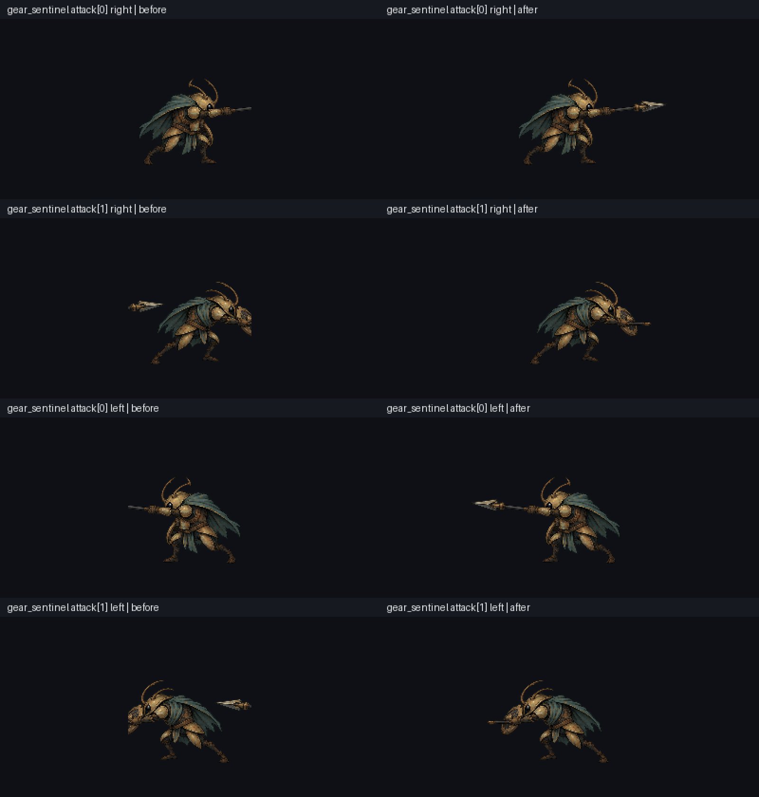
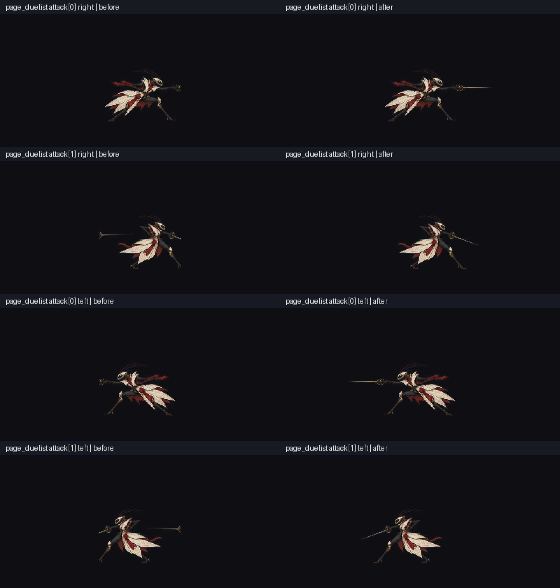

# 两怪物攻击原画切帧修复与角色覆盖记录

日期：2026-10-16。基于最新升级PR #99 `9e33deb02192cac1b193a2c90cf99b7ec8cca797`，独立素材差量，不重复计入上游动作/死亡/图钉/首区修复。

## 玩家实际改善

修复 `gear_sentinel` 与 `page_duelist` 各两张现有攻击姿态的错误裁边：原图里的矛尖/剑刃恢复，邻近姿态的武器残片移除。保持身体、双脚、握持点和左右朝向注册；攻击伤害/碰撞、前摇/有效/收招时长、FPS、帧数、缩放与偏移不变。新增绘制 **0**，插值帧 **0**，本批是 **4张既有姿态恢复**，不是补齐全动作关键帧。

两图每行左旧右新，依次为attack0右、attack1右、attack0左、attack1左。真实生产loader/actor/Shader渲染，未重画图像；这是隔离检查视角，不是自然六区游玩。

## 原像素、画布和可重建性

两份原atlas保持逐字节不变。手工审核的空间归属多边形、body种子和alpha>0连通选择保留所属低alpha边缘；四份输出每一保留RGBA都能由source-coordinate行程mask回溯，不用alpha阈值抹掉武器。page attack0的跨行alpha1桥按空间归属排除1522像素，alpha>=2丢失0；不把该归属选择隐藏成“所有原图像素都保留”。

两画布各边新增192水平、16垂直边距；新像素坐标q=s-r+m+P、C'=C+2P，故q-C'/2=s-r+m-C/2，左右变换下注册均不变。其他20帧仅更新margin补偿，原region/atlas/RGBA实际显示不变。gear第二姿态保留原回收短杆，不凭空生成新矛尖。

每种怪的 `attack_integrity.json` 是可重建来源记录，多数新增JSON行是逐行归属范围。`attack_source_manifest.json` 固定原字节/SHA；正常工具无需Git历史或Git命令。17项原像素单测包括无.git/PATH空的完整重建，无跳过检查。新4PNG沿原目录明确Git二进制例外，未把资源变为LFS指针。

## 真实运行与永久门禁

- Godot4.6.1原180秒严格双导入通过。冷85秒诊断失败（含初始XDG不可写）保留；接受轮是已核同引擎/6809同源资源及cache MD5的warm reuse，4新PNG确实重新导入。不能称冷导入180秒性能已通过。
- 原enemy_visibility641与generated_runtime六章通过。专用真实GL3315项通过：24帧×左右48状态，未改20帧×左右40次framebuffer逐RGBA完全相等；4修复帧×左右8次生产Atlas绘制等于完整canvas输出。四真实攻击模式×左右8次播放、时长、位置、清理通过。
- 新图默认 `fix_alpha_border` 会改极低alpha的RGB。首轮4个“导入纹理等于原PNG”过严断言失败保留；最终用公开 `Image.fix_alpha_edges()` 对原PNG副本作同设置oracle，导入结果全RGBA完全相等。变化只在alpha1–19的RGB，所有alpha及alpha255 RGB不变；原PNG原像素门禁未删。
- 最终接最新9e33链后，以正式runner再次真实GL3315通过，0引擎错误。30 runner单测通过；默认111套=原110全保留+专用套，强制真实绘制/fixed60和完整48状态/8播放marker；原180秒/ERROR严格策略不变。CI同时永久执行17项原像素Python门禁。最终准确head完整CI/双平台另核。
- 动画WebP是实际GL逐帧截图按固定60Hz模拟游戏时序编码的检查预览，像素/时长解码已核。它不是墙钟实时录屏，不能据此宣传实际60FPS、无卡顿或自然受击通关。

## 全角色后续范围与优先级

角色素材最高优先，技能特效与怪物受击反馈其次，其余原计划新功能后排。基线盘点覆盖正式World40种普通怪、6个Boss、25个命名NPC（另有主角动作清单）；71角色的实际状态/帧/命令与缺口记录于 `artifacts/character_animation_coverage/`。这份审计冻结在e3e7d0a6，仍如实保留修复前数据，本报告明确本批只关闭其中两怪4攻击帧裁边，不能将全表标已升级。

未完成：主角待机最差接点/呼吸/跑攻过渡真绘，怪物/NPC其余裁边候选与缺帧、全周期衔接、自然伤害六区、目标硬件帧时间与长期资源稳定。NPC无实际移动状态时不凭空增加玩法。
