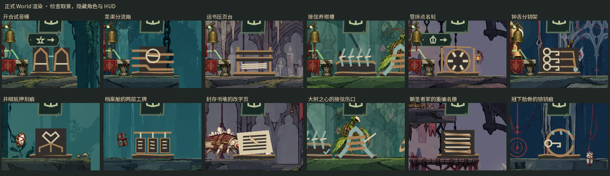

# N04：生产设施与原始证词的场景印证

六区各加入一件生产设施与一件原始证词对应的物件：试音泥模、泵渠分流箱、运书压页台、接弦养根槽、营床点名轮和分钥架说明设施如何服务居民，又如何接入失声秩序；六件刻痕、工牌、改字页、树心伤口、重编军册与锁钥痕直接复用原证词的场景文字。四件战具的目录来源补成具体旧设施与工匠手艺，绘针、罗盘和三枚契印的来源、用途也进入当地观察文字。

每件物件站在现有平台上，与原证词拾取点错开，新增十二项检查保证原拾取点仍选中原证词；没有新增道路碰撞或地图图钉。证词痕迹只在进入对应房间后显示；交互采用现有范围并检查地形遮挡。按实际绑定的交互键查看，读完后明确确认才记入旅记；离开与中断只保留会话阅读书签。保存失败回滚标记与世界状态并保持阅读面板可重试。旧档无需改格式，未知或格式错误的见闻标记不揭露内容，回访从保存标记重建已读刻口。

环境见闻与原始证词分别解释，不给物品、钱、能力或终局条件；旅记主线仍居首。组合 #166 的分类时见闻归入证词线索，敌人页不会混入见闻。静态物件只在状态改变时重画，泵阀才有缓慢摆动；每区固定两件，没有新增粒子。

快速关闭背包后立刻换区还暴露旧生命周期问题：未挂树的待播放音效节点不在区域子树里，字段重置使它们丢失并一直持有音频流。区域音频释放现在在重置字段前取消这些待挂载播放器；未修前场景套件退出有音频释放 ERROR，修复后验证无遗留孤立节点。原失败保留在本地 `artifacts/n04_scene_history_final`。

验证基于 main `896b127e`：十套真实 GL 通过（场景见闻、音频、正式 World UI、UI 改版、9798 项叙事结果、输入提示、存档、启动预算、敌人驻留、读档）。最终位置／正文源再次执行 scene_history 183 项通过；组合 #161/#166/#167/#168 的六套检查通过，最终位置还独立复验 185 项见闻与分类集成。最终六处原证词拾取保护与全部房间归属均通过，失败位置已保留在本地 `artifacts/n04_scene_history_pickup_safe`。npm test 与 campaign 通过；POSIX runner/import 可执行夹具在本机 Windows 按既有规则跳过，不冒充本机执行。

十二张正式 World 的 GL 截图已检查。下图为检查镜头取景，隐藏角色与 HUD，保持实际场景和绘制；没有用传送夹具证明自然抵达。原截图在本地保留，CI 会上传自己的独立截图。

部分旧 World 套件及个别实拍轮退出仍有 ObjectDB warning，继续归入 T03；本批没有忽略 ERROR 来判通过。陌生玩家的自然发现、长文本理解、整段操作体验与整体美术统一仍分别交由 T04／V01 验收，不据定向夹具关闭整份升级清单。
