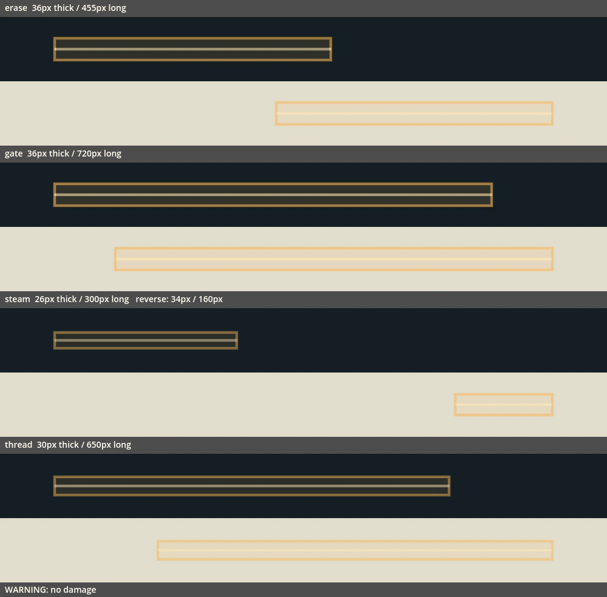
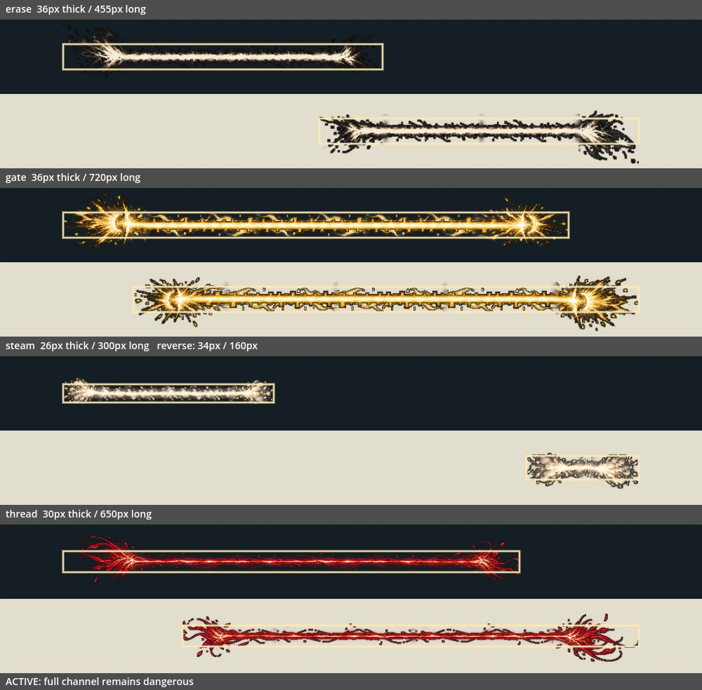
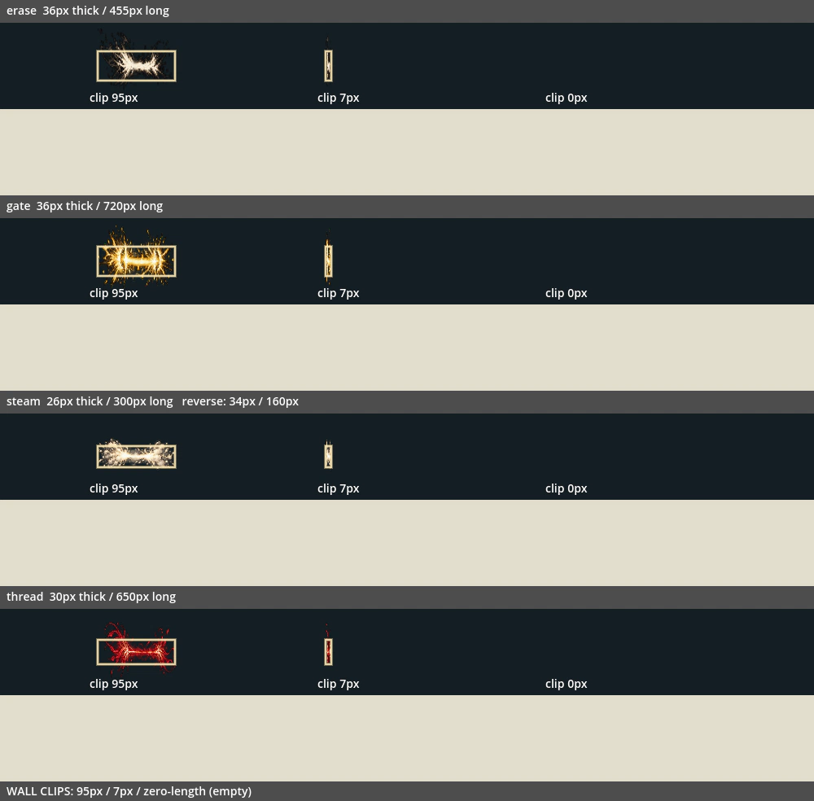

# V04：四类分段光束运行时接入

日期：2026-10-20。接续 #151，base 为 `codex/v04-terrain-attack-runtime`（`af720427`）。本批接入四类光束的 16 格源图：每类为起点、中段 A、中段 B、末端，不是四帧整条光束轮播。

## 玩家可见变化

| 家族 | 实际攻击 | 原宽度 / 长度 | 原前摇 / 有效期 |
|---|---|---|---|
| steam 蒸汽束 | 管弹投手「近身蒸汽反喷」 | 34px / 160px | 0.65s / 0.38s |
| steam 蒸汽束 | 阀门爬虫「排汽横扫」 | 26px / 300px | 0.9s / 0.4s |
| erase 擦除线 | 擦除执达吏「擦除直线」 | 36px / 455px | 1.1s / 0.36s |
| thread 绯线 | 緋线执剪者「绯线封路」 | 30px / 650px | 1.0s / 0.42s |
| gate 冠门封线 | 无声王冠「冠门封线」 | 36px / 720px | 1.15s / 0.42s |







以上为真实 OpenGL 的受控生产攻击对象夹具：采用五条命令的宽度、长度、前摇及有效时间，冻结物理并指定时间采样，供逐段核对。动图按选定采样帧展示，不是自然游玩录像；其中短裁切图为专门配置的边界案例。矩形框为保留的原危险通道边界。

## 拼接、对齐与时序

- 源 PNG/TXT/JSON 保持原样。图像与提示词哈希在打包时校验，元数据哈希留档。按交付 JSON 的实际横带裁框读取，避免名义四等分切开光束。
- 每类统一源图比例，以两个中段的最大厚度为 32px 打包基准。通过直线延续区的 alpha 加权轴线对齐各段：起点采右侧、末端采左侧、中段采整条，避开端部爆发影响。
- 起点选首段左侧部分，末端选末段右侧部分；中段取中央一半，保留重复材质。选区、源轴线与图集矩形逐一记录于 manifest.json。
- 所有相接边缘共用一个 RGBA 剖面，在边缘 8px 内渐变到同一接缝。中段 A/B 的连接宽度相同；运行时使用完整中段等分填满剩余距离，保留最后一处接缝，避免在花纹中间截断后接末端。
- 光束短于两个端部的自然总宽度时，仅横向压缩两端；不让起点、末端或中段越过原射线裁切点。零长度不画贴图或通道框。上下的端部飞屑是图形装饰，碰撞厚度仍使用原半径。
- 使用真实 heading 旋转，左右与斜向共用同一套图。原墙体/岩块的最近射线交点仍决定 length，没有更改裁切或命中代码。
- 中段 A/B 按 12fps 交替，端部保持静态。前摇只显示原警告通道，正式判伤后显示完整图形与边界，直到原到期点；不再在仍可伤人的最后 180ms 提前淡出这四类光束。
- 原伤害、一次命中、不可反弹、前摇、有效期、轴向端点、横向玩家中心容差、UI 输入锁暂停、危险优先层级与主人退场清理均保留。到期按原逻辑取消，没有把组合用的端部当成消散帧，也没有额外命中装饰。
- 每束最多 64 个中段加两个端部；当前五条攻击常规布局只需 3–5 段。超长合成用例也保持完整长度和有界分配，不以装饰预算裁减危险物。

## 资源与导入

单张 1024×512 图集，PNG **220211 字节**，解码 RGBA **2MiB**；无损、无 mipmap。运行时只解析一次同目录清单，不逐帧读取文件，也不持有主人或场景引用。现有导出规则包括 JSON，清单随图集导出。

为保持接缝颜色，**此图集关闭 process/fix_alpha_border**。实测 Godot 默认边缘重写会改变冠门封线的接缝颜色；源图打包的暗细边已提供轮廓，运行时检查保留了该导入约束。全透明 texel 的 RGB 不影响接缝覆盖比较，所有可见 texel 与 alpha 须相等。

## 验证

[结构化验收、源图哈希与排除项](../../artifacts/beam_art/verification.json) · [逐套日志](../../artifacts/beam_art/logs)

- 新增 `beam_art_validation.gd`，挂入已有 `enemy_effect_lifetime` 注册入口；**441 项通过**。原飞行物 300 项、地面池 375 项、地波/地刺 609 项、生命周期 46 项仍通过。
- 16 个部件非空且各家族四部分不同；源图/运行时矩形逐一对应。各接缝可见 RGBA 和 alpha 在整条扫描线上一致；两个中段每一列均有不透明核心，没有透明断口。
- 长度 0、0.25、1、17、100、160、455、650、720、100000 的布局，两个中段状态都检查连续覆盖、完整源矩形、精确终点与 66 段上限。正常游戏范围容差为 0.001px；合成超长案例按 Rect2 单精度浮点精度允许不足 0.01px 的舍入误差。
- 四类在深浅背景、右向/左向/45°、两个中段状态及有效期最后 1ms 的真实 GL 像素，和独立按清单布局的源图对照；每通道最多 1/255 的帧缓冲量化差。另检查实际厚度可读性、两帧确实变化、原点前方与裁切终点外无图形、7px 压缩和零长度无残留。
- 经真实 `_spawn_command_effects` 验证全部五条攻击的家族、伤害、宽度、射程、前摇、有效期、不可格挡、层级与瞄准。实际物理墙验证左右和斜向裁切、近岩块优先、远岩块不覆盖近墙、原点受阻归零。
- 实际物理帧验证前摇不判伤、不可反弹、只伤一次、保留轴向包含端点与横向 19px 玩家容差、UI 锁暂停、到期注销、不制造假命中/消退、主人退场清理和装饰饱和时仍生成危险光束。
- 负例一：仅禁用新渲染分支，**85 项失败**。负例二：仅让图形比裁切结果多画 64px，**145 项失败**。恢复后重新运行，441 项全过。
- Godot 4.6.1 recovery-mode 双轮严格导入、npm test、test:campaign、打包 --check、Python 编译、工作流结构及差异检查通过。真实 GL 预览使用 Dummy 音频，日志无 ERROR/SCRIPT ERROR。

本地 **14 套相关注册回归全部通过**：enemy_effect_lifetime、character_art_prewarm、combat、combat_visual_budget、enemy_ai_behavior、enemy_lifecycle_regression、enemy_visibility、greenhouse_experience、obsidian_experience、optional_challenges、player_melee_feedback、seal_combat、world_enemy_residency、world_startup_budget。最终逐套结果见 verification.json，日志保留。完整默认集合由本提交 CI 独立判定。旧套件的 ObjectDB/StringName 退出警告保留，未计作本批修复；未重新认证自然六区通关、长期资源曲线或目标硬件帧时间。

## 占用与隔离

修改 `enemy_attack_effect.gd`、`enemy_effect_lifetime_validation.gd`、`.gitattributes`；新增 `beam_art.gd`、`beam_art_validation.gd`、图集与清单、三份打包/预览工具、独立 `.github/workflows/beam-art.yml`、本报告和 `artifacts/beam_art/`。

不修改 T02 / E04 / N05 / U06 的存档、构筑、主场景、叙事、旅记、设置源码；不修改共享测试登记、package.json、共享台账或进度页。已核对 #150 的文件列表，与本批差量无重叠；排除项逐一留档。

本批接在 #151 后，待其合入后再合本 PR。敌方已交付飞行物、地面池、地波/地刺和光束合计 32 类、236 格已分批接入；V04 仍部分完成，主角技能/战具 7 张源图、其它预算和自然流程验收留待后续，不能视为整项验收结束。

## 复现

```bash
python tools/build_beam_art.py --check
python tools/run_godot_import.py --engine "$GODOT" --recovery-mode --timeout 600 --log-dir /tmp/beam-import
python tools/run_godot_regressions.py --engine "$GODOT" --software-gl --suite enemy_effect_lifetime --suite combat_visual_budget --log-dir /tmp/beam-tests
```

通过 `tools/software_gl.py` 上下文提供真实显示，设置 `BEAM_GALLERY_DIR=/tmp/beam-gallery`，运行 Godot 参数 `--audio-driver Dummy --path godot --script ../tools/capture_beam_art.gd`；成功后执行：

```bash
python tools/build_beam_previews.py --capture-dir /tmp/beam-gallery
```
