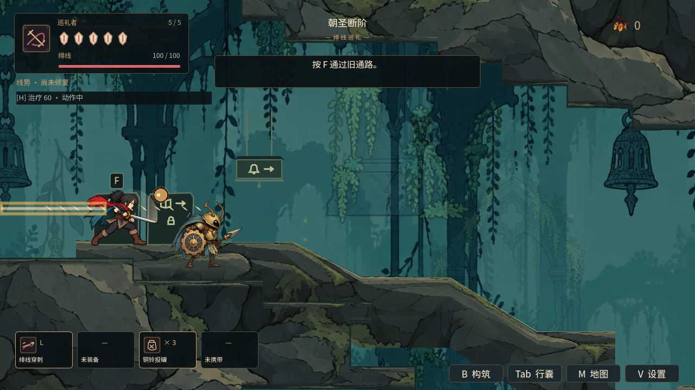
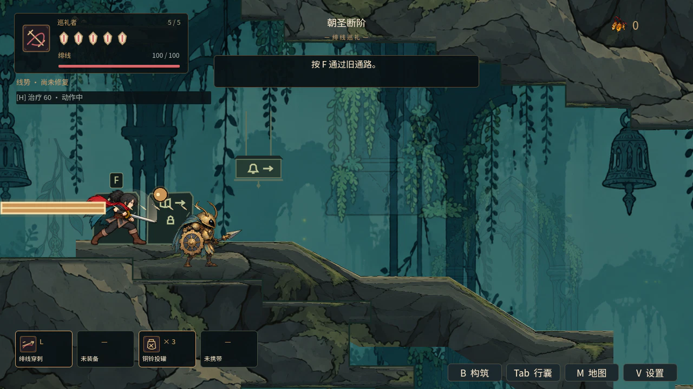

# V04 子项：危险优先与全屏反馈预算

最初基于 main `a91d1b3e`，现已同步 main `418321cd`（含 PR #141／#142／#143）。推进修订方案 V04 的危险优先、同屏层级与闪光预算，同时检查 U06 设置与 T03 回收。

## 行为

原飞弹 Z=7、前摇提示 Z=8–22，而玩家刀光 Z=60、命中小切口 Z=80，会在重叠时盖住危险。新增 `combat_visual_policy.gd`：飞弹、光束、地面危害与攻击线使用绝对 Z=100，前摇提示绝对 Z=110；父节点偏移不再改变顺序，类型标记保留。

敌人受击火花与玩家命中小切口共享 12 个纯装饰名额。满额只跳过新的装饰，不改变真实命中、伤害、回能、危险物数量、判定或时序。排队删除立即释放名额，场景树负责回收，无新增静态节点引用。刀缘仍按原武器锚点绘制。

全屏反馈共用单层：提亮最多 0.12 alpha，受击压暗最多 0.24 alpha；每次最多 50ms，新的反馈间隔至少 200ms。受击可以替换正在播放的击杀提亮，但不能延长原截止时间；同级或低级请求不能重启效果。真实时钟负责截止，慢放不拉长反馈。关闭闪光或换镜头立即清理，受击孔洞位置与原命中停顿沿用。

## 验收范围

`combat_visual_budget` 接入默认 CI，检查同帧重复请求、优先级与反序、截止/间隔、慢放、设置/换镜头清理、24 次真实扣血、装饰满额下 20 个危险物全部生成、场景回收与慢首帧。两种敌人视觉模式都检查父层级隔离。真实 GL 像素对比覆盖光束预警/生效、飞弹不透明核心在装饰重叠前后的一致性。

视觉探针子类仅关闭音频，真实播放由既有 `audio_retirement` 单独验证。`combat` 与 `enemy_lifecycle_regression` 的 Ogg 退出 ObjectDB 警告在原 main 上也能复现，不把它记为本批修复。

本地 Godot 4.6.1 双轮 recovery-mode 导入、npm、章节审计和 10 套相关真实 GL 回归全部通过，新增套件 32 项通过；临时恢复旧 Z=7 后 6 项失败，恢复修复后通过。最终本地结果、原始日志与源码哈希见 [verification.json](../../artifacts/combat_visual_budget/verification.json)。默认套件登记由 122 增至 123（含四套叙事脚本），本机只运行受影响集合；远端完整 CI 按最终提交独立报告。

## 画面与后续

已在本地目检生产 World 暂停夹具的预警/生效画面；可用 `tools/capture_combat_visual_budget.gd` 重现。截图已附入 PR，脚本布置角色、飞弹、光束和 12 个命中标记，不能代替自然流程或帧率验收。展示夹具退出仍有 Ogg ObjectDB 警告，未声称修复。

V04 保持部分完成：本批名额只覆盖命中火花/小切口，没有覆盖所有冲刺残影、技能及环境粒子。特效源图逐格接入、全房间混战目检、闪光舒适度、T04 自然六区流程、T03 长期资源曲线仍待验收。下一批在攻击特效源图合入后按实际帧矩形、锚点、判定范围与正常游玩尺度接入，并扩展其它装饰预算。

## 2026-10-20：同步主分支并解决合并冲突

合并 main `418321cd`，保留角色动作 v5 的收招过渡和大房间地图分段。三处文本冲突分别合并两边台账、两个新增完成标记与运行器测试入口；默认注册共 124 套（含四套叙事脚本），`combat_visual_budget` 与 `survey_room_segments` 均保留。`enemy_actor.gd` 自动合并后逐段核对，相对 main 只增加本批视觉层级和命中装饰预算，没有回退角色动作。

双轮资源导入、npm、章节审计、角色素材校验与 12 套相关真实 GL 回归通过，包含视觉预算 32 项、角色动作 5052 项、地图分段 27 项；既有 ObjectDB 退出警告保留，未计作修复。本次合并的独立验证记录见 `artifacts/combat_visual_budget/main_sync_verification.json`；上文 123 套及旧源码哈希属于首次提交的历史记录。远端 CI 仍按新的合并提交单独核验。
