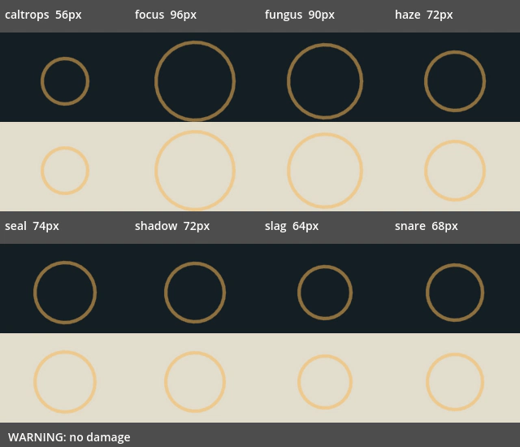
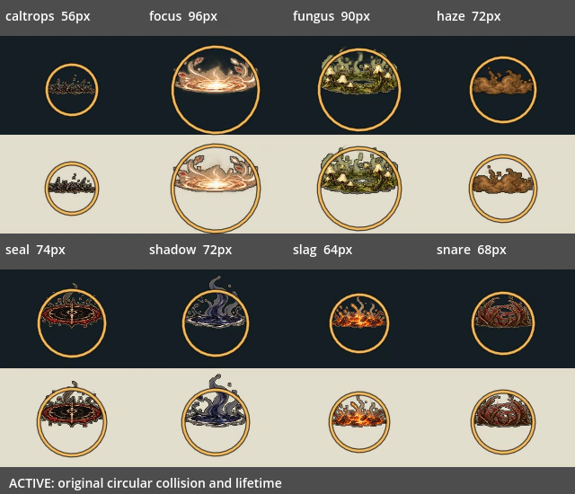

# V04：八类地面持续危害运行时接入

日期：2026-10-20。接续 #147 飞行物，base 为 `codex/v04-projectile-runtime`（`81330a7a`）；依次等待 #144、#147 合入。本批不包含地波、地刺、光束、主角技能或战具。

## 玩家可见变化

原有池状攻击共用圆圈与五个光点，现在使用已交付的八类手绘图，各 8 格，共 64 格。判定仍为原圆形，保留高对比边界，以免低矮的地面贴图误导玩家对危险范围的判断。

| 图形 | 实际攻击 | 游戏内主体宽度 |
|---|---|---|
| 印阵 seal | 落点封印、双落印 | 60–74px |
| 菌圈 fungus | 菌圈落点、迟发苔音 | 78–90px |
| 烟圈 haze | 香灰落圈、错位花粉圈 | 72–96px |
| 根笼 snare | 根笼囚网、交错根笼、断线结阵 | 62–68px |
| 灰钉阵 caltrops | 灰钉阵 | 56px |
| 影池 shadow | 影落封圈、镜池迟影 | 72px |
| 聚光 focus | 延迟聚光 | 96px |
| 铁渣滩 slag | 管弹碰撞后生成的池 | 64px |





以上为真实 OpenGL 的受控生产攻击对象夹具；冻结物理并指定时间采样，供逐格检查，不代表自然游玩录像。图中上下分别为深浅背景，标注宽度为实际攻击直径；判定还沿用原玩家中心容差。

## 图形、时序与资源

- 使用交付 JSON 的实际裁框，核验全部 PNG、提示词 TXT 的 SHA-256，并记录 JSON 哈希。源 PNG/TXT/JSON 没有改动。
- 每类八格共用比例；以四格持续主体的最大宽度作为直径基准。逐格按 alpha>24 的可见底边注册至采样地面，兼容交付中不等高的两行与各格边距；不采用名义网格的 70% 基线。细暗边与浅内边支持深浅背景。
- 单张 1536×1536 图集，文件约 1.0MiB、解码 RGBA 为 9MiB；纹理无损、不生成 mipmap。打包 `--check` 对比解码像素，避免 PNG 压缩版本造成假差异。
- 原前摇最后 200ms 播放生成两格，保留原脉冲警告；短前摇按比例容纳两格，不延长前摇。前摇为零则直接显示完整主体。
- 有效阶段按 12fps 循环四格，完整主体与判定圈一直保留至原有效期结束。没有提前淡出危险提示。
- 到期立即移除原伤害对象，再播两格无伤害消退（约 167ms）。消退不持有主人引用，不加入 `hostile_attack`，与命中装饰共用 12 个限额；达到限额只省略装饰，不裁减危险物。
- 主人退场、取消与跨过整个生命周期的慢帧不会制造消退。UI 输入锁仍暂停原危险物时钟。原半径、伤害、一次命中、减速、地形采样、迫击弹转池流程和危险层级保留。
- 旧通用皮肤仅按现有主人/皮肤组合映射；明确的新皮肤优先，未知皮肤保留程序绘制后备。烟圈按攻击原颜色着色。

## 验证

[验收记录及源码哈希](../../artifacts/ground_hazard_art/verification.json) · [逐套日志](../../artifacts/ground_hazard_art/logs)

- 新专项 **375 项，0 失败**，挂入已有 `enemy_effect_lifetime` 入口，未新增共享测试登记。上一批飞行物 300 项及原生命周期 46 项仍通过。
- 八类全部 64 格非空且各自不同；实际战斗目录经真实命令生成 13 条池状攻击，验证数量、采样落点、警告、持续时间、伤害、减速与优先级。实际管弹碰墙验证第八类铁渣滩。
- 八类×八格×深浅底的真实 GL 读回，对比独立绘制的源图像素；每通道最多允许 1/255 的透明边缘帧缓冲量化差，较大差异立即失败。另验证实际尺寸可见性与四格持续动画。
- 覆盖前摇不判伤、越过前摇后恰好命中一次并减速、原圆形容差、UI 暂停、原到期注销、两格安全消退、慢首帧、取消/主人退场不遗留、共享限额不裁危险物。
- 负例只禁用运行时池渲染分支，专项 **108 项失败**；恢复后重新运行，375 项全过。
- 本地 **13 套**真实 GL 注册回归通过：enemy_effect_lifetime、combat_visual_budget、enemy_visibility、enemy_lifecycle_regression、combat、seal_combat、player_melee_feedback、world_enemy_residency、world_startup_budget、character_art_prewarm、greenhouse_experience、obsidian_experience、optional_challenges。
- Godot 4.6.1 recovery-mode 双轮严格导入、npm test、test:campaign、打包 --check、Python 编译与 git diff --check 通过。预览采用 Dummy 音频驱动，日志无引擎 ERROR/SCRIPT ERROR。
- 旧套件仍有 ObjectDB/StringName 退出警告，未计作修复。未重新认证自然六区通关、长期内存或目标硬件帧时间；完整默认集合以本提交 CI 为准。

独立工作流 `.github/workflows/ground-hazard-art.yml` 拉取精确 PR 头，核验源图与打包结果、执行双轮导入和相关真实 GL 回归，并保留日志。默认集成 CI 通过已有入口运行新专项。

## 占用与隔离

本批修改 `enemy_attack_effect.gd`、`enemy_effect_lifetime_validation.gd`、`.gitattributes`；新增 `ground_hazard_art.gd`、`ground_hazard_art_validation.gd`、`godot/assets/vfx/ground_hazards/`、三份打包/预览工具、独立工作流、本报告及 `artifacts/ground_hazard_art/`。

继续排除 T02 / E04：没有修改 `world_state.gd`、`build_system.gd`、`main_level.gd`、`save_recovery_validation.gd`、`run_godot_regressions.py`、`godot_suite_success_markers.json`、`test_regression_runner.py`、`package.json`、共享台账、共享进度或 T02 报告。隔离校验逐项记录于 verification.json。V04 仍部分完成，剩余地波、地刺、光束、主角技能与战具图后续接入；待并行批次收束后可将本报告结论回填共享台账。

## 复现

```bash
python tools/build_ground_hazard_art.py --check
python tools/run_godot_import.py --engine "$GODOT" --recovery-mode --timeout 600 --log-dir /tmp/ground-import
python tools/run_godot_regressions.py --engine "$GODOT" --software-gl --suite enemy_effect_lifetime --suite combat_visual_budget --log-dir /tmp/ground-tests
```

预览脚本为 `tools/capture_ground_hazard_art.gd`。用现有 `tools/software_gl.py` 上下文提供真实显示，运行 Godot 参数 `--audio-driver Dummy --path godot --script ../tools/capture_ground_hazard_art.gd`，环境 `GROUND_HAZARD_GALLERY_DIR=/tmp/ground-gallery`；随后执行：

```bash
python tools/build_ground_hazard_previews.py --capture-dir /tmp/ground-gallery
```
