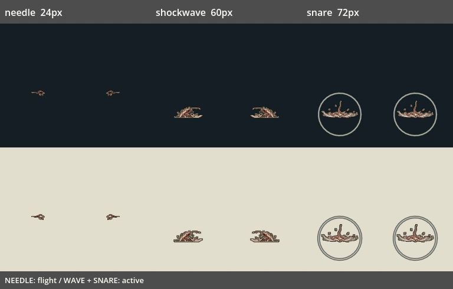
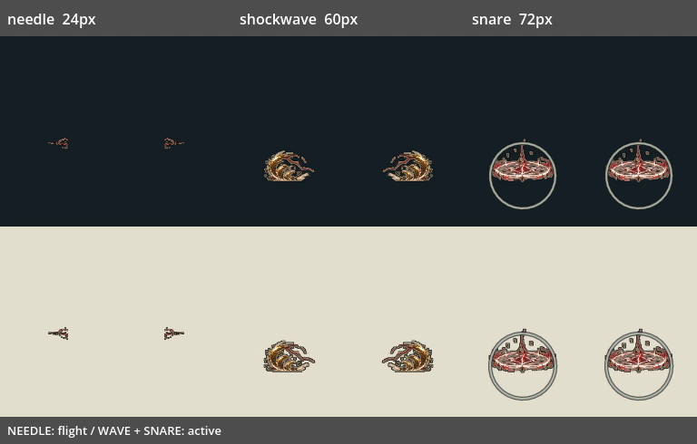

# V04：主角三类线术特效接入

日期：2026-10-20。基于最新 main `01ccabd2`，已包含 T02 存档恢复与 E04 工匠改制；本批独立于尚未合入的 #151/#152，不把前序敌方特效差量带入本 PR。

## 台账依据与本批范围

[本批基线的升级台账](https://github.com/superman2003/Crimson-Thread-Pilgrimage/blob/01ccabd2ce5fea59b394002da6e5f18cd4f9c09f/docs/UPGRADE_TASK_LEDGER.md)中，V04 的已做项是危险/前摇层级、12 个命中装饰名额及全屏反馈预算，剩余项包括“特效源图接入、其它粒子预算与真实混战/舒适度验收”。本批推进其中的主角线术源图接入，不修改 C03/C04 已确定的耗能、冷却、校习方向与控制规则。

| 线术 | 图形与阶段 | 实际尺度 |
|---|---|---|
| 回声针 needle | 4 格飞行＋4 格命中碎片 | 主体宽 24px |
| 钟鸣震波 shockwave | 2 格升起＋4 格行进＋2 格消退 | 主体宽 60px |
| 盐印缚线 snare | 2 格生成＋4 格持续＋2 格消退 | 主体宽 72px；原受击框扩展量 36px |

四件战具（投罐、绊线钉、盐雾瓶、诱铃）的 28 格留待下一批。共享台账/进度页仍由 N05/U06 并行批次占用，本批用独立报告和结构化记录提交可回填的结论，不将 V04 或 T04 整项标记完成。





以上为真实 OpenGL 的生产效果对象夹具：冻结物理并指定时间采样，各类采用自己的阶段时钟；合成动图统一间隔供逐格检查，不代表自然游玩速度。上下为深浅背景，左右为朝向变化；缚线本身不随朝向镜像。

## 运行时行为

- 原三类线术共用 16×10 的矩形显示。现在依据 `skill_effect` 和既有 payload kind 选择源图，实际施放入口不变；没有给战具误套技能贴图，也没有修改玩家、构筑或技能数据。
- 回声针 14fps 循环四格飞行，按朝向镜像。真实命中立即结束伤害对象，四格无伤害碎片另播约 200ms；碎片定位在原扫掠检测点或实际墙面交点，避免大步长时跑到敌人后方。自然超时、射程到期不制造假命中。
- 震波使用 24fps，在原短射程内完成升起并进入行进循环；保持原 620px/s 水平路径、伤害、沿途每敌一次与踉跄参数。绘图底边以原生成点下方 42px 注册，平地生成时接地；本批**没有新增沿坡地追踪**或改变碰墙结束规则。
- 缚线使用 12fps 的生成/持续动画，底边在原生成点下方 6px，保留名义 36px 的细圈提示。生成阶段仍按原规则立即命中和控制，不把图形生成当成新的前摇。受击框 `.grow(36)`、盐记消耗后延长控制、每敌一次与再次放置替换旧阵的规则保留。
- 震波射程/时限到期、碰墙，或缚线区域到期后，先结束原对象，再播两格约 167ms 的纯装饰消退。敌人已获得的踉跄、盐记或束缚仍按原计时运行，消退对象不再施加状态。
- 外部取消、替换缚线、主人释放和场景退场不会制造假的命中/自然消退。终端动画不保留玩家引用、不属于陷阱/控制区组，与现有命中装饰共用 12 个名额；达到上限只省略装饰，不裁减技能伤害或控制。
- 主动线术位于绝对 `BLADE_Z=60`，终端装饰沿用 `CONTACT_Z=80`，低于敌方危险 100 和前摇 110，避免自己的线术遮住敌方危险。

## 图集与源图

源 PNG/TXT/JSON 只读，校验并记录图像、提示词与元数据 SHA-256。按交付的实际裁框切取（实际均为 1774×887），不能按名义 4×2 网格盲切。

每类八格共用比例：针按四格飞行最大宽度归一，震波/缚线按四格持续最大宽度归一。针逐格注册中心，震波与缚线注册可见底边；保留各阶段的自然扩散和收缩。图集加细暗边与浅内边，所有格均检查不触边。

一张 1536×576 无损图集，PNG 183412 字节、解码 RGBA 3.375MiB，无 mipmap。没有合成或插补新帧。使用两个素材目录内的 `.gitattributes`，不占用前序 PR 正在修改的根属性文件。

## 验证

[结构化验收、台账依据与排除项](../../artifacts/player_skill_art/verification.json) · [逐套日志](../../artifacts/player_skill_art/logs)

- 新专项 **254 项全部通过**，追加到已有 `seal_combat` 注册入口，原 138 项保留。没有修改共享测试登记或 package.json。
- 24 格非空且每类八格不同；深浅背景、左右方向、全部阶段的真实 GL 像素和独立按清单绘制的源图对照，每通道容许最多 1/255 的量化差。另检查实际 24/60/72px 尺寸的可读性和四格持续动画确有变化。
- 真实 Player 的 `cast_selected_skill` →有效帧→效果对象路径，三类分别检查左右施放、一次发出、耗能、payload、生成位置和层级；实际 `cast_tool` 检查第二个缚线替换第一个且不制造消退。
- 实际物理扫掠检查针只伤一名在场敌人并施加盐记、命中定位、不能再次命中、墙面停止；震波保持原水平位移、沿途多目标每敌一次与踉跄；缚线首次生成立即控制、盐记消耗及延长、原受击框扩展边界、只控制一次、区域到期退出。
- 另查自然射程/时限到期、主人释放、外部取消、各终端帧顺序、慢首帧、有限寿命、共享装饰上限不裁控制、未接入战具保留原矩形，以及场景退场回收。
- 负例仅禁用主动绘制时 **88 项失败**，仅禁用左右镜像时 **32 项失败**；恢复后重新运行，254 项全部通过。
- Godot 4.6.1 recovery-mode 双轮严格导入、npm test、test:campaign、打包 --check、Python 编译、工作流结构及差异检查通过。真实 GL 预览采用 Dummy 音频，日志无 ERROR/SCRIPT ERROR。

本地 **15 套相关注册回归全部通过**：seal_combat、artisan_crafts、character_art_prewarm、combat、combat_visual_budget、enemy_effect_lifetime、player_melee_feedback、player_state_cleanup、seal_acceptance、seal_identity、seal_system、skill_branches、tool_practice、world_enemy_residency、world_startup_budget。最终逐套结果见 verification.json。完整默认集合由本提交 CI 独立判定；旧套件的 ObjectDB/StringName 退出警告保留，未计作本批修复。未认证自然六区流程、陌生玩家理解、长期资源曲线或目标硬件帧时间，也未将键鼠/手柄完整施放打断验收标为结束。

## 占用与隔离

修改 `player_tool_effect.gd` 与 `seal_combat_validation.gd`。新增 `player_skill_art.gd`、专项、图集、打包/预览工具、独立 CI、本报告与 artifacts 记录；属性覆盖仅放在新目录内。

未改 `player_controller.gd`、`build_system.gd`、`world_state.gd`、`main_level.gd`、`pilgrimage_interface.gd`、叙事文件、设置文件、共享测试登记、package.json、根 `.gitattributes`、共享台账与进度页。前序未合入的敌方地波/地刺/光束也未随此分支带入。

## 复现

```bash
python tools/build_player_skill_art.py --check
python tools/run_godot_import.py --engine "$GODOT" --recovery-mode --timeout 600 --log-dir /tmp/player-skill-import
python tools/run_godot_regressions.py --engine "$GODOT" --software-gl --suite seal_combat --suite skill_branches --suite tool_practice --log-dir /tmp/player-skill-tests
```

通过 `tools/software_gl.py` 上下文提供显示，设置 `PLAYER_SKILL_GALLERY_DIR=/tmp/player-skill-gallery`，运行 Godot 参数 `--audio-driver Dummy --path godot --script ../tools/capture_player_skill_art.gd`；成功后执行：

```bash
python tools/build_player_skill_previews.py --capture-dir /tmp/player-skill-gallery
```
