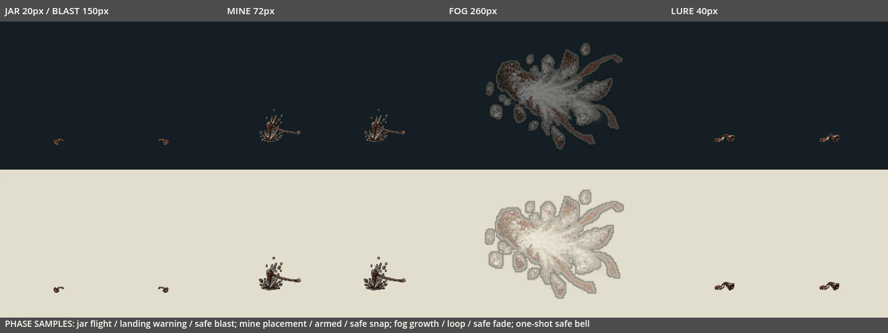
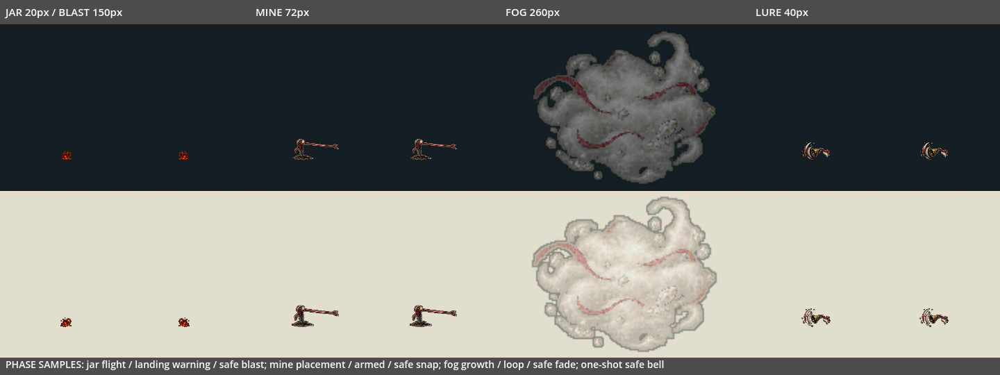

# V04：四件主角战具的源图接入

日期：2026-10-20。分支 `codex/v04-player-tool-runtime`，基于 main `2571f891`，包含已合入的 #153 三类线术以及 #151/#152 地波、地刺和光束。本批只接四件战具；没有将 V04、T03 或 T04 整项标记完成。

## 本批范围

- 铜铃投罐：8 格，2 格飞行、2 格落地预警、4 格爆裂。罐体约 20px，爆裂主体约 150px。
- 绊线钉：8 格，1 格放置、2 格待机循环、3 格触发断线及 2 格消散。主体宽约 72px。
- 盐雾瓶：8 格，2 格展开、4 格循环、2 格消散。主体宽约 260px，绘制透明度上限 45%，避免实心雾核遮住角色。
- 回响诱铃：4 格，完整放下、摇铃与收声；一次引诱后播放约 250ms 的纯装饰动画。主体宽约 40px。





图片由生产 `player_tool_effect.gd` 和终端装饰在真实 Windows OpenGL 3.3 中绘制。夹具冻结物理、分别取样各阶段，不是自然战斗录像；动图按统一间隔排列，不能当成原速施放或帧时间验收。投罐与绊线钉展示双向，诱铃双向不镜像，盐雾每种背景展示一个完整的 260px 雾团。

## 保留的玩法与生命周期

实际施放仍由 Player 与 BuildSystem 完成，战具 payload、次数、材料补给、伤害和控制不变，效果不回充绯线。没有修改 `player_controller.gd`、`build_system.gd`、构筑数据或主场景。

投罐仍以水平 290px/s、初始竖直 -270px/s、重力 700px/s² 走原抛物线。原地形射线/岩石遮挡、落地后 0.35 秒橙色预警、半径参数 75、1 秒总寿命和 360px 行程限制不变；原实现会在碰撞当帧扣掉该帧 delta，绘制直接读原 `warning_timer`，不另起一个动画倒计时。爆炸当帧立即结束伤害对象，再播放四格无伤害碎片；空中超时不制造假爆炸。预警继承原橙色调制，终端碎片保留源图的铜色与绯线色。

绊线钉仍在放下后立即生效，不将第一格打桩画面当成新前摇。判定仍为敌人受击框 `.grow(36)`、伤害 3、绊倒 0.7 秒、最多两个、6 秒总寿命。触发后效果对象退出，另播断线与消散；未触发而到期只播最后两格，不制造触发动作。终端不属于 `player_trap`，不占陷阱名额。

盐雾仍在原放置点持续 4 秒，对受击框 `.grow(130)` 内的在场敌人按原规则刷新 2 秒索敌干扰，不造成伤害。最后两格是独立装饰，不延长干扰。Boss、远程敌人与已发弹体的处理仍交给既有敌人逻辑。

诱铃仍只在一个物理 tick 发出一次 `investigate_lure(point, 1.5)`。源图说明曾写 320px，但当前 `build_catalog.json` 的实际 `range` 是 **180px**，本批按实际 payload 保留 180px；未借美术接入修改 AI 距离。铃声装饰不持有玩家引用，也不会反复发送引诱命令。

放置点保持原值：钉在主角前方 24、上方 6px；其它战具前方 24、上方 42px。钉贴图底边下移 6px、诱铃下移 42px 接到地面，只改变绘制，AI/判定坐标不动。投罐飞行注册中心、落地罐注册底边，爆裂注册实际碰撞点中心；没有新增沿坡追踪。

主动特效沿用绝对 `BLADE_Z=60`，尾帧沿用 `CONTACT_Z=80`，低于敌方危险 100 和前摇 110。尾帧与现有命中装饰共享 12 个名额；达到上限只省略装饰，不抑制伤害/控制。外部取消、主人释放、场景退场不生成假的触发或自然消散。

## 图集与源图

交付的 PNG/TXT/JSON 保持原内容，构建器核验并记录三类 SHA-256；文本哈希使用 Git 的 LF 表示，以兼容 Windows 文本检出。严格使用交付 JSON 中的实际裁框，三张 1774×887 与一张 2172×724，未按名义格子盲切。

使用 2048×1024 的无损图集：28 个非空格，4 个空格，解码 RGBA 8MiB，无 mipmap。每个阶段共用缩放，不逐格拉伸。源图罐体与爆炸的画面比例不足以表达玩法所需的 20/150px，明确分为罐体、爆裂两组归一，并在 manifest 逐格登记；钉、雾、铃各自全帧共用一套比例。细暗边与浅内边沿用前序批次；检查每格不触图集边界，无插帧或新增绘制。

## 验证与证据

[结构化记录](../../artifacts/player_tool_art/verification.json) · [逐套日志](../../artifacts/player_tool_art/logs)

新专项接入已有默认 `tool_practice` 入口，保留原 98 项练习/正式 World 检查；前序 `seal_combat` 的 254 项技能素材检查也保留，仅把“未接入 mine”的旧回退断言改为 unknown payload 回退。

专项涵盖源图帧矩形与非空/独特像素，深浅背景、方向、全部阶段与原生尺寸的独立参考绘制，罐体飞行/落地计时、爆裂/陷阱/盐雾边界、在场敌人过滤、地形射线、AI 命令一次性、真实 Player 左右施放、BuildSystem 次数扣除/空库存拒绝、两个陷阱上限、外部取消、主人释放、终端逐帧、慢首帧、有限寿命、共享装饰饱和与场景回收。

射线遮挡夹具将遮挡墙与发射表面分开，避免把原生物理“射线起点恰在碰撞边界”的行为当成美术接入回归；本批未修改边界起射规则，也未宣称修复所有墙边爆炸情况。

Godot 4.6.1 recovery-mode 双轮严格导入、图集 `--check`、Python 编译、`npm test`、`test:campaign` 及差异检查通过。相关注册回归使用本机真实 NVIDIA GL；独立 PR CI 在 Linux Mesa 中重跑相同专项与 15 套回归。精确检查数、负例及最终各套状态记录在 verification.json，不以本地结果代替尚未结束的 CI。

原有部分套件的退出 ObjectDB warning 仍保留，没有计作本批修复。自然六区通关、真实混战遮挡/舒适度、长期内存曲线、手柄手感及目标硬件帧时间继续 OPEN。

## 复现

```bash
python tools/build_player_tool_art.py --check
python tools/run_godot_import.py --engine "$GODOT" --recovery-mode --timeout 600 --log-dir /tmp/player-tool-import
python tools/run_godot_regressions.py --engine "$GODOT" --software-gl --suite tool_practice --suite seal_combat --suite combat_visual_budget --log-dir /tmp/player-tool-tests
```

设置 `PLAYER_TOOL_GALLERY_DIR`，在真实 GL 显示下运行 `--audio-driver Dummy --path godot --script ../tools/capture_player_tool_art.gd`；再执行 `python tools/build_player_tool_previews.py --capture-dir "$PLAYER_TOOL_GALLERY_DIR"` 合成阶段动图。
