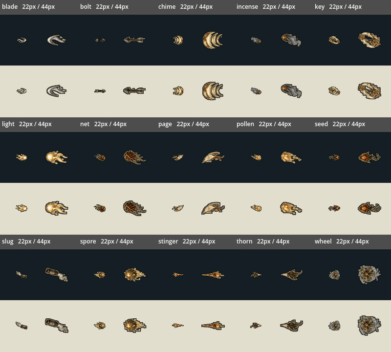
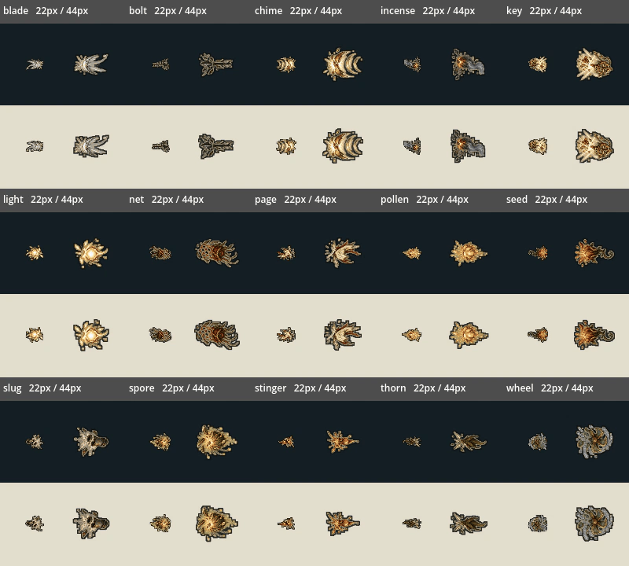

# V04：15 类敌方飞行物源图接入运行时

本批接在 #144 的 `e7e9a520` 之上，独立分支 `codex/v04-projectile-runtime`。排除正在进行的 T02（#146）与工匠改制（#145），不修改它们的存档、构筑、主场景、测试登记、package.json、共享台账或进度页。该报告作为本批独立进度记录。

## 玩家看到的变化

15 张 `FX_P_*` 源图的 120 格正式接入：每类前 4 格循环飞行、后 4 格播放命中破碎。原来多种飞行物只是同一个三角形/圆点；根笼猎手现在投根网，蜡蜂投蜡针，弩手投弩矢，管炮手投管弹，香炉投香灰，主教投藤种，此外有影刃、钟声弹、书页、水轮刃、钥刃等独立形状。

按真实怪物种类和旧 skin 配对翻译旧通用标记，不改原指令；未来显式指定的其它 skin 仍按自身选择。未知 skin 保留原程序图形兜底。飞行物随当前速度旋转，回返/追踪/重力转向时画面跟随；反弹保留金色返弹提示。

撞墙、击中玩家或反弹击中敌人时，伤害对象立即按原流程注销，另生成四格纯装饰破碎。装饰沿用 #144 的全局 12 个命中标记预算，不再携带碰撞或伤害，约 0.2 游戏秒后回收。慢首帧保留一次显示机会。自然到期、主人退场/死亡与主动取消不制造假命中；迫击弹仍按原流程变成有前摇的地面危害。

## 打包与尺度

`tools/build_projectile_art.py` 读取交付 JSON 的实际 `rect_xyxy`，不盲目等分源图。以每类前四格的最大主体尺寸确定一个缩放比例，八格共用该比例，逐格按主体边界中心注册；保留破碎原有的扩散大小。源 PNG、提示词、检查 JSON 均只读并核对 SHA-256。

运行时只有一张 1024×1920 图集（解码 RGBA 约 7.5MiB）。主体规范为 64px，绘制时对应实际攻击半径的直径；测试/预览的“22px/44px”指主体，不含细描边。统一细暗边和较细的浅色边只写入运行时图集，避免荆针和根网在暗底消失。没有改原始图，也没有插帧。`--check` 比较解码像素与清单，避免压缩器差异被当成像素变化。

线条/命中标记仍在危险层之下。#144 原像素测试假设飞弹是完全不透明的程序圆点；本批改为按实际图集的完全不透明像素检查遮挡，半透明碎屑不冒充不透明主体，仍要求足够数量的真实不透明采样点逐像素一致。

## 验证

- 新 `projectile_art_validation.gd` **300 项通过**，从已有 `enemy_effect_lifetime` 入口调用；原 46 项生命周期检查保留，新增检查失败会令原入口失败，不改默认登记表或数量。
- 从真实战斗目录经 `_effect` 生成，覆盖全部 15 类；核对伤害与指令不被修改。覆盖玩家命中只结算一次、实际朝向反弹、反弹击中敌人、撞墙命中点、迫击弹转池、装饰限额、慢帧、取消/到期不产生假破碎。
- 实际 GL 在深浅背景按 22px 主体绘制，15 类都可见、四格循环确实逐帧变化。临时禁用新渲染分支产生 **30 项失败**；恢复后通过，负例日志保留。
- 14 套相关真实 GL 回归通过：enemy_effect_lifetime、combat_visual_budget、enemy_visibility、enemy_lifecycle_regression、combat、seal_combat、player_melee_feedback、world_enemy_residency、world_startup_budget、character_art_prewarm、expanded_character_motion、optional_challenges、obsidian_experience、greenhouse_experience。
- 双轮 recovery-mode 导入、`npm test`、`test:campaign` 与源图/运行时像素 `--check` 通过。既有 ObjectDB/StringName 退出警告保留，未计作修复。`world_startup_budget` 中的故意失败夹具不等于套件失败，严格运行器最终通过。

原始记录、源码哈希、排除文件检查见 [verification.json](../../artifacts/projectile_art/verification.json)。完整默认套件、自然六区通关和长期帧时间未在本批重新认证。

## 实际渲染预览

每格左边为游戏尺度，右边为两倍尺度且朝向相反；同时显示深浅背景。所有图片来自 Godot 实际绘制。命中展示按生产环境的 12 个装饰预算分批截取后排成图谱，回放间隔只用于展示；不是自然战斗录像，也不表示游戏放宽了装饰上限。

复现：真实 GL 运行 `tools/capture_projectile_art.gd`，再用 `tools/build_projectile_previews.py --capture-dir <截取目录>` 合成展示。专用工作流 `projectile-art.yml` 检查源图与运行时像素并执行受影响套件。

## 剩余范围

本批仅接入敌方飞行物。地面危害、地波、地刺、光束拼接、主角线术与战具的其余 24 张源图留待后续；未改它们的图形、危险时序或机制。画面细节与连战手感仍需目标硬件实机验收。
