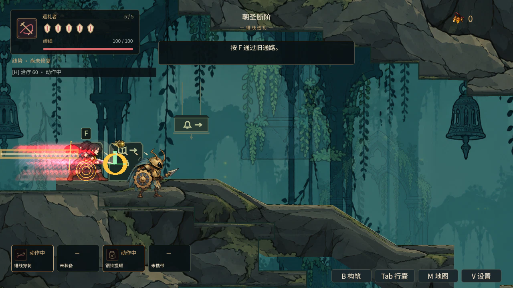

# V04：移动、技能与机关的瞬态装饰预算

冲刺残影、二段跳线、疗伤丝线、能力脉冲、招式附加线与拾取／开路光圈此前分别创建节点，没有共享数量限制。现在这些纯装饰共用最多 24 个 CanvasItem 单位，并保留分类上限：移动 12、疗伤／技能／状态 12、环境事件 8。复合装饰按全部子 CanvasItem 计数；排队删除立即让出名额，场景树持有预算，不新增静态节点引用。

冲刺主线与辉光、钩索招式的附加线与钩尖、技能附加线与环、拾取环与火花成组准入，容量不足时整组释放，建 tween 之前结束。实际抓钩连接线、角色主体动作、危险预警、飞弹、战具和技能伤害节点仍按原机制生成。武器装饰拖痕也纳入既有全局八动作名额；命中痕迹仍用独立十二名额。

移动和状态装饰记录创建者的数字实例 ID。重生／切区的 traversal reset 与 Player 退出都会清理挂在 World 下的残影／线迹；短 tween 改为绑定自己的装饰节点，清理后没有失效动画目标。所有新装饰及嵌套子节点使用绝对层级、不高于 75，低于命中 80、伤害 100、预警 110；父节点偏移不能把它们抬到危险前面。

新增检查通过现有 combat_visual_budget 默认 CI 入口执行，不减少原有 32 项检查。旧生产生成路径在初版夹具中 10 项失败；最终新增 50 项通过，包括 80 次真实残影请求、多角色共享与整组拒绝、混合满额、实际付费疗伤和冲刺、20 发真实线术命中、钟龛状态和真实挡路物删除、跨区／玩家退出清理、复合节点计数与九百毫秒生命周期。原像素套件再以 24 单位嵌套高层级不透明装饰覆盖画面，新增 12 项，合计 44 项通过；光束预警、生效和飞弹不透明像素仍在最上层。

基于 main 17f192b4，最终冻结 275 份生产／数据源，十套真实 GL 通过且源前后一致：combat_visual_budget、player_melee_feedback 112、seal_combat 138（含技能素材 254）、seal_presentation 175、player_state_cleanup 9、player_motion_continuity 1192、ability_movement、world_resume_regression 38、world_death_cache_flush 27、save_product 45。npm 与 campaign 通过；Windows 的 31/11 项 POSIX 执行夹具按既有规则跳过，不记为本机执行通过。部分普通 World 回归退出警告继续保留，不能记为 T03 通过。开发期间一处测试变量的类型推断编译失败已修正，日志单列，不算生产回归或通过证据。

两张真实 World 截图已目检：环境 8、移动 12、状态 4，共 24 单位，并同时摆放危险光束、飞弹与十二个命中痕迹；预警与实际光束可见。截图采用脚本摆放、暂停敌人和 tween、Dummy 音频，不是自然混战或舒适度验收；退出一个零引用对象的警告保留，旧资源读取路径另由 #170 处理。截图来源、哈希和失败记录见 artifacts/v04_secondary_budget/summary.json；十套原始证据同目录。

本批覆盖现有临时移动、技能、状态和环境完成装饰。静态雨线、场景层次与常驻设施标记仍属场景构图／V03；自然六区混战、人体闪光舒适度、正常帧时间与最终声音语义继续待验收，V04 不勾选完成。

提交前同步 main bb81601a（含 N04）。两处冲突保留双方截图例外与台账；Main 自动合并。4.6.1 严格双轮 recovery-mode 导入通过，重新执行预算／像素 50+44 项、N04 场景历史 183 项及保存 45 项，全部断言通过；场景历史退出警告保留。三套测试的生产／数据与 b25ca37a 合并提交没有 canonical Git 差量，记录测试后的文件哈希，不冒称另外做过前后字节冻结。原 275 份冻结与十套完整证据仍只属于 17f192b4 基线；新主干复验单列。
