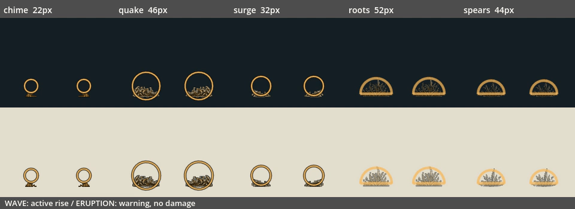
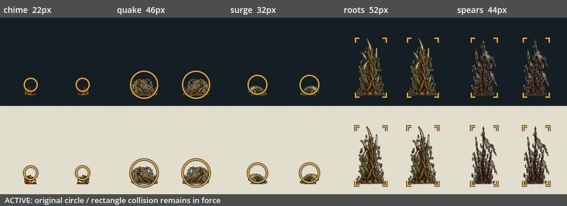

# V04：地波与地刺运行时接入

日期：2026-10-20。接续 #148，base 为 `codex/v04-ground-hazard-runtime`（`d6ef17f5`）。本批只接入三类地波与两类地刺，共 36 格源图。

## 玩家可见变化

| 家族 | 实际攻击 | 主体尺度 |
|---|---|---|
| chime 钟声地波 | 贴地双钟波、号口震波、双向钟涟、快慢双轮波、钥环震地 | 宽 22–46px |
| quake 震地裂波 | 重壳震地、连环震地、钟冠重压 | 宽 40–46px |
| surge 渠水涌浪 | 潜盔涌浪 | 宽 32px |
| roots 根刺 | 三段根刺、根墙封路、花种落刺、间隔根刺、根冠苏醒、循地根刺 | 宽 44–52px；原判定高 100px |
| spears 枪阵 | 军旗落阵、号令枪阵 | 宽 44px；原判定高 100px |





图片为真实 OpenGL 读回的生产攻击夹具：冻结物理并指定时间采样，供逐格核对；不是自然游玩录像。每类左右两份对应向左/向右，地刺方向不改变竖直形态。上、下为深、浅背景；标注的是宽度。波纹判定圆及地刺判定矩形的角标在有效期内持续可见。

## 接入规则

- 五份 PNG/TXT/JSON 源图只读。打包前验证图像及提示词哈希；按交付的真实裁框读取，记录元数据哈希。三张地波实际为 1774×887，地刺为 1536×1024，不能盲目套名义网格。
- 每类各阶段共用缩放比例，逐格按可见底边注册地面。地波保持原图宽高比，只水平镜像，不随坡面或速度旋转。地刺分别适配原宽度与固定高度；完整最高帧的可见主体从中心 -92px 到 +5px，原矩形仍为 -92px 到 +8px，高 100px。两个完整帧保留原有轻微摆动。
- 单张 1152×1024 图集，PNG 465850 字节，解码 RGBA 4.5MiB；无损、无 mipmap。地波以 64px 主体基准打包，细边在最小 22px 尺寸仍可见；地刺采用独立高格。透明边缘有安全间距，所有格均检查不触边。
- 地波 2 格升起后循环 4 格行进，12fps；升起时仍沿用原伤害时机，判定圈完整显示。原地形采样继续把中心保持在地面上方 18px，速度、左右交替、快慢波差值与三秒寿命不变。
- 地刺前摇最后 200ms 播 2 格冒出，保留原半圆警告；正式判伤开始即循环 2 格完整高度。原数量、间距、瞄准落点、逐根 120ms 延迟及有效时间不变。零前摇直接进入完整高度，短前摇压缩生成阶段。
- 两类攻击都在原到期点立即注销伤害对象，之后由独立无伤害装饰播放两格消退/回缩，约 167ms。没有提前回缩仍可伤人的地刺。
- 消退使用已有 12 个共享命中装饰名额，满额只省略装饰，不影响危险物。取消、主人退场、整段生命周期跳过不留假消退；消退不保留主人引用，退场释放名额。
- 原一次命中、不可格挡、玩家中心容差、圆/矩形边界、UI 锁暂停与危险优先层级保留。钟波沿用原攻击着色；明确指定的家族受尊重，未知或不适合该攻击种类的皮肤继续程序绘制后备。

## 验证

[结构化验收及源码哈希](../../artifacts/terrain_attack_art/verification.json) · [日志](../../artifacts/terrain_attack_art/logs)

- 新增 `terrain_attack_art_validation.gd`，沿用已注册的 `enemy_effect_lifetime` 入口；**609 项全部通过**。原飞行物 300 项、地面池 375 项及生命周期 46 项仍通过。
- 真实战斗目录经 `_spawn_command_effects` 覆盖全部 **17 条**地波/根线出招、五类图形，逐一核对数量、伤害、半径、不可格挡、左右速度、分档速度、120ms 延迟、落点及原寿命。
- 36 格非空且各阶段不同；运行时图集矩形与打包清单逐一对照。真实 GL 在深浅背景、左右方向、游戏实际半径下读回各阶段，与独立依据清单绘制的源图对照；每通道允许最多 1/255 的帧缓冲量化差。
- 源图像素对照避开描边/前摇提示覆盖的像素；另外对有效阶段的判定圆顶边、矩形角标做独立像素检查，防止只显示较小的手绘轮廓。四格地波与两格地刺完整循环均有实际像素变化。
- 生产攻击实际物理路径验证左移、坡地地形采样、升起时仍按原时机命中一次、不可反弹、UI 锁暂停、地刺前摇不判伤、完整矩形及排他下边界、到期注销、两格无伤害消退、慢首帧、取消/主人退场清理、共享上限不裁危险物和场景退场回收。
- 负例一：仅禁用新渲染分支，**124 项失败**。负例二：仅禁用左右镜像，**48 项失败**。恢复后重新运行，609 项全部通过。
- Godot 4.6.1 recovery-mode 双轮严格导入、npm test、test:campaign、打包 --check、Python 编译与差异检查通过。预览使用真实 Mesa llvmpipe GL 与 Dummy 音频，日志无 ERROR/SCRIPT ERROR。

本地 **14 套相关注册回归全部通过**：enemy_effect_lifetime、character_art_prewarm、combat、combat_visual_budget、enemy_ai_behavior、enemy_lifecycle_regression、enemy_visibility、greenhouse_experience、obsidian_experience、optional_challenges、player_melee_feedback、seal_combat、world_enemy_residency、world_startup_budget。最终结果见 verification.json，逐套日志保留；完整默认集合由本提交 CI 独立判定。既有 ObjectDB/StringName 退出警告保留，未计作修复。本批未重新认证自然六区通关、长期资源曲线或目标硬件帧时间。

## 占用与隔离

修改 `enemy_attack_effect.gd`、`enemy_effect_lifetime_validation.gd`、`.gitattributes`；新增地形攻击渲染模块与专项、图集、三份打包/预览工具、独立工作流、本报告及 `artifacts/terrain_attack_art/`。

不修改 T02 / E04 / N05 的存档、构筑、主场景、旅记或叙事源码；不修改共享测试登记、package.json、共享台账和进度页。已核对 #149 文件列表，与本批差量无重叠。排除项逐一记录于 verification.json。

合入顺序：#144 → #147 → #148 → 本 PR。V04 仍部分完成：四类光束、主角技能/战具、其它预算及自然流程验收留待后续；共享台账在并行批次收束后依据独立报告回填。

## 复现

```bash
python tools/build_terrain_attack_art.py --check
python tools/run_godot_import.py --engine "$GODOT" --recovery-mode --timeout 600 --log-dir /tmp/terrain-import
python tools/run_godot_regressions.py --engine "$GODOT" --software-gl --suite enemy_effect_lifetime --suite combat_visual_budget --log-dir /tmp/terrain-tests
```

通过 `tools/software_gl.py` 的上下文提供显示，设置 `TERRAIN_ATTACK_GALLERY_DIR=/tmp/terrain-gallery`，运行 Godot 参数 `--audio-driver Dummy --path godot --script ../tools/capture_terrain_attack_art.gd`，成功后执行：

```bash
python tools/build_terrain_attack_previews.py --capture-dir /tmp/terrain-gallery
```
