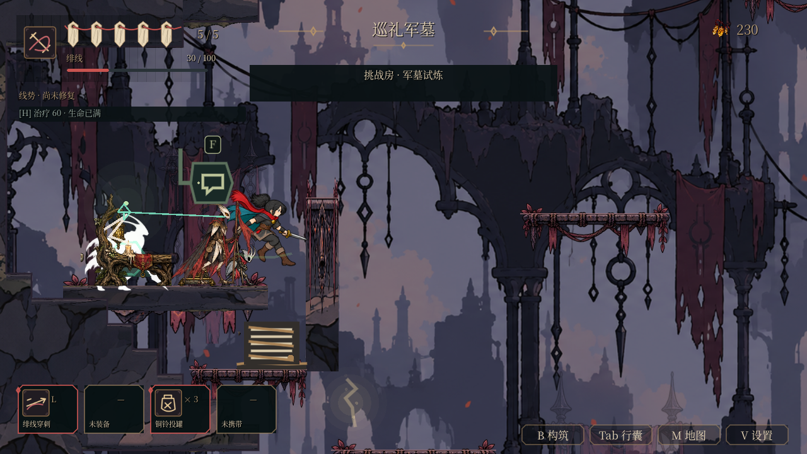

# B01：灰旗支援与军墓遭遇

本批从台账 B01 明列的“支援型（增益／治疗同伴）职责”继续。起点为 `3d88d1d`，最终同步至含 #193 的 main `dc31736`；#194 的温室根牢工作未纳入本批。所有 46 个任务包的最终验收仍开放。

## 玩法变化

灰旗小鬼仍保留旗枪三连和回旗退刺。在看见领地内玩家、附近有受伤同伴时，它会优先停下举旗引导：青绿色连线指向受援者，菱形标明目标；0.9 秒后只回复 1 HP，随后收势 0.55 秒。每次尝试从起手开始消耗 8 秒冷却，打断也不能立即重试，冷却期间照常使用原有攻击。

选择同一宿主、同一可选挑战的 260px 范围内同伴，优先生命比例最低者，再比较距离；高度差不得超过 90px，地形射线必须畅通。自身、Boss、其他支援者、满血／死亡／排队删除／未激活的角色不能接受治疗。引导中重新检查这些条件以及对玩家的视线和领地条件；受击、绊倒、干扰、诱饵、目标离开或被释放都会取消。UI 暂停冻结引导和冷却。

区域休眠会直接停掉处理帧，不能只指望敌人下次更新时发现自己已不活跃。本批在正式休眠服务关闭处理之前取消引导，恢复后不保留旧目标和连线；复活也清除目标并重置冷却。目标采用弱引用，不延长旧角色生命周期。

军墓试炼原有 `CH05_N1` 长枪兵与 `CH05_N2` 灰旗小鬼相距 170px，直接使用这组遭遇，没有增加敌人数、改地形或改主路。独处的灰旗猎物仍使用原有攻击。旅记与角色说明同步写明治疗及受击打断。

## 正式 World 画面与证据边界

这是原生 OpenGL Compatibility／llvmpipe 的 1280×720 实际渲染，来自正常场景构建的军墓试炼；测试定位到房间、打开无敌并对长枪兵调用一次受击，再由正常物理帧中的自动 AI 完成引导和治疗。它证明正式宿主、实体地形、挑战身份与实际恢复结算接通，不代表从新档自然抵达、开启伤害的胜负记录、人工手感或专属动画验收。治疗时钱包不变。

## 验证

- `enemy_tactical_roles`：原有 184 项保留，最终 263 项通过。覆盖实际军墓配置、引导时序、只回一格、普通攻击兼容、冷却、暂停、受击／绊倒／干扰／诱饵、双方视线、距离／高度、跨挑战／宿主、死亡／释放、休眠恢复和复活。
- `optional_challenges`：354 项通过（包含可选截图检查），新增正式 World 的自动治疗和不发放货币断言。其余首清、不可刷奖励、离房中止与读档检查保留。
- 最终整合 10 套真实 GL：上述两套，以及 `enemy_ai_behavior`、`enemy_encounter_roles`、`enemy_lifecycle_regression`、`enemy_effect_lifetime`、`combat_visual_budget`、`obsidian_experience`、`world_enemy_residency`、`world_interaction_residency`。
- 两种反向检查分别移除实际加血、冷却准入，均由行为断言拒绝；保留失败日志，随后恢复原文件。不是靠解析错误触发失败。
- 双轮恢复模式资源导入、`npm test`、`npm run test:campaign`、敌人旅记数据、生成场景校验与 Python 编译通过。生成场景校验器原先仍匹配无参数的旧 `_refresh_ability_gates()`，现匹配生产脚本已有的可选音效参数签名；未改变能力门逻辑。

检查摘要在 [`verification.json`](../../artifacts/b01_support/verification.json)，逐套日志、反向日志和前后源文件指纹封装于 [`evidence.tar.gz`](../../artifacts/b01_support/evidence.tar.gz)，字节数与 SHA-256 清单见 [`archive_manifest.json`](../../artifacts/b01_support/archive_manifest.json)。514 份运行时／工具文本源文件前后完全一致（范围不含图片及文档）。原生 GL 不等于实体显示器或最终目标硬件性能验收。

## 失败与保留问题

首次引擎解压产物无法稳定启动，重新完整解压后可正常运行。初轮在首次资源导入尚未完成时启动套件，出现未导入资源错误；初版夹具的军墓 ID 也写错，已更正。首次 GL 环境因缺少键盘编译器无法启动。完成导入与本地显示依赖后，以原错误／超时门禁重跑，没有忽略这些失败。专项目录保留可复核的初轮日志。

`enemy_ai_behavior`、`enemy_encounter_roles`、`enemy_lifecycle_regression`、本轮 `optional_challenges` 与 `world_enemy_residency` 仍有 ObjectDB 退出 warning，后者另列 4 个未认领 StringName；它们不记为零警告，也不由本批宣布解决。没有执行本地全部 136 套回归或最终发布包检查，远端 CI 以本 PR 的确切提交为准。

本批只推进 B01 支援行为。蛰伏／报警／支援的专属动作和声音、自然遭遇中的发现与优先击杀判断、三契印难度、六区流程和人工验收继续待证。
