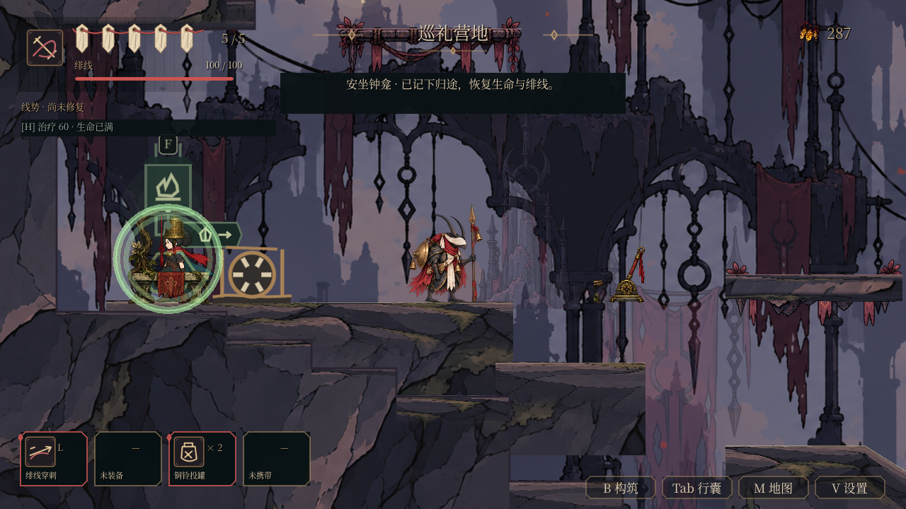

# 黑曜巡礼道下路净空、免费上行与营地读档（W01／W02／W05／A01／C01／U04／T04 子项）

从 #196 正常铜根主教胜利存档继续实际行走、跳跃、攻击与 F 交互，在第五章三组地形问题修复后抵达巡礼营地。正式证据是 `artifacts/t04_obsidian_route/final_native_36` 的完整 **36 步**，与另一个新引擎 PID 的精确恢复。不是新档六区完成、人工验收或 FPS 测量；46 项最终验收保持 OPEN。

起点提交 `1083882372897f3f3731156aabb405b4c1e6c735` 与已合并 #196 后 main `e394b9897616bb8e7449f6057a7911dfdfc480ab` 的 Git tree 相同。输入种子 SHA256 `f754c5ed76f8b0fa36caa2cd8166a74b20409f0421bf0ef469c9b18cc019d7f2`，逐字节复制到唯一私人测试存档 `user://test_world_obsidian_earned_route.json`。没有写入玩家位置、授予能力、钱包或伤害屏蔽；所有实际战斗参数保持生产值。

## 实际阻塞与最小几何修改

1. 下路已有坡道被上层洞窟实体的 bulk 填回。旧数据有 `[1728,2496,32,224]` 岩体，实际从货车台面合理边缘普通双跳、走近再跳都卡在约 `(1711,2710)`；原文碰撞为 `CaveWorld/SolidCaveMass/RockChunk_1_2`，法线 `(-1,0)`。局部普通步行又发现第二段已有坡道 x2240 的同类岩体。生成器仅为第五章货车→下路与下路→钟龛台阶这两段现有坡面补齐 protected：沿用台面已有的两侧 38px、上方 260px 与底部 3px 余量，防止上层 bulk 重新填入相同移动／跳跃净空。没有增加平台或传送通道。
2. `terrain_lower_scree_0_2` 的原深度 104px 与下方钟龛台阶冲突。其东台面 top2608、底2712，而下路 top2716，只剩4px，无法容纳84px主角。将整个 **550px chunk（x2080..2630，含 lsw_rise_b／lsw_rise_a 与中间斜坡）** 薄化到18px，并将 a 台面厚度同步到18px；位置、坡度、落点不变。东端下路现在有90px净空，中间斜坡下方同样需要净空，因此保留原连续 chunk，没有另造分割地形。地形生成器按拥有 lsw_rise_a 的这组道路同步生成。
3. 免费轴梯最上方被实心上层码头封住。正式 native 旧码头回放 `native_old_dock_15` 从原种子正常到 f8，再跳时三次记录 `/root/PilgrimageWorld/cave_dock_1`、法线 `(0,1)`、玩家 `(3456.959,1980.075)`／`(3367.018,1980.075)`，随后坠回灰坡。上层 `cave_dock_1` 改为已有 ember_bridge 单向桥，生成器 HANGING_DOCKS 仅新增 `(5,1)`；它下方同样遮挡的原 `funicular_dock` 也原位改为 ember 单向桥。升降笼、收费、开关和平台坐标均保留。

只读几何复核：HEAD→本批实际碰撞仅移除 **21504px²**，差集范围 **(1632,2496)..(2336,2784)**，无新增岩体；outlines 旋转／反向归一化后仅一环实质变化，远处差异是闭环起点排序。平台 XY／数量、其他章节数据与玩家参数未改。

旧／新生成器各自完整重建六章，其他五章派生结果完全相同；只有 C5 platforms／terrain／cave_world 变化，C5 重建与生产 JSON 完全一致。直接用旧生成器重建历史 HEAD 本来就有 NPC 探索提示追加、visibility=normal／design 文案等漂移；缺 visibility 的运行时也默认 normal。本批 C5 重新生成包含这些派生字段，不能称所有其余字段逐字节不变。初次直接比较的失败记录与最终隔离对照一并保留。

## 局部回归与真实流程分界

`obsidian_road_clearance_validation.gd` 与 `obsidian_dock_clearance_validation.gd` 是明确定位的碰撞夹具：暂停敌人调度／接触及 hazard 监测，禁止二段跳和攀墙，分别用普通步行穿两段下路坡道、普通跳从 f8 到实际1868上层地面。它们不作为自然探索证据。最终 LF 同脚本旧完整 C5 数据失败，修复数据通过；最终结果见 `clearance-final-results.json`。初轮只停敌人而未停火漆箱的失败也保留。

完整实际回放正常跨过 C4 战后东侧离区口，等待 passage／加载结束后进入 C5；在向导处用 F 与 Enter 支付50碎钱购图，沿下路与免费交替桥 f1..f8 上行，用普通跳登上实际上层1868地面，向西走至砌道并逐级回到营地。E05 相位审查者悬飞约 y2275..2280，正常两次下劈命中并反弹越过；E06 长枪兵用已装备 cleave 提前在空中出手；E07 沿途普通近战正常结算。没有删除、休眠或关闭支援敌人 E04，回放从桥上绕过它。

正式钱包 **297−50＋5×8＝287**：C4 重访守卫8，加 C5 四名普通敌人各8，共40收入；生产奖励未改。全部23种物品精确数量保留，含4黑曜碎片、正常途中取得的1灯影相位；12条C5旅记在实际营地 F 安坐后补绘，打开无定位地图并正常关闭。**3次扣血、4次成功耗能疗伤、0死亡**，营地最终HP5／能量100。输入种子与输出构筑、两份投罐余量完全相同。C5绞盘未开启（shortcuts为空），首领尚未解锁／开战／击败（boss_unlocked=false）。

Godot4.6.1／原生NVIDIA GL 双进程 **39.77秒**，其中重启 **4.64秒**；每进程严格180秒，8751份源／数据／资产／脚本／runner／生成器／输入种子冻结前后相同。两个进程均exit0，零ERROR；退出warning为主进程0条、重启0条。第34轮双进程零warning，第35轮重启保留1条ObjectDB warning，属于尚未归因／修复的退出问题，T03继续OPEN；均不隐藏，也不以第36轮无warning声称修复。固定60Hz只用于可重放输入，不是帧率验收。新PID精确恢复287钱包、23种物品数量、12条补绘、营地检查点、灯影相位及构筑。错钱包、小数数量、缺PID、缺补绘、错检查点、错构筑六类证明均exit1，各恰一条预期ERROR；它们检验证明检查器，不冒充存档损坏恢复。



组件回归：黑曜体验197项、六章路线270项、洞窟78次、平台流送13652项、契印战斗194项、敌人职责264项，六套原生GL均exit0且8751份源冻结一致。六章路线保留1条ObjectDB退出warning，其余五套零warning；不能称整批零警告。两套最终LF定位夹具旧数据exit1／新数据exit0。`PYTHONUTF8=1 npm test` 与 `npm run test:campaign` 通过。

## 失败记录、历史纠正与复现

所有启动／控制／战斗失败保留，均不计通过。新工作区最初 LFS 指针与导入缓存不完整，恢复后逐一核对5214个指针的 HEAD SHA256／size，全吻合；不将资源恢复作为源码改动提交。默认GBK导致的 npm 首轮失败保留，显式 PYTHONUTF8=1 后再验证。预引擎 git diff 对资产过滤器长时间等待的一轮明确记录未启动引擎，随后只缩小 diff 展示范围，完整资产 SHA 冻结保持。

初稿沿用的 C4 固定恢复断言、无效 dash／parry 输入、过早或过晚二跳、每帧放开攻击导致未实际发动、落沿被击退等失败均归档。最终只按真正拥有的能力执行。另更正 #196 报告“已经拥有的空中突进”：正常种子拥有的是 `thread_burst` 重型线刃，没有 `thread_dash`，生产 `dash_unlocked=false`。历史回放确曾按无效 dash，但胜利依靠普通／二段跳与已装备战技，原始日志和快照不改。

可重放完整实际路线：

```sh
python tools/run_obsidian_earned.py --engine /path/to/godot --native-gl --log-dir /tmp/obsidian-earned
```

局部夹具可用 `--headless --path godot --script res://scripts/obsidian_road_clearance_validation.gd`（或 dock 文件），旧数据通过 `-- --clearance-config=res://../artifacts/t04_obsidian_route/blocked_road/old-data.json` 指定。所有夹具使用独立私人存档。

正常营地种子为 `earned_camp_seed.json`，其 SHA 与实际 native 回放／新PID证明绑定在 `seed_provenance.json`，供后续塔顶、灯影门、军墓与首领续跑。当前仅证明以上已走路线；六区新档、全回环、探索顺序、多构筑／契印、人工理解与实听、性能和最终发布继续 OPEN。
