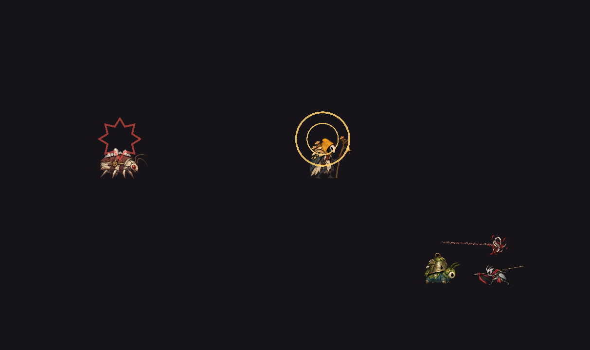

# B01：伏击、报警与支援的可读提示，蛰伏／守点不再触发战斗音乐

本批从台账 B01 剩余的“蛰伏／报警／支援的专属动作和声音”继续，起点为 main `7b0f465e`。所有 46 个任务包的最终验收仍开放。

## 玩法变化

此前三种职责只有行为，没有各自的提示：伏击者直接从蛰伏转入普通战斗，报警者通知同伴时无声无形，支援者只有画面连线。现在每次职责转换都有自己的声音，伏击与报警另有一次性的画面标记：

- **伏击现身**：伏击者从蛰伏中第一次看见玩家时，播放“枯丛撕开＋低线绷断”的短促声音，头顶出现一圈锯齿状红色爆线；随后原地停 0.35 秒、面向玩家，期间不移动、不起手，然后进入普通战斗。追击中不会重复；脱战回到原位重新蛰伏后，下一次现身会再次提示。
- **报警**：报警者发出呼叫时，播放两记急促的降 B 铜铃叠短号低鸣，头顶先后扩散两道金色圆环。提示与报警共用 8 秒冷却；被叫来的同伴不发出自己的提示。
- **支援引导**：灰旗小鬼开始 0.9 秒引导时播放旗布簌响托着缓升暗色线音，与玩家疗伤的明亮钟对区分，玩家能听见“要治疗了”并去打断。原有引导连线和释放标记不变。

圆环和爆线走危险提示层（与原有引导连线相同），每次交战最多一次，不进入装饰名额，因此混战中不会被预算裁掉；它们不造成伤害，也不改变任何判定。

三个声音由 `tools/generate_sfx_pack.py` 新配方离线合成（项目自产 CC0），登记为 `audio_visual_manifest.json` 中的 `enemy_ambush_reveal`／`enemy_alarm_call`／`enemy_support_mend`（wired，P1），经 AudioDirector 声部准入在 SFXEnemy 总线播放。生成器新增 `--only` 只重写指定文件，ffmpeg 可由 `CTP_FFMPEG` 或 PATH 指定；本批只生成了这三个文件，其余 47 个已有音效未重新编码。

## 修复：蛰伏的伏击者和守点护卫一直开着战斗音乐

AudioDirector 的战斗层每 0.25 秒读取全区敌人的 `last_ai_decision`，除 `patrol`／`return` 以外都算交战。10-21 职责行为入 main 之后，伏击者蛰伏时记为 `lurk`、护卫守点记为 `hold_post`／`return_post`，它们每帧都在更新，于是只要区域里驻留着一只护卫或伏击者，战斗音乐层就一直不退，还会在第一次轮询时播放敌人警觉声——相当于提前暴露伏击。

现在敌人提供 `combat_engaged()`：巡逻、回位、蛰伏、守点、回岗都算平静；AudioDirector 优先使用它，旧对象仍按原判定。搜索（`investigate`）与正常交战照旧开启战斗层。

## 画面

原生 OpenGL Compatibility 的 1280×720 实际渲染，由 `capture_role_cues.gd` 生成：生产敌人脚本与正式精灵，夹具舞台与目标，在一次 AI 决策后 9 个物理帧截取。它证明提示实际绘制、位置和颜色，不代表正式区域中的自然遭遇、人工可读性或听感验收。

## 验证

- `enemy_tactical_roles`：原有 264 项保留，新增 22 项，合计 286 项通过。覆盖三个声音文件可加载且时长 0.3–1.0 秒、清单登记一致；蛰伏无提示且不算交战；现身提示一次、画一圈、同帧不起手、面向玩家、约 0.35 秒后恢复普通战斗、追击中不重复、回岗后再次现身重新提示；报警一次画两圈、同伴不发提示、冷却内不重复；支援起手即提示；以及 AudioDirector 战斗层对蛰伏／守点／回岗保持平静、对真正交战仍开启。
- 反向检查：把 `audio_director.gd` 换回 main 版本，“蛰伏／守点不开战斗音乐”“回岗平静”2 项失败；把现身停顿设为 0，“同帧不起手”“约三分之一秒停顿”2 项失败。均为行为断言失败，恢复后全部通过。
- 相关套件：`enemy_ai_behavior` 38、`enemy_encounter_roles` 19、`enemy_lifecycle_regression` 31、`minor_enemy_skill_art` 5252、`world_enemy_residency` 56、`audio_retirement` 通过；真实 GL 下 `combat_visual_budget`（52＋44）、`enemy_visibility` 638、`enemy_effect_lifetime` 46、`enemy_atlas_integrity` 3325 通过，均零 ERROR。`enemy_atlas_integrity` 首次误用 headless 运行时报“需要真实显示”并超时，第二次在 GL 下未加 `--fixed-fps 60` 有 6 项时长量化失败；按 runner／CI 同样的 `--fixed-fps 60` 重跑全部通过。
- 旧脚本 `audio_visual_validation`（不在 CI 套件中）里三个新条目的路径、文件存在与加载均通过；该脚本另有 CH01 旧地图素材与 `start_platform` 已移除导致的既有失败并在其后挂起，与本批无关，已手动结束。
- `tools/validate_audio_visual_manifest.py` 通过（wired 131）；合约测试、`npm test`、`npm run test:campaign` 通过。

## 边界

伏击现身多了 0.35 秒停顿，此前的 T04 实际输入回放（`world_*_playback.gd`，不在默认套件中）若在伏击者附近录制，扣血时序可能不同；本批未重放这些记录。专属敌人动作帧（举铃、跃出、举旗）需要美术素材，本批只用声音与几何标记。声音响度按现有战斗音效惯例设定，未做人工听感与混音验收；自然流程中的可读性、难度与 T04 仍开放。
