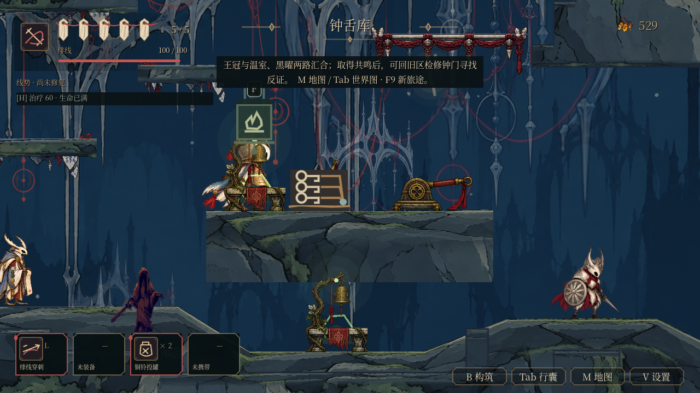

# T04：C5 战后至 C6 下环的正常输入续跑

2026-10-24。本批为自动正常 Input 续跑，不冒充陌生玩家、人工重试时间或 FPS 测量。46 项最终验收均保持 OPEN。

## 结果与范围

从 PR209 真正取得的 Bride 胜利 seed（SHA256 `d8e950d6fac3e1be55b4fb7bbb5b85eac09fdfdc45a6d8ed9fbc6410535e443f`）出发，46 步正常战斗、跳跃、交谈、物理下行、F 拉杆及 F 安坐到达 `save_ch06_lower_loop`。伤害开启，0 死亡、5 次受伤、4 次正常疗伤；无位置/HP/库存/剧情赋写、无无敌、无授予 dash、无修改敌人或战斗参数。已有 cleave/shard 构筑完全保留。

正式原生 GL 主进程 29.34 秒，新独立 PID 精确读档 4.25 秒；各有严格 180 秒上限，均 0 ERROR / 0 ObjectDB warning。固定 60Hz 仅为自动输入调度。最终 8879 个源文件冻结前后相同。正式基线 `408c8942313a781303e41bc744c42658e45df291` 的树 `7acf027d59b65e11c858577155441e33980dcbca` 与后来 main `3f28501f6e11b2058cfd66a3f2eb2011109d0250` 完全一致；发布前仅整合其合并元数据为 `2a9249d947dce9cb5ae90720883ad1dc68f90a6a`，未将旧记录称作新内容重测。

## 两处真实阻点与最小修复

原雨池地台 x4480..4880 与轮台 x4990..5190 之间作者预留 110px 槽，但 terrain 生成器把两者连接为 104px 深的坡体，封住正常下落。仅对 C6 echo_canal 在轮台前分段，保留两侧平台 XY、104px 深度、材质和其他坡面。另一个阻点是雨池地台末端与下阶只有 10px 横向间隔，小于 34px 角色宽；原地台底抵住下阶角色头部。只将左岸最后 64px（x4816..4880）唇沿深度 104 改为 30，获得 90px 下行净空；其余 336px 及右岸仍保持原厚度。

几何差集记录在 `artifacts/t04_crown_entry/isolated_generator/geometry-provenance-final.json`。旧/新生成器隔离重建仅 C6 改变，C1–C5 JSON 逐字相同；C6 terrain 仅去除 16176px²（连坡 11440 + 唇沿 4736），边界 [4816,1128,4990,1284]。CaveMass 仅去除 6144px²，范围 [4928,1312,4992,1408]，无新增材料。平台 ID/XY/材质/角色与所有非几何字段不变。

旧生成器对原 HEAD 全重建本来就另去掉 [1856,1088,1888,1120] 的 1024px² 历史格子。本批发布 JSON 刻意保留该格子，只提取上述真实槽内差量；所以不声称整份新生成结果与发布 JSON 字节相等。发布轮廓的几何差同样仅在槽内。原/候选/发布数据、构建器和哈希全部归档，可复查两组隔离比较。

## 实际路线与收入

先正常清 C5 门槛 E13 和缆道 E14，经已败 Boss 场地、缆道与实际 F World 通道进入 C6；两敌带来 16 钱、2 黑曜碎片。通道生产要求为已有 lantern_phase，未绕过条件。

走近前厅 [3050,660] 时先由实际 body-enter collectible `upgrade_obtain_crown_resonance` 自动实取共鸣，再 F 与回声交谈。最终控制器在 F 前断言 collected_id 和库存为 1。F 本身不是授予来源；早期日志中将两者归因为 F 的文案保留并在此纠正。本批没有按 R，R 效果由别批覆盖。

经东肩、雨池真实 E01 盾敌、轮台 E02、新净空槽、弦棚 E04/E03、双跳攻击空中 E05/E06，下行核心阶梯至钟舌库。正常自动实取 5 共鸣碎片，F 开 `ch06_west_ring_shortcut`，F 在下环安坐。6 个 C6 敌人各 8 钱，精英首次额外 30，钱包 435→451→529；黑曜碎片 22→24；C6 碎片 6+精英额外2+库5=13；新增共鸣与碎片两类，25→27 种物品。构筑与工具数完全不变。

最终不可变 seed `artifacts/t04_crown_entry/earned_lower_seed.json` SHA256 `991da3aee7e085764c400b51792a48a28f9cf226cea89b50794d2c0610c03dae`，HP5/energy100，checkpoint `save_ch06_lower_loop`，无归途结、无 thread_dash。此 seed 来自旧最大 HP5 的真实链，不能作为后来容量奖励的证据。Boss 已由正常拉杆解锁但尚未生成/进入战斗，无锁、无 Boss 音乐。

## 正反与退出证明

`final_native_01/verification.json` 为正式正常链及独立进程结果。精确读档比较钱包、全部库存/build/story/regions、地图 pending/charted/owned、HP/上限/energy、checkpoint、结及 Boss 状态，且证明 PID 真正变化。`final_negative_cpu_02` 的 19 类错误证明必须以指定断言失败，包含非法小数，未用仅非零退出替代。

定位夹具与自然链分开：夹具明确设置起点、暂停敌人/危险用于几何因果对照，不作为 earned 来源。普通上跨/落槽/上跳返回阶段关闭双跳与抓墙；最后弦棚回返只恢复真实 seed 已有双跳。最终原生旧连坡失败于 drop（8.86 秒），只拆坡旧唇沿失败于 outflow（9.55 秒），最终修复通过上下往返（8.72 秒）。反向每套要求确切一个预期 ERROR/失败阶段、无其他错误和无退出 warning，防止无关错误假阳性。对应 CPU 正反均通过。

最终 UTF8 Windows `npm test`、`npm run test:campaign` 均成功，默认回归实际集合为 144；新增 crown_rain_slot 同步 runner、markers 与跨平台契约。相关 crown_rain_slot / silent_crown_experience（427 checks）CPU 通过。已有导出脚本排除验证脚本；测试源不进发布运行包。

所有早期路线受伤/死亡、错误落点、缺导入、夹具初始化及合同计数失败原文保留。早期 related_cpu_01 有一条未归因 ObjectDB warning；后续零 warning 不证明其因果修复。资源仅从已核 PNG raw / import 参数的只读缓存源恢复，清单记录 raw 与 LF 归一差异。日志以 gzip mtime0 保存并验证解压原字节；manifest 固定全体归档文件。

## 仍待验证

C6 地图未购买，深处 npc_six_mark_keeper 售价 55；前厅回声不是商人。当前探索只记 pending，不冒称补绘。西环返程、地图实购、共鸣门后第六证言、完整最终 Boss / 结局仍待下一批。未覆盖最终整合长跑、人类可读性或最终 46 项验收。

## 首龛恢复画面

正式玩法验证后，另一个新 PID37132 从同一 `991da3…` 原始 seed 读入专用私人存档，正常等待相机与落地后保存 PNG；9.20 秒、0 ERROR/warning，正式 8879 源仍逐字相同。该图是 earned 恢复画面，非定位夹具。

