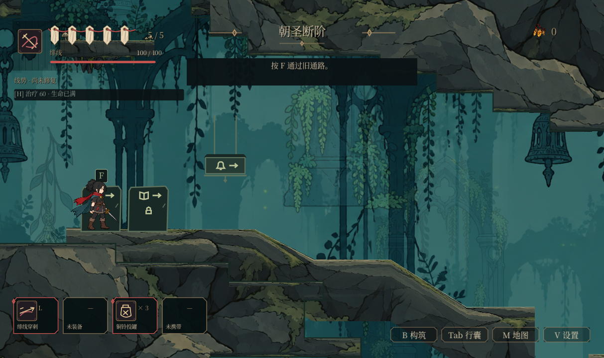
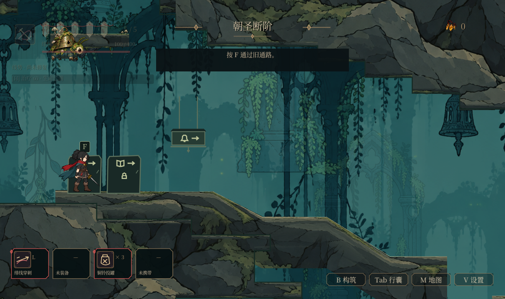

# U03：战斗内容在 HUD 后方时，HUD 让开

本批从台账 U03 剩余的“危险信息优先、HUD 与战斗画面遮挡”继续，起点为 main `93365331`。所有 46 个任务包的最终验收仍开放。

## 问题

HUD 有两组固定在画面上的卡片：左上的生命／绯线卡及其下方的契印机制、治疗行、钉记（约 26–390 × 24–257），左下的四张技能／战具卡（约 28–448 × 610–688，1280×720 基准）。镜头靠近房间边缘时，玩家、敌人和敌方弹道、光束可以落到这些不透明卡片后面，被完全遮住。没有任何机制让 HUD 让开。

## 现在

新增 `hud_occlusion.gd`，由 HUD 每帧调用：

- **谁优先**：玩家身体（含精灵余量）、所有驻留且未在死亡消散中的敌人受击框、以及这些敌人当前存活的攻击效果。光束按整段长度计算覆盖范围，而不只是起点。
- **怎么让**：两组各自独立判断。屏幕上与某组重叠时，该组在约 0.1 秒内淡到 30% 不透明；离开后同样速度恢复。只淡被挡住的那一组，另一组保持原样。
- **不改变什么**：只改显示透明度，不改输入、命中判定或 HUD 显示的数值。打开地图、行囊等界面时不计算遮挡，HUD 恢复不透明（这些界面本身会隐藏战斗 HUD）。

| 后方无内容 | 苔虫在左上 HUD 后方 |
|---|---|
|  |  |

正式 World 原生 OpenGL Compatibility 1280×720 实际渲染，由 `capture_hud_occlusion.gd` 生成；只直接设置了苔虫的位置（按实际镜头反算到左上 HUD 后方），AI 物理处理暂停。左上组透明度 0.30，左下组 1.00。

## 验证

- 新增 `hud_occlusion_checks.gd`，接入 `ui_world_integration`（正式 World，按实际镜头反算位置）：两组都有真实屏幕范围；后方无内容时保持不透明；真实敌人放到左上组后方，第一帧开始淡出而非瞬间消失、最终整组（卡片、治疗行）为 30%，左下组不受影响；敌人离开后恢复；敌方攻击效果放到左下组后方（其主人不在附近）也会让左下组淡出；打开地图后恢复；移除攻击效果后恢复；光束覆盖整段长度。
- 反向检查三组，均为行为断言失败：去掉每帧刷新 3 项；不计攻击效果 1 项；任一组被挡就两组一起淡 1 项。
- 相关套件：runner 引擎错误门禁（含 SCRIPT ERROR）下 `ui_world_integration`、`ui_redesign`、`global_font`、`input_prompt`、`settings_remap`、`seal_ui`、`save_recovery`、`ui_text_order`、`ui_build_accessibility` 通过；真实 GL 下 `ui_world_integration`、`build_slots_ui` 37、`world_map` 673、`artisan_crafts` 92、`ui_redesign` 70 通过，零 ERROR／SCRIPT ERROR。
- 合约测试、`npm test`、`npm run test:campaign` 通过。

## 边界

淡出比例与速度是首版取值，混战中是否足够、是否会频繁闪烁需要实机观察（T04）。Boss 的大型场地效果若不通过敌人的 `owned_attack_effects` 管理，则不在本批判断范围内。HUD 的其它元素（地点名、碎钱、右下快捷按钮、提示条）未纳入淡出组。
