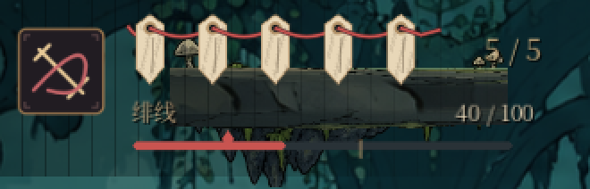
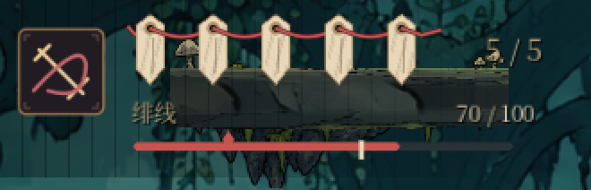

# U03：绯线条直接标出治疗阈值与当前线术费用

本批从台账 U03 继续（计划原文：线量同时说明技能可用与疗伤阈值），起点为 main `93365331`。所有 46 个任务包的最终验收仍开放。

## 改动前

HUD 左上的绯线条只有填充和“40 / 100”数字。治疗要 60、当前线术要 25 等信息只出现在下方治疗行（“缺 20 绯线”）和技能卡上，战斗中要在三处之间来回看，才能判断这一下能不能疗伤或放术。

## 现在

绯线条上叠一层刻度（`PilgrimageChrome` 新增 `thresholds` 绘制）：

- **治疗刻度**：在治疗费用处画一道竖向刻痕，绯线够时为亮骨白、不够时为暗铜色。费用随契印／铭饰改变时刻度跟着移动。
- **线术刻度**：在当前激活线术的费用处画一枚菱形，够时实心绯红、不够时只剩暗铜描边。激活槽为空、休眠或费用为 0 时不画。
- 刻度每帧从玩家实际的 `heal_energy_cost`、`max_energy` 与构筑系统 `selected_skill()` 读取（已含校习方向与铭饰的费用倍率），和治疗行、技能卡用的是同一套门槛，不另算一套数字。

| 40 绯线：线术够、治疗不够 | 70 绯线：两者都够 |
|---|---|
|  |  |

以上为正式 World 原生 OpenGL Compatibility 1280×720 实际渲染的 HUD 卡片截取（2 倍最近邻放大），由 `capture_thread_thresholds.gd` 生成；只直接设置了绯线数值。

## 验证

- `ui_world_integration`（正式 World）新增 10 项 HUD 检查：刻度与绯线条同宽同父节点；HUD 帧把实际治疗费用、上限与当前绯线写入刻度；差 1 点时治疗刻度暗、刚好够时亮且治疗门槛的原因不再是绯线不足；刻度位置等于费用比例；线术刻度取激活槽实际费用（新档为 cleave 25），差 1 点时暗且技能卡同样显示“缺1”，够时亮；治疗费用改变后刻度跟随；清空激活槽后不画线术刻度。
- 反向检查：去掉每帧刷新，6 项失败；刻度忽略当前绯线一律点亮，2 项失败。
- CI typography-and-ui 同组 12 套（`global_font`、`ui_redesign`、`ui_world_integration`、`ui_build_accessibility`、`input_prompt`、`settings_remap`、`build_slots_ui`、`seal_ui`、`world_map`、`map_player_pins`、`artisan_crafts`、`save_recovery`）以及 `ui_text_order`、`seal_combat` 在真实 GL 下：`global_font` 241、`ui_redesign` 70、`ui_world_integration`、`ui_build_accessibility`、`input_prompt` 36、`settings_remap` 23、`build_slots_ui` 37、`seal_ui` 31、`world_map` 673、`artisan_crafts` 92、`save_recovery` 35、`ui_text_order` 9、`seal_combat` 194 通过，零 ERROR。`world_map`／`artisan_crafts` 首轮与其它进程并发时 World 15 秒内未就绪，单独重跑通过。`map_player_pins` 本机有 5 项真实右键缩放／平移断言失败；把两个 UI 文件换回 main 版本同样是这 5 项失败，属本机离屏窗口的鼠标环境问题，与本批无关，以 CI typography-and-ui 结果为准。
- 合约测试、`npm test`、`npm run test:campaign` 通过。
- 首次推送后 CI 的三组 focused-regressions 在 `ui_build_accessibility` 报 SCRIPT ERROR：该套的 MockPlayer 没有 `heal_energy_cost`。本地首轮只统计了以 `ERROR` 开头的行，漏看了 `SCRIPT ERROR`。现改为属性存在时才读取（夹具无治疗费用时不画治疗刻度），并用 runner 的引擎错误门禁重跑 12 套 UI 套件：11 套通过，`build_slots_ui` 仅有 Dummy 渲染器截图的已知纹理错误（真实 GL 下零错误）。

## 边界

刻度位置与亮暗由测试和截图证明；它在激烈战斗中是否足够醒目、颜色是否与绯线填充区分得开，需要实机观察（T04）。U03 其余部分——危险信息优先、HUD 与战斗画面的遮挡验收——本批未处理。
