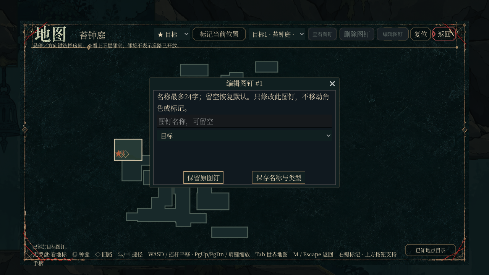

# 图钉命名、分类编辑与持久确认

已有图钉可以改名、切换目标/留意/回访类型，名称最多24字并拒绝控制字符。编辑默认取消，确认时重新核对图钉身份与当前已知地图，保存失败沿原事务回滚；地图关闭和场景退场会关闭编辑窗口。旧存档缺少名称或名称损坏时仍保留有效坐标。

本轮第 1/10 项，独立基于 main `856010d8`。生产范围：`godot/scripts/map_player_pins.gd`, `godot/scripts/map_player_pins_runtime.gd`。不修改其他 agent 占用的主世界入口、主界面、玩家脚本或共用回归注册表。

## 验证

Godot `4.6.1.stable.official.14d19694e`。独立临时工程从原 main 展开，仅覆盖本 PR 的文件，新专项 **15 项通过**。临时源代码故障注入后，同一测试产生 **4 项语义断言失败**，没有 SCRIPT ERROR；生产文件已保持正向版本。输入SHA256、正反日志和故障替换内容见 `artifacts/upgrade_20261025e/01_pin_editor/`。

同源码在真实 llvmpipe GL 运行通过，原始日志为同目录 `real_gl.log`。专用 CI `.github/workflows/upgrade-e01-pin_editor.yml` 保留严格双导入、180秒专项上限、引擎错误检查和完成标记，不放宽原项目门禁。CI须在发布后按远端状态另核。

截图使用显式测试数据，展示布局/渲染；不代表自然流程取得或玩家体验结论。

## 范围与限制

本批不关闭原46项最终验收，也没有完成实体手柄实听/手感、自然六区通关或发行包验证。不自动合并。
