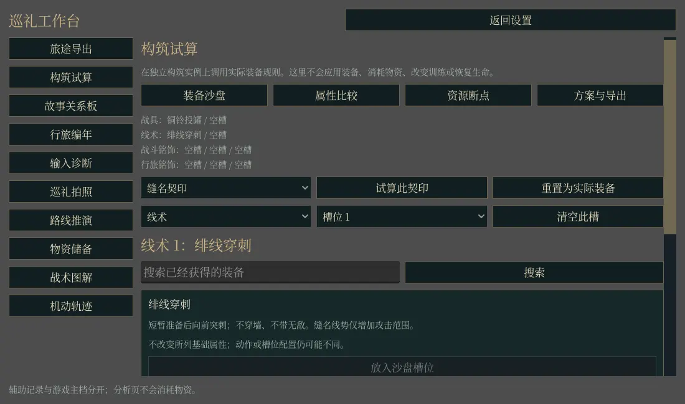

# 真实构筑规则沙盘、属性差异与资源断点

克隆实际构筑引擎试算已持有装备、比较属性与资源费用、保存方案和差异报告；不安装装备或消费资源。

入口为设置 → 旅途工作台 → 构筑试算。辅助记录按主档路径的 SHA256 隔离，原游戏主档仍由既有系统管理。

本 PR 基于本批第 1 项基础分支。合并基础 PR 后可转向 `main`；本功能不依赖另外八项功能。 基础提交对齐 `main b7b26eefdf4839dfb81ca210d0c54dab2513bffc`。提交前检查了 46 个开放 PR 的文件范围，本批源文件没有与它们重叠。生产模块使用独立目录和动态发现；动态目录从实际运行入口进入导出闭包，测试目录从桌面导出中排除。

## 改动规模与范围

本 PR 新增 **501 行有效业务代码**：按生产 GDScript／shader 的非空、非注释行统计。测试、文档、日志、CI、UID、导出审计工具和基础 PR 的代码均不计入功能 PR 的数量。

生产文件：

- `godot/journey/build_lab/model.gd`
- `godot/journey/features/build_lab.gd`

## 验证

Godot 4.6.1，独立“基础 + 本功能”快照分别通过 headless 与真实 Mesa llvmpipe OpenGL。专项检查 19／19 项，实际 World 检查 10／10 项，最终共享核心检查各 17 项，均 0 失败。拍照专项的 OpenGL 额外检查真实 PNG 及尺寸复读。

十项叠加的实际 World 检查通过，包含原生模态输入锁、设置入口边界、各模块页面、主档及物资不变、照片生命周期恢复和 World 退役。`npm test`、`npm run test:campaign` 通过；原 controller_comfort、world_map、journal_desk、scene_history、world_wayfinding、save_product、ui_world_integration、ui_build_accessibility 及新合入的 goal_desk 回归通过。完成标记、引擎错误和进程退出码均检查；没有放宽原有 15 秒 World 就绪门槛。

初次并发验证发生 World 15 秒超时（路线 headless、战术 OpenGL、既有 controller_comfort／goal_desk）。失败日志保留；路线、战术、基础 World 和 goal_desk 在原门槛下串行复验通过。controller_comfort 的默认 headless 31 项通过，本机软件 OpenGL 仍触及该就绪门槛，作为已知验证限制保留。另生成桌面 PCK，并在仅挂载 PCK 时验证十个动态模块均可载入、初始数据有效且测试脚本未打包。此检查不构成完整发行包验收；本轮未完成实体手柄体验或自然六区通关。

源码 SHA256、独立复验日志及检查数量见 `artifacts/upgrade_20261025h/03-build-lab`。截图为十模块叠加时的实际 World 原生窗口，使用隔离测试存档；不是自然流程进度证明。



复现：

```bash
python3 tools/run_journey_workbench_tests.py --engine godot --feature build_lab --backend headless --log-dir /tmp/journey-build_lab-headless
LIBGL_ALWAYS_SOFTWARE=1 xvfb-run -a python3 tools/run_journey_workbench_tests.py --engine godot --feature build_lab --backend gl --log-dir /tmp/journey-build_lab-gl
```

专属 CI 检出确切 PR head、拉取运行素材、使用固定 Godot 4.6.1，并顺序执行资源导入、导出闭包审计、headless 与 OpenGL 检查。远端结果以 GitHub 当前 head 的检查为准。
