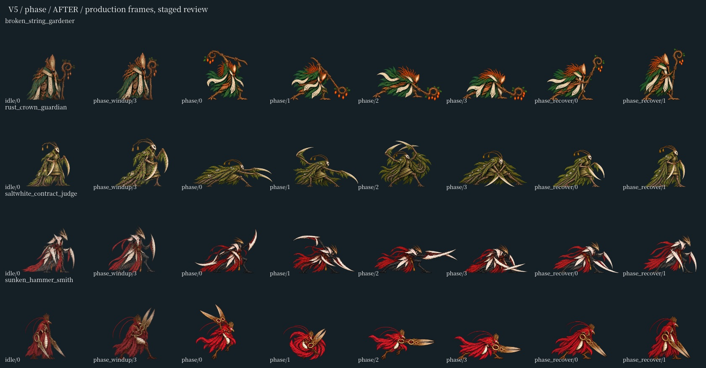
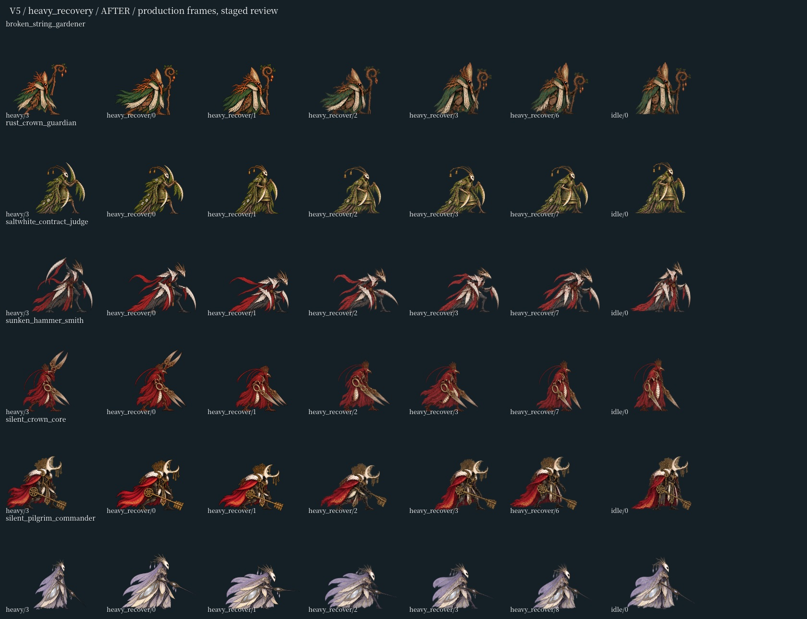

# v5 角色动作接入

> 历史快照：以下记录针对最初 da54e285 上的本地 v5 接入，不代表最终 PR 的运行时模型。正式分支保留 main bd11a96f 的 bridge／settle、颜色校准与卡顿补偿，见 [v6 主线适配报告](20261101_boss_motion_v6.md)。

2026-11-01，基线 `da54e285`，在原有字体和普攻特效未提交改动上继续工作。

32 张源图、67 个新画姿势已接入 13 个正式角色。E 组替换四位 Boss 的二阶段出招；F 组为六位 Boss 的 heavy、cast、phase 各增加两帧专属收招过渡，随后串接原有通用收招；G 组修灰旗小鬼的前摇、出招起手和收招、回声书吏的出招末帧、蜡枪兵的收招；H 组修主教阵亡、迟影收招、投管工受击及两名 NPC 对话的指定帧。

每张图统一比例，脚底对齐，水平位置按 alpha 质量中位数注册。保存源图 SHA-256、原注册和校准信息，重复构建不依赖改造后的图集。新增宽姿势可能改变图集画布，打包器保留原半宽奇偶性，避免 half-even 取整让旧帧横移一个图集像素；另修正 Windows 路径分隔符和 UTF-8 编码。

既有演员已经支持按攻击动画选择 `_recover`，本批无需修改敌人状态机、攻击数据或伤害判定。新过渡和原收招共同使用原来的 recover 时长。

验证结果：

- `expanded_character_motion`：真实 NVIDIA GeForce RTX 5060 / Godot 4.6 Compatibility，5642 项、71 个角色、2933 个运行时帧引用，零失败。包含六位 Boss 三种真实特殊招式、左右朝向、逐帧播放、重复重启、原收招窗口及回到待机。
- `validate_character_motion_v5_preservation.py --baseline-ref da54e285`：573 个保留旧帧的可见 RGBA 与游戏内定位均相同。透明像素隐藏 RGB 不计入渲染比较。
- 八套相关回归通过：combat、enemy_ai_behavior、enemy_lifecycle_regression、enemy_effect_lifetime、enemy_visibility、boss_trial、optional_challenges、seal_identity。后三者中 Boss／挑战退出的 ObjectDB 警告继续保留。
- `npm test`、`test:boss-assets`、`test:character-motion` 通过；v5 登记检查已接入后者。
- 现有严格导入工具以 `--recovery-mode` 完成两轮资源导入，零引擎错误。普通编辑器首轮出现 MetSys UID／解析诊断，后续仍有退出纹理／字体 RID 泄漏，不能计为普通编辑器通过，也不宣称新改动已证明其根因。
- 初轮对比截图夹具因旧资源路径未带角色家族名走错 loader，已修正。最终 14 张真实 GL 对比图与 capture.json 零引擎错误，截图是静态摆拍，Boss 按 0.5 倍、其他角色按 1 倍取景，不能当作自然战斗或帧率证据。

[全部证据](../../artifacts/motion_v5_runtime/)包含源登记、像素保留检查、逐套日志和截图。





复现：

```powershell
python -X utf8 tools/build_character_motion_v5.py --check
python -X utf8 tools/validate_character_motion_v5_preservation.py --baseline-ref da54e285
godot --path godot --rendering-method gl_compatibility --fixed-fps 60 --script res://scripts/expanded_character_motion_validation.gd
godot --path godot --rendering-method gl_compatibility --script res://../tools/capture_character_motion_v5.gd -- --capture-output=C:/absolute/output
```

用户随后反馈 Boss 衔接仍跳帧。v5 完成的是源图接入，未完成所有动作的帧密度与连续性验收；六位正式 Boss 的后续 288 个新姿势已接入，见 [后续报告](20261101_boss_motion_v6.md)。自然带伤六区流程、全角色画风和长期稳定仍 OPEN。
