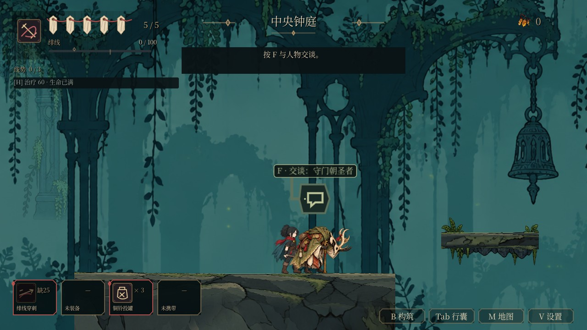

# V02：25 位 NPC 的靠近问候与对话生命周期

正式图集中已有每位 NPC 两格问候，但原入口直接播放 `talk`，这些姿势没有进入正常交互。本批让 25 位 NPC 的 50 个既有问候姿势实际播放。最新 main `4242f790` 已包含主角后续动作与身形／特效修正，本 PR 同步后只保留 NPC 差量；NPC 新增画稿数为零。

25 位 NPC 的 50 份原／动作清单及 50 张图集保持原字节，见[素材保留证据](../../artifacts/npc_dialogue_motion_v10/source-preservation.json)。[主线差量检查](../../artifacts/npc_dialogue_motion_v10/main-integration-preservation.json)同时核对主角资产目录、控制器及全部 31 条动画记录与 main 一致。

## 实际行为

真实 Player 碰撞体进入 NPC 原有 34px 交互区域时播放一次问候，完成后回待机；单实例 8 秒冷却，反复跨过边界不会连续招手。冷却使用真实时间；动画仍由 AnimatedSprite／SceneTree 的速度和暂停规则控制，没有另开动画计时器或每帧距离轮询。

开始交谈时，尚在播放的靠近问候接着当前进度，完成后进入原 `talk` 循环；未在问候时则从首格开始。文字立即显示。继续台词或切换主题不重置手势进度；关闭、换说话者或转读史迹时，前一位 NPC 回待机。问候缺失、错误循环或零帧率时直接使用原说话动作；旧普通 AnimatedSprite 夹具保留。

截图使用落地／定位夹具与真实交互碰撞区域，不是自然抵达路线。镜头调用正式到达重置入口，取样检查 NPC 位于实际视口内。问候提前到靠近时，能在对话面板打开前看到完整身体动作。

## 实现与验证

`npc_dialogue_motion.gd` 直接附在原 AnimatedSprite 上，只连接区域进入和动画结束信号，使用原图集／帧率，没有额外绘制层或节点。Main 仅 `_make_npc` 改变；界面仅 `show_speaker`、`close_dialogue` 增加动作交接及一个转发函数。台词、任务交付、库存、关系与剧情提交逻辑不改。

- [五套原生 GL 验证](../../artifacts/npc_dialogue_motion_v10/verification-native.json)：新 NPC 专项 244 项，全部 25 位实际播放两格问候；完整角色动作 6230 项（71 位／3114 个姿势引用）、原剧情引导六章、预热零同步 miss。守门朝圣者处验证真实 Player 接近和正常交谈入口；另有两区往返后的织线学徒自然接近／交谈。其他地点仍待流程验收。
- 专项覆盖问候→说话、换主题、冷却期满、无人交谈回待机、半速／暂停、提前关闭／重开、换 NPC、史迹、卸载与三种不可用问候回退。临时让 helper 不使用问候时，[244 项准确失败 60 项](../../artifacts/npc_dialogue_motion_v10/negative-verification.json)，无脚本错误；恢复源 SHA 后通过。
- 首发 CI 48 个工作流中 46 个成功，两个失败都来自跨区验收旧有的“进入信号总数等于一”断言。主交互和新增问候分别绑定一次是正确状态。现分别核对回调目标、方法、绑定区域和进入／离开总数；真实跨区流程继续使用该严格检查，没有跳过。新专项共用同一检查器，并直接注入额外监听、用错误区域替换正确回调，两种反向都被拒绝，恢复后通过；五项结果写入 `verification.json` 的 `callback_contract`。
- [Windows 原生完整跨区补跑](../../artifacts/npc_dialogue_motion_v10/windows-neighbor-observation.json)最终 52 项通过、零引擎错误：两次实际管道跨越各约 8574px，保留原有 5／8 个邻区实例，正常受伤 4→3、击杀与碎钱 +8、返回安坐钟龛，再自然步行接近织线学徒，先触发问候后按键交谈。仅初始检查点为夹具；随后没有传送或抑制伤害，不是六区通关。早期停住时方向输入为零的失败原样保留；离屏测试窗口改在项目窗口初始化后的 deferred 入口设为不可抢焦点，截图后模拟按键对齐到下次输入轮询前。未改生产移动、重发按住方向或放宽预算。
- 无头环境不执行窗口焦点两项，[最终 50 项全流程同样通过](../../artifacts/npc_dialogue_motion_v10/neighbor-headless-final-run.log)。后续 CI 的真实 Linux GL 流程通过了 49 项，但 wrapper 仍要求旧的 48 项完成标记；现同步两个 GPU workflow 及其契约测试至 52 项。发布头结果继续独立核验。
- [三套相关无头回归](../../artifacts/npc_dialogue_motion_v10/runtime-run.log)通过：剧情结果 9878、阅读 26、交互安全 24 项；`npm test`、campaign、工作流契约六项、双轮导入、两套导出预设（377 项可达资源）通过。Windows runner 执行 3 项、按平台跳过 32 项；Linux 全量结果随发布头记录。

新增专项进入默认回归与动作 CI，默认套件 210→211。原生入口现包括两区完整实走，共五套。原生复验入口：`npm run test:npc-motion-native -- --engine <Godot 4.6.1>`。备用休息格、职业操作和任务交付姿态没有计作已完成。

V02 整包、NPC 其余交互、其他角色、全动作比例一致性、自然连续观感与完整流程继续 OPEN；T03／T04／T05 不关闭。
