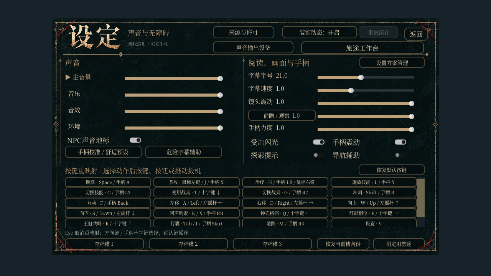

# T03：设置页按五组分帧构建，保留原界面

到达提交时，原 `_build_settings` 在一个调度项里加入 82 个 Control，六区同机取样为 10.08–12.42ms。现在按原顺序创建外壳、声音、阅读／无障碍、重映射和收尾五组；原同步入口仍完整调用这五组。加载器的每批操作数和时间预算保留，完成前的界面继续隐藏并关闭输入。

主界面已有函数只改 `build_steps` 与 `_build_settings`，另加五个构建函数。原 88 行非空构造语句及其顺序逐字一致；NPC／对话和其余已有 UI 函数与 main `35987a41` 保持一致。见[来源检查](../../artifacts/settings_construction_v12/source-preservation.json)。

同一未改的 `world_async_loading` 504 项夹具，Windows 原生 GL、六区依次切换，每个版本各一遍：起点 `4242f790` 的设置项 10.08–12.42ms，隔离改动后最大组为 3.72–5.38ms；同步含 NPC 问候的 main 后复测为 3.95–5.98ms。完整逐区记录见[CPU 作业测量](../../artifacts/settings_construction_v12/metrics-comparison.json)。这是单个加载作业的耗时；总构建工作、整段加载时间及自然帧率没有据此记作改善。

1280×720 的[前后像素与完整控件树](../../artifacts/settings_construction_v12/capture/comparison.json)一致，同步 main 后再次一致。取样使用暂停的独立页面和纯背景；自然游戏背景、交互观感与帧时间另验。

验证范围：

- [七套原生 GL 通过](../../artifacts/settings_construction_v12/verification-native.json)：新构建专项 89 项、六区异步加载 504 项、排版 18 项、实际输入适配 85 项、重映射 23 项、手柄舒适设置 31 项及页面截图。新专项[无头环境同样通过](../../artifacts/settings_construction_v12/headless-run.log)。
- 新专项在实际到达创建第一条音量滑条时取消，检查半成品界面忽略快捷键、原地区／位置／进度与存档地区恢复。随后逐项执行正式 HUD 计划，完成前每步检查输入隔离，最大新增 26 个 Control（上限 32）。完成后实际操作四条音量、无障碍、重映射取消、校准及声音输出窗口，旅途状态与游戏存档原字节保留。
- 同步入口核对控件结构、请求位置、最小尺寸、文字、范围、状态及回调；隐藏控件随排版通知变化的临时尺寸不跨构建时序比较，实际发布页面的完整树和像素另行严格核对。
- [主线组合反向实验](../../artifacts/settings_construction_v12/integrated-negative-verification.json)把保留的同步入口重新作为一个调度项：77 项中准确失败一项，单项新增 82 个控件，无 SCRIPT ERROR；恢复同一 UI 源 SHA 后 89 项通过。检查总数随调度步数变化，原有功能检查继续执行。
- `npm test`、campaign、工作流契约与双轮资源导入通过。Windows runner 实际执行三项、平台跳过 32 项，Linux 发布头的完整门禁另记。

截图辅助曾在暂停的离屏夹具中等待自动绘制信号超时，旧 240 秒失败保留在[记录](../../artifacts/settings_construction_v12/capture-wait-observation.json)。现于主线程显式绘制一帧后读取图像，仍使用原超时边界，结果与原始像素／完整树一致；接口依据 [Godot 4.6 RenderingServer 文档](https://docs.godotengine.org/en/4.6/classes/class_renderingserver.html#class-renderingserver-method-force-draw)。截图标记只在原生工具中提供，不能覆盖正式套件的完成标记，正式默认集合仍严格对应。

默认回归在当前 main 上由 211 增至 212；新增专项进入现有字体／UI CI 的 GL 和 Dummy 渲染器门禁。原生入口：`npm run test:settings-construction-native -- --engine <Godot 4.6.1>`。物品预热 #539 仍单独评审，两项后续合并需保留各自专项。

T03 整包、当前组合的其余尖峰、自然连续帧时间、长跑与发布包退出仍 OPEN；T04／T05 不关闭。
