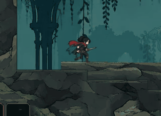

# Grounded protagonist run

The former run sequence could change leg proportions, and the later rigid-part
draft kept bone lengths while allowing the support foot to slide. This change
uses one continuous distance-driven gait and a fixed set of painted leg parts.
The actual support sole cancels body travel, with fixed thigh/shin lengths and
a continuous swing into the next contact. The upper body uses the original v4
art, with a shaped tunic hem and overlapping painted joints.

The production rig follows the full fractional phase rather than switching
between baked poses. Twenty-four cels remain available for ghosts and exports.
Attack, jump, dash, hurt, idle and death keep their authored sequences and
materials. Player and camera share physics interpolation; vertical framing
retains its own single filter, and ordinary room boundaries no longer pin X.

Validation on Godot 4.6.1:

- Two resource import passes complete without engine errors.
- `grounded_run`: fixed-bone geometry, contact and loop seams; both directions,
  multiple scales/slopes; actual Player acceleration, reduced/increased speed,
  stop, attack, jump, landing and respawn. Observed live support slip is below
  the 0.02-world-pixel threshold.
- `player_motion_continuity`, `hero_animation`, `player_melee_feedback`,
  `room_camera_stability`, `camera_focus`, `ability_movement` pass.
- Native NVIDIA OpenGL capture at 144 render frames / 60 physics ticks keeps
  the player marker at x=639.5 pixels in both running directions.
- Asset hashes, runner contracts and CI shard partition checks pass.

The native gameplay review includes forward movement and reversal:

The visual style and motion remain reviewable separately from numerical foot
planting. The rig uses painted overlapping parts; it does not replace the other
authored actions or change gameplay movement speed.
