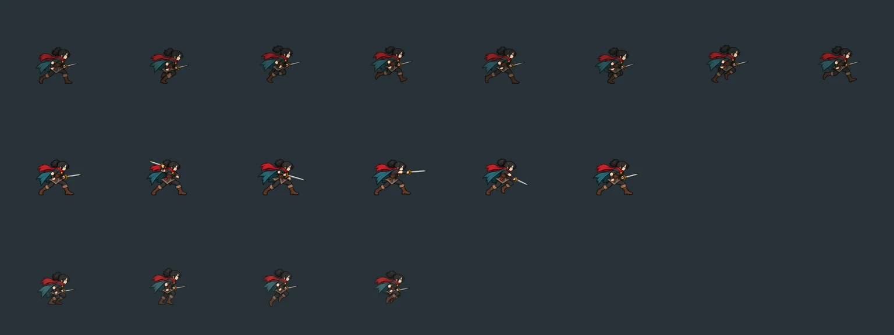
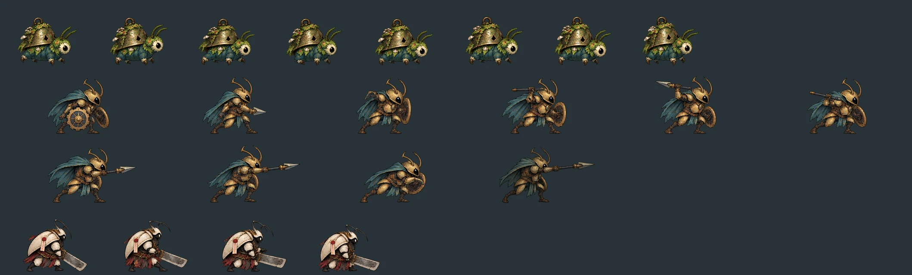
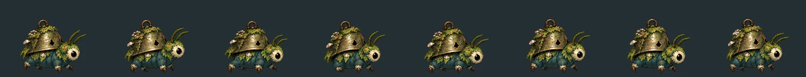
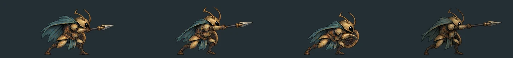
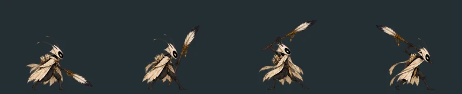

# V02：主角与敌人动作为什么不顺，以及怎么改（对照《空洞骑士：丝之歌》）

> 只是调查报告，本 PR 不改游戏行为。数据都可以用 `tools/audit_animation_smoothness.py` 复现（约 10 秒）。
> 基线：main `6858d30`，Godot 4.6.1。

## 一句话结论

“不顺”来自三层问题，按影响和成本排序：

1. **引擎层**：物理 60 帧更新，但没开物理插值。在 120/144Hz 显示器上，主角、敌人和镜头的位置每两三帧才变一次，整体发抖。这一项不用画任何图，改设置加少量代码就能解决，**应该最先做**。
2. **节奏层**：敌人每个阶段的帧被均匀拉伸，去填战斗数据规定的时长。恢复阶段的中位数只有 8fps，最慢 3.5fps；而且 80 个蓄力/飞行循环里有 78 个只有 2 帧。这不是帧数不够，是**帧时间分配不对**。不画新图，改成“关键姿势停顿”就能明显改善。
3. **美术层**：素材是逐帧生成的图。相邻两帧不是“同一个角色动了一点”，而是“重新画了一遍”：轮廓、道具、甲片每帧都变（“沸腾”），四肢在关键帧之间直接跳到新位置，中间没有过渡。丝之歌顺滑的根本原因在这一层：手绘逐帧，同一套造型。这一层只能靠重画或补中间帧，成本最高。

## 怎么测的

```bash
python3 tools/audit_animation_smoothness.py                 # 摘要
python3 tools/audit_animation_smoothness.py --json out.json # 逐条数据
python3 tools/audit_animation_smoothness.py --sheets dir/   # 输出最差几例的逐帧排列图
```

工具读取游戏实际加载的数据：

- 主角 `generated_hero_v3/manifest.json`；
- 敌人 `original_creatures/*/motion_manifest.json`；
- 战斗时长 `original_creature_combat.json`。

它按 `enemy_actor.gd` 的规则还原每个攻击阶段实际播放的动画和有效帧率：

- `_pose_sprite` 决定选哪个动画；
- `_fit_animation_duration` 把整段动画拉伸到阶段时长，即 `speed_scale = 帧数 / (fps × 时长)`；
- `POSE_LOOP_LEAD` 决定阶段很长时，先在 0.42 / 0.2 / 0.18 秒内播完主动画，再接循环动画。

“帧间变化”的范围是每种敌人的 idle、walk，以及攻击阶段实际会播放的全部动画（含按指令专门画的动画、循环和过渡），循环动画也算上末帧回到首帧那一步。算法是相邻两帧的透明度轮廓按 1 − 交集 / 并集计算。作为参照，同一帧整体右移 2 像素，这个值中位数是 0.09。

## 发现

### A. 引擎：没有物理插值

- `project.godot` 只设了 `physics_ticks_per_second=60`，没有 `physics/common/physics_interpolation`。
- 主角走 `move_and_slide`，敌人在 `_physics_process` 里改位置，镜头 `position_smoothing_speed = 6.0`（`Player.tscn`）。
- 屏幕刷新率高于 60Hz 时，画面帧之间物体不动，下一帧又一次跳过去：一会儿 2 帧、一会儿 3 帧，节奏不均匀。动画画得再好也会显得卡。
- 60Hz 屏幕上不明显，所以开发时容易漏掉。

### B. 主角

| 动作 | 帧数 | 计时方式 | 说明 |
|---|---|---|---|
| idle | 8 | 按 5fps 播放 | 每帧 0.2 秒，呼吸动作有颗粒感 |
| run | 8 | 按移动距离驱动 | 步幅和速度已经对上，问题不在节奏 |
| attack_1 / air_attack / down_attack 等攻击 | 6 | 按攻击计时选帧 | `_update_attack_pose` 暂停播放、按前摇/判定/收招进度选帧，各 2 帧；普通攻击整段约 0.34–0.48 秒，随攻速变化。manifest 里写的 fps 运行时不用 |
| jump_start / land | 4 | 起跳按 36fps；落地按 0.14 秒计时选帧 | 起跳和落地已经有过渡 |
| jump_loop / fall | **2** | 按 8fps 播放 | 空中只在两张图之间来回切 |
| 转身 | 无 | — | `sprite.flip_h` 当帧翻转 |

- 共 31 个动作、162 个帧引用、154 张不同的图（`jump_start` 与 `land` 复用了 `jump` 与 `landing` 的图）。
- 问题主要在**帧与帧之间**：攻击时剑的角度一帧一跳，没有拖影帧（smear），也没有中间角度（下图第二行）。跳跃时身体高度变化 13%，看起来像角色在“缩放”，而不是在“收腿”。



### C. 敌人

**1）帧时间被均匀拉伸**（46 种敌人，含 6 个 Boss；114 条普通/精英指令）

| 阶段 | 有效 fps 中位数 | 最低 | 低于 8fps 的条数 |
|---|---|---|---|
| 蓄力 windup | 9.5 | 6.1 | 24 |
| 出手 active | 16.7 | 5.7 | 4 |
| 恢复 recover | **8.0** | **3.5** | **27** |

- 最慢的例子：`pilgrim_chariot` 冲撞、`falling_clapper` 下砸，都是 4 帧恢复撑 1.15 秒，每帧停 0.29 秒；`corridor_heavy`、`erasure_bailiff` 精英横扫也是 4 帧撑 1.1 秒。
- 4 帧均匀播放 1 秒，玩家看到的是“幻灯片”。如果同样 4 帧改成“第 1 帧停 0.7 秒，后 3 帧 0.15 秒快速收回”，看起来就是“砸完喘一口气再起身”。

**2）2 帧循环**

- 阶段时长超过 `POSE_LOOP_LEAD + 0.12` 秒时，会在主动画后接 `_charge` / `_travel` 循环。80 个这样的循环里有 **78 个只有 2 帧**，其中 14 个要循环 0.5 秒以上。另有 20 条 Boss 恢复先播 `_bridge`，再把共用的 `recover` 拉伸播放一次直到结束，这部分有效帧率中位数 19.4fps、最低 12fps，不是问题。
- 例子：`bailiff_erase` 蓄力 0.68 秒，`chariot_elite_drift` 飞行 0.6 秒，以及 `crossbow_burst` 和两条精英蓄力。
- 两张图来回切，读起来像“闪烁”，不像“蓄力”。

**3）帧间变化：沸腾和跳帧**

| 动作 | 相邻帧轮廓变化中位数 | 对照：整体右移 2px |
|---|---|---|
| idle | 0.27 | 0.09 |
| walk | 0.34 | 0.09 |
| windup | 0.30 | 0.09 |
| active | 0.37 | 0.09 |
| recover | 0.31 | 0.09 |

- **待机变化是右移 2px 的 3 倍。** 只是“呼吸”，轮廓却每帧都在重画，这就是“沸腾”。
- **走路只比待机多一点。** 腿脚的位移被淹没在重画噪声里。例如 `moss_larva`：下图 8 帧走路，腿几乎没动，铃壳和苔藓每帧形状不同。由于 `enemy_actor` 对 idle/walk 固定 `speed_scale = 1.0`，播放速度不随移动速度变化，所以还会“滑步”。
- 504 段动画里有 **107 段**存在相邻两帧轮廓变化超过一半的情况，属于“跳帧”。按指令专门画的动画（如 `gear_guard`、`larva_snap`）比通用的 `windup`/`attack`/`recover` 稳一些：中位数 0.30 对 0.36，跳帧 33/237 对 50/175。例如：
  - `gear_sentinel` 攻击：盾和齿轮时有时无，长矛长度变化，最大 0.75；
  - `index_scribe` 蓄力：笔从身后直接跳到头顶，最大 0.79；
  - `bell_mote` 走路：最大 0.80。







**脚底对齐没有问题**：逐帧脚底位置漂移为 0px，之前的对齐修复是有效的。所以“抖”不是位置没对齐，而是画面本身每帧在变。

## 对照丝之歌

能找到出处的事实：

- Team Cherry 在 Photoshop 里逐帧手绘每一帧动画，导出 PNG 后接入引擎（[Game Informer：The Making of Hollow Knight](https://www.gameinformer.com/2018/10/16/the-making-of-hollow-knight)，[Team Cherry：Introducing Hollow Knight](https://www.teamcherry.com.au/introducing-hollow-knight)）。丝之歌延续了同一手绘风格。
- 玩家对照发现，大黄蜂的不少基础动作和后跳与《恶魔城：月下夜想曲》的阿鲁卡多高度相似（[80.lv](https://80.lv/articles/fans-spot-character-animations-similarities-in-hollow-knight-silksong-castlevania)、[VidaExtra](https://www.vidaextra.com/aventura-plataformas/silksong-le-ha-calcado-animaciones-a-castlevania-literalmente-eso-se-siente-rebien-a-mandos)）。也就是说，它的动作参考的是一套成熟的、按手感打磨过的动作时序，而不是凭感觉排帧。
- 评测普遍认为大黄蜂的移动比初代小骑士更顺、更灵（[Gfinity](https://www.gfinityesports.com/article/silksong-why-hornet-feels-better-to-play-than-the-knight)）。社区按官方精灵图逐帧还原动画时，每帧大约用 80–120ms（[OpenCritic 报道](https://opencritic.com/news/15793/hollow-knight-silksong-fans-turn-new-sprite-sheet-into-hornet-animations-frame-by-frame)）。官方没有公布帧率。

由此可以得出的要点：

- **帧率本身不高。** 80–120ms 一帧，约等于 8–12fps，和我们敌人的中位数差不多。顺滑感不是靠“更多帧”，而是靠**同一造型的稳定线条**加上**不均匀的帧时间**：预备动作停住、出手一两帧带拖影、收招慢慢回。我们恰好在这两点上都反着来：线条每帧重画，时间均匀拉伸。
- **一套造型，一个“演员”。** 手绘时每一帧都在同一个角色模型上改动，所以帧间变化集中在真正在动的部位。我们的生成图每帧独立生成，不动的部分也在变。
- **按手感排的时序。** 先定“几帧预备、几帧打击、几帧收招、各停多久”，再画图。我们是先有均匀的帧，再被战斗时长拉伸。

## 方案（按优先级）

### P0：不用画图，一两个 PR 就能做

1. **打开 2D 物理插值**
   - 改动：
     - `project.godot` 加 `physics/common/physics_interpolation=true`；
     - 所有瞬移的地方（存档点复活、房间切换、`restore_at_save_point`、Boss 试炼重置、测试里的强制摆位）调用 `reset_physics_interpolation()`，否则会看到一帧拖影；
     - 镜头平滑需要在 120Hz 下重新目测。
   - 风险：
     - 回归脚本大量直接改 `global_position`，可能需要统一在一个辅助函数里重置插值；
     - 在 `_process` 里移动的节点（部分特效）不受影响，要逐个确认。
   - 验收：144Hz 屏幕上录屏，主角匀速跑、镜头跟随时，相邻画面帧的位移应该均匀。
2. **敌人阶段动画改为“关键姿势停顿”，替代均匀拉伸**
   - 改动：
     - 在 `_fit_animation_duration` 里，不再统一设置 `speed_scale`，而是按阶段给每帧分配时间：
       - 蓄力：前几帧快，最后一帧（满弓）停住吃掉多余时间；
       - 恢复：第 1 帧（打击后的姿势）停住，其余帧快速收回；
       - 出手：保持现状。
     - 实现上可以在加载时为每个阶段动画写 SpriteFrames 的逐帧 `duration`，或在 `_physics_process` 按进度手动选帧（主角攻击已经这么做了）。
   - 收益：27 条“恢复低于 8fps”和 24 条“蓄力低于 8fps”都会从“慢放幻灯片”变成“停顿加动作”。不改战斗时长，玩家能读到的出招节奏不变。
   - 验收：工具里加一个“最长单帧停留”和“非停顿帧的有效 fps”指标，非停顿帧不低于 10fps。
3. **2 帧循环换成“停住加程序抖动”**
   - 改动：蓄力循环期间停在蓄力最后一帧，用代码加 ±1px、约 30Hz 的震颤和 1–2% 的缩放呼吸，配合已有的预警特效逐渐变亮。飞行循环保留两帧，但在两帧之间加位移拉伸（沿速度方向拉长 3–5%）。
   - 收益：消除 78 个 2 帧循环的闪烁感。
4. **走路播放速度跟随移动速度**
   - 改动：`walk` 的 `speed_scale` 按实际水平速度与该生物标称速度之比设置（限制在 0.6–1.4），减少滑步。主角跑步已经按距离驱动，可以照搬思路。

### P1：程序动画，少量代码，弥补帧数

1. **挤压与拉伸**：起跳拉长、落地压扁（主角已有 `_play_pogo_squash`，可以推广到落地、受击、敌人落地与冲撞）。持续 3–5 帧，幅度 5–10%。
2. **攻击拖影**：主角攻击已有 `player_basic_attack` 特效，检查它的弧线是否覆盖了剑角度跳变的那一帧。敌人近战在出手第一帧加一道沿武器轨迹的弧形拖影，可以掩盖 `gear_sentinel`、`index_scribe` 这类跳帧。
3. **二级动作**：主角红围巾和斗篷、敌人的布条和羽毛，可以用分层精灵加简单弹簧跟随。v4 资源已有分层待机，可以作为起点。这是丝之歌“活”的重要来源，但工作量较大，建议只做主角。
4. **转身**：加 2–3 帧的转身过渡（或至少 1 帧压缩加翻转）。注意不能延迟实际转向判定，手感优先，只改表现。

### P2：美术重做，成本最高、效果最大

1. **先定时序表，再出图**：每个动作先写出“预备 n 帧 / 打击 n 帧 / 收招 n 帧 / 停顿位置”，再按表出图。不要先出均匀的帧再拉伸。
2. **控制造型一致性**：生成图时以第一帧为参考做图生图、局部重绘，只允许活动部位变化，道具（盾、齿轮、长矛长度）必须每帧一致。工具里的“帧间变化”可以作为验收指标：待机目标 < 0.15，走路腿部以外基本不变。
3. **补中间帧的优先级**：按“玩家看到的次数 × 当前跳帧程度”排序：
   - 主角攻击、跳跃、下落最先；
   - 其次是前两章常见敌人的走路和攻击：`moss_larva`、`gear_sentinel`、`bell_mote`；
   - Boss 的蓄力和恢复最后，P0 第 2 条已能缓解大部分。
4. **不建议**：
   - 用 AI 补帧（光流插帧）自动生成中间帧：对轮廓“沸腾”的素材只会产生糊影；
   - 把所有动画统一提高 fps：时间不变时只是更快地闪。

## 建议的执行顺序

| 顺序 | 内容 | 预计 | 依赖 |
|---|---|---|---|
| 1 | 物理插值加瞬移重置 | 1 个 PR | 无 |
| 2 | 敌人关键姿势停顿、2 帧循环改为停住加抖动、走路随速度 | 1–2 个 PR | 无 |
| 3 | 挤压拉伸、敌人攻击拖影 | 1 个 PR | 无 |
| 4 | 主角空中、攻击补帧和转身 | 美术批次 | 时序表 |
| 5 | 常见敌人按一致性标准重出 | 美术批次 | 时序表、工具指标 |

1–3 都不需要新美术，做完后再录一次 120Hz 视频对比，能判断剩下的“不顺”有多少真的需要重画。

## 附：工具输出（基线）

```
HERO actions=31 frame_refs=162 distinct_images=154 timer_driven=19 held_loops=['jump_loop', 'fall']
ENEMY windup phases=114 effective_fps median=9.5 min=6.1 below_8=24
ENEMY active phases=114 effective_fps median=16.7 min=5.7 below_8=4
ENEMY recover phases=114 effective_fps median=8.0 min=3.5 below_8=27
ENEMY loops=80 two_frame=78 two_frame_over_0.5s=14
ENEMY bridge_recoveries=20 stretched_recover_fps median=19.4 min=12.0 below_8=0
ENEMY frame_change cycles=504 median idle=0.27 walk=0.34 windup=0.30 active=0.37 recover=0.31 shift_2px_reference=0.09 jumpy_over_0.5=107
```

其他参考：[Godot：物理插值简介](https://docs.godotengine.org/en/stable/tutorials/physics/interpolation/physics_interpolation_introduction.html)。
